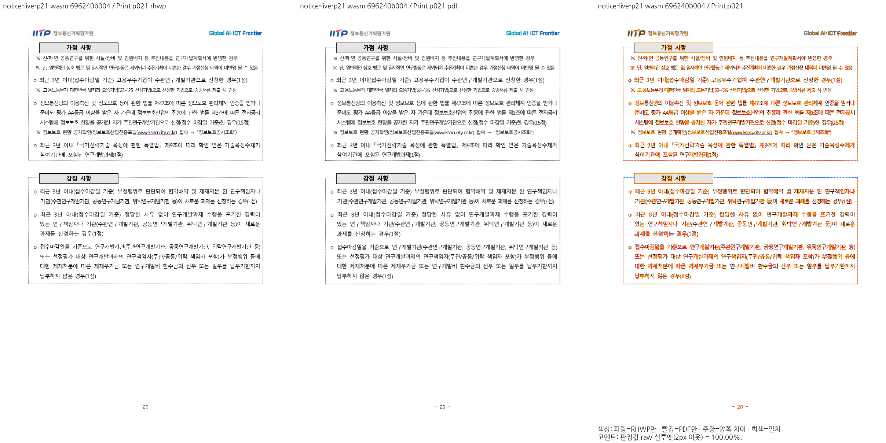
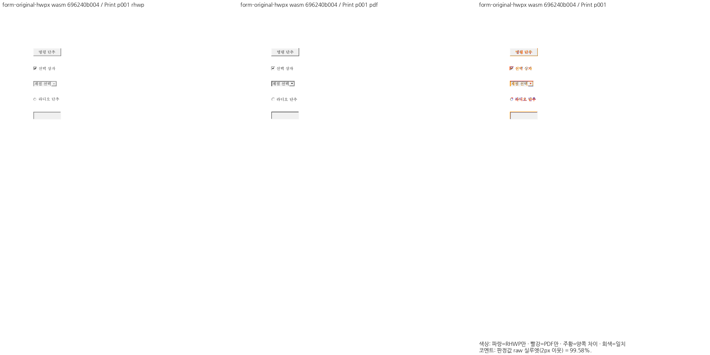

현재 devel `96827b3accd98ad0b80f76260b42fba24eded504`와의 충돌 없는 merge-tree에서 최신 정책·workspace all-target·WASM 컴파일 호환성도 확인했습니다. source branch는 유지했고 [base 변경과 보존 근거](base-advance-compatibility.md)를 기록했습니다.

최신 보정 code `5e374d01f641745d20bc9424ce233021a327ed16`에서 CodeQL이 지적한 문서 좌표 진단을 제거하고 Native CLI의 PNG 출처 계약을 수정했습니다. stock **12,475 PASS / 45 skip**, 실제 Native CI의 **22개 명령·192 PASS**, 별도 Native lib 전체 **4,040 PASS / 12 ignored**, Native 출처 **11 PASS**를 확인했습니다. 기존의 잘못된 false 고정을 실제 글꼴 보고 표지로 바꾸었고, 종료 코드·feature·schema·출력 파일 검사는 유지했습니다. 보안 query·분류·workflow는 바꾸지 않았습니다. [실제 실패와 최종 보정 검증](ci-head223-followup.md)에 근거와 한계를 기록했습니다.

조판 계산은 같아 아래 ef6/696의 Native/fresh WASM 시각 producer와 전쪽 TSV·직접 판독·실제 저장 증거를 명시적으로 재사용합니다. 새 head의 GitHub CI·CodeQL과 self-review 성공 뒤에만 merge합니다.

표 삽입 뒤 본문 흐름, 양식의 논리 편집과 줄 소유, 개체 변환·문단 간격·저장 metadata의 경계 오류를 메인터너 보정으로 해결합니다. semanticist21의 원 PR 10개 head와 기여 commit을 누적 merge history에 보존합니다.

대형 저장소의 checkout을 포함한 전체 CI 시간이 기존 20·30분 상한에 걸리는 문제도 보정합니다. Lint·Proptest는 45분, Frontend package·release-test archive builder는 60분으로 조정하며, 검사 범위와 판정 기준을 유지합니다. [실측과 운영 계약 검증](ci-budget-adjustment.md)에 근거를 기록했습니다.

| 원 PR | 최종 동작 |
| --- | --- |
| #8211 | 표 삽입·본문 흐름 |
| #8235 | 양식의 논리 편집·선택 |
| #8281 | 개체만 있는 마지막 줄의 끝 캐럿 |
| #8287 | 다각형 회전·대칭·크기 왕복 |
| #8290 | 문단 간격 편집·되돌리기 |
| #8292 | 중복 표 ID의 HWPX 격자 저장 |
| #8293 | 머리말·꼬리말 마지막 넘침 문단 |
| #8298 | 재조판한 표의 저장 높이 |
| #8299 | 저장 줄 없는 문단의 공간·위치 델타 |
| #8308 | 중첩·분할 셀 hit-test clip |

현행 논리 편집 API·Storage 예산·schema 35·#8517 및 선행 해결 PR의 동작을 유지했습니다. 원격 원 head를 그대로 승인한 결과와 보정된 통합 후보의 검증을 구분합니다. #8281의 기존 두 경계, #8290 뒤 간격, #8308의 기존 가시 배치처럼 이미 해결된 부분은 별도로 기록했습니다.

최신 제출 후보의 로컬 검증: stock release-test nextest **12,475 PASS / 45 skip**, Native Skia 필수 3종·기본/Native 실제 출처 계약·root/WASM/workspace Clippy·workspace build·release build/lib·doc test·최적화 WASM·Studio **2,717 PASS**, 관련 Python·Node 계약 **275 PASS**를 확인했습니다. **32개 입력·72쪽**의 Native/fresh WASM 전쪽 raw 최저는 각각 **92.89641% / 92.88059%**이며 쪽수 일치·확대 판독을 완료했습니다. Native 6개/WASM 7개 실제 API와 14개 저장 교차 재열기/실시간 역할 175쪽도 검증했습니다.

기준 devel은 `1924d371d6757392d063b8dc2e9bbe9a298be817`, 검증 후보는 `696240b004707a6686864f94130befe3dd7f213e`입니다. Native의 동일 렌더링 source 재사용 producer `ef6d302937`와 이번 후보의 새 최적화 WASM·실제 API 실행을 구분했습니다. 새 base의 Native 웹폰트 공급은 필수 편람 **383쪽 / 최저 99.96465% / 기준 대비 하락 0쪽**과 관련 계약으로 보존을 확인했습니다. 이전 c6ad/H4의 증적은 이력으로 보존합니다.

새 글꼴 보고의 출처 선언 누락과 오프라인 소비 fixture 불일치는 기존 guard를 유지한 채 공통 지도·소비 문서에서 보정했습니다. [원 계약·기존 PR 추적·실패와 재검증](ci-provenance-followup.md)을 기록했습니다. 폰트 선택·조판·paint 규칙은 해당 보정에서 바뀌지 않았습니다.

[최신 검증·전쪽 TSV·대표 review/overlay](rebase-validation.md) · [최종 검증](validation.md) · [원 PR별 검토](../../semanticist21_20261103_review_plan.md) · [원본/독립 Print 출처](../../../../pdf/semanticist21-20261103/print-provenance.md)

merge commit으로 통합해 원 기여 history를 보존합니다.

[CodeQL 후속 보정과 CLI 음성·양성 대조](ci-security-followup.md)를 기록했습니다. 보안 경고 분류·query·workflow는 변경하지 않았습니다.

