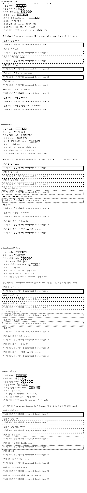

기여해 주셔서 감사합니다. 원형 점선·단일/이중 물결선을 [통합 PR](https://github.com/edwardkim/rhwp/pull/<MERGE_PR_NUMBER>)에서 원 기여 커밋을 보존해 수용했습니다. 통합 commit은 `<MERGE_SHA>`입니다.

최신 devel의 3D 비표시 규칙을 보존해 충돌을 해결했다. 독립 한컴 2020/2024의 16굵기 지름·간격을 공통 border 경로로 전달한다.

- CI: [통합 후보의 실제 최신 head 검사](https://github.com/edwardkim/rhwp/actions/runs/<CI_RUN_ID>)를 확인했습니다.
- 로컬 검증: [실행 결과와 source 구분](https://github.com/edwardkim/rhwp/blob/<MERGE_SHA>/mydocs/pr/assets/semanticist21-20261105-next10/validation.md)을 기록했습니다.
- 문서 비교: [Visual Sweep 정본](https://github.com/edwardkim/rhwp/blob/<MERGE_SHA>/mydocs/manual/verification/visual_sweep_guide.md#github-merge-comment)을 따랐습니다. 해당 기능 2쪽의 Native 최저 97.79%, fresh WASM 최저 97.73%이며 전쪽의 누락·쪽수 차이·90% 미만은 없습니다. [전체 TSV·입력/PDF 해시](https://github.com/edwardkim/rhwp/blob/<MERGE_SHA>/mydocs/pr/assets/semanticist21-20261105-next10/validation/post8622/summary.json)와 [확대 판독](https://github.com/edwardkim/rhwp/blob/<MERGE_SHA>/mydocs/pr/assets/semanticist21-20261105-next10/validation/post8622/direct-reading.md)을 함께 남겼습니다.

아래 그림은 border_line_types/borders.hwp 1쪽입니다. 위에서부터 동일 입력의 base Native·후보 Native·fresh WASM·독립 Print이며, 셀 균등화 그림만 첫 패널이 적용 전 원본입니다. 새로 바꾼 원형 점선의 물리 측정과 96 DPI의 AA 차이를 구분한다.

현재 devel과의 [실제 병합 호환](https://github.com/edwardkim/rhwp/blob/<MERGE_SHA>/mydocs/pr/assets/semanticist21-20261105-next10/current-base-compatibility.md)도 확인했습니다. 이번 124쪽씩을 추가 재출력한 PNG 248개가 기존 후보와 모두 같아, 출처를 기록한 위 비교 그림을 재사용합니다.
