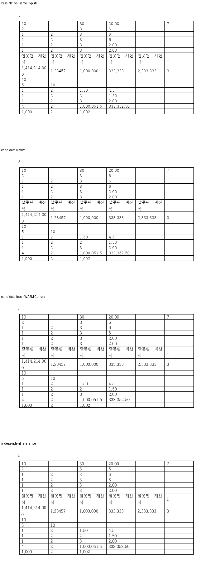
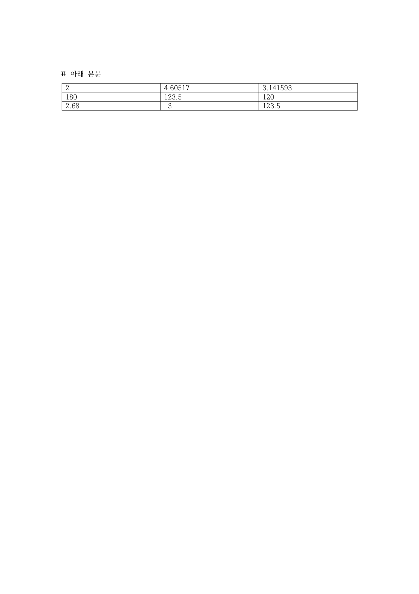
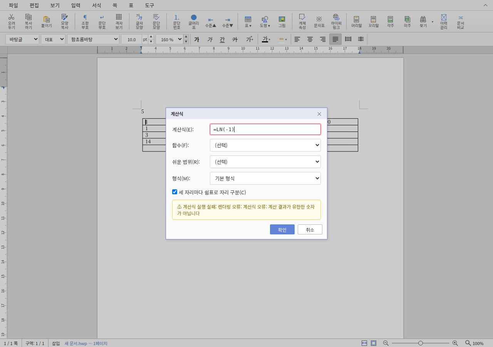

기여해 주셔서 감사합니다. LOG/LN·각도·자릿수 ROUND 함수를 [통합 PR](https://github.com/edwardkim/rhwp/pull/8640)에서 원 기여 커밋을 보존해 수용했습니다. 통합 commit은 `fd598250b7d8abee39eba1b1c68e604a326faa17`입니다.

원 CI의 WMF 그림 자원 실패는 기존 해결 이력을 추적해 최신 base에서 실제 통과를 확인했습니다. LN/ROUND를 한컴 저장 값과 대조했으며, 일반 API가 NaN/무한대를 JSON으로 반환하거나 셀에 기록하던 경로를 기존 FORMULA의 유한수 검사와 공통화했습니다.

- CI: [통합 후보의 실제 최신 head 검사](https://github.com/edwardkim/rhwp/actions/runs/42015462699)를 확인했습니다.
- 로컬 검증: [실행 결과와 source 구분](https://github.com/edwardkim/rhwp/blob/fd598250b7d8abee39eba1b1c68e604a326faa17/mydocs/pr/assets/semanticist21-20261105-next10/validation.md)을 기록했습니다.
- 문서 비교: [Visual Sweep 정본](https://github.com/edwardkim/rhwp/blob/fd598250b7d8abee39eba1b1c68e604a326faa17/mydocs/manual/verification/visual_sweep_guide.md#github-merge-comment)을 따랐습니다. 해당 기능 7쪽의 Native 최저 100.00%, fresh WASM 최저 100.00%이며 전쪽의 누락·쪽수 차이·90% 미만은 없습니다. [전체 TSV·입력/PDF 해시](https://github.com/edwardkim/rhwp/blob/fd598250b7d8abee39eba1b1c68e604a326faa17/mydocs/pr/assets/semanticist21-20261105-next10/validation/post8622/summary.json)와 [확대 판독](https://github.com/edwardkim/rhwp/blob/fd598250b7d8abee39eba1b1c68e604a326faa17/mydocs/pr/assets/semanticist21-20261105-next10/validation/post8622/direct-reading.md)을 함께 남겼습니다.

아래 그림은 보완한 table-formula-recalculated.hwpx 1쪽; 원 PR의 함수 결과 PDF는 별도 그림입니다. 위에서부터 base Native·후보 Native·fresh WASM·독립 Print의 같은 영역입니다. 원 PR에 HWP/HWPX 입력이 없어 같은 함수의 독립 저장 값과 실제 계산 fixture를 보완했습니다. [PR #8504](https://github.com/edwardkim/rhwp/pull/8504)의 FORMULA API와 기존 대화창의 일반 결과 쓰기를 구분했습니다.

원 PR에서 제공하신 한컴 함수 결과 PDF 1쪽도 별도로 확인했습니다. 아래는 그 원본 기준 자료이며, 위 실제 API 재계산 문서와 같은 입력이라고 표시하지 않습니다.

실제 계산식 대화창에서도 `LOG(100)=2`, `LN(EXP(1))=1`, 실행 취소·다시 실행, `LN(-1)` 오류 시 셀 내용 보존을 확인했습니다. 아래는 정의역 오류의 정상 안내이며 원 PDF의 pixel 비교 그림과 구분합니다.

현재 devel과의 [실제 병합 호환](https://github.com/edwardkim/rhwp/blob/fd598250b7d8abee39eba1b1c68e604a326faa17/mydocs/pr/assets/semanticist21-20261105-next10/current-base-compatibility.md)도 확인했습니다. 이번 124쪽씩을 추가 재출력한 PNG 248개가 기존 후보와 모두 같아, 출처를 기록한 위 비교 그림을 재사용합니다.

자동 실루엣 일치율은 내용 픽셀의 유사도를 나타내는 보조값이며 사람의 최종 판정 정확도가 아닙니다. 수치와 별도로 위 영역의 모양·간격·내용 보존을 직접 판독했습니다.
