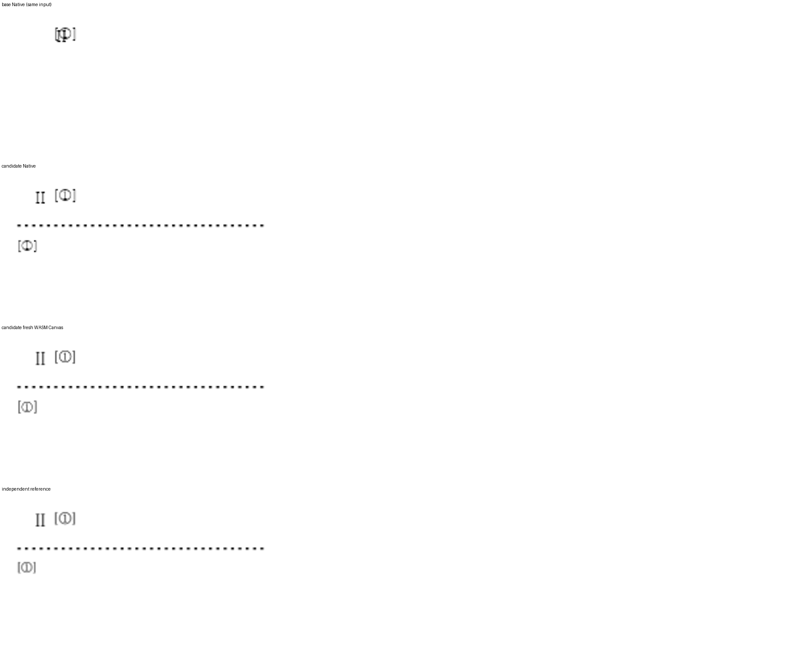

기여해 주셔서 감사합니다. 각주 모양 조회·적용·전파를 [통합 PR](https://github.com/edwardkim/rhwp/pull/8640)에서 원 기여 커밋을 보존해 수용했습니다. 통합 commit은 `fd598250b7d8abee39eba1b1c68e604a326faa17`입니다.

기존 inline 각주가 실제 마지막 본문 줄의 점유 하단을 소비하도록 연결했습니다. 선두 참조와 로마자 문단 머리의 겹침, 위첨자 투영 및 LineType2 저장 매핑도 공통 경로에서 보정했습니다.

- CI: [통합 후보의 실제 최신 head 검사](https://github.com/edwardkim/rhwp/actions/runs/42015462699)를 확인했습니다.
- 로컬 검증: [실행 결과와 source 구분](https://github.com/edwardkim/rhwp/blob/fd598250b7d8abee39eba1b1c68e604a326faa17/mydocs/pr/assets/semanticist21-20261105-next10/validation.md)을 기록했습니다.
- 문서 비교: [Visual Sweep 정본](https://github.com/edwardkim/rhwp/blob/fd598250b7d8abee39eba1b1c68e604a326faa17/mydocs/manual/verification/visual_sweep_guide.md#github-merge-comment)을 따랐습니다. 해당 기능 10쪽의 Native 최저 99.92%, fresh WASM 최저 99.92%이며 전쪽의 누락·쪽수 차이·90% 미만은 없습니다. [전체 TSV·입력/PDF 해시](https://github.com/edwardkim/rhwp/blob/fd598250b7d8abee39eba1b1c68e604a326faa17/mydocs/pr/assets/semanticist21-20261105-next10/validation/post8622/summary.json)와 [확대 판독](https://github.com/edwardkim/rhwp/blob/fd598250b7d8abee39eba1b1c68e604a326faa17/mydocs/pr/assets/semanticist21-20261105-next10/validation/post8622/direct-reading.md)을 함께 남겼습니다.

아래 그림은 footnote_shape/restart-page.hwp 2쪽입니다. 위에서부터 base Native·후보 Native·fresh WASM·독립 Print의 같은 영역입니다. 설정 변경의 numberCodeSuperscript=false 옵션과 원본 글자모양의 위첨자 효과를 구분했습니다.

현재 devel과의 [실제 병합 호환](https://github.com/edwardkim/rhwp/blob/fd598250b7d8abee39eba1b1c68e604a326faa17/mydocs/pr/assets/semanticist21-20261105-next10/current-base-compatibility.md)도 확인했습니다. 이번 124쪽씩을 추가 재출력한 PNG 248개가 기존 후보와 모두 같아, 출처를 기록한 위 비교 그림을 재사용합니다.

자동 실루엣 일치율은 내용 픽셀의 유사도를 나타내는 보조값이며 사람의 최종 판정 정확도가 아닙니다. 수치와 별도로 위 영역의 모양·간격·내용 보존을 직접 판독했습니다.
