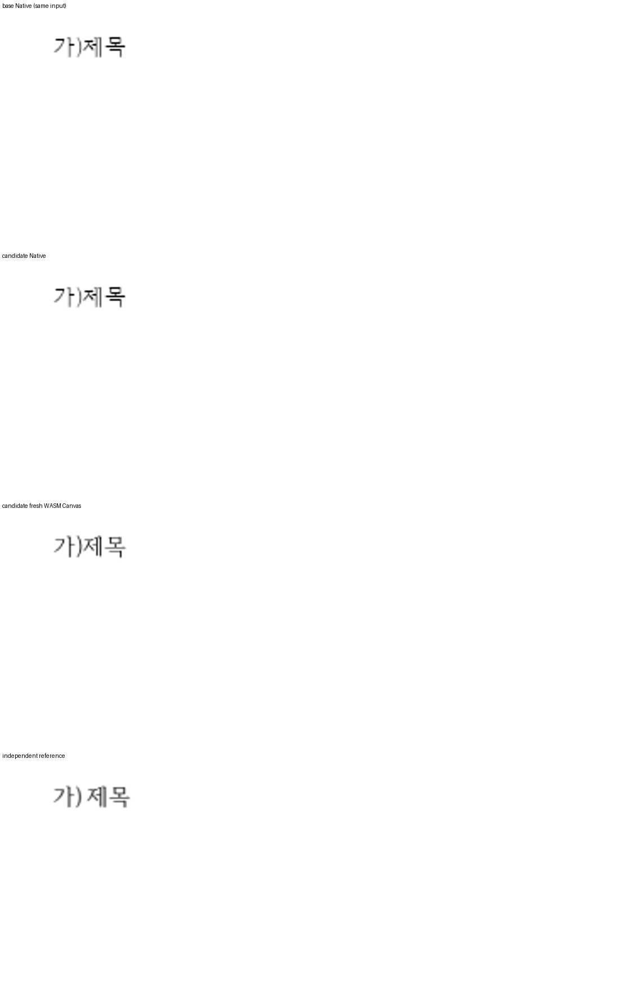

기여해 주셔서 감사합니다. 구역 개요 번호 모양 ID 조회·설정을 [통합 PR](https://github.com/edwardkim/rhwp/pull/8640)에서 원 기여 커밋을 보존해 수용했습니다. 통합 commit은 `fd598250b7d8abee39eba1b1c68e604a326faa17`입니다.

u16 overflow·음수·분수·문자열/객체 타입과 존재하지 않는 ID를 전체 구역 변경 전에 거부하도록 보완했습니다. TypeScript 선언도 추가했습니다.

- CI: [통합 후보의 실제 최신 head 검사](https://github.com/edwardkim/rhwp/actions/runs/42015462699)를 확인했습니다.
- 로컬 검증: [실행 결과와 source 구분](https://github.com/edwardkim/rhwp/blob/fd598250b7d8abee39eba1b1c68e604a326faa17/mydocs/pr/assets/semanticist21-20261105-next10/validation.md)을 기록했습니다.
- 문서 비교: [Visual Sweep 정본](https://github.com/edwardkim/rhwp/blob/fd598250b7d8abee39eba1b1c68e604a326faa17/mydocs/manual/verification/visual_sweep_guide.md#github-merge-comment)을 따랐습니다. 해당 기능 2쪽의 Native 최저 96.49%, fresh WASM 최저 97.10%이며 전쪽의 누락·쪽수 차이·90% 미만은 없습니다. [전체 TSV·입력/PDF 해시](https://github.com/edwardkim/rhwp/blob/fd598250b7d8abee39eba1b1c68e604a326faa17/mydocs/pr/assets/semanticist21-20261105-next10/validation/post8622/summary.json)와 [확대 판독](https://github.com/edwardkim/rhwp/blob/fd598250b7d8abee39eba1b1c68e604a326faa17/mydocs/pr/assets/semanticist21-20261105-next10/validation/post8622/direct-reading.md)을 함께 남겼습니다.

아래 그림은 독립 생성 outline-id2.hwpx 1쪽입니다. 위에서부터 base Native·후보 Native·fresh WASM·독립 Print의 같은 영역입니다. 원 PR의 입력 파일이 없어 독립 생성한 공개 입력과 해당 Print를 대응시켰습니다. 명시한 글꼴로 Native/fresh WASM 전쪽 raw 최저 96.49%/97.10%를 확인했습니다.

현재 devel과의 [실제 병합 호환](https://github.com/edwardkim/rhwp/blob/fd598250b7d8abee39eba1b1c68e604a326faa17/mydocs/pr/assets/semanticist21-20261105-next10/current-base-compatibility.md)도 확인했습니다. 이번 124쪽씩을 추가 재출력한 PNG 248개가 기존 후보와 모두 같아, 출처를 기록한 위 비교 그림을 재사용합니다.

자동 실루엣 일치율은 내용 픽셀의 유사도를 나타내는 보조값이며 사람의 최종 판정 정확도가 아닙니다. 수치와 별도로 위 영역의 모양·간격·내용 보존을 직접 판독했습니다.
