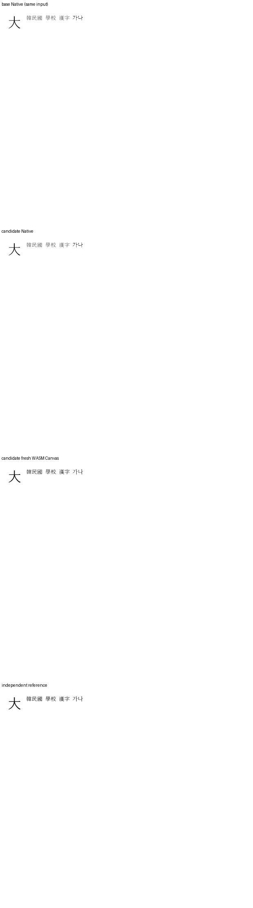

기여해 주셔서 감사합니다. 첫 글자 장식 메타데이터 저장 보존을 [통합 PR](https://github.com/edwardkim/rhwp/pull/<MERGE_PR_NUMBER>)에서 원 기여 커밋을 보존해 수용했습니다. 통합 commit은 `<MERGE_SHA>`입니다.

추가 제품 보정은 필요하지 않았다. 원 기여 코드와 DoubleLine·TripleLine·Margin 속성의 HWP/HWPX 저장 보존을 유지하고 증적을 보강했다.

- CI: [통합 후보의 실제 최신 head 검사](https://github.com/edwardkim/rhwp/actions/runs/<CI_RUN_ID>)를 확인했습니다.
- 로컬 검증: [실행 결과와 source 구분](https://github.com/edwardkim/rhwp/blob/<MERGE_SHA>/mydocs/pr/assets/semanticist21-20261105-next10/validation.md)을 기록했습니다.
- 문서 비교: [Visual Sweep 정본](https://github.com/edwardkim/rhwp/blob/<MERGE_SHA>/mydocs/manual/verification/visual_sweep_guide.md#github-merge-comment)을 따랐습니다. 해당 기능 1쪽의 Native 최저 100.00%, fresh WASM 최저 100.00%이며 전쪽의 누락·쪽수 차이·90% 미만은 없습니다. [전체 TSV·입력/PDF 해시](https://github.com/edwardkim/rhwp/blob/<MERGE_SHA>/mydocs/pr/assets/semanticist21-20261105-next10/validation/post8622/summary.json)와 [확대 판독](https://github.com/edwardkim/rhwp/blob/<MERGE_SHA>/mydocs/pr/assets/semanticist21-20261105-next10/validation/post8622/direct-reading.md)을 함께 남겼습니다.

아래 그림은 drop_cap/double-line.hwp 1쪽입니다. 위에서부터 동일 입력의 base Native·후보 Native·fresh WASM·독립 Print이며, 셀 균등화 그림만 첫 패널이 적용 전 원본입니다. 새 장식 생성 UI나 속성만으로 자동 재배치하는 기능은 이 PR의 구현 범위가 아니다.

