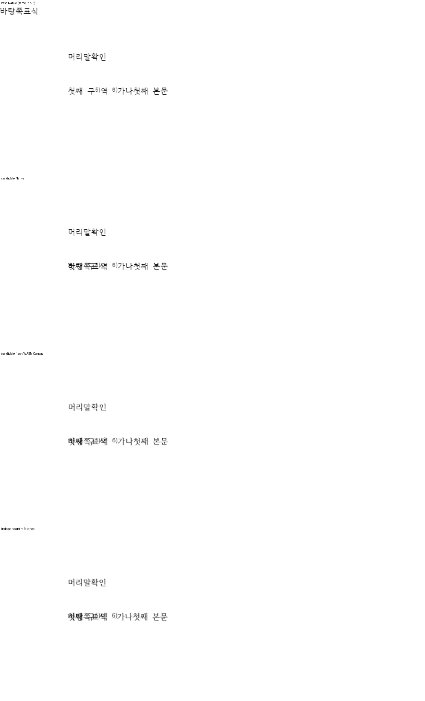

기여해 주셔서 감사합니다. 구역별 미주 번호와 편집 후 갱신을 [통합 PR](https://github.com/edwardkim/rhwp/pull/<MERGE_PR_NUMBER>)에서 원 기여 커밋을 보존해 수용했습니다. 통합 commit은 `<MERGE_SHA>`입니다.

일반 바탕쪽 텍스트의 원점을 저장 본문 프레임으로 보정했다. Paper/Page 기준 개체의 원래 계약과 독립 Print의 의도된 본문 겹침은 보존했다.

- CI: [통합 후보의 실제 최신 head 검사](https://github.com/edwardkim/rhwp/actions/runs/<CI_RUN_ID>)를 확인했습니다.
- 로컬 검증: [실행 결과와 source 구분](https://github.com/edwardkim/rhwp/blob/<MERGE_SHA>/mydocs/pr/assets/semanticist21-20261105-next10/validation.md)을 기록했습니다.
- 문서 비교: [Visual Sweep 정본](https://github.com/edwardkim/rhwp/blob/<MERGE_SHA>/mydocs/manual/verification/visual_sweep_guide.md#github-merge-comment)을 따랐습니다. 해당 기능 28쪽의 Native 최저 100.00%, fresh WASM 최저 100.00%이며 전쪽의 누락·쪽수 차이·90% 미만은 없습니다. [전체 TSV·입력/PDF 해시](https://github.com/edwardkim/rhwp/blob/<MERGE_SHA>/mydocs/pr/assets/semanticist21-20261105-next10/validation/post8622/summary.json)와 [확대 판독](https://github.com/edwardkim/rhwp/blob/<MERGE_SHA>/mydocs/pr/assets/semanticist21-20261105-next10/validation/post8622/direct-reading.md)을 함께 남겼습니다.

아래 그림은 endnote_numbering/restart-5.hwpx 1쪽입니다. 위에서부터 동일 입력의 base Native·후보 Native·fresh WASM·독립 Print이며, 셀 균등화 그림만 첫 패널이 적용 전 원본입니다. 바탕쪽 텍스트가 첫 본문과 겹치는 부분은 독립 Print에도 동일하다. 정상 편집 의도를 겹침 제거로 바꾸지 않았다.

