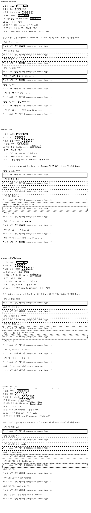
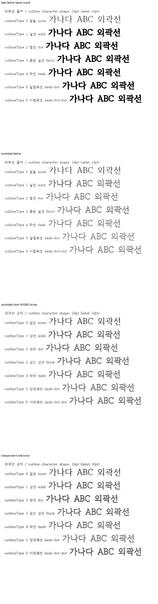
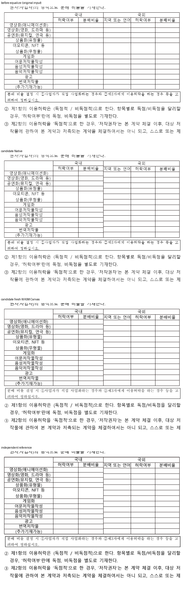
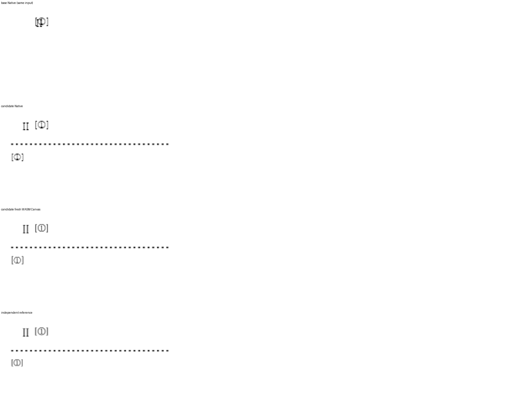
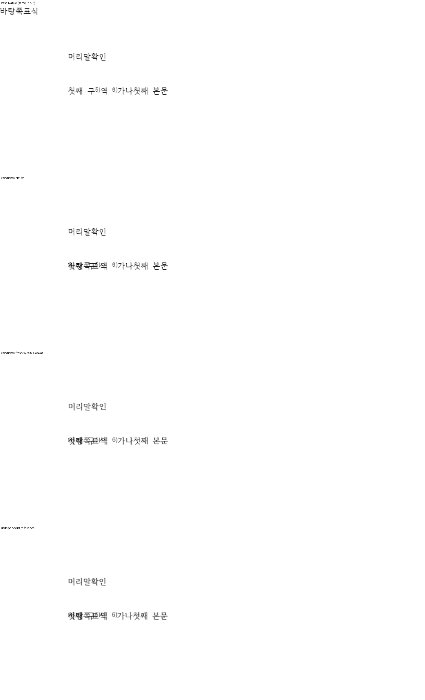
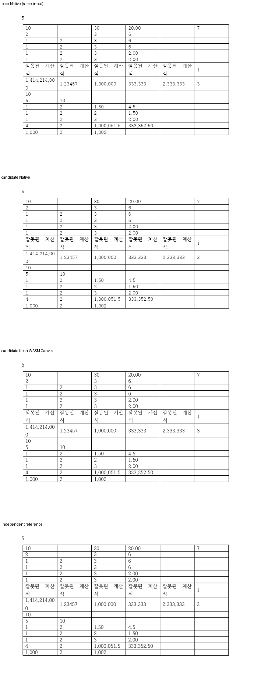
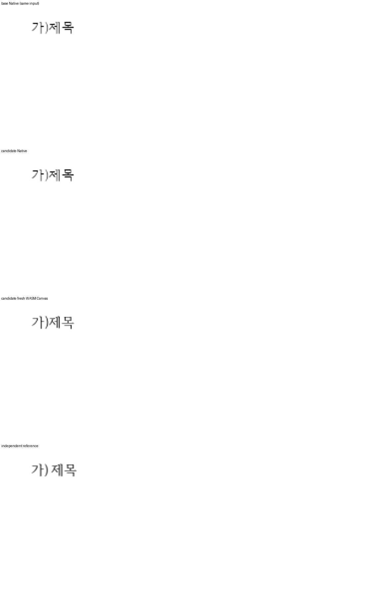
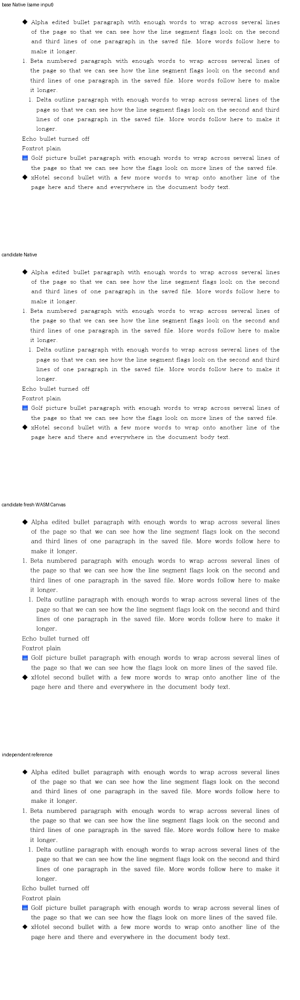
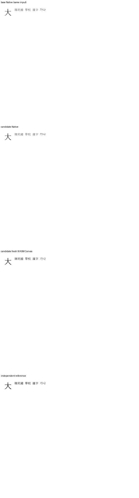

# semanticist21 PR 10건 통합: 테두리·문자 획·표 편집·각주·계산식

**제품 CI 성공**: 기본 회귀 12,443 PASS·45 SKIP, Studio 2,721 PASS·2 SKIP. [작성자 self-review](https://github.com/edwardkim/rhwp/pull/8640#pullrequestreview-5784229538)를 완료했습니다.

원 기여 commit을 그대로 보존해 다음 10건을 통합합니다. 최신 devel의 공통 편집·Storage 예산·기존 PDF TextPaint·글꼴 shaping·첫 줄 fit·3D 비표시 계약을 유지했습니다.

대상: [#8368](https://github.com/edwardkim/rhwp/pull/8368), [#8369](https://github.com/edwardkim/rhwp/pull/8369), [#8385](https://github.com/edwardkim/rhwp/pull/8385), [#8484](https://github.com/edwardkim/rhwp/pull/8484), [#8488](https://github.com/edwardkim/rhwp/pull/8488), [#8490](https://github.com/edwardkim/rhwp/pull/8490), [#8492](https://github.com/edwardkim/rhwp/pull/8492), [#8494](https://github.com/edwardkim/rhwp/pull/8494), [#8500](https://github.com/edwardkim/rhwp/pull/8500), [#8504](https://github.com/edwardkim/rhwp/pull/8504).

메인테이너 보정은 오류의 원자적 거부·각주/바탕쪽 원점·개요 ID 검증·공통 획의 CanvasKit 소비와 계산식의 유한수 검사입니다. 원 기여와 보정·실제 검증을 개별 기록에서 구분합니다.

로컬 필수 검증은 최종 소스에서 완료했습니다. 전체 회귀 12,629 PASS·45 SKIP, release lib 3,983 PASS·12 IGNORE, Native 공식 3종 4,064 PASS·12 IGNORE입니다. fmt·Rust lint·workspace build·doc test·TypeScript·Studio 2,720건·build·실제 fresh WASM/Canvas2D/CanvasKit/계산식 대화창 검사도 통과했습니다. 아래 기록의 producer를 새로 출력하지 않은 head로 바꾸어 표시하지 않습니다.

- 이번 10건: 동일 입력·독립 한컴 Print·96 DPI 전 124쪽, Native 최저 96.49% / fresh WASM 97.10%. 90% 미만·누락·쪽수 불일치·2%p 초과 하락 없음.
- 최신 devel #8622의 추가 39 PR 보존: 80상태·406쪽, Native 최저 92.45% / WASM 92.99%, 경로별 403쪽 PNG 동일. 달라진 3쪽도 직접 확대 대조했고 점수 하락 없음.
- Native canonical 편람 383쪽 gate 통과: 최저 99.96%, 370쪽 100%.
- 위 시각 producer는 `d53115fabc92bd392044d9b906c599baddb4368d`. 마지막 계산 API 보정은 `584c9503baa651c62d0403dad9cb77c5cb9ffde6`이며 renderer/paint/parser/model/serializer/Studio/입력 tree 불변과 영향 계산식 전쪽·실제 API·대화창 검증을 별도로 기록합니다.

[개별 검토와 원 기여/보정 구분](https://github.com/edwardkim/rhwp/blob/4cf202d2aba44b0cfdd33465b03e37d1826a3fdc/mydocs/pr/semanticist21_20261105_next10_review.md), [실행 결과·전쪽 TSV·직접 판독·입력/Print/글꼴 해시](https://github.com/edwardkim/rhwp/blob/4cf202d2aba44b0cfdd33465b03e37d1826a3fdc/mydocs/pr/assets/semanticist21-20261105-next10/validation.md)를 연결합니다. 제출 시 링크는 제출 후보 SHA로 고정합니다.

FORMULA는 명시적 재계산 API 범위이며 기존 계산식 대화창의 일반 값 쓰기와 구분합니다. 첫 글자 장식은 메타데이터 저장 보존 범위입니다. 새 생성 UI·타이핑 자동 재계산·장식 자동 재배치를 구현한 것으로 설명하지 않습니다. 원 contributor fork branch는 변경하지 않았습니다.

현재 base `a95d1d5afad1bfd61998794fa78fb0db100d690a`와의 실제 병합 트리도 별도 검증했습니다. 원 코드 head는 유지했으며 Native/최적화 WASM의 이번 124쪽씩은 PNG 248개가 기존 후보와 같고, 새 글상자 편집의 3·4쪽은 양쪽 100%입니다. 집중 Rust 18건·실제 클릭/입력/Esc·API·Studio 2,721건이 성공했습니다. [검증한 source와 범위](https://github.com/edwardkim/rhwp/blob/4cf202d2aba44b0cfdd33465b03e37d1826a3fdc/mydocs/pr/assets/semanticist21-20261105-next10/current-base-compatibility.md)를 구분합니다.

## Visual Sweep 직접 증적

그림은 위에서부터 base Native·후보 Native·fresh WASM·독립 Print의 같은 영역입니다. 대표 쪽만 표시하며 전쪽 수치는 TSV로 확인합니다.

제출 저장소는 `edwardkim/rhwp`, head는 `4cf202d2aba44b0cfdd33465b03e37d1826a3fdc`입니다. 원본 TSV·PNG는 이 head에 포함됩니다. producer·추가 실행·입력/Print·글꼴 해시는 위 기록과 아래 대응 목록에서 구분합니다. 모든 표의 90% 미만·누락·측정 불가·쪽수 불일치는 0입니다. raw 실루엣은 96 DPI·2px 관용이며 사람의 판독을 대신하지 않습니다.

이번 10건 · 46상태 / 124쪽씩: Native/fresh WASM 전쪽 TSV 원본

입력·독립 Print·SHA와 base 전후값: [전체 대응 목록](https://github.com/edwardkim/rhwp/raw/4cf202d2aba44b0cfdd33465b03e37d1826a3fdc/mydocs/pr/assets/semanticist21-20261105-next10/validation/post8622/summary.json). O/I 번호는 각 대응 목록의 rows 순서입니다. 아래 두 값은 경로별 전쪽 최저값입니다.

| 입력 키 | 쪽 | Native 최저·TSV | fresh WASM 최저·TSV |
| --- | ---: | --- | --- |
| O01 | 1 | [97.79%](https://github.com/edwardkim/rhwp/raw/4cf202d2aba44b0cfdd33465b03e37d1826a3fdc/mydocs/pr/assets/semanticist21-20261105-next10/validation/post8622/candidate/native/borders.tsv) | [97.73%](https://github.com/edwardkim/rhwp/raw/4cf202d2aba44b0cfdd33465b03e37d1826a3fdc/mydocs/pr/assets/semanticist21-20261105-next10/validation/post8622/candidate/wasm/borders.tsv) |
| O02 | 1 | [100.00%](https://github.com/edwardkim/rhwp/raw/4cf202d2aba44b0cfdd33465b03e37d1826a3fdc/mydocs/pr/assets/semanticist21-20261105-next10/validation/post8622/candidate/native/outline.tsv) | [100.00%](https://github.com/edwardkim/rhwp/raw/4cf202d2aba44b0cfdd33465b03e37d1826a3fdc/mydocs/pr/assets/semanticist21-20261105-next10/validation/post8622/candidate/wasm/outline.tsv) |
| O03 | 7 | [99.56%](https://github.com/edwardkim/rhwp/raw/4cf202d2aba44b0cfdd33465b03e37d1826a3fdc/mydocs/pr/assets/semanticist21-20261105-next10/validation/post8622/candidate/native/equal-height.tsv) | [99.57%](https://github.com/edwardkim/rhwp/raw/4cf202d2aba44b0cfdd33465b03e37d1826a3fdc/mydocs/pr/assets/semanticist21-20261105-next10/validation/post8622/candidate/wasm/equal-height.tsv) |
| O04 | 7 | [99.55%](https://github.com/edwardkim/rhwp/raw/4cf202d2aba44b0cfdd33465b03e37d1826a3fdc/mydocs/pr/assets/semanticist21-20261105-next10/validation/post8622/candidate/native/equal-width.tsv) | [99.57%](https://github.com/edwardkim/rhwp/raw/4cf202d2aba44b0cfdd33465b03e37d1826a3fdc/mydocs/pr/assets/semanticist21-20261105-next10/validation/post8622/candidate/wasm/equal-width.tsv) |
| O05 | 1 | [100.00%](https://github.com/edwardkim/rhwp/raw/4cf202d2aba44b0cfdd33465b03e37d1826a3fdc/mydocs/pr/assets/semanticist21-20261105-next10/validation/post8622/candidate/native/uneven-height.tsv) | [100.00%](https://github.com/edwardkim/rhwp/raw/4cf202d2aba44b0cfdd33465b03e37d1826a3fdc/mydocs/pr/assets/semanticist21-20261105-next10/validation/post8622/candidate/wasm/uneven-height.tsv) |
| O06 | 1 | [100.00%](https://github.com/edwardkim/rhwp/raw/4cf202d2aba44b0cfdd33465b03e37d1826a3fdc/mydocs/pr/assets/semanticist21-20261105-next10/validation/post8622/candidate/native/uneven-width.tsv) | [100.00%](https://github.com/edwardkim/rhwp/raw/4cf202d2aba44b0cfdd33465b03e37d1826a3fdc/mydocs/pr/assets/semanticist21-20261105-next10/validation/post8622/candidate/wasm/uneven-width.tsv) |
| O07 | 2 | [100.00%](https://github.com/edwardkim/rhwp/raw/4cf202d2aba44b0cfdd33465b03e37d1826a3fdc/mydocs/pr/assets/semanticist21-20261105-next10/validation/post8622/candidate/native/footnote-shape.tsv) | [100.00%](https://github.com/edwardkim/rhwp/raw/4cf202d2aba44b0cfdd33465b03e37d1826a3fdc/mydocs/pr/assets/semanticist21-20261105-next10/validation/post8622/candidate/wasm/footnote-shape.tsv) |
| O08 | 1 | [100.00%](https://github.com/edwardkim/rhwp/raw/4cf202d2aba44b0cfdd33465b03e37d1826a3fdc/mydocs/pr/assets/semanticist21-20261105-next10/validation/post8622/candidate/native/drop-cap.tsv) | [100.00%](https://github.com/edwardkim/rhwp/raw/4cf202d2aba44b0cfdd33465b03e37d1826a3fdc/mydocs/pr/assets/semanticist21-20261105-next10/validation/post8622/candidate/wasm/drop-cap.tsv) |
| O09 | 4 | [100.00%](https://github.com/edwardkim/rhwp/raw/4cf202d2aba44b0cfdd33465b03e37d1826a3fdc/mydocs/pr/assets/semanticist21-20261105-next10/validation/post8622/candidate/native/endnote-restart5.tsv) | [100.00%](https://github.com/edwardkim/rhwp/raw/4cf202d2aba44b0cfdd33465b03e37d1826a3fdc/mydocs/pr/assets/semanticist21-20261105-next10/validation/post8622/candidate/wasm/endnote-restart5.tsv) |
| O10 | 4 | [100.00%](https://github.com/edwardkim/rhwp/raw/4cf202d2aba44b0cfdd33465b03e37d1826a3fdc/mydocs/pr/assets/semanticist21-20261105-next10/validation/post8622/candidate/native/endnote-continue.tsv) | [100.00%](https://github.com/edwardkim/rhwp/raw/4cf202d2aba44b0cfdd33465b03e37d1826a3fdc/mydocs/pr/assets/semanticist21-20261105-next10/validation/post8622/candidate/wasm/endnote-continue.tsv) |
| O11 | 4 | [100.00%](https://github.com/edwardkim/rhwp/raw/4cf202d2aba44b0cfdd33465b03e37d1826a3fdc/mydocs/pr/assets/semanticist21-20261105-next10/validation/post8622/candidate/native/endnote-new20.tsv) | [100.00%](https://github.com/edwardkim/rhwp/raw/4cf202d2aba44b0cfdd33465b03e37d1826a3fdc/mydocs/pr/assets/semanticist21-20261105-next10/validation/post8622/candidate/wasm/endnote-new20.tsv) |
| O12 | 1 | [100.00%](https://github.com/edwardkim/rhwp/raw/4cf202d2aba44b0cfdd33465b03e37d1826a3fdc/mydocs/pr/assets/semanticist21-20261105-next10/validation/post8622/candidate/native/paragraph-heads.tsv) | [100.00%](https://github.com/edwardkim/rhwp/raw/4cf202d2aba44b0cfdd33465b03e37d1826a3fdc/mydocs/pr/assets/semanticist21-20261105-next10/validation/post8622/candidate/wasm/paragraph-heads.tsv) |
| O13 | 1 | [100.00%](https://github.com/edwardkim/rhwp/raw/4cf202d2aba44b0cfdd33465b03e37d1826a3fdc/mydocs/pr/assets/semanticist21-20261105-next10/validation/post8622/candidate/native/table-formula-easy.tsv) | [100.00%](https://github.com/edwardkim/rhwp/raw/4cf202d2aba44b0cfdd33465b03e37d1826a3fdc/mydocs/pr/assets/semanticist21-20261105-next10/validation/post8622/candidate/wasm/table-formula-easy.tsv) |
| O14 | 1 | [100.00%](https://github.com/edwardkim/rhwp/raw/4cf202d2aba44b0cfdd33465b03e37d1826a3fdc/mydocs/pr/assets/semanticist21-20261105-next10/validation/post8622/candidate/native/table-formula-hancom-result.tsv) | [100.00%](https://github.com/edwardkim/rhwp/raw/4cf202d2aba44b0cfdd33465b03e37d1826a3fdc/mydocs/pr/assets/semanticist21-20261105-next10/validation/post8622/candidate/wasm/table-formula-hancom-result.tsv) |
| O15 | 1 | [100.00%](https://github.com/edwardkim/rhwp/raw/4cf202d2aba44b0cfdd33465b03e37d1826a3fdc/mydocs/pr/assets/semanticist21-20261105-next10/validation/post8622/candidate/native/table-formula-stale.tsv) | [100.00%](https://github.com/edwardkim/rhwp/raw/4cf202d2aba44b0cfdd33465b03e37d1826a3fdc/mydocs/pr/assets/semanticist21-20261105-next10/validation/post8622/candidate/wasm/table-formula-stale.tsv) |
| O16 | 1 | [100.00%](https://github.com/edwardkim/rhwp/raw/4cf202d2aba44b0cfdd33465b03e37d1826a3fdc/mydocs/pr/assets/semanticist21-20261105-next10/validation/post8622/candidate/native/table-formula-cycles.tsv) | [100.00%](https://github.com/edwardkim/rhwp/raw/4cf202d2aba44b0cfdd33465b03e37d1826a3fdc/mydocs/pr/assets/semanticist21-20261105-next10/validation/post8622/candidate/wasm/table-formula-cycles.tsv) |
| O17 | 4 | [100.00%](https://github.com/edwardkim/rhwp/raw/4cf202d2aba44b0cfdd33465b03e37d1826a3fdc/mydocs/pr/assets/semanticist21-20261105-next10/validation/post8622/candidate/native/endnote-continued-hwp.tsv) | [100.00%](https://github.com/edwardkim/rhwp/raw/4cf202d2aba44b0cfdd33465b03e37d1826a3fdc/mydocs/pr/assets/semanticist21-20261105-next10/validation/post8622/candidate/wasm/endnote-continued-hwp.tsv) |
| O18 | 4 | [100.00%](https://github.com/edwardkim/rhwp/raw/4cf202d2aba44b0cfdd33465b03e37d1826a3fdc/mydocs/pr/assets/semanticist21-20261105-next10/validation/post8622/candidate/native/endnote-continued-hwpx.tsv) | [100.00%](https://github.com/edwardkim/rhwp/raw/4cf202d2aba44b0cfdd33465b03e37d1826a3fdc/mydocs/pr/assets/semanticist21-20261105-next10/validation/post8622/candidate/wasm/endnote-continued-hwpx.tsv) |
| O19 | 4 | [100.00%](https://github.com/edwardkim/rhwp/raw/4cf202d2aba44b0cfdd33465b03e37d1826a3fdc/mydocs/pr/assets/semanticist21-20261105-next10/validation/post8622/candidate/native/endnote-deleted-hwpx.tsv) | [100.00%](https://github.com/edwardkim/rhwp/raw/4cf202d2aba44b0cfdd33465b03e37d1826a3fdc/mydocs/pr/assets/semanticist21-20261105-next10/validation/post8622/candidate/wasm/endnote-deleted-hwpx.tsv) |
| O20 | 4 | [100.00%](https://github.com/edwardkim/rhwp/raw/4cf202d2aba44b0cfdd33465b03e37d1826a3fdc/mydocs/pr/assets/semanticist21-20261105-next10/validation/post8622/candidate/native/endnote-inserted-hwpx.tsv) | [100.00%](https://github.com/edwardkim/rhwp/raw/4cf202d2aba44b0cfdd33465b03e37d1826a3fdc/mydocs/pr/assets/semanticist21-20261105-next10/validation/post8622/candidate/wasm/endnote-inserted-hwpx.tsv) |
| O21 | 7 | [99.12%](https://github.com/edwardkim/rhwp/raw/4cf202d2aba44b0cfdd33465b03e37d1826a3fdc/mydocs/pr/assets/semanticist21-20261105-next10/validation/post8622/candidate/native/equal-height-edited-hwp.tsv) | [99.72%](https://github.com/edwardkim/rhwp/raw/4cf202d2aba44b0cfdd33465b03e37d1826a3fdc/mydocs/pr/assets/semanticist21-20261105-next10/validation/post8622/candidate/wasm/equal-height-edited-hwp.tsv) |
| O22 | 7 | [99.12%](https://github.com/edwardkim/rhwp/raw/4cf202d2aba44b0cfdd33465b03e37d1826a3fdc/mydocs/pr/assets/semanticist21-20261105-next10/validation/post8622/candidate/native/equal-height-edited-hwpx.tsv) | [99.72%](https://github.com/edwardkim/rhwp/raw/4cf202d2aba44b0cfdd33465b03e37d1826a3fdc/mydocs/pr/assets/semanticist21-20261105-next10/validation/post8622/candidate/wasm/equal-height-edited-hwpx.tsv) |
| O23 | 7 | [99.12%](https://github.com/edwardkim/rhwp/raw/4cf202d2aba44b0cfdd33465b03e37d1826a3fdc/mydocs/pr/assets/semanticist21-20261105-next10/validation/post8622/candidate/native/equal-width-edited-hwp.tsv) | [99.72%](https://github.com/edwardkim/rhwp/raw/4cf202d2aba44b0cfdd33465b03e37d1826a3fdc/mydocs/pr/assets/semanticist21-20261105-next10/validation/post8622/candidate/wasm/equal-width-edited-hwp.tsv) |
| O24 | 7 | [99.12%](https://github.com/edwardkim/rhwp/raw/4cf202d2aba44b0cfdd33465b03e37d1826a3fdc/mydocs/pr/assets/semanticist21-20261105-next10/validation/post8622/candidate/native/equal-width-edited-hwpx.tsv) | [99.72%](https://github.com/edwardkim/rhwp/raw/4cf202d2aba44b0cfdd33465b03e37d1826a3fdc/mydocs/pr/assets/semanticist21-20261105-next10/validation/post8622/candidate/wasm/equal-width-edited-hwpx.tsv) |
| O25 | 2 | [100.00%](https://github.com/edwardkim/rhwp/raw/4cf202d2aba44b0cfdd33465b03e37d1826a3fdc/mydocs/pr/assets/semanticist21-20261105-next10/validation/post8622/candidate/native/footnote-shape-applied-hwp.tsv) | [100.00%](https://github.com/edwardkim/rhwp/raw/4cf202d2aba44b0cfdd33465b03e37d1826a3fdc/mydocs/pr/assets/semanticist21-20261105-next10/validation/post8622/candidate/wasm/footnote-shape-applied-hwp.tsv) |
| O26 | 2 | [100.00%](https://github.com/edwardkim/rhwp/raw/4cf202d2aba44b0cfdd33465b03e37d1826a3fdc/mydocs/pr/assets/semanticist21-20261105-next10/validation/post8622/candidate/native/footnote-shape-applied-hwpx.tsv) | [100.00%](https://github.com/edwardkim/rhwp/raw/4cf202d2aba44b0cfdd33465b03e37d1826a3fdc/mydocs/pr/assets/semanticist21-20261105-next10/validation/post8622/candidate/wasm/footnote-shape-applied-hwpx.tsv) |
| O27 | 1 | [96.49%](https://github.com/edwardkim/rhwp/raw/4cf202d2aba44b0cfdd33465b03e37d1826a3fdc/mydocs/pr/assets/semanticist21-20261105-next10/validation/post8622/candidate/native/outline-id2-hwp.tsv) | [97.10%](https://github.com/edwardkim/rhwp/raw/4cf202d2aba44b0cfdd33465b03e37d1826a3fdc/mydocs/pr/assets/semanticist21-20261105-next10/validation/post8622/candidate/wasm/outline-id2-hwp.tsv) |
| O28 | 1 | [96.49%](https://github.com/edwardkim/rhwp/raw/4cf202d2aba44b0cfdd33465b03e37d1826a3fdc/mydocs/pr/assets/semanticist21-20261105-next10/validation/post8622/candidate/native/outline-id2-hwpx.tsv) | [97.10%](https://github.com/edwardkim/rhwp/raw/4cf202d2aba44b0cfdd33465b03e37d1826a3fdc/mydocs/pr/assets/semanticist21-20261105-next10/validation/post8622/candidate/wasm/outline-id2-hwpx.tsv) |
| O29 | 1 | [99.71%](https://github.com/edwardkim/rhwp/raw/4cf202d2aba44b0cfdd33465b03e37d1826a3fdc/mydocs/pr/assets/semanticist21-20261105-next10/validation/post8622/candidate/native/paragraph-head-edited-hwp.tsv) | [99.69%](https://github.com/edwardkim/rhwp/raw/4cf202d2aba44b0cfdd33465b03e37d1826a3fdc/mydocs/pr/assets/semanticist21-20261105-next10/validation/post8622/candidate/wasm/paragraph-head-edited-hwp.tsv) |
| O30 | 1 | [100.00%](https://github.com/edwardkim/rhwp/raw/4cf202d2aba44b0cfdd33465b03e37d1826a3fdc/mydocs/pr/assets/semanticist21-20261105-next10/validation/post8622/candidate/native/paragraph-head-edited-hwpx.tsv) | [100.00%](https://github.com/edwardkim/rhwp/raw/4cf202d2aba44b0cfdd33465b03e37d1826a3fdc/mydocs/pr/assets/semanticist21-20261105-next10/validation/post8622/candidate/wasm/paragraph-head-edited-hwpx.tsv) |
| O31 | 1 | [100.00%](https://github.com/edwardkim/rhwp/raw/4cf202d2aba44b0cfdd33465b03e37d1826a3fdc/mydocs/pr/assets/semanticist21-20261105-next10/validation/post8622/candidate/native/paragraph-head-off-hwpx.tsv) | [100.00%](https://github.com/edwardkim/rhwp/raw/4cf202d2aba44b0cfdd33465b03e37d1826a3fdc/mydocs/pr/assets/semanticist21-20261105-next10/validation/post8622/candidate/wasm/paragraph-head-off-hwpx.tsv) |
| O32 | 1 | [100.00%](https://github.com/edwardkim/rhwp/raw/4cf202d2aba44b0cfdd33465b03e37d1826a3fdc/mydocs/pr/assets/semanticist21-20261105-next10/validation/post8622/candidate/native/table-formula-easy-edited-hwpx.tsv) | [100.00%](https://github.com/edwardkim/rhwp/raw/4cf202d2aba44b0cfdd33465b03e37d1826a3fdc/mydocs/pr/assets/semanticist21-20261105-next10/validation/post8622/candidate/wasm/table-formula-easy-edited-hwpx.tsv) |
| O33 | 1 | [100.00%](https://github.com/edwardkim/rhwp/raw/4cf202d2aba44b0cfdd33465b03e37d1826a3fdc/mydocs/pr/assets/semanticist21-20261105-next10/validation/post8622/candidate/native/table-formula-recalculated-hwp.tsv) | [100.00%](https://github.com/edwardkim/rhwp/raw/4cf202d2aba44b0cfdd33465b03e37d1826a3fdc/mydocs/pr/assets/semanticist21-20261105-next10/validation/post8622/candidate/wasm/table-formula-recalculated-hwp.tsv) |
| O34 | 1 | [100.00%](https://github.com/edwardkim/rhwp/raw/4cf202d2aba44b0cfdd33465b03e37d1826a3fdc/mydocs/pr/assets/semanticist21-20261105-next10/validation/post8622/candidate/native/table-formula-recalculated-hwpx.tsv) | [100.00%](https://github.com/edwardkim/rhwp/raw/4cf202d2aba44b0cfdd33465b03e37d1826a3fdc/mydocs/pr/assets/semanticist21-20261105-next10/validation/post8622/candidate/wasm/table-formula-recalculated-hwpx.tsv) |
| O35 | 1 | [100.00%](https://github.com/edwardkim/rhwp/raw/4cf202d2aba44b0cfdd33465b03e37d1826a3fdc/mydocs/pr/assets/semanticist21-20261105-next10/validation/post8622/candidate/native/uneven-height-edited-hwp.tsv) | [100.00%](https://github.com/edwardkim/rhwp/raw/4cf202d2aba44b0cfdd33465b03e37d1826a3fdc/mydocs/pr/assets/semanticist21-20261105-next10/validation/post8622/candidate/wasm/uneven-height-edited-hwp.tsv) |
| O36 | 1 | [100.00%](https://github.com/edwardkim/rhwp/raw/4cf202d2aba44b0cfdd33465b03e37d1826a3fdc/mydocs/pr/assets/semanticist21-20261105-next10/validation/post8622/candidate/native/uneven-height-edited-hwpx.tsv) | [100.00%](https://github.com/edwardkim/rhwp/raw/4cf202d2aba44b0cfdd33465b03e37d1826a3fdc/mydocs/pr/assets/semanticist21-20261105-next10/validation/post8622/candidate/wasm/uneven-height-edited-hwpx.tsv) |
| O37 | 1 | [100.00%](https://github.com/edwardkim/rhwp/raw/4cf202d2aba44b0cfdd33465b03e37d1826a3fdc/mydocs/pr/assets/semanticist21-20261105-next10/validation/post8622/candidate/native/uneven-width-edited-hwp.tsv) | [100.00%](https://github.com/edwardkim/rhwp/raw/4cf202d2aba44b0cfdd33465b03e37d1826a3fdc/mydocs/pr/assets/semanticist21-20261105-next10/validation/post8622/candidate/wasm/uneven-width-edited-hwp.tsv) |
| O38 | 1 | [100.00%](https://github.com/edwardkim/rhwp/raw/4cf202d2aba44b0cfdd33465b03e37d1826a3fdc/mydocs/pr/assets/semanticist21-20261105-next10/validation/post8622/candidate/native/uneven-width-edited-hwpx.tsv) | [100.00%](https://github.com/edwardkim/rhwp/raw/4cf202d2aba44b0cfdd33465b03e37d1826a3fdc/mydocs/pr/assets/semanticist21-20261105-next10/validation/post8622/candidate/wasm/uneven-width-edited-hwpx.tsv) |
| O39 | 2 | [100.00%](https://github.com/edwardkim/rhwp/raw/4cf202d2aba44b0cfdd33465b03e37d1826a3fdc/mydocs/pr/assets/semanticist21-20261105-next10/validation/post8622/candidate/native/footnote-shape-corrected-hwpx.tsv) | [100.00%](https://github.com/edwardkim/rhwp/raw/4cf202d2aba44b0cfdd33465b03e37d1826a3fdc/mydocs/pr/assets/semanticist21-20261105-next10/validation/post8622/candidate/wasm/footnote-shape-corrected-hwpx.tsv) |
| O40 | 7 | [100.00%](https://github.com/edwardkim/rhwp/raw/4cf202d2aba44b0cfdd33465b03e37d1826a3fdc/mydocs/pr/assets/semanticist21-20261105-next10/validation/post8622/candidate/native/pdf-text-paint.tsv) | [100.00%](https://github.com/edwardkim/rhwp/raw/4cf202d2aba44b0cfdd33465b03e37d1826a3fdc/mydocs/pr/assets/semanticist21-20261105-next10/validation/post8622/candidate/wasm/pdf-text-paint.tsv) |
| O41 | 5 | [99.87%](https://github.com/edwardkim/rhwp/raw/4cf202d2aba44b0cfdd33465b03e37d1826a3fdc/mydocs/pr/assets/semanticist21-20261105-next10/validation/post8622/candidate/native/pdf-image-patterns.tsv) | [99.87%](https://github.com/edwardkim/rhwp/raw/4cf202d2aba44b0cfdd33465b03e37d1826a3fdc/mydocs/pr/assets/semanticist21-20261105-next10/validation/post8622/candidate/wasm/pdf-image-patterns.tsv) |
| O42 | 1 | [98.04%](https://github.com/edwardkim/rhwp/raw/4cf202d2aba44b0cfdd33465b03e37d1826a3fdc/mydocs/pr/assets/semanticist21-20261105-next10/validation/post8622/candidate/native/borders-windows.tsv) | [97.98%](https://github.com/edwardkim/rhwp/raw/4cf202d2aba44b0cfdd33465b03e37d1826a3fdc/mydocs/pr/assets/semanticist21-20261105-next10/validation/post8622/candidate/wasm/borders-windows.tsv) |
| O43 | 7 | [99.12%](https://github.com/edwardkim/rhwp/raw/4cf202d2aba44b0cfdd33465b03e37d1826a3fdc/mydocs/pr/assets/semanticist21-20261105-next10/validation/post8622/candidate/native/equalize-original.tsv) | [99.72%](https://github.com/edwardkim/rhwp/raw/4cf202d2aba44b0cfdd33465b03e37d1826a3fdc/mydocs/pr/assets/semanticist21-20261105-next10/validation/post8622/candidate/wasm/equalize-original.tsv) |
| O44 | 1 | [100.00%](https://github.com/edwardkim/rhwp/raw/4cf202d2aba44b0cfdd33465b03e37d1826a3fdc/mydocs/pr/assets/semanticist21-20261105-next10/validation/post8622/candidate/native/uneven-height-original.tsv) | [100.00%](https://github.com/edwardkim/rhwp/raw/4cf202d2aba44b0cfdd33465b03e37d1826a3fdc/mydocs/pr/assets/semanticist21-20261105-next10/validation/post8622/candidate/wasm/uneven-height-original.tsv) |
| O45 | 1 | [100.00%](https://github.com/edwardkim/rhwp/raw/4cf202d2aba44b0cfdd33465b03e37d1826a3fdc/mydocs/pr/assets/semanticist21-20261105-next10/validation/post8622/candidate/native/uneven-width-original.tsv) | [100.00%](https://github.com/edwardkim/rhwp/raw/4cf202d2aba44b0cfdd33465b03e37d1826a3fdc/mydocs/pr/assets/semanticist21-20261105-next10/validation/post8622/candidate/wasm/uneven-width-original.tsv) |
| O46 | 2 | [99.92%](https://github.com/edwardkim/rhwp/raw/4cf202d2aba44b0cfdd33465b03e37d1826a3fdc/mydocs/pr/assets/semanticist21-20261105-next10/validation/post8622/candidate/native/footnote-shape-configured-hwpx.tsv) | [99.92%](https://github.com/edwardkim/rhwp/raw/4cf202d2aba44b0cfdd33465b03e37d1826a3fdc/mydocs/pr/assets/semanticist21-20261105-next10/validation/post8622/candidate/wasm/footnote-shape-configured-hwpx.tsv) |

devel #8622 보존 · 80상태 / 406쪽씩: Native/fresh WASM 전쪽 TSV 원본

입력·독립 Print·SHA와 base 전후값: [전체 대응 목록](https://github.com/edwardkim/rhwp/raw/4cf202d2aba44b0cfdd33465b03e37d1826a3fdc/mydocs/pr/assets/semanticist21-20261105-next10/validation/inherited8622/summary.json). O/I 번호는 각 대응 목록의 rows 순서입니다. 아래 두 값은 경로별 전쪽 최저값입니다.

| 입력 키 | 쪽 | Native 최저·TSV | fresh WASM 최저·TSV |
| --- | ---: | --- | --- |
| I01 | 37 | [97.52%](https://github.com/edwardkim/rhwp/raw/4cf202d2aba44b0cfdd33465b03e37d1826a3fdc/mydocs/pr/assets/semanticist21-20261105-next10/validation/inherited8622/candidate/native/inherited-8422-30026-safety-reform-toc-4d9b1e87.tsv) | [97.49%](https://github.com/edwardkim/rhwp/raw/4cf202d2aba44b0cfdd33465b03e37d1826a3fdc/mydocs/pr/assets/semanticist21-20261105-next10/validation/inherited8622/candidate/wasm/inherited-8422-30026-safety-reform-toc-4d9b1e87.tsv) |
| I02 | 3 | [100.00%](https://github.com/edwardkim/rhwp/raw/4cf202d2aba44b0cfdd33465b03e37d1826a3fdc/mydocs/pr/assets/semanticist21-20261105-next10/validation/inherited8622/candidate/native/inherited-8429-business_plan-65fb722d.tsv) | [100.00%](https://github.com/edwardkim/rhwp/raw/4cf202d2aba44b0cfdd33465b03e37d1826a3fdc/mydocs/pr/assets/semanticist21-20261105-next10/validation/inherited8622/candidate/wasm/inherited-8429-business_plan-65fb722d.tsv) |
| I03 | 1 | [100.00%](https://github.com/edwardkim/rhwp/raw/4cf202d2aba44b0cfdd33465b03e37d1826a3fdc/mydocs/pr/assets/semanticist21-20261105-next10/validation/inherited8622/candidate/native/inherited-8429-cellwrap-30645772.tsv) | [100.00%](https://github.com/edwardkim/rhwp/raw/4cf202d2aba44b0cfdd33465b03e37d1826a3fdc/mydocs/pr/assets/semanticist21-20261105-next10/validation/inherited8622/candidate/wasm/inherited-8429-cellwrap-30645772.tsv) |
| I04 | 25 | [98.64%](https://github.com/edwardkim/rhwp/raw/4cf202d2aba44b0cfdd33465b03e37d1826a3fdc/mydocs/pr/assets/semanticist21-20261105-next10/validation/inherited8622/candidate/native/inherited-8431-30396-childcare-leave-recommendation-cc72ee3e.tsv) | [98.62%](https://github.com/edwardkim/rhwp/raw/4cf202d2aba44b0cfdd33465b03e37d1826a3fdc/mydocs/pr/assets/semanticist21-20261105-next10/validation/inherited8622/candidate/wasm/inherited-8431-30396-childcare-leave-recommendation-cc72ee3e.tsv) |
| I05 | 1 | [100.00%](https://github.com/edwardkim/rhwp/raw/4cf202d2aba44b0cfdd33465b03e37d1826a3fdc/mydocs/pr/assets/semanticist21-20261105-next10/validation/inherited8622/candidate/native/inherited-8433-levels-f2652c2c.tsv) | [100.00%](https://github.com/edwardkim/rhwp/raw/4cf202d2aba44b0cfdd33465b03e37d1826a3fdc/mydocs/pr/assets/semanticist21-20261105-next10/validation/inherited8622/candidate/wasm/inherited-8433-levels-f2652c2c.tsv) |
| I06 | 3 | [99.13%](https://github.com/edwardkim/rhwp/raw/4cf202d2aba44b0cfdd33465b03e37d1826a3fdc/mydocs/pr/assets/semanticist21-20261105-next10/validation/inherited8622/candidate/native/inherited-8434-156690773-declared-zero-textbox-f431ab62.tsv) | [99.16%](https://github.com/edwardkim/rhwp/raw/4cf202d2aba44b0cfdd33465b03e37d1826a3fdc/mydocs/pr/assets/semanticist21-20261105-next10/validation/inherited8622/candidate/wasm/inherited-8434-156690773-declared-zero-textbox-f431ab62.tsv) |
| I07 | 3 | [99.99%](https://github.com/edwardkim/rhwp/raw/4cf202d2aba44b0cfdd33465b03e37d1826a3fdc/mydocs/pr/assets/semanticist21-20261105-next10/validation/inherited8622/candidate/native/inherited-8434-156761223-declared-zero-textbox-b4876e08.tsv) | [99.99%](https://github.com/edwardkim/rhwp/raw/4cf202d2aba44b0cfdd33465b03e37d1826a3fdc/mydocs/pr/assets/semanticist21-20261105-next10/validation/inherited8622/candidate/wasm/inherited-8434-156761223-declared-zero-textbox-b4876e08.tsv) |
| I08 | 2 | [99.13%](https://github.com/edwardkim/rhwp/raw/4cf202d2aba44b0cfdd33465b03e37d1826a3fdc/mydocs/pr/assets/semanticist21-20261105-next10/validation/inherited8622/candidate/native/inherited-8437-156618114-logo-textbox-offset-801f6531.tsv) | [99.11%](https://github.com/edwardkim/rhwp/raw/4cf202d2aba44b0cfdd33465b03e37d1826a3fdc/mydocs/pr/assets/semanticist21-20261105-next10/validation/inherited8622/candidate/wasm/inherited-8437-156618114-logo-textbox-offset-801f6531.tsv) |
| I09 | 3 | [99.95%](https://github.com/edwardkim/rhwp/raw/4cf202d2aba44b0cfdd33465b03e37d1826a3fdc/mydocs/pr/assets/semanticist21-20261105-next10/validation/inherited8622/candidate/native/inherited-8437-156638890-logo-textbox-6e5fa9a2.tsv) | [99.95%](https://github.com/edwardkim/rhwp/raw/4cf202d2aba44b0cfdd33465b03e37d1826a3fdc/mydocs/pr/assets/semanticist21-20261105-next10/validation/inherited8622/candidate/wasm/inherited-8437-156638890-logo-textbox-6e5fa9a2.tsv) |
| I10 | 3 | [99.94%](https://github.com/edwardkim/rhwp/raw/4cf202d2aba44b0cfdd33465b03e37d1826a3fdc/mydocs/pr/assets/semanticist21-20261105-next10/validation/inherited8622/candidate/native/inherited-8437-156770078-logo-table-f0aeb610.tsv) | [99.98%](https://github.com/edwardkim/rhwp/raw/4cf202d2aba44b0cfdd33465b03e37d1826a3fdc/mydocs/pr/assets/semanticist21-20261105-next10/validation/inherited8622/candidate/wasm/inherited-8437-156770078-logo-table-f0aeb610.tsv) |
| I11 | 2 | [99.61%](https://github.com/edwardkim/rhwp/raw/4cf202d2aba44b0cfdd33465b03e37d1826a3fdc/mydocs/pr/assets/semanticist21-20261105-next10/validation/inherited8622/candidate/native/inherited-8444-156578788-tac-logo-line-70bceb4d.tsv) | [99.57%](https://github.com/edwardkim/rhwp/raw/4cf202d2aba44b0cfdd33465b03e37d1826a3fdc/mydocs/pr/assets/semanticist21-20261105-next10/validation/inherited8622/candidate/wasm/inherited-8444-156578788-tac-logo-line-70bceb4d.tsv) |
| I12 | 1 | [99.98%](https://github.com/edwardkim/rhwp/raw/4cf202d2aba44b0cfdd33465b03e37d1826a3fdc/mydocs/pr/assets/semanticist21-20261105-next10/validation/inherited8622/candidate/native/inherited-8444-156669499-tac-logo-line-b211b06e.tsv) | [99.98%](https://github.com/edwardkim/rhwp/raw/4cf202d2aba44b0cfdd33465b03e37d1826a3fdc/mydocs/pr/assets/semanticist21-20261105-next10/validation/inherited8622/candidate/wasm/inherited-8444-156669499-tac-logo-line-b211b06e.tsv) |
| I13 | 4 | [99.09%](https://github.com/edwardkim/rhwp/raw/4cf202d2aba44b0cfdd33465b03e37d1826a3fdc/mydocs/pr/assets/semanticist21-20261105-next10/validation/inherited8622/candidate/native/inherited-8444-156715172-tac-table-picture-523d0814.tsv) | [99.10%](https://github.com/edwardkim/rhwp/raw/4cf202d2aba44b0cfdd33465b03e37d1826a3fdc/mydocs/pr/assets/semanticist21-20261105-next10/validation/inherited8622/candidate/wasm/inherited-8444-156715172-tac-table-picture-523d0814.tsv) |
| I14 | 2 | [99.93%](https://github.com/edwardkim/rhwp/raw/4cf202d2aba44b0cfdd33465b03e37d1826a3fdc/mydocs/pr/assets/semanticist21-20261105-next10/validation/inherited8622/candidate/native/inherited-8448-156569782-reset-line-logo-empty-c9cd577e.tsv) | [99.92%](https://github.com/edwardkim/rhwp/raw/4cf202d2aba44b0cfdd33465b03e37d1826a3fdc/mydocs/pr/assets/semanticist21-20261105-next10/validation/inherited8622/candidate/wasm/inherited-8448-156569782-reset-line-logo-empty-c9cd577e.tsv) |
| I15 | 3 | [96.75%](https://github.com/edwardkim/rhwp/raw/4cf202d2aba44b0cfdd33465b03e37d1826a3fdc/mydocs/pr/assets/semanticist21-20261105-next10/validation/inherited8622/candidate/native/inherited-8448-156667426-reset-line-logo-e8f85889.tsv) | [96.82%](https://github.com/edwardkim/rhwp/raw/4cf202d2aba44b0cfdd33465b03e37d1826a3fdc/mydocs/pr/assets/semanticist21-20261105-next10/validation/inherited8622/candidate/wasm/inherited-8448-156667426-reset-line-logo-e8f85889.tsv) |
| I16 | 12 | [93.12%](https://github.com/edwardkim/rhwp/raw/4cf202d2aba44b0cfdd33465b03e37d1826a3fdc/mydocs/pr/assets/semanticist21-20261105-next10/validation/inherited8622/candidate/native/inherited-8461-156759019-text-line-tac-logo-ae810ce3.tsv) | [93.01%](https://github.com/edwardkim/rhwp/raw/4cf202d2aba44b0cfdd33465b03e37d1826a3fdc/mydocs/pr/assets/semanticist21-20261105-next10/validation/inherited8622/candidate/wasm/inherited-8461-156759019-text-line-tac-logo-ae810ce3.tsv) |
| I17 | 3 | [98.04%](https://github.com/edwardkim/rhwp/raw/4cf202d2aba44b0cfdd33465b03e37d1826a3fdc/mydocs/pr/assets/semanticist21-20261105-next10/validation/inherited8622/candidate/native/inherited-8465-156552561-offpage-textbox-a9dbe435.tsv) | [98.15%](https://github.com/edwardkim/rhwp/raw/4cf202d2aba44b0cfdd33465b03e37d1826a3fdc/mydocs/pr/assets/semanticist21-20261105-next10/validation/inherited8622/candidate/wasm/inherited-8465-156552561-offpage-textbox-a9dbe435.tsv) |
| I18 | 1 | [100.00%](https://github.com/edwardkim/rhwp/raw/4cf202d2aba44b0cfdd33465b03e37d1826a3fdc/mydocs/pr/assets/semanticist21-20261105-next10/validation/inherited8622/candidate/native/inherited-8465-156633674-offpage-logo-154f0246.tsv) | [100.00%](https://github.com/edwardkim/rhwp/raw/4cf202d2aba44b0cfdd33465b03e37d1826a3fdc/mydocs/pr/assets/semanticist21-20261105-next10/validation/inherited8622/candidate/wasm/inherited-8465-156633674-offpage-logo-154f0246.tsv) |
| I19 | 3 | [99.94%](https://github.com/edwardkim/rhwp/raw/4cf202d2aba44b0cfdd33465b03e37d1826a3fdc/mydocs/pr/assets/semanticist21-20261105-next10/validation/inherited8622/candidate/native/inherited-8469-rowbreak_content_fit_f1200_h2660_d14-c69372da.tsv) | [100.00%](https://github.com/edwardkim/rhwp/raw/4cf202d2aba44b0cfdd33465b03e37d1826a3fdc/mydocs/pr/assets/semanticist21-20261105-next10/validation/inherited8622/candidate/wasm/inherited-8469-rowbreak_content_fit_f1200_h2660_d14-c69372da.tsv) |
| I20 | 3 | [99.96%](https://github.com/edwardkim/rhwp/raw/4cf202d2aba44b0cfdd33465b03e37d1826a3fdc/mydocs/pr/assets/semanticist21-20261105-next10/validation/inherited8622/candidate/native/inherited-8469-rowbreak_content_fit_f1200_h2660_d16-f1087834.tsv) | [100.00%](https://github.com/edwardkim/rhwp/raw/4cf202d2aba44b0cfdd33465b03e37d1826a3fdc/mydocs/pr/assets/semanticist21-20261105-next10/validation/inherited8622/candidate/wasm/inherited-8469-rowbreak_content_fit_f1200_h2660_d16-f1087834.tsv) |
| I21 | 3 | [99.96%](https://github.com/edwardkim/rhwp/raw/4cf202d2aba44b0cfdd33465b03e37d1826a3fdc/mydocs/pr/assets/semanticist21-20261105-next10/validation/inherited8622/candidate/native/inherited-8469-rowbreak_content_fit_h2505-53850f2e.tsv) | [100.00%](https://github.com/edwardkim/rhwp/raw/4cf202d2aba44b0cfdd33465b03e37d1826a3fdc/mydocs/pr/assets/semanticist21-20261105-next10/validation/inherited8622/candidate/wasm/inherited-8469-rowbreak_content_fit_h2505-53850f2e.tsv) |
| I22 | 3 | [100.00%](https://github.com/edwardkim/rhwp/raw/4cf202d2aba44b0cfdd33465b03e37d1826a3fdc/mydocs/pr/assets/semanticist21-20261105-next10/validation/inherited8622/candidate/native/inherited-8469-rowbreak_content_fit_h2570-1b562bda.tsv) | [100.00%](https://github.com/edwardkim/rhwp/raw/4cf202d2aba44b0cfdd33465b03e37d1826a3fdc/mydocs/pr/assets/semanticist21-20261105-next10/validation/inherited8622/candidate/wasm/inherited-8469-rowbreak_content_fit_h2570-1b562bda.tsv) |
| I23 | 3 | [100.00%](https://github.com/edwardkim/rhwp/raw/4cf202d2aba44b0cfdd33465b03e37d1826a3fdc/mydocs/pr/assets/semanticist21-20261105-next10/validation/inherited8622/candidate/native/inherited-8469-rowbreak_content_fit_h3180-e0251984.tsv) | [100.00%](https://github.com/edwardkim/rhwp/raw/4cf202d2aba44b0cfdd33465b03e37d1826a3fdc/mydocs/pr/assets/semanticist21-20261105-next10/validation/inherited8622/candidate/wasm/inherited-8469-rowbreak_content_fit_h3180-e0251984.tsv) |
| I24 | 2 | [99.99%](https://github.com/edwardkim/rhwp/raw/4cf202d2aba44b0cfdd33465b03e37d1826a3fdc/mydocs/pr/assets/semanticist21-20261105-next10/validation/inherited8622/candidate/native/inherited-8473-36412338-approval-footer-split-bf170718.tsv) | [99.99%](https://github.com/edwardkim/rhwp/raw/4cf202d2aba44b0cfdd33465b03e37d1826a3fdc/mydocs/pr/assets/semanticist21-20261105-next10/validation/inherited8622/candidate/wasm/inherited-8473-36412338-approval-footer-split-bf170718.tsv) |
| I25 | 2 | [100.00%](https://github.com/edwardkim/rhwp/raw/4cf202d2aba44b0cfdd33465b03e37d1826a3fdc/mydocs/pr/assets/semanticist21-20261105-next10/validation/inherited8622/candidate/native/inherited-8473-36416725-approval-footer-split-e78ae965.tsv) | [100.00%](https://github.com/edwardkim/rhwp/raw/4cf202d2aba44b0cfdd33465b03e37d1826a3fdc/mydocs/pr/assets/semanticist21-20261105-next10/validation/inherited8622/candidate/wasm/inherited-8473-36416725-approval-footer-split-e78ae965.tsv) |
| I26 | 5 | [100.00%](https://github.com/edwardkim/rhwp/raw/4cf202d2aba44b0cfdd33465b03e37d1826a3fdc/mydocs/pr/assets/semanticist21-20261105-next10/validation/inherited8622/candidate/native/inherited-8475-vertical_fit-2eaf38d7.tsv) | [100.00%](https://github.com/edwardkim/rhwp/raw/4cf202d2aba44b0cfdd33465b03e37d1826a3fdc/mydocs/pr/assets/semanticist21-20261105-next10/validation/inherited8622/candidate/wasm/inherited-8475-vertical_fit-2eaf38d7.tsv) |
| I27 | 5 | [100.00%](https://github.com/edwardkim/rhwp/raw/4cf202d2aba44b0cfdd33465b03e37d1826a3fdc/mydocs/pr/assets/semanticist21-20261105-next10/validation/inherited8622/candidate/native/inherited-8475-vertical_oversize-2c9ceea5.tsv) | [100.00%](https://github.com/edwardkim/rhwp/raw/4cf202d2aba44b0cfdd33465b03e37d1826a3fdc/mydocs/pr/assets/semanticist21-20261105-next10/validation/inherited8622/candidate/wasm/inherited-8475-vertical_oversize-2c9ceea5.tsv) |
| I28 | 8 | [99.96%](https://github.com/edwardkim/rhwp/raw/4cf202d2aba44b0cfdd33465b03e37d1826a3fdc/mydocs/pr/assets/semanticist21-20261105-next10/validation/inherited8622/candidate/native/inherited-8476-pushed_none-96a4bbd2.tsv) | [100.00%](https://github.com/edwardkim/rhwp/raw/4cf202d2aba44b0cfdd33465b03e37d1826a3fdc/mydocs/pr/assets/semanticist21-20261105-next10/validation/inherited8622/candidate/wasm/inherited-8476-pushed_none-96a4bbd2.tsv) |
| I29 | 2 | [100.00%](https://github.com/edwardkim/rhwp/raw/4cf202d2aba44b0cfdd33465b03e37d1826a3fdc/mydocs/pr/assets/semanticist21-20261105-next10/validation/inherited8622/candidate/native/inherited-8477-cell_picture_row_split-12224777.tsv) | [99.99%](https://github.com/edwardkim/rhwp/raw/4cf202d2aba44b0cfdd33465b03e37d1826a3fdc/mydocs/pr/assets/semanticist21-20261105-next10/validation/inherited8622/candidate/wasm/inherited-8477-cell_picture_row_split-12224777.tsv) |
| I30 | 8 | [99.99%](https://github.com/edwardkim/rhwp/raw/4cf202d2aba44b0cfdd33465b03e37d1826a3fdc/mydocs/pr/assets/semanticist21-20261105-next10/validation/inherited8622/candidate/native/inherited-8486-156454114-p4g-opening-remarks-eb9f4f2e.tsv) | [100.00%](https://github.com/edwardkim/rhwp/raw/4cf202d2aba44b0cfdd33465b03e37d1826a3fdc/mydocs/pr/assets/semanticist21-20261105-next10/validation/inherited8622/candidate/wasm/inherited-8486-156454114-p4g-opening-remarks-eb9f4f2e.tsv) |
| I31 | 2 | [99.99%](https://github.com/edwardkim/rhwp/raw/4cf202d2aba44b0cfdd33465b03e37d1826a3fdc/mydocs/pr/assets/semanticist21-20261105-next10/validation/inherited8622/candidate/native/inherited-8486-line_reserve_F20_L30_A30_R12-9289b22d.tsv) | [99.99%](https://github.com/edwardkim/rhwp/raw/4cf202d2aba44b0cfdd33465b03e37d1826a3fdc/mydocs/pr/assets/semanticist21-20261105-next10/validation/inherited8622/candidate/wasm/inherited-8486-line_reserve_F20_L30_A30_R12-9289b22d.tsv) |
| I32 | 2 | [100.00%](https://github.com/edwardkim/rhwp/raw/4cf202d2aba44b0cfdd33465b03e37d1826a3fdc/mydocs/pr/assets/semanticist21-20261105-next10/validation/inherited8622/candidate/native/inherited-8486-line_reserve_F20_L30_A40_R12-808febd7.tsv) | [100.00%](https://github.com/edwardkim/rhwp/raw/4cf202d2aba44b0cfdd33465b03e37d1826a3fdc/mydocs/pr/assets/semanticist21-20261105-next10/validation/inherited8622/candidate/wasm/inherited-8486-line_reserve_F20_L30_A40_R12-808febd7.tsv) |
| I33 | 2 | [100.00%](https://github.com/edwardkim/rhwp/raw/4cf202d2aba44b0cfdd33465b03e37d1826a3fdc/mydocs/pr/assets/semanticist21-20261105-next10/validation/inherited8622/candidate/native/inherited-8487-missing_lines-9fc68f91.tsv) | [100.00%](https://github.com/edwardkim/rhwp/raw/4cf202d2aba44b0cfdd33465b03e37d1826a3fdc/mydocs/pr/assets/semanticist21-20261105-next10/validation/inherited8622/candidate/wasm/inherited-8487-missing_lines-9fc68f91.tsv) |
| I34 | 8 | [100.00%](https://github.com/edwardkim/rhwp/raw/4cf202d2aba44b0cfdd33465b03e37d1826a3fdc/mydocs/pr/assets/semanticist21-20261105-next10/validation/inherited8622/candidate/native/inherited-8489-section_top_spacing-2020-50596b20.tsv) | [100.00%](https://github.com/edwardkim/rhwp/raw/4cf202d2aba44b0cfdd33465b03e37d1826a3fdc/mydocs/pr/assets/semanticist21-20261105-next10/validation/inherited8622/candidate/wasm/inherited-8489-section_top_spacing-2020-50596b20.tsv) |
| I35 | 8 | [100.00%](https://github.com/edwardkim/rhwp/raw/4cf202d2aba44b0cfdd33465b03e37d1826a3fdc/mydocs/pr/assets/semanticist21-20261105-next10/validation/inherited8622/candidate/native/inherited-8489-section_top_spacing-ccac78d0.tsv) | [100.00%](https://github.com/edwardkim/rhwp/raw/4cf202d2aba44b0cfdd33465b03e37d1826a3fdc/mydocs/pr/assets/semanticist21-20261105-next10/validation/inherited8622/candidate/wasm/inherited-8489-section_top_spacing-ccac78d0.tsv) |
| I36 | 4 | [100.00%](https://github.com/edwardkim/rhwp/raw/4cf202d2aba44b0cfdd33465b03e37d1826a3fdc/mydocs/pr/assets/semanticist21-20261105-next10/validation/inherited8622/candidate/native/inherited-8489-top_tac_cases-2020-40a002eb.tsv) | [100.00%](https://github.com/edwardkim/rhwp/raw/4cf202d2aba44b0cfdd33465b03e37d1826a3fdc/mydocs/pr/assets/semanticist21-20261105-next10/validation/inherited8622/candidate/wasm/inherited-8489-top_tac_cases-2020-40a002eb.tsv) |
| I37 | 4 | [100.00%](https://github.com/edwardkim/rhwp/raw/4cf202d2aba44b0cfdd33465b03e37d1826a3fdc/mydocs/pr/assets/semanticist21-20261105-next10/validation/inherited8622/candidate/native/inherited-8489-top_tac_cases-62a702a1.tsv) | [100.00%](https://github.com/edwardkim/rhwp/raw/4cf202d2aba44b0cfdd33465b03e37d1826a3fdc/mydocs/pr/assets/semanticist21-20261105-next10/validation/inherited8622/candidate/wasm/inherited-8489-top_tac_cases-62a702a1.tsv) |
| I38 | 3 | [100.00%](https://github.com/edwardkim/rhwp/raw/4cf202d2aba44b0cfdd33465b03e37d1826a3fdc/mydocs/pr/assets/semanticist21-20261105-next10/validation/inherited8622/candidate/native/inherited-8496-table_tail-43890f75.tsv) | [100.00%](https://github.com/edwardkim/rhwp/raw/4cf202d2aba44b0cfdd33465b03e37d1826a3fdc/mydocs/pr/assets/semanticist21-20261105-next10/validation/inherited8622/candidate/wasm/inherited-8496-table_tail-43890f75.tsv) |
| I39 | 12 | [99.77%](https://github.com/edwardkim/rhwp/raw/4cf202d2aba44b0cfdd33465b03e37d1826a3fdc/mydocs/pr/assets/semanticist21-20261105-next10/validation/inherited8622/candidate/native/inherited-8497-span_page_bottom-2020-1fe047cd.tsv) | [100.00%](https://github.com/edwardkim/rhwp/raw/4cf202d2aba44b0cfdd33465b03e37d1826a3fdc/mydocs/pr/assets/semanticist21-20261105-next10/validation/inherited8622/candidate/wasm/inherited-8497-span_page_bottom-2020-1fe047cd.tsv) |
| I40 | 3 | [99.41%](https://github.com/edwardkim/rhwp/raw/4cf202d2aba44b0cfdd33465b03e37d1826a3fdc/mydocs/pr/assets/semanticist21-20261105-next10/validation/inherited8622/candidate/native/inherited-8498-156602236-press-logo-8d933207.tsv) | [99.43%](https://github.com/edwardkim/rhwp/raw/4cf202d2aba44b0cfdd33465b03e37d1826a3fdc/mydocs/pr/assets/semanticist21-20261105-next10/validation/inherited8622/candidate/wasm/inherited-8498-156602236-press-logo-8d933207.tsv) |
| I41 | 5 | [92.45%](https://github.com/edwardkim/rhwp/raw/4cf202d2aba44b0cfdd33465b03e37d1826a3fdc/mydocs/pr/assets/semanticist21-20261105-next10/validation/inherited8622/candidate/native/inherited-8498-156736331-press-logo-76c0ba67.tsv) | [93.05%](https://github.com/edwardkim/rhwp/raw/4cf202d2aba44b0cfdd33465b03e37d1826a3fdc/mydocs/pr/assets/semanticist21-20261105-next10/validation/inherited8622/candidate/wasm/inherited-8498-156736331-press-logo-76c0ba67.tsv) |
| I42 | 19 | [99.79%](https://github.com/edwardkim/rhwp/raw/4cf202d2aba44b0cfdd33465b03e37d1826a3fdc/mydocs/pr/assets/semanticist21-20261105-next10/validation/inherited8622/candidate/native/inherited-8505-child_product_safety_rule-d52ca56b.tsv) | [99.81%](https://github.com/edwardkim/rhwp/raw/4cf202d2aba44b0cfdd33465b03e37d1826a3fdc/mydocs/pr/assets/semanticist21-20261105-next10/validation/inherited8622/candidate/wasm/inherited-8505-child_product_safety_rule-d52ca56b.tsv) |
| I43 | 5 | [99.87%](https://github.com/edwardkim/rhwp/raw/4cf202d2aba44b0cfdd33465b03e37d1826a3fdc/mydocs/pr/assets/semanticist21-20261105-next10/validation/inherited8622/candidate/native/inherited-8508-36316493-approval-body-06c2ded9.tsv) | [99.72%](https://github.com/edwardkim/rhwp/raw/4cf202d2aba44b0cfdd33465b03e37d1826a3fdc/mydocs/pr/assets/semanticist21-20261105-next10/validation/inherited8622/candidate/wasm/inherited-8508-36316493-approval-body-06c2ded9.tsv) |
| I44 | 1 | [98.80%](https://github.com/edwardkim/rhwp/raw/4cf202d2aba44b0cfdd33465b03e37d1826a3fdc/mydocs/pr/assets/semanticist21-20261105-next10/validation/inherited8622/candidate/native/inherited-8509-1190000-200700045-nearfit-table-indent-09d118a9.tsv) | [98.85%](https://github.com/edwardkim/rhwp/raw/4cf202d2aba44b0cfdd33465b03e37d1826a3fdc/mydocs/pr/assets/semanticist21-20261105-next10/validation/inherited8622/candidate/wasm/inherited-8509-1190000-200700045-nearfit-table-indent-09d118a9.tsv) |
| I45 | 1 | [100.00%](https://github.com/edwardkim/rhwp/raw/4cf202d2aba44b0cfdd33465b03e37d1826a3fdc/mydocs/pr/assets/semanticist21-20261105-next10/validation/inherited8622/candidate/native/inherited-8509-1490000-201000053-nearfit-table-indent-76d032da.tsv) | [100.00%](https://github.com/edwardkim/rhwp/raw/4cf202d2aba44b0cfdd33465b03e37d1826a3fdc/mydocs/pr/assets/semanticist21-20261105-next10/validation/inherited8622/candidate/wasm/inherited-8509-1490000-201000053-nearfit-table-indent-76d032da.tsv) |
| I46 | 5 | [99.25%](https://github.com/edwardkim/rhwp/raw/4cf202d2aba44b0cfdd33465b03e37d1826a3fdc/mydocs/pr/assets/semanticist21-20261105-next10/validation/inherited8622/candidate/native/inherited-8512-156500952-k-startup-league-046d03c4.tsv) | [99.34%](https://github.com/edwardkim/rhwp/raw/4cf202d2aba44b0cfdd33465b03e37d1826a3fdc/mydocs/pr/assets/semanticist21-20261105-next10/validation/inherited8622/candidate/wasm/inherited-8512-156500952-k-startup-league-046d03c4.tsv) |
| I47 | 26 | [99.98%](https://github.com/edwardkim/rhwp/raw/4cf202d2aba44b0cfdd33465b03e37d1826a3fdc/mydocs/pr/assets/semanticist21-20261105-next10/validation/inherited8622/candidate/native/inherited-8514-wanju_goods_forms-04b9094a.tsv) | [99.98%](https://github.com/edwardkim/rhwp/raw/4cf202d2aba44b0cfdd33465b03e37d1826a3fdc/mydocs/pr/assets/semanticist21-20261105-next10/validation/inherited8622/candidate/wasm/inherited-8514-wanju_goods_forms-04b9094a.tsv) |
| I48 | 2 | [100.00%](https://github.com/edwardkim/rhwp/raw/4cf202d2aba44b0cfdd33465b03e37d1826a3fdc/mydocs/pr/assets/semanticist21-20261105-next10/validation/inherited8622/candidate/native/inherited-8519-table_host_top-cbb9b797.tsv) | [100.00%](https://github.com/edwardkim/rhwp/raw/4cf202d2aba44b0cfdd33465b03e37d1826a3fdc/mydocs/pr/assets/semanticist21-20261105-next10/validation/inherited8622/candidate/wasm/inherited-8519-table_host_top-cbb9b797.tsv) |
| I49 | 3 | [99.94%](https://github.com/edwardkim/rhwp/raw/4cf202d2aba44b0cfdd33465b03e37d1826a3fdc/mydocs/pr/assets/semanticist21-20261105-next10/validation/inherited8622/candidate/native/inherited-8530-rowbreak_exact_fit-f181befc.tsv) | [99.96%](https://github.com/edwardkim/rhwp/raw/4cf202d2aba44b0cfdd33465b03e37d1826a3fdc/mydocs/pr/assets/semanticist21-20261105-next10/validation/inherited8622/candidate/wasm/inherited-8530-rowbreak_exact_fit-f181befc.tsv) |
| I50 | 2 | [100.00%](https://github.com/edwardkim/rhwp/raw/4cf202d2aba44b0cfdd33465b03e37d1826a3fdc/mydocs/pr/assets/semanticist21-20261105-next10/validation/inherited8622/candidate/native/inherited-8486-line_reserve_F20_L30_A46_R12-cf7042a2.tsv) | [100.00%](https://github.com/edwardkim/rhwp/raw/4cf202d2aba44b0cfdd33465b03e37d1826a3fdc/mydocs/pr/assets/semanticist21-20261105-next10/validation/inherited8622/candidate/wasm/inherited-8486-line_reserve_F20_L30_A46_R12-cf7042a2.tsv) |
| I51 | 1 | [100.00%](https://github.com/edwardkim/rhwp/raw/4cf202d2aba44b0cfdd33465b03e37d1826a3fdc/mydocs/pr/assets/semanticist21-20261105-next10/validation/inherited8622/candidate/native/inherited-8522-field_fit-93d0d90f.tsv) | [100.00%](https://github.com/edwardkim/rhwp/raw/4cf202d2aba44b0cfdd33465b03e37d1826a3fdc/mydocs/pr/assets/semanticist21-20261105-next10/validation/inherited8622/candidate/wasm/inherited-8522-field_fit-93d0d90f.tsv) |
| I52 | 1 | [100.00%](https://github.com/edwardkim/rhwp/raw/4cf202d2aba44b0cfdd33465b03e37d1826a3fdc/mydocs/pr/assets/semanticist21-20261105-next10/validation/inherited8622/candidate/native/inherited-8522-field_fit_rb-7da35f31.tsv) | [100.00%](https://github.com/edwardkim/rhwp/raw/4cf202d2aba44b0cfdd33465b03e37d1826a3fdc/mydocs/pr/assets/semanticist21-20261105-next10/validation/inherited8622/candidate/wasm/inherited-8522-field_fit_rb-7da35f31.tsv) |
| I53 | 1 | [100.00%](https://github.com/edwardkim/rhwp/raw/4cf202d2aba44b0cfdd33465b03e37d1826a3fdc/mydocs/pr/assets/semanticist21-20261105-next10/validation/inherited8622/candidate/native/inherited-8522-field_over1414-687a4539.tsv) | [100.00%](https://github.com/edwardkim/rhwp/raw/4cf202d2aba44b0cfdd33465b03e37d1826a3fdc/mydocs/pr/assets/semanticist21-20261105-next10/validation/inherited8622/candidate/wasm/inherited-8522-field_over1414-687a4539.tsv) |
| I54 | 1 | [100.00%](https://github.com/edwardkim/rhwp/raw/4cf202d2aba44b0cfdd33465b03e37d1826a3fdc/mydocs/pr/assets/semanticist21-20261105-next10/validation/inherited8622/candidate/native/inherited-8522-field_over1414-3ee90206.tsv) | [100.00%](https://github.com/edwardkim/rhwp/raw/4cf202d2aba44b0cfdd33465b03e37d1826a3fdc/mydocs/pr/assets/semanticist21-20261105-next10/validation/inherited8622/candidate/wasm/inherited-8522-field_over1414-3ee90206.tsv) |
| I55 | 1 | [100.00%](https://github.com/edwardkim/rhwp/raw/4cf202d2aba44b0cfdd33465b03e37d1826a3fdc/mydocs/pr/assets/semanticist21-20261105-next10/validation/inherited8622/candidate/native/inherited-8522-field_over19-191a6f37.tsv) | [100.00%](https://github.com/edwardkim/rhwp/raw/4cf202d2aba44b0cfdd33465b03e37d1826a3fdc/mydocs/pr/assets/semanticist21-20261105-next10/validation/inherited8622/candidate/wasm/inherited-8522-field_over19-191a6f37.tsv) |
| I56 | 1 | [100.00%](https://github.com/edwardkim/rhwp/raw/4cf202d2aba44b0cfdd33465b03e37d1826a3fdc/mydocs/pr/assets/semanticist21-20261105-next10/validation/inherited8622/candidate/native/inherited-8522-field_over19-af2b4bbf.tsv) | [100.00%](https://github.com/edwardkim/rhwp/raw/4cf202d2aba44b0cfdd33465b03e37d1826a3fdc/mydocs/pr/assets/semanticist21-20261105-next10/validation/inherited8622/candidate/wasm/inherited-8522-field_over19-af2b4bbf.tsv) |
| I57 | 1 | [100.00%](https://github.com/edwardkim/rhwp/raw/4cf202d2aba44b0cfdd33465b03e37d1826a3fdc/mydocs/pr/assets/semanticist21-20261105-next10/validation/inherited8622/candidate/native/inherited-8522-field_over19_rb-54c65a02.tsv) | [100.00%](https://github.com/edwardkim/rhwp/raw/4cf202d2aba44b0cfdd33465b03e37d1826a3fdc/mydocs/pr/assets/semanticist21-20261105-next10/validation/inherited8622/candidate/wasm/inherited-8522-field_over19_rb-54c65a02.tsv) |
| I58 | 1 | [100.00%](https://github.com/edwardkim/rhwp/raw/4cf202d2aba44b0cfdd33465b03e37d1826a3fdc/mydocs/pr/assets/semanticist21-20261105-next10/validation/inherited8622/candidate/native/inherited-8522-field_over19-saved-2020-49421291.tsv) | [100.00%](https://github.com/edwardkim/rhwp/raw/4cf202d2aba44b0cfdd33465b03e37d1826a3fdc/mydocs/pr/assets/semanticist21-20261105-next10/validation/inherited8622/candidate/wasm/inherited-8522-field_over19-saved-2020-49421291.tsv) |
| I59 | 1 | [100.00%](https://github.com/edwardkim/rhwp/raw/4cf202d2aba44b0cfdd33465b03e37d1826a3fdc/mydocs/pr/assets/semanticist21-20261105-next10/validation/inherited8622/candidate/native/inherited-8522-tac_adjacent-saved-8ddd0b0c.tsv) | [100.00%](https://github.com/edwardkim/rhwp/raw/4cf202d2aba44b0cfdd33465b03e37d1826a3fdc/mydocs/pr/assets/semanticist21-20261105-next10/validation/inherited8622/candidate/wasm/inherited-8522-tac_adjacent-saved-8ddd0b0c.tsv) |
| I60 | 1 | [100.00%](https://github.com/edwardkim/rhwp/raw/4cf202d2aba44b0cfdd33465b03e37d1826a3fdc/mydocs/pr/assets/semanticist21-20261105-next10/validation/inherited8622/candidate/native/inherited-8522-tac_adjacent_generator-cbfdabc9.tsv) | [100.00%](https://github.com/edwardkim/rhwp/raw/4cf202d2aba44b0cfdd33465b03e37d1826a3fdc/mydocs/pr/assets/semanticist21-20261105-next10/validation/inherited8622/candidate/wasm/inherited-8522-tac_adjacent_generator-cbfdabc9.tsv) |
| I61 | 1 | [100.00%](https://github.com/edwardkim/rhwp/raw/4cf202d2aba44b0cfdd33465b03e37d1826a3fdc/mydocs/pr/assets/semanticist21-20261105-next10/validation/inherited8622/candidate/native/inherited-8531-band_host_spacing_22-ae913637.tsv) | [100.00%](https://github.com/edwardkim/rhwp/raw/4cf202d2aba44b0cfdd33465b03e37d1826a3fdc/mydocs/pr/assets/semanticist21-20261105-next10/validation/inherited8622/candidate/wasm/inherited-8531-band_host_spacing_22-ae913637.tsv) |
| I62 | 1 | [100.00%](https://github.com/edwardkim/rhwp/raw/4cf202d2aba44b0cfdd33465b03e37d1826a3fdc/mydocs/pr/assets/semanticist21-20261105-next10/validation/inherited8622/candidate/native/inherited-8531-band_host_spacing_23-b9c80517.tsv) | [100.00%](https://github.com/edwardkim/rhwp/raw/4cf202d2aba44b0cfdd33465b03e37d1826a3fdc/mydocs/pr/assets/semanticist21-20261105-next10/validation/inherited8622/candidate/wasm/inherited-8531-band_host_spacing_23-b9c80517.tsv) |
| I63 | 1 | [100.00%](https://github.com/edwardkim/rhwp/raw/4cf202d2aba44b0cfdd33465b03e37d1826a3fdc/mydocs/pr/assets/semanticist21-20261105-next10/validation/inherited8622/candidate/native/inherited-8531-band_host_spacing_23-c4e0b7ab.tsv) | [100.00%](https://github.com/edwardkim/rhwp/raw/4cf202d2aba44b0cfdd33465b03e37d1826a3fdc/mydocs/pr/assets/semanticist21-20261105-next10/validation/inherited8622/candidate/wasm/inherited-8531-band_host_spacing_23-c4e0b7ab.tsv) |
| I64 | 2 | [100.00%](https://github.com/edwardkim/rhwp/raw/4cf202d2aba44b0cfdd33465b03e37d1826a3fdc/mydocs/pr/assets/semanticist21-20261105-next10/validation/inherited8622/candidate/native/inherited-8531-band_host_spacing_24-15926f5a.tsv) | [100.00%](https://github.com/edwardkim/rhwp/raw/4cf202d2aba44b0cfdd33465b03e37d1826a3fdc/mydocs/pr/assets/semanticist21-20261105-next10/validation/inherited8622/candidate/wasm/inherited-8531-band_host_spacing_24-15926f5a.tsv) |
| I65 | 8 | [99.95%](https://github.com/edwardkim/rhwp/raw/4cf202d2aba44b0cfdd33465b03e37d1826a3fdc/mydocs/pr/assets/semanticist21-20261105-next10/validation/inherited8622/candidate/native/inherited-8428-issue2004_cell_image_stack-21390a49.tsv) | [99.35%](https://github.com/edwardkim/rhwp/raw/4cf202d2aba44b0cfdd33465b03e37d1826a3fdc/mydocs/pr/assets/semanticist21-20261105-next10/validation/inherited8622/candidate/wasm/inherited-8428-issue2004_cell_image_stack-21390a49.tsv) |
| I66 | 8 | [99.95%](https://github.com/edwardkim/rhwp/raw/4cf202d2aba44b0cfdd33465b03e37d1826a3fdc/mydocs/pr/assets/semanticist21-20261105-next10/validation/inherited8622/candidate/native/inherited-8428-issue2004_cell_image_stack-c067a47a.tsv) | [99.35%](https://github.com/edwardkim/rhwp/raw/4cf202d2aba44b0cfdd33465b03e37d1826a3fdc/mydocs/pr/assets/semanticist21-20261105-next10/validation/inherited8622/candidate/wasm/inherited-8428-issue2004_cell_image_stack-c067a47a.tsv) |
| I67 | 1 | [100.00%](https://github.com/edwardkim/rhwp/raw/4cf202d2aba44b0cfdd33465b03e37d1826a3fdc/mydocs/pr/assets/semanticist21-20261105-next10/validation/inherited8622/candidate/native/inherited-8433-levels-f13119ad.tsv) | [100.00%](https://github.com/edwardkim/rhwp/raw/4cf202d2aba44b0cfdd33465b03e37d1826a3fdc/mydocs/pr/assets/semanticist21-20261105-next10/validation/inherited8622/candidate/wasm/inherited-8433-levels-f13119ad.tsv) |
| I68 | 2 | [99.10%](https://github.com/edwardkim/rhwp/raw/4cf202d2aba44b0cfdd33465b03e37d1826a3fdc/mydocs/pr/assets/semanticist21-20261105-next10/validation/inherited8622/candidate/native/inherited-8535-scaffold_table_footnote-79380e3b.tsv) | [99.15%](https://github.com/edwardkim/rhwp/raw/4cf202d2aba44b0cfdd33465b03e37d1826a3fdc/mydocs/pr/assets/semanticist21-20261105-next10/validation/inherited8622/candidate/wasm/inherited-8535-scaffold_table_footnote-79380e3b.tsv) |
| I69 | 2 | [98.88%](https://github.com/edwardkim/rhwp/raw/4cf202d2aba44b0cfdd33465b03e37d1826a3fdc/mydocs/pr/assets/semanticist21-20261105-next10/validation/inherited8622/candidate/native/inherited-8422-156487948-marine-pollution-law-3ce9bcbd.tsv) | [98.89%](https://github.com/edwardkim/rhwp/raw/4cf202d2aba44b0cfdd33465b03e37d1826a3fdc/mydocs/pr/assets/semanticist21-20261105-next10/validation/inherited8622/candidate/wasm/inherited-8422-156487948-marine-pollution-law-3ce9bcbd.tsv) |
| I70 | 9 | [99.99%](https://github.com/edwardkim/rhwp/raw/4cf202d2aba44b0cfdd33465b03e37d1826a3fdc/mydocs/pr/assets/semanticist21-20261105-next10/validation/inherited8622/candidate/native/inherited-8433-issue3307_outline_number-e7854d13.tsv) | [99.97%](https://github.com/edwardkim/rhwp/raw/4cf202d2aba44b0cfdd33465b03e37d1826a3fdc/mydocs/pr/assets/semanticist21-20261105-next10/validation/inherited8622/candidate/wasm/inherited-8433-issue3307_outline_number-e7854d13.tsv) |
| I71 | 16 | [99.05%](https://github.com/edwardkim/rhwp/raw/4cf202d2aba44b0cfdd33465b03e37d1826a3fdc/mydocs/pr/assets/semanticist21-20261105-next10/validation/inherited8622/candidate/native/inherited-8475-42565_입법예고문-0b724721.tsv) | [99.05%](https://github.com/edwardkim/rhwp/raw/4cf202d2aba44b0cfdd33465b03e37d1826a3fdc/mydocs/pr/assets/semanticist21-20261105-next10/validation/inherited8622/candidate/wasm/inherited-8475-42565_입법예고문-0b724721.tsv) |
| I72 | 2 | [93.14%](https://github.com/edwardkim/rhwp/raw/4cf202d2aba44b0cfdd33465b03e37d1826a3fdc/mydocs/pr/assets/semanticist21-20261105-next10/validation/inherited8622/candidate/native/inherited-8546-leading_shape_line-2020-954a6ac6.tsv) | [92.99%](https://github.com/edwardkim/rhwp/raw/4cf202d2aba44b0cfdd33465b03e37d1826a3fdc/mydocs/pr/assets/semanticist21-20261105-next10/validation/inherited8622/candidate/wasm/inherited-8546-leading_shape_line-2020-954a6ac6.tsv) |
| I73 | 2 | [93.44%](https://github.com/edwardkim/rhwp/raw/4cf202d2aba44b0cfdd33465b03e37d1826a3fdc/mydocs/pr/assets/semanticist21-20261105-next10/validation/inherited8622/candidate/native/inherited-8546-leading_shape_line-2020-7d2068ce.tsv) | [93.09%](https://github.com/edwardkim/rhwp/raw/4cf202d2aba44b0cfdd33465b03e37d1826a3fdc/mydocs/pr/assets/semanticist21-20261105-next10/validation/inherited8622/candidate/wasm/inherited-8546-leading_shape_line-2020-7d2068ce.tsv) |
| I74 | 6 | [99.88%](https://github.com/edwardkim/rhwp/raw/4cf202d2aba44b0cfdd33465b03e37d1826a3fdc/mydocs/pr/assets/semanticist21-20261105-next10/validation/inherited8622/candidate/native/inherited-8547-gangseo_exempt_certificates-23319a87.tsv) | [99.87%](https://github.com/edwardkim/rhwp/raw/4cf202d2aba44b0cfdd33465b03e37d1826a3fdc/mydocs/pr/assets/semanticist21-20261105-next10/validation/inherited8622/candidate/wasm/inherited-8547-gangseo_exempt_certificates-23319a87.tsv) |
| I75 | 16 | [97.80%](https://github.com/edwardkim/rhwp/raw/4cf202d2aba44b0cfdd33465b03e37d1826a3fdc/mydocs/pr/assets/semanticist21-20261105-next10/validation/inherited8622/candidate/native/inherited-8408-editable-2010-686bfd9c.tsv) | [98.08%](https://github.com/edwardkim/rhwp/raw/4cf202d2aba44b0cfdd33465b03e37d1826a3fdc/mydocs/pr/assets/semanticist21-20261105-next10/validation/inherited8622/candidate/wasm/inherited-8408-editable-2010-686bfd9c.tsv) |
| I76 | 15 | [99.19%](https://github.com/edwardkim/rhwp/raw/4cf202d2aba44b0cfdd33465b03e37d1826a3fdc/mydocs/pr/assets/semanticist21-20261105-next10/validation/inherited8622/candidate/native/inherited-8408-editable-2020-4819647e.tsv) | [99.18%](https://github.com/edwardkim/rhwp/raw/4cf202d2aba44b0cfdd33465b03e37d1826a3fdc/mydocs/pr/assets/semanticist21-20261105-next10/validation/inherited8622/candidate/wasm/inherited-8408-editable-2020-4819647e.tsv) |
| I77 | 15 | [98.54%](https://github.com/edwardkim/rhwp/raw/4cf202d2aba44b0cfdd33465b03e37d1826a3fdc/mydocs/pr/assets/semanticist21-20261105-next10/validation/inherited8622/candidate/native/inherited-8408-editable-plain-808a7cc1.tsv) | [98.44%](https://github.com/edwardkim/rhwp/raw/4cf202d2aba44b0cfdd33465b03e37d1826a3fdc/mydocs/pr/assets/semanticist21-20261105-next10/validation/inherited8622/candidate/wasm/inherited-8408-editable-plain-808a7cc1.tsv) |
| I78 | 14 | [99.97%](https://github.com/edwardkim/rhwp/raw/4cf202d2aba44b0cfdd33465b03e37d1826a3fdc/mydocs/pr/assets/semanticist21-20261105-next10/validation/inherited8622/candidate/native/inherited-8443-pr8443-emc-edit-d93eca1f.tsv) | [99.97%](https://github.com/edwardkim/rhwp/raw/4cf202d2aba44b0cfdd33465b03e37d1826a3fdc/mydocs/pr/assets/semanticist21-20261105-next10/validation/inherited8622/candidate/wasm/inherited-8443-pr8443-emc-edit-d93eca1f.tsv) |
| I79 | 1 | [100.00%](https://github.com/edwardkim/rhwp/raw/4cf202d2aba44b0cfdd33465b03e37d1826a3fdc/mydocs/pr/assets/semanticist21-20261105-next10/validation/inherited8622/candidate/native/inherited-8540-scaffold_outline_a-c9e5374b.tsv) | [100.00%](https://github.com/edwardkim/rhwp/raw/4cf202d2aba44b0cfdd33465b03e37d1826a3fdc/mydocs/pr/assets/semanticist21-20261105-next10/validation/inherited8622/candidate/wasm/inherited-8540-scaffold_outline_a-c9e5374b.tsv) |
| I80 | 1 | [100.00%](https://github.com/edwardkim/rhwp/raw/4cf202d2aba44b0cfdd33465b03e37d1826a3fdc/mydocs/pr/assets/semanticist21-20261105-next10/validation/inherited8622/candidate/native/inherited-8540-scaffold_outline_b-215a6b38.tsv) | [100.00%](https://github.com/edwardkim/rhwp/raw/4cf202d2aba44b0cfdd33465b03e37d1826a3fdc/mydocs/pr/assets/semanticist21-20261105-next10/validation/inherited8622/candidate/wasm/inherited-8540-scaffold_outline_b-215a6b38.tsv) |

### borders · 기준 Print p1 ↔ rhwp p1

입력 `tests/fixtures/border_line_types/borders.hwp`, 기준 `pdf/border_line_types/borders-hancom-mac-12.30.pdf`.

원형 점선·물결선과 문단 테두리. 16굵기 고해상도 물리 측정과 96 DPI 가장자리 차이를 구분합니다.

### outline · 기준 Print p1 ↔ rhwp p1

입력 `tests/fixtures/char_outline_types/outline.hwp`, 기준 `pdf/char_outline_types/outline-hancom-mac-12.30.pdf`.

여섯 문자 획의 투명한 내부·반복 형태, PDF 명시 paint 보존을 확인했습니다.

### equal-height-edited-hwpx · 기준 Print p2 ↔ rhwp p2

입력 `tests/fixtures/semanticist21_next10_review/equal-height-edited.hwpx`, 기준 `pdf/semanticist21-20261105-next10/equal-height-edited-hwpx-2020.pdf`.

첫 패널은 적용 전 원본입니다. 편집 후 독립 Print와 셀 격자·내용·표 아래 본문을 대조했습니다.

### footnote-shape · 기준 Print p2 ↔ rhwp p2

입력 `tests/fixtures/footnote_shape/restart-page.hwp`, 기준 `pdf/footnote_shape/restart-page-hancom-mac-12.30.pdf`.

로마자 머리와 선두 참조 분리·위첨자·본문 아래 각주를 확인했습니다.

### endnote-restart5 · 기준 Print p1 ↔ rhwp p1

입력 `tests/fixtures/endnote_numbering/restart-5.hwpx`, 기준 `pdf/semanticist21-20261105-next10/endnote-restart5-2020.pdf`.

바탕쪽 원점을 복원했습니다. 첫 본문과 의도적으로 겹치는 부분은 독립 Print와 같습니다.

### table-formula-recalculated-hwpx · 기준 Print p1 ↔ rhwp p1

입력 `tests/fixtures/semanticist21_next10_review/table-formula-recalculated.hwpx`, 기준 `pdf/semanticist21-20261105-next10/table-formula-recalculated-hwpx-2020.pdf`.

계산 숫자·쉼표·소수 자리·셀 안 포함을 확인했습니다. 실제 평가 37값 및 API·일반 대화창은 별도 기록으로 구분합니다.

### outline-id2-hwpx · 기준 Print p1 ↔ rhwp p1

입력 `tests/fixtures/semanticist21_next10_review/outline-id2.hwpx`, 기준 `pdf/semanticist21-20261105-next10/outline-id2-hwpx-2020.pdf`.

가) 머리와 본문 간격을 확인했습니다. 원 PR 입력 부재로 보완한 공개 입력이며 원자적 오류 거부는 실제 API로 확인했습니다.

### paragraph-head-edited-hwpx · 기준 Print p1 ↔ rhwp p1

입력 `tests/fixtures/semanticist21_next10_review/paragraph-head-edited.hwpx`, 기준 `pdf/semanticist21-20261105-next10/paragraph-head-edited-hwpx-2020.pdf`.

문단 머리·후속 줄·일반 문단의 순서와 내용을 확인했습니다.

### drop-cap · 기준 Print p1 ↔ rhwp p1

입력 `tests/fixtures/drop_cap/double-line.hwp`, 기준 `pdf/drop_cap/double-line-hancom-mac-12.30.pdf`.

大와 뒤 본문 표시를 보존했습니다. 메타데이터 저장 보존 범위입니다.

직접 확대 판독과 이미지별 crop·SHA: [판독 기록](https://github.com/edwardkim/rhwp/raw/4cf202d2aba44b0cfdd33465b03e37d1826a3fdc/mydocs/pr/assets/semanticist21-20261105-next10/validation/post8622/direct-reading.md). 기존 PNG 재사용은 새 head 재출력으로 표시하지 않았습니다.

첫 head의 Render Diff 합성 계약을 [독립 Print·원 해결 이력에 맞춰 보완](https://github.com/edwardkim/rhwp/blob/4cf202d2aba44b0cfdd33465b03e37d1826a3fdc/mydocs/pr/assets/semanticist21-20261105-next10/renderer-contract-ci-review.md)했습니다. 제품 코드는 동일하며 새 head의 필수 CI를 확인했습니다.

[최종 정책 감사 attempt 2](https://github.com/edwardkim/rhwp/actions/runs/42019684654/attempts/2)도 success로 확정했습니다.
