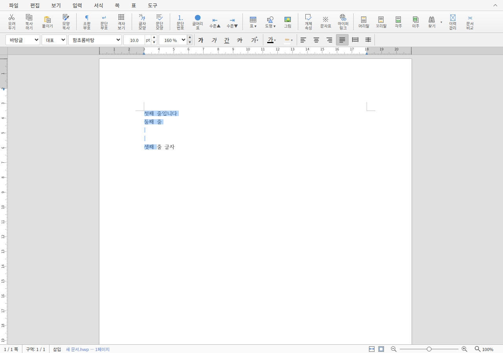
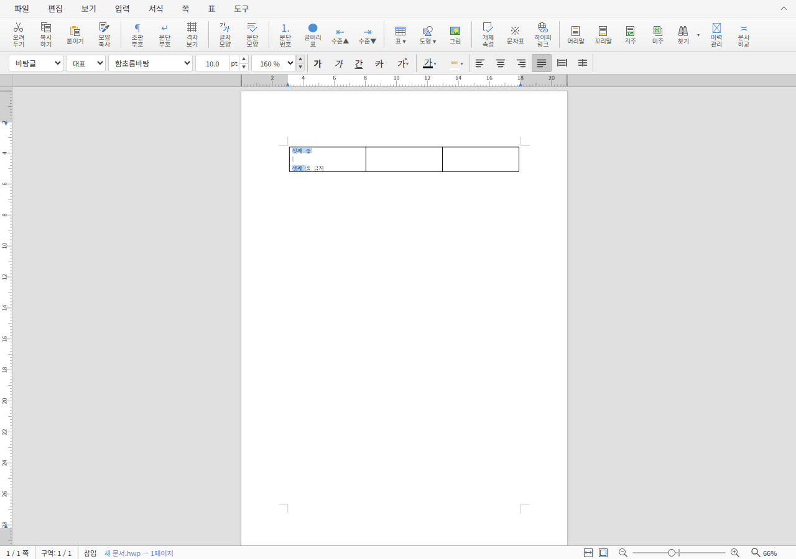

# #8913·#8915 원격 처리안과 공개 문안

2026-11-11 KST 준비한 승인 요청 문안이다. 작업지시자가 두 PR 머지·후속 처리까지 승인했고
해당 순서로 원 PR merge·운영 기록·이슈 완료 확인·감사 댓글을 실행했다. 아래 초안은 승인 당시
문안을 보존한 것이며 실제 SHA·URL·결과는 [후속 결과](receipts/followup-results.json)에 기록했다.
두 원 PR의 기여 head와 fork branch를 보존한다. 새 통합 PR이나 원 fork push는 하지 않는다.

## 승인 범위와 실행 순서

1. #8915·#8913 순서로 각 원 PR의 head·CI·reviewer·base·mergeability를 재조회하고
   최신 `upstream/devel`의 `merge-tree --write-tree`와 diff 공백 검사를 완료한다.
2. 각 원 head에 아래 승인 리뷰를 게시하고 `--match-head-commit`으로 SHA를 고정해 merge한다.
   source가 바뀌면 이전 CI를 옮겨 쓰지 않고 새 변경 범위를 검토한다. 첫 병합 뒤 두 번째도 재확인한다.
3. 확정 merge SHA·CI·결과를 review archive와 오늘할일에 기록한다. 검토 계획·원장도 연결한다.
   maintainer 직접 반영 범위인 mydocs 운영 기록만 devel에 commit·push한다.
   source·test·workflow·원 fork branch를 변경하지 않는다.
4. devel fast-forward sync 뒤 #8908·#8914를 재조회한다. OPEN이면 아래 문안으로 완료 댓글과 close,
   CLOSED여도 같은 증거의 maintainer 댓글이 없으면 완료 댓글을 게시한다.
5. 원 PR에 감사 댓글을 게시한다. `MERGE_SHA`·`OPS_SHA`는 확인한 실제 값으로 치환한다.
   PNG raw URL은 운영 기록이 devel에 존재한 뒤 해시·형식을 확인한다.
6. 해당 작업의 clean local branch/worktree를 제거한다. 원 fork branch와 다른 WIP는 보존한다.
   post_merge 7.7에 따라 저장소 루트 output 전체·사용이 끝난 target/pr-review/debug를 정리하고 검증한다.
   예상 밖 post-merge 제품 CI를 시작하거나 재실행하지 않는다.

## #8913 승인 리뷰 초안

여러 문단·셀의 빈 문단과 문단 끝 선택 표시를 확인했습니다. 최신 devel에서 원인 코드가 남아
있음을 대조했고 원 기여를 추가 보정 없이 검증했습니다. 최소 글꼴 focused Rust 4건,
이번 소스의 개발용 WASM API 11건, 실제 Studio overlay 8건과 400문단·10쪽의 정상 대조
156개 검사가 통과했습니다. 원 head `66141a6c485844e37cdd133f7ac92890e9d8a2c3`의
[CI](https://github.com/edwardkim/rhwp/actions/runs/42803126005)도 확인했습니다.
문서 조판과 분리된 선택 UI query임을 확인했습니다. 감사합니다.

## #8915 승인 리뷰 초안

일반 페이지에서 설치 속성·ready 이벤트·bridge script가 생성되지 않고, head의
`<meta name="hwp:integration" content="enabled">`가 있는 페이지의 통합 기능과 동적 HWP 배지가
유지됨을 실제 Chrome 확장으로 확인했습니다. 기존 script를 사용하면 일반 페이지 검사에서
실패하고 후보에서는 통과했습니다. Node 100건·build·smoke와 원 head
`61198fcf3f4d185c8f78eac5b3259d99303b8845`의
[CI](https://github.com/edwardkim/rhwp/actions/runs/42810525003)를 확인했습니다. 감사합니다.

## #8908 완료 댓글 초안

[PR #8913](https://github.com/edwardkim/rhwp/pull/8913)을 `MERGE_SHA`로 devel에 반영했습니다.
빈 문단과 문단 끝 선택 표시, 같은 문단의 부분 끝점, 자동 줄바꿈 중간 줄을 확인했습니다.
focused Rust 4건·이번 소스의 개발용 WASM API 11건·Studio overlay 8건과 기존 400문단·10쪽
대조군 156개 검사가 통과했습니다. [CI](https://github.com/edwardkim/rhwp/actions/runs/42803126005)와
[검토 증거](https://github.com/edwardkim/rhwp/blob/OPS_SHA/mydocs/pr/archives/pr_8913_review.md)를
남깁니다. 문서 Print 비교가 아닌 선택 UI 검증이며, 이번 이슈 범위의 미해결 사항은 없습니다.
확인한 close 상태를 함께 기록하고 완료 처리합니다. 감사합니다.

## #8914 완료 댓글 초안

[PR #8915](https://github.com/edwardkim/rhwp/pull/8915)을 `MERGE_SHA`로 devel에 반영했습니다.
일반 페이지 비간섭과 명시적으로 통합한 페이지의 ready·rhwpDev, 동적 HWP 링크 기능을
실제 확장에서 확인했습니다. Node 100건·build·수정 전 실패/수정 후 성공 smoke 및
[CI](https://github.com/edwardkim/rhwp/actions/runs/42810525003)를 확인했습니다.
[검토 증거](https://github.com/edwardkim/rhwp/blob/OPS_SHA/mydocs/pr/archives/pr_8915_review.md)에
입력과 결과를 보존했습니다. 이번 이슈 범위의 미해결 사항은 없습니다.
확인한 close 상태를 함께 기록하고 완료 처리합니다. 감사합니다.

## #8913 감사 댓글 초안

검토 및 머지 완료했습니다. 기여해 주셔서 감사합니다.

`MERGE_SHA`로 반영했으며 [CI](https://github.com/edwardkim/rhwp/actions/runs/42803126005),
focused Rust 4건·개발용 WASM 선택 API 11건·Studio overlay 8건과 400문단·10쪽 정상 대조
156개 검사를 확인했습니다. 빈 문단과 셀 선택 표시를 직접 확인했고 추가 제품 보정은 없습니다.
연결된 [#8908](https://github.com/edwardkim/rhwp/issues/8908)의 완료 상태도 확인했습니다.

선택 UI 증거이며 문서 Print 실루엣 비교는 아닙니다.
[상세 검토](https://github.com/edwardkim/rhwp/blob/OPS_SHA/mydocs/pr/archives/pr_8913_review.md).

## #8915 감사 댓글 초안

검토 및 머지 완료했습니다. 기여해 주셔서 감사합니다.

`MERGE_SHA`로 반영했으며 [CI](https://github.com/edwardkim/rhwp/actions/runs/42810525003),
Node 100건·실제 확장 build·smoke를 확인했습니다. 동일 확장의 기존 script는 일반 페이지
DOM 비간섭 검사에서 실패했고 수정 후보는 통과했습니다. 명시적 meta 통합과 동적 HWP 링크
배지도 유지됩니다. 추가 제품 보정 없이 수용했습니다.

연결된 [#8914](https://github.com/edwardkim/rhwp/issues/8914)의 완료 상태도 확인했습니다.
[상세 검토](https://github.com/edwardkim/rhwp/blob/OPS_SHA/mydocs/pr/archives/pr_8915_review.md).
