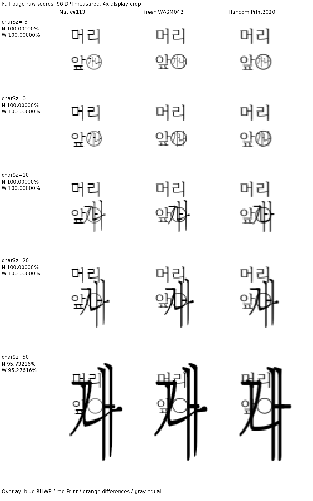
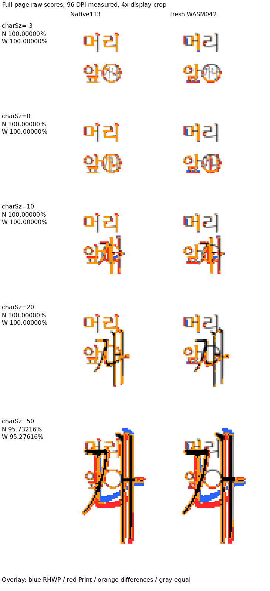

# 글자겹침의 부호 있는 크기 계약 — 독립 Print 대조군

이 자료는 합성 HWPX의 `charOverlap/@charSz` 해석을 확인하는 대조군이다.
5개 ZIP의 part 이름과 본문은 이 속성값만 제외하면 바이트가 같다. `char-sz-0.hwpx`를
기준으로 해당 속성만 -3/10/20/50으로 바꾸어 같은 검사를 재현할 수 있다.
표는 없으며 배치 변경의 실물 원본을 대신하는 자료가 아니다.

기준 PDF는 MCP의 Hancom Office 2020 11.0.0.9136에서 `PrintMethod=0`,
`hancom2020_pdf_driver_one_up` 인쇄 경로로 출력한 각 1쪽이다.
[Print 계약](../../../../manual/mcp_hwp2024Convert_usage.md#기준-pdf-인쇄-계약)을 적용했다.
다운로드한 입력과 PDF를 바꾸지 않고 보존했다. PDF당 9.8~13.3KiB로 50MiB 미만이다.

PDF content stream에서 본문은 device font size 83이고, 겹친 글자는 순서대로
58/83/167/250/500이다. 본문 약 10pt에 대해 약 7/10/20/30/60pt에 해당한다.
따라서 양수 50은 50% 축소가 아닌 약 6배 크기다. 작은 device 단위의 반올림과
dimensionless 크기 계약을 구분한다. 기존 측정 JSON의 음수 ratio=1은 첫 본문
font size를 골랐던 집계 오류이며 실제 겹친 글자의 값은 58이다.

## 입력·Print·전쪽 TSV

| charSz | 입력 | 독립 Print | 입력 SHA-256 | PDF SHA-256 | Native113 raw | fresh042 raw |
| ---: | --- | --- | --- | --- | ---: | ---: |
| -3 | [char-sz-neg3.hwpx](char-sz-neg3.hwpx) | [char-overlap-size--3-2020.pdf](../../../../../pdf/semanticist21-20261019/char-overlap-size-020/char-overlap-size--3/char-overlap-size--3-2020.pdf) | `e70eae0266268ef7fbbeafd85ef49cb5e90ac8f1fc4143092543cbfaee8222a0` | `6b8732159d7a0ebf32e600f7a05b47c95f9675600cc2c5ec18f23ecd92ced7c1` | 100.00000% | 100.00000% |
| 0 | [char-sz-0.hwpx](char-sz-0.hwpx) | [char-overlap-size-0-2020.pdf](../../../../../pdf/semanticist21-20261019/char-overlap-size-020/char-overlap-size-0/char-overlap-size-0-2020.pdf) | `5865d26442e363b8dc4f64cfccf05b56ddf89d94fcbc9c9219b72ef2e53bce29` | `798d35764ed74207574e5ddb135edcf9a2f4c8c1a351b4e08b2d62f63d3421f0` | 100.00000% | 100.00000% |
| 10 | [char-sz-10.hwpx](char-sz-10.hwpx) | [char-overlap-size-10-2020.pdf](../../../../../pdf/semanticist21-20261019/char-overlap-size-020/char-overlap-size-10/char-overlap-size-10-2020.pdf) | `aeaaadcc5835509ddf4a0469803eca3129b7447e84ce9385a4f6465018305261` | `2edc2c2b36ea0191186eda2304f66cf180b93a1d146dbd92584c71f99b2afb76` | 100.00000% | 100.00000% |
| 20 | [char-sz-20.hwpx](char-sz-20.hwpx) | [char-overlap-size-20-2020.pdf](../../../../../pdf/semanticist21-20261019/char-overlap-size-020/char-overlap-size-20/char-overlap-size-20-2020.pdf) | `96f5ce5a2d53a9c92d4fe9177a22dce92c36d4f3c36e72c2aac46fc6fed733a9` | `a474ff5ba618124aae66121901de3b2b168b54c0edf7f177c320c891d8f3c3d2` | 100.00000% | 100.00000% |
| 50 | [char-sz-50.hwpx](char-sz-50.hwpx) | [char-overlap-size-50-2020.pdf](../../../../../pdf/semanticist21-20261019/char-overlap-size-020/char-overlap-size-50/char-overlap-size-50-2020.pdf) | `6b0defb11ec51e72eac4e0d56f2cf95539a1fa0048e8dcb5fc546de0c5cd3b7e` | `7d4b8e0d4530f87c7b9701768366d4c4d0479332f289fcb96e59d9c84c312e38` | 95.73216% | 95.27616% |

각 TSV는 `native113/`와 `fresh042/`에서 파일 stem별 원문을 보존했다.
Native113은 `0909aceb6f28fedbea9c49845d47a0f7d3c752c8` 위 dirty 제품 소스를 빌드한
고정 producer이며 `char-overlap-native-build-113-result.json`에 소스·바이너리 해시가 있다.
fresh042는 제품 커밋 `476d0f131dfe7bb411f9bffbe8d98c52531b4fc1`의 최적화된 WASM이다.
두 출력의 실제 실행 기록은 ignored `output/pr-review/semanticist21-20261019/`의
`char-overlap-size-native113-1705/results.json`, `char-overlap-size-wasm042-1666/results.json`이다.
이전 출력을 이후 head의 새 출력으로 표시하지 않는다. 최종 제출 전에는 새 runtime에서
해당 입력도 다시 산출한다. 이 자료를 전체 PR 검증 완료나 다른 문서의 글꼴 예외로 사용하지 않는다.

## 직접 확대 판독

전쪽 raw는 둘 다 90% 이상이다. 모든 내용 픽셀의 합집합 영역을 같은 좌표로 잘라
4배 최근접 확대했다. 점수는 잘라내거나 확대해 다시 계산하지 않은 전쪽 TSV 원래 값이다.
Native113·fresh042·독립 Print의 glyph 크기·기준선·원 테두리·앞 본문과의 겹침을 함께 읽었다.
양수 확대는 독립 Print에서도 발생하며 50% 축소로 바꿀 근거가 아니다.
50의 glyph 윤곽에는 차이가 남는다. 크기 해석의 증거와 전체 glyph 모양의 일치를 구분하며,
이 차이를 고쳤거나 완전한 픽셀 일치라고 주장하지 않는다.

## 리베이스 후 같은 계약의 실행 확인

Native115의 전쪽 TSV도 `native115/`에 바이트 그대로 보존했다. 다섯 입력의
raw는 위 Native113과 같고, 독립 PDF 쪽수도 각 1쪽이다. 실제 producer는
`char-overlap-native-build-115-result.json`의 소스 snapshot과 바이너리 해시로
구분한다. 이 실행과 같은 공개 함수에 변경한 정식 검사 본문을 그대로 연결한
`char_overlap_signed_size_steps_follow_hancom_print`가 통과했다.
기존 테두리 없음·음수 크기 검사를 유지하고, Print와 다른 양수 50의 0.5 기대를
6.0으로 교정했다. 실제 함수의 크기 규칙은 이번 검사 수정에서 바꾸지 않았다.

새 source-side 검사 수를 늘리지 않도록 기존 한 함수 안에서 모든 조건을 검사한다.
현재 base `f7abae4a8e70c062c378db06ad64d2d2eacb88cd` 대비 정책 검사는
4,101개 검사·296개 모듈에서 통과했다. 실행 로그와 중간 JSON은 ignored output에
보존하며 커밋하지 않는다. Native115와 최종 fresh 출력의 전체 PR 검증은 별도이며,
50의 glyph 윤곽 차이를 이 크기 계약 통과로 면제하지 않는다.
