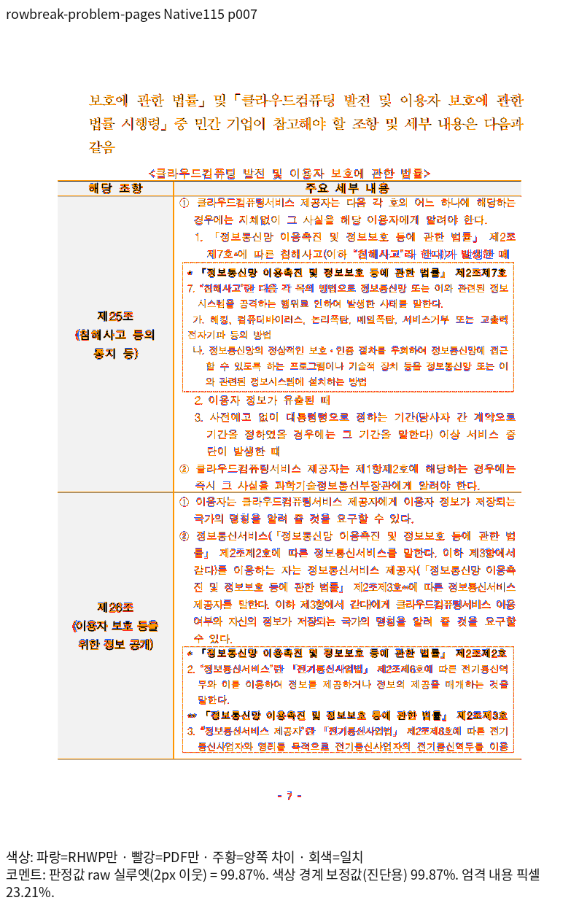
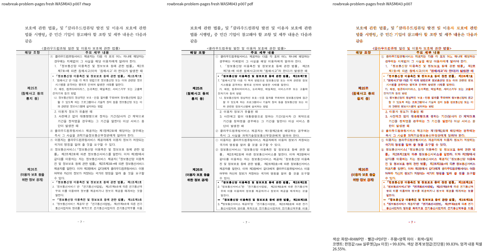
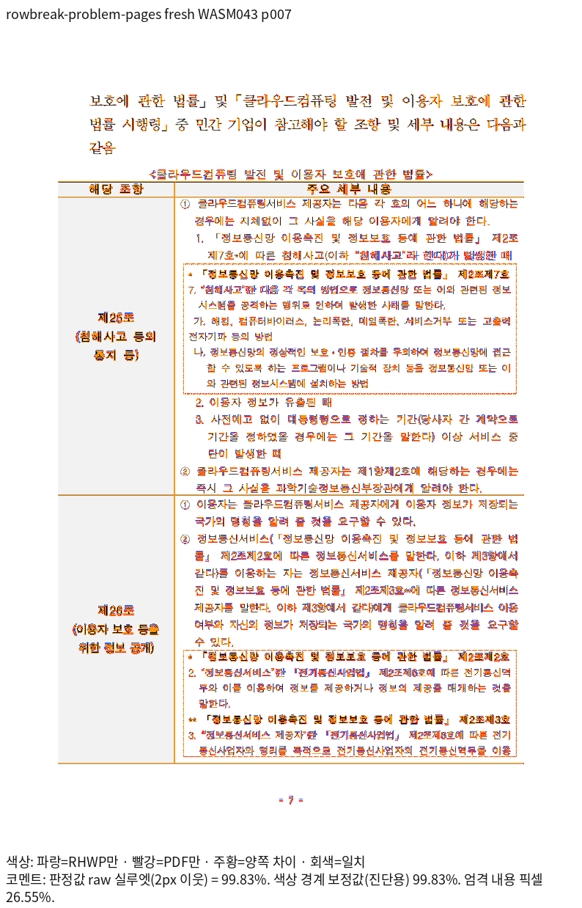

# 원본 첫 혼합 조각의 기준선과 내용 소유

- 입력: [rowbreak-problem-pages.hwp](../../../../../samples/rowbreak-problem-pages.hwp)
- 독립 한컴 Print: [rowbreak-problem-pages-hwp-2024.pdf](../../../../../pdf/rowbreak-problem-pages-hwp-2024.pdf), 전 18쪽
- 입력 SHA-256: `10b6ab6548610e18c82ba78a1c844a00107fedbb28c195cb05e6fd20626d33ed`
- PDF SHA-256: `2c49bda9cc21dc8b93b554d2607da241dd7e894657eb308ed823e7d44654e85c`
- DPI 96, 배율 1, print 프로필, compat 2024. 실제 Native Skia와 fresh WASM Canvas를 사용했다.

| 실행 | 전체 쪽수 | 전쪽 최저 raw | 완료 7쪽 raw | 전체 TSV |
| --- | ---: | ---: | ---: | --- |
| Native115 | 18 | 93.39366% | 99.86687% | [원문](native115/silhouette.tsv) |
| fresh043 | 18 | 93.43214% | 99.83075% | [원문](fresh043/silhouette.tsv) |

producer는 `char-overlap-native-build-115-result.json`과
`char-overlap-fresh-wasm-build-043-result.json`에 고정했다. fresh043의 실제 source
commit은 `d61beab674`이며 Native snapshot의 소스 599개가 그 commit과 같은 것을
확인했다. 로그·snapshot·중간 JSON은 ignored output/pr-review/semanticist21-20261019에
보존한다. 이후 주소 보정 소스의 검증으로 이 캡처를 바꾸어 보고하지 않는다.

## 독립 좌표와 새 회귀

7쪽의 본문 `①이용자는클라우드컴퓨팅서비스...`의 PDF 기준선은 494.28pt다.
96dpi CSS 좌표는 659.04px이며 ±2px로 보호한다. 원본 소유는 section 0 /
paragraph 21 / table control 0 / row 3 col 1이다. 좌표·크기로 소유자를 고르지 않는다.

두 정식 새 검사 `issue_7470_mixed_opening_print_baseline`은 원본 Center 속성,
18쪽 수, 셀 안 포함·본문 뒤 자식 순서, 앞 문장의 단일 소유와 다음 쪽 마지막
문장의 누락·중복을 검사한다. 첫 기준선의 좌표 고정은 양쪽 raw 98% 이상·직접
확대 판독을 확인한 7쪽에만 사용한다. 다음 쪽에는 관계 검사만 사용한다.

같은 정식 CLI 검사를 같은 test binary에서 실제 이전 Native110 CLI와 현재
Native115 CLI로 실행했다. 이전 baseline 655.653333px는 독립 659.04px의 ±2px를
벗어나 FAIL이고, 현재 CLI와 typed 내용 관계 검사는 2 PASS다. 실제 CLI binary
선택은 CARGO_BIN_EXE_rhwp로 구분한다. SVG는 임시 출력의 한 baseline만 읽고
삭제하며 전체 SVG 해시·골든이나 고정 px 영역 선택을 사용하지 않는다.

최초 이전 rlib 직접 연결은 현재 dependency cache와 맞지 않아 빌드가 중단됐다.
그 결과를 수정 전 FAIL 증거로 세지 않았다. 실제 이전 CLI를 실행한
rowbreak-new-print-guard-1763-proof.json과 해당 로그가 수정 전 검출 증거다.

## 직접 판독

새 7쪽의 Native/fresh review·standalone overlay에서 우측 본문 시작과 자식
첫 조각의 원점·마지막 줄, 왼쪽 표제·부모 가로 괘선·앞뒤 쪽 내용을 대조했다.
원본 첫 상자의 정렬을 유지하고 같은 배치 결과를 측정과 실제 자식 원점이 읽는다.
가는 글자 획의 안티앨리어싱 차이는 남으며 완전한 픽셀 동일성으로 주장하지 않는다.

