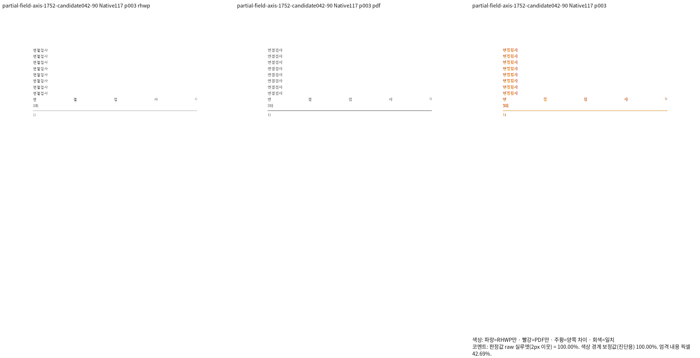
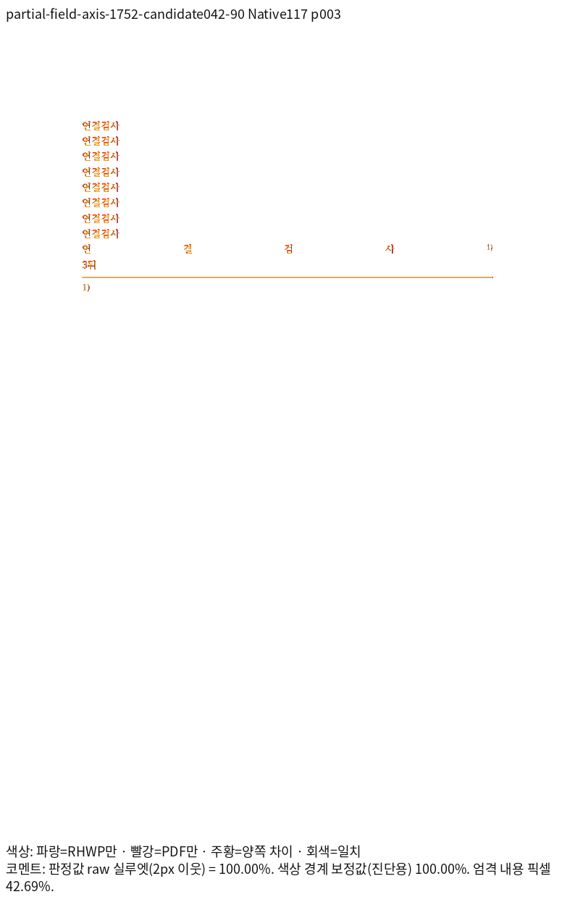
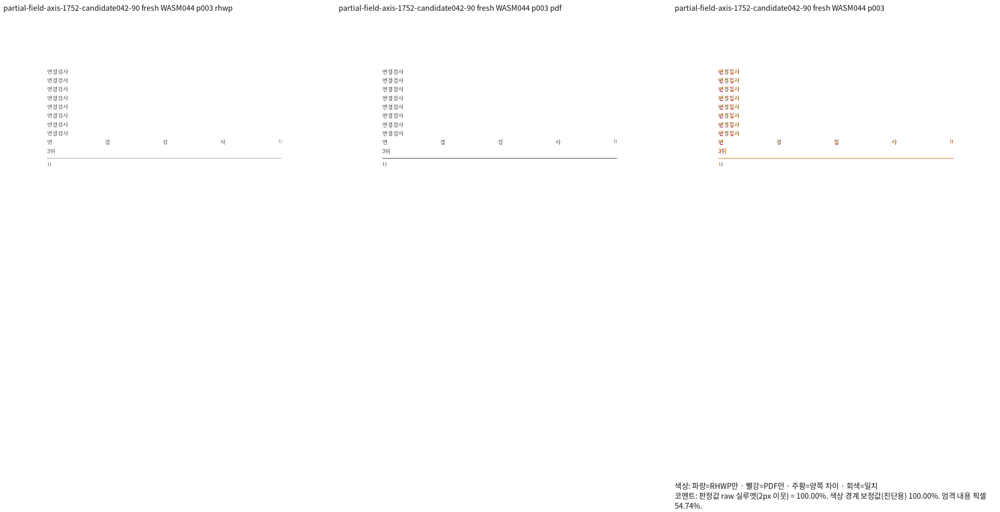
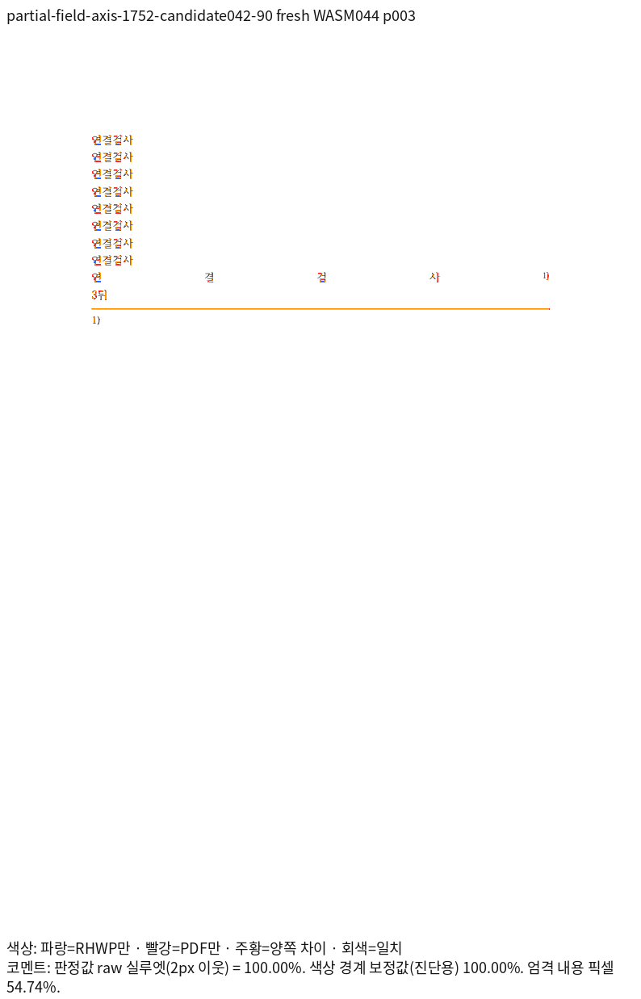

# 인라인 주석과 본문 쪽번호의 원문·줄 소속

## 검증한 제품과 범위

제품 소스는 `9c860c00668a411ea64edf42576193975af09773`다. Native117과 최적화
fresh WASM044를 같은 제품 소스로 빌드했다. Native는 Skia PNG, fresh는 실제 Chrome
Canvas PNG이며 96dpi·compat2022(한컴 2020 대응)로 독립 Print와 비교했다.
각 문서의 전체 쪽수는 같고 5개 입력·14쪽의 양쪽 raw 최저값이 모두 100%다.
이 값은 색상 경계 보정 전 2px 실루엣이며 RGB 완전 일치나 통합 PR 전체 완료를 뜻하지 않는다.

- Native 실행 파일 SHA-256: `02a51586442579a7b90e4806a99220d62d981f55f1d91df2260c6d939a6561a8`
- fresh WASM SHA-256: `6e48b663f5da7e496dd6b87fecc61d5399a8c5547271c313f25d2b3a27b4214a`
- 빌드: 공용 `target/pr-review`, 빌드 잡 8개. fresh 최적화 874.34초·exit 0, Studio JS/WASM 동기화 일치.

## 입력 생성과 독립 Print

기존 `tests/fixtures/semanticist21_20261015/pr7671-endnote.hwpx` 또는
`pr7671-footnote.hwpx`를 fresh043의 공개 편집 API로 열어 `연결검사\n`을 반복 삽입했다.
원본 저장 제품은 한컴 2020 11.0.0.3524다. LineSeg를 손으로 만들거나 고치지 않았다.

| 입력 stem | 공개 편집 순서 | Print 쪽수 | 본문 참조 쪽 / PAGE 필드 쪽 |
| --- | --- | --- | --- |
| endnote-forced-break-field-40 | insertText(0,1,1,반복40) | 2 | 1 / 2 |
| endnote-forced-break-field-90 | insertText(0,1,1,반복90) | 3 | 3 / 3 |
| footnote-forced-break-field-90 | 각주 원본에 insertText(0,1,1,반복90) | 3 | 3 / 3 |
| early-endnote-and-field-90 | insertText(0,1,2,반복90) | 3 | 1 / 1 |
| early-endnote-late-field-90 | insertText(0,1,1,반복90), deleteFootnote(0,1,0), insertEndnote(0,1,1) | 3 | 1 / 3 |

40회 입력의 참조는 1쪽 마지막 글줄, 필드는 2쪽 첫 글줄이다. 같은 쪽이라는 가정을
쓰지 않는다. `early-endnote-and-field-90`은 실제 XML에서 주석과 필드 모두 반복 본문
앞에 있다. 진단 때의 의도와 다르게 생성된 입력을 잘못 설명하지 않으며 앞쪽 소속의
정상 대조군으로 보존한다. 미주만 앞쪽인 별도 입력은 삭제·재삽입 API로 만들고 XML 제어
순서와 독립 Print를 다시 확인했다.

모두 MCP의 engine2020·target pdf·start/status/download로 인쇄했다. 실제 한컴은
`11.0.0.9136`, `pdf_print_method=0`, `hancom2020_pdf_driver_one_up`이다.
Save As PDF나 HWP/HWPX 변환 결과를 기준 PDF로 사용하지 않았다. 원문과 기준 PDF는
검증한 바이트 그대로 아래 정식 경로에 복사했다.

| 입력·PDF | 입력 SHA-256 | PDF SHA-256 |
| --- | --- | --- |
| [endnote-forced-break-field-40.hwpx](../../../../../tests/fixtures/semanticist21_20261022/inline_note_page_fields/endnote-forced-break-field-40.hwpx) · [Print PDF](../../../../../pdf/semanticist21-20261022/inline_note_page_fields/endnote-forced-break-field-40-2020.pdf) | `3b1e0cd1b36b47f09c309f9967eb0a2aa883fb1ecb095f8e98a1c4fcc76f21c6` | `74983558246768b92846019b777edbe8353a299dac9fca7378b040fa0b4a2ccd` |
| [endnote-forced-break-field-90.hwpx](../../../../../tests/fixtures/semanticist21_20261022/inline_note_page_fields/endnote-forced-break-field-90.hwpx) · [Print PDF](../../../../../pdf/semanticist21-20261022/inline_note_page_fields/endnote-forced-break-field-90-2020.pdf) | `f15ebe7c843116783d70f29f39617f1277df780d5319f5fe3759d3d63c36dadc` | `c5fe01beb4534e2b4dae2cf104e54635876122f0392a9926f67ea6ffd5ce7f3e` |
| [early-endnote-and-field-90.hwpx](../../../../../tests/fixtures/semanticist21_20261022/inline_note_page_fields/early-endnote-and-field-90.hwpx) · [Print PDF](../../../../../pdf/semanticist21-20261022/inline_note_page_fields/early-endnote-and-field-90-2020.pdf) | `d84a295e562faddfaa91b1726a10914338bbfe9358989917e7af48e3f41afbbc` | `9f3722b4e07450b8fd252911fdbf2bfc03d55e0ed6071d0d6d9b5fd0d9319789` |
| [footnote-forced-break-field-90.hwpx](../../../../../tests/fixtures/semanticist21_20261022/inline_note_page_fields/footnote-forced-break-field-90.hwpx) · [Print PDF](../../../../../pdf/semanticist21-20261022/inline_note_page_fields/footnote-forced-break-field-90-2020.pdf) | `71a468ac754a54925cc8076d95140c9ac410cf90939b847a1e751497e12dbc73` | `0bf2a36e21f9ecdc0608f02507fb026871dee46b57dd535c68f6b8f757b0fc92` |
| [early-endnote-late-field-90.hwpx](../../../../../tests/fixtures/semanticist21_20261022/inline_note_page_fields/early-endnote-late-field-90.hwpx) · [Print PDF](../../../../../pdf/semanticist21-20261022/inline_note_page_fields/early-endnote-late-field-90-2020.pdf) | `fa1e5044ca12041da884f4bc81ddcc0f2457d9682e677ee391f4528778a39d94` | `e1fac4cca0e09f6bd3009ab2ee7dff0beb9cb30c5b8e38e9b5a787adaeb3dc8c` |

## 전쪽 TSV와 직접 판독

| 입력 stem | Native TSV | fresh WASM TSV | 양쪽 raw 최저 |
| --- | --- | --- | --- |
| endnote-forced-break-field-40 | [전체 2쪽](native/endnote-forced-break-field-40.tsv) | [전체 2쪽](wasm/endnote-forced-break-field-40.tsv) | 100% / 100% |
| endnote-forced-break-field-90 | [전체 3쪽](native/endnote-forced-break-field-90.tsv) | [전체 3쪽](wasm/endnote-forced-break-field-90.tsv) | 100% / 100% |
| early-endnote-and-field-90 | [전체 3쪽](native/early-endnote-and-field-90.tsv) | [전체 3쪽](wasm/early-endnote-and-field-90.tsv) | 100% / 100% |
| footnote-forced-break-field-90 | [전체 3쪽](native/footnote-forced-break-field-90.tsv) | [전체 3쪽](wasm/footnote-forced-break-field-90.tsv) | 100% / 100% |
| early-endnote-late-field-90 | [전체 3쪽](native/early-endnote-late-field-90.tsv) | [전체 3쪽](wasm/early-endnote-late-field-90.tsv) | 100% / 100% |

대표는 `endnote-forced-break-field-90`의 물리 3쪽이다. 본문 마지막 반복 줄의 미주
참조가 같은 줄 오른쪽에 있고 `3뒤`는 다음 줄에 놓인다. 네 글자와 참조 사이 배분,
참조 기준선, 필드와 뒤 글자 간격 및 주석 구분선·본문을 같은 배율로 직접 판독했다.
앞쪽 참조 대조군의 첫 쪽과 뒤쪽 필드 소속도 대조했다. 색상·안티앨리어싱의 잔차는 남는다.

### Native117

### fresh WASM044

## 새 회귀 검사와 독립 기대값

[정식 회귀](../../../../../tests/cases/inline_note_page_field_source_ownership.rs)는 두 함수다.
기존 검사의 이름을 덮어쓰지 않았다. 첫 함수는 5개 입력의 원문/논리 한 칸 구분,
본문 PAGE 표시값·쪽 소속, 주석 참조의 유일한 줄 소속, 페이지 경계를 포함한 바로
다음 줄 관계와 전체 본문의 순서·누락·중복을 검사한다.

두 번째 함수는 실제 CLI의 물리 3쪽 SVG에서 내용을 따라 본문 참조·필드를 찾아
완료된 양쪽 100% 페이지의 독립 Print 원점만 ±2px로 보호한다. 임시 SVG는 출력
검사 후 삭제하며 전체 SVG 해시나 임의 px 영역으로 대상을 선택하지 않는다.

독립 PDF의 CTM은 x=0.119935, y=-0.119869다. 72pt→96dpi 환산에 아래 원점을 쓴다.

| 대상 | PDF device 원점 x / y(상단 기준) | 비교할 위치 |
| --- | --- | --- |
| 본문 미주 참조 | 4198 / 1947 | x와 alphabetic baseline |
| 다음 줄 PAGE 필드 | 709 / 2098 | x와 alphabetic baseline |

실행 1808에서 두 함수 모두 통과했다. 실제 CLI를 바꾼 1809의 동일 정식 검사에서
Native115는 원문 451의 부분 문단 소유 오류로 실패하고, Native116은 본문 참조 x가
113.38667로 독립 Print 671.31617과 달라 실패했다. Native117은 통과했다. 수정 전에도
통과하는 검사를 결함 검출 근거로 쓰지 않았다. 초기 1807은 40회 입력의 참조도
2쪽이라고 잘못 가정해 실패했으며 독립 Print의 1쪽 끝/2쪽 첫 줄로 바로잡았다.

실행 로그·중간 JSON과 생성 스크립트는 ignored
`output/pr-review/semanticist21-20261019/`의 1752·1753·1778·1779·1786·1787,
1769·1781·1789·1796·1804·1806·1808·1809에 보존한다. 최종 전체 Rust·lint·
통합 검증과 남은 기존 실패 해결은 별도 필수 단계이며 이 기록으로 완료 처리하지 않는다.
