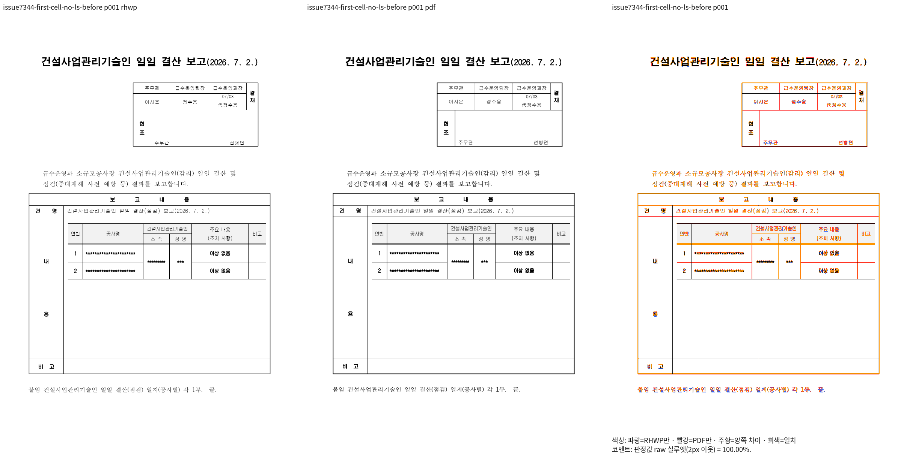
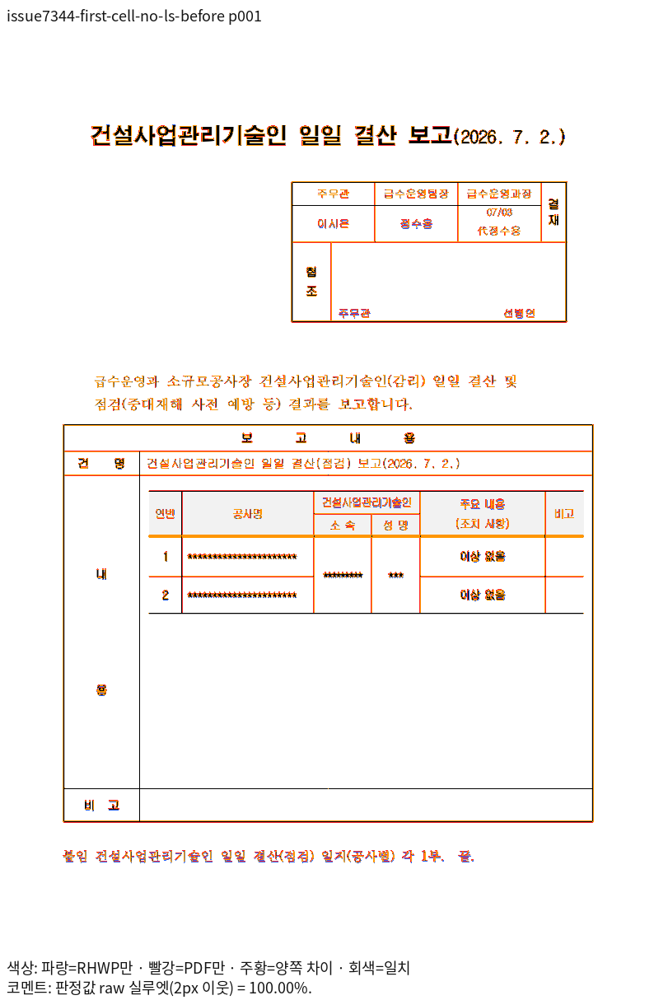
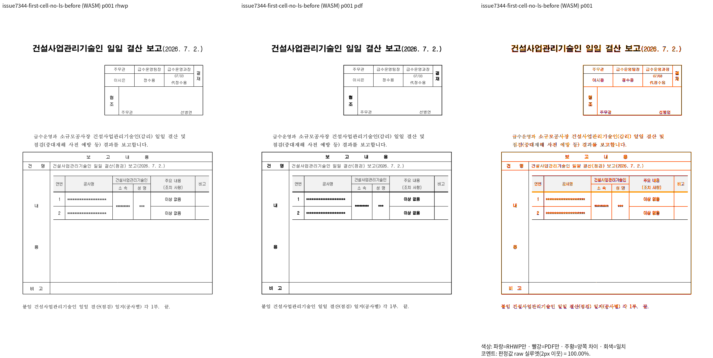
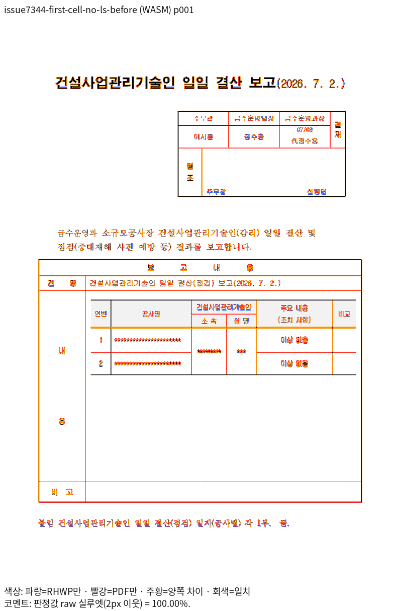

# 셀 첫 문단의 앞 간격·바깥 위 여백 보존

원본 `samples/issue7344/36455985_no_lineseg_cell_spacing_before.hwpx`와 기존 `pdf/issue7344/36455985-2020.pdf`를 그대로 비교했다. 고정 ECE9 base Native는 98.99%, 통합 R3는 71.72%, 실제 제품 보정 R4는 Native/fresh WASM 각각 전 1쪽 100.00%다. 원본·PDF·판정 범위는 바꾸지 않았다. [base TSV](base-ece9.tsv)와 [보정 전 TSV](before-r3.tsv)를 구분한다.

R1의 개체 줄 소유 정보가 생겨도 저장 원점이 생긴 것은 아니다. 측정과 글줄 배치가 소비한 첫 문단 위 간격을 전체 셀의 중첩 표도 실제 배치된 줄에서 읽도록 `2de033b4e42be406a01ea0b9053a4531247e147c`로 보정했다. 기존 줄 소유·다른 줄·부분 조각 계약은 되돌리지 않았다.

독립 PDF에서 외곽 셀 상단 약 542.767 CSSpx, 중첩 표 상단 약 562.425 CSSpx를 확인했다. 원본의 셀 안 위 여백 140HU·문단 위 간격 1200HU·중첩 표 바깥 위 여백 140HU가 각각 한 번 적용된다. 기존 회귀는 안 여백 다음 앞 공간에 문단 간격 16px만 기대했으나 Print와 현재 실제 배치는 바깥 여백을 포함한 17.8667px를 지지한다.

실제 출력을 먼저 양쪽 100%로 복구하고 같은 영역을 확대 판독한 뒤, 이 기대값을 원본 HWPX의 `HwpUnitChar prev + Table.outer_margin_top`과 실제 상대 공간의 비율 관계로 정정했다. 원본 1200HU를 임의 px 상수로 바꿔 고정하지 않고 소속·간격 보존을 유지한다. 정상 36494836(저장 줄·탭)과 36312980(셀 사다리·정렬)도 각 전 1쪽 Native/fresh WASM 100%/100%, 99.87%/100%로 확인했다. 기존 완료 페이지의 독립 ±2px 좌표 검사는 그대로 유지한다.

[같은 원본별 측정·SHA](../validation-r6/measurements.md), [Native producer](../historical-validation.md), [최적화 fresh WASM producer](../historical-validation.md)를 연결한다. 입력·PDF는 기존 Git 파일과 실행 바이트의 동일성을 확인했으며 중복 사본을 추가하지 않는다. 같은 폴더의 native/wasm TSV는 페이지별 원본이다. 최소 글꼴 5개에서 관계 검사를 실행하며 시스템 상용 글꼴을 전제로 하지 않는다.

이 자료는 ECE9 기반 R4의 리베이스 전 완료 증거다. 새 upstream/devel `170b886f167b705b6e630c5b34bb638d92fae0a9`의 PR #8542 RowBreak 기능을 함께 반영한 최종 제품의 검증은 별도로 수행한다. 진행 중인 이전 전쪽 측정의 중단·대기를 전체 통과로 표시하지 않는다.

초기 관계 검사 작성에서 IR의 2배 문단 여백을 실제 HWPUNIT으로 읽은 오류도 원본 XML로 확인했다. 원본 paraPr 4의 `prev=1200`, `unit=HWPUNIT`을 독립 XML 독자로 읽으며 제품의 마진 해석 helper를 기대값에 재사용하지 않는다. 실제 출력이나 허용 오차를 바꿔 이 작성 오류를 가리지 않는다.

[정정 후 최소 글꼴 집중 결과](../historical-validation.md)는 해당 기존 모듈 4건 PASS다. 전체 181건을 다시 실행했다고 쓰지 않으며, 앞선 181건 실행의 180 PASS/1 FAIL과 구분한다. 원래 전체 Rust 5건 실패의 나머지 원인 정리와 최종 전체 검증도 통합 원장에서 별도로 추적한다.
