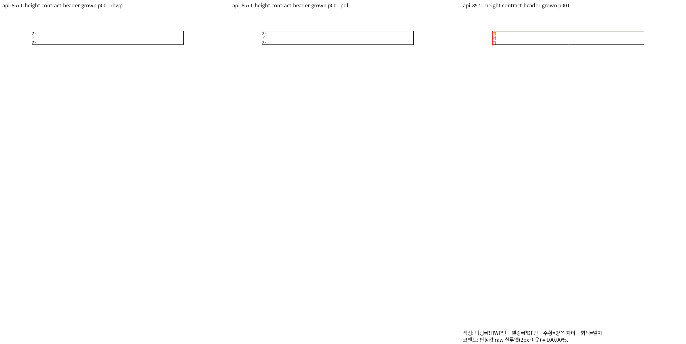
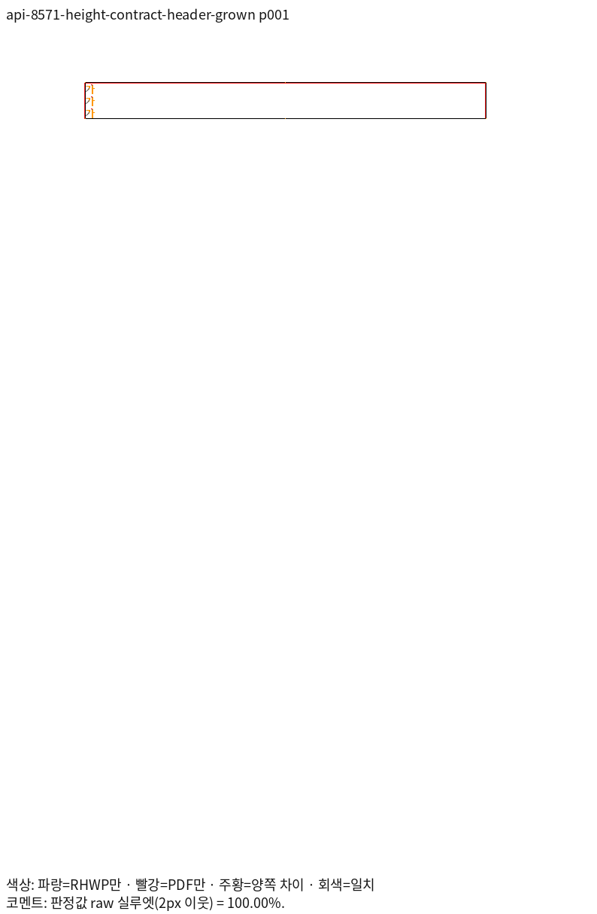
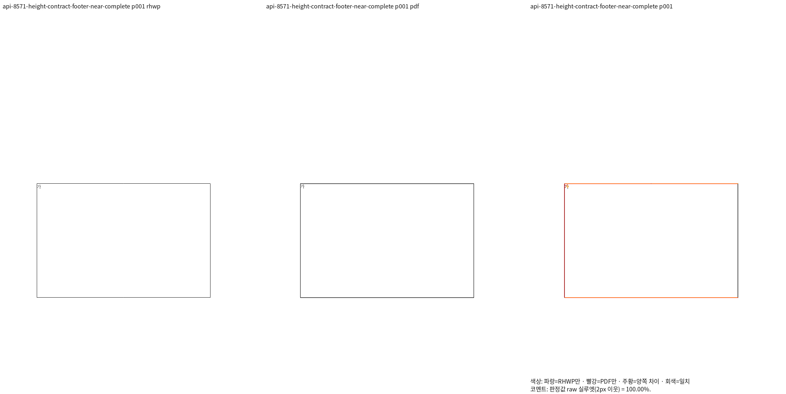
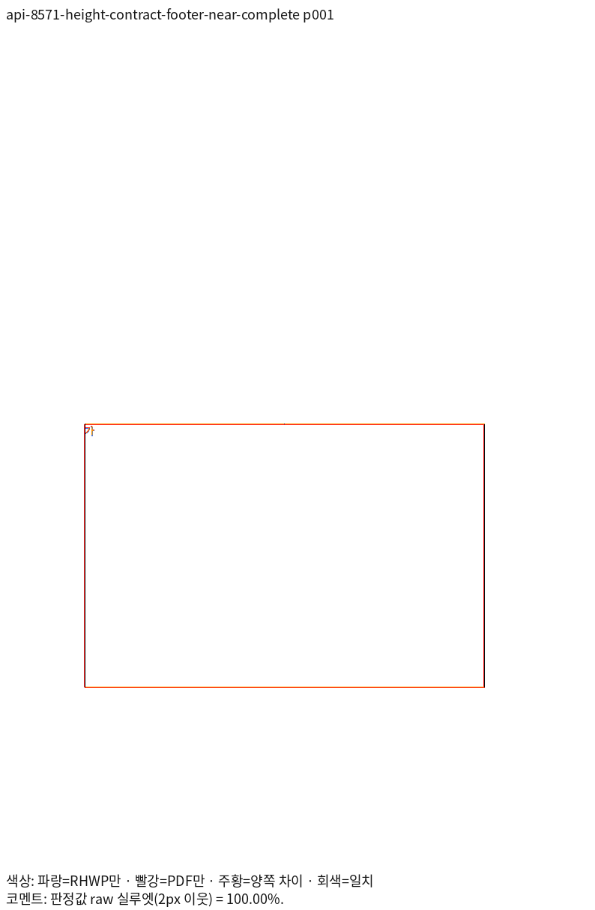

# 머리말·꼬리말 표 높이의 독립 기대값 재검토

기존 회귀 `007cd428c7821f91bb82631fac659fda5ae3a93f`는 측정 표가 없던 경로에서 `common.height`가 셀 높이의 2배 미만이거나 내용이 셀을 키우면 개체 높이를 따른다는 임시 가정을 고정했다. PR #8571 이후 공통 측정이 실제 셀·내용 높이를 전달하면서 기존 두 기대값 200px·357.24px가 실패했다. 정확한 기존 검사를 완화한 것으로 처리하지 않고 독립 Print로 이 가정부터 확인했다.

## 합성 계약과 독립 Print

옛 메모리 생성기는 글자 모양이 비어 있고 여러 줄의 text_start가 모두 0인 상태였다. 정상 문서의 DocInfo를 공급하고 줄마다 명시적 개행·정확한 문자 경계·보이는 괘선을 가진 합성 HWPX를 만들었다. 원 법제처 문서를 검증한 것으로 표현하지 않는다. 각각 같은 바이트를 MCP 2020의 PrintMethod=0, 한컴 PDF 드라이버 one-up 경로로 출력했다. 입력·PDF·양쪽 producer·TSV SHA는 [대응표](../validation-r6/measurements.md)에 있다.

머리말·꼬리말 각각 stale(셀 1982HU/개체 56850HU), near(26355/26793HU), grown(284/15000HU·3줄)을 비교했다. 여섯 입력은 각각 전 1쪽 Native/fresh WASM raw 100.00%, 쪽수 일치다. 실제 measured 제품은 셀 최소 높이 26.4267·351.4 CSSpx와 내용으로 커진 48 CSSpx를 사용하며, Print와 일치한다. 테스트는 이 숫자를 절대 좌표로 고정하지 않고 원본 최소 크기·개체 선언과의 비율/대소·글줄 포함·내용 순서를 검사한다.

처음 footer-near는 양쪽 100%여도 쪽 밖에서 하단이 잘려 독립 높이 판독 근거가 불충분했다. 원 진단은 output에 보존하고, 아래 여백 40000HU를 명시한 footer-near-complete를 별도로 출력해 표 전체를 확인했다. 이 여백 변경을 기존 입력에서의 제품 개선으로 주장하지 않는다.

비-TAC 거대 높이의 상충 합성 진단 두 개는 시각 미달이어서 정상 출력 근거로 사용하지 않는다. 대신 실제 공개 API 생성본 `non-inline-header-table.hwp/.hwpx`의 각 전 1쪽 Native/fresh WASM 100% 증거와 소속·내용 포함을 유지한다. 비-TAC 동작 전체를 보증하거나 옛 758px pin을 정당화하지 않는다.

## 판독과 회귀

머리말 세 줄의 끝·외곽과 꼬리말 큰 셀의 시작·하단을 같은 입력·Print의 review/overlay에서 직접 확인했다. 정확히 같은 픽셀이라는 뜻은 아니며 raw는 2px 이웃을 허용한다. 새 검사는 독립 Print가 확인한 의미 관계를 보호하고 특정 시스템 글꼴 설치에 의존하지 않는다. 파일 첫머리에 실제 측정일·직전 Git 변경 시각·제품 SHA·증적을 구분했다.

이 증거의 제품은 `a314d7a24d3234305abff43149f575853db31105`다. 이후 실제 배치 보정 제품의 최종 통합 검증을 대신하지 않으며 해당 원본도 후속 최종 검증 목록에 포함한다.

최소 글꼴 5개 격리에서 [관계 회귀 4건](../validation-r6/runtime-checks.md)은 모두 PASS였다. 원본 선언·내용으로 정한 기대 관계를 사용하며 제품의 높이 계산 helper를 다시 호출해 기대값을 만들지 않는다.
