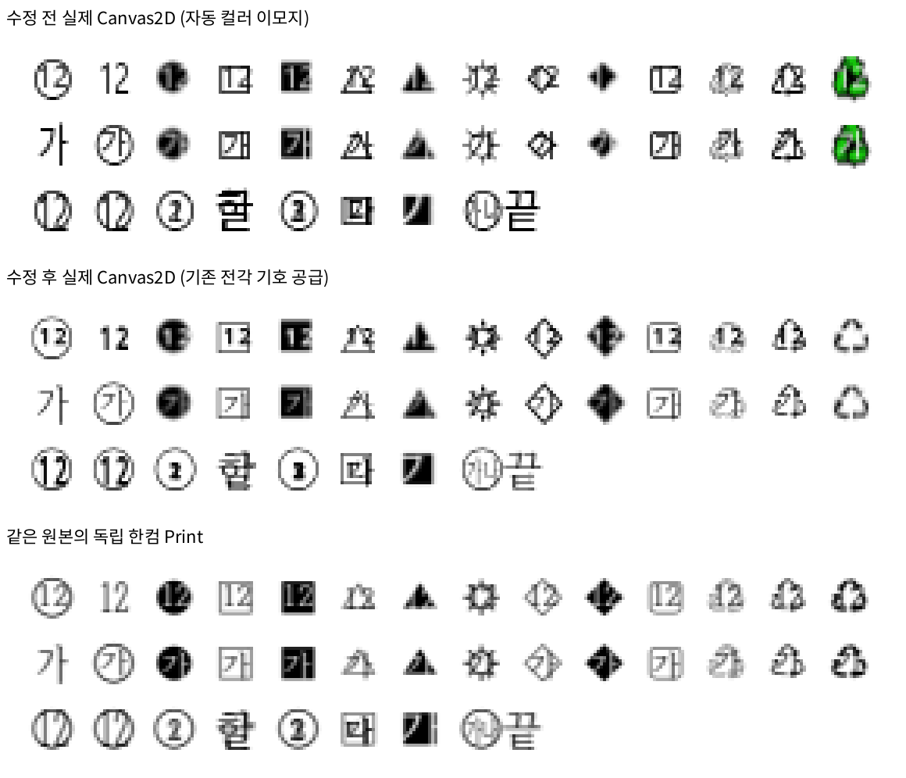
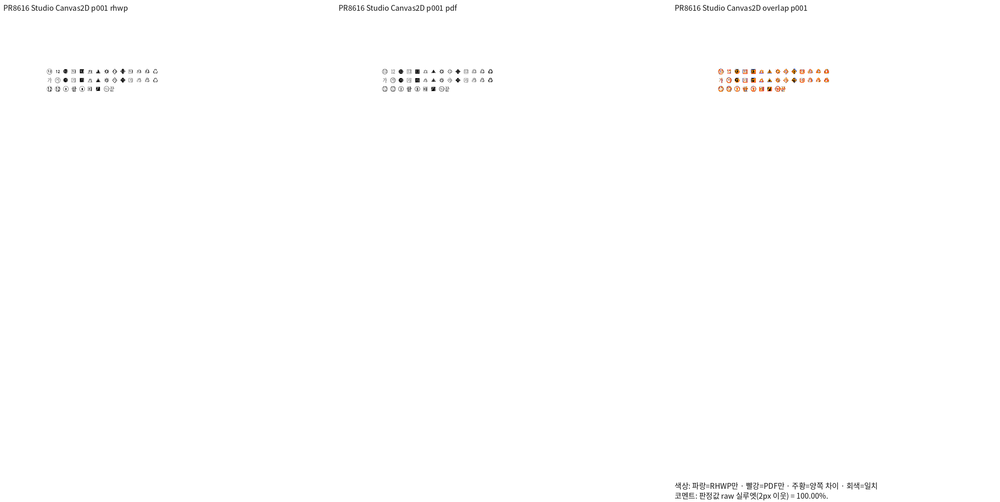
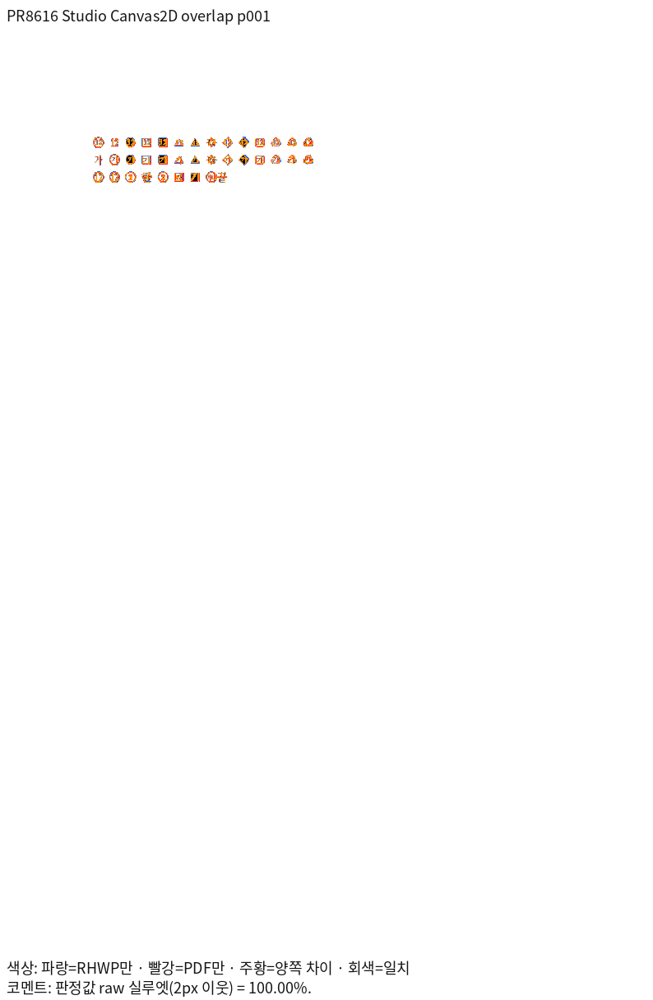
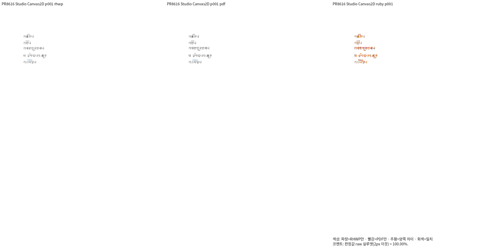
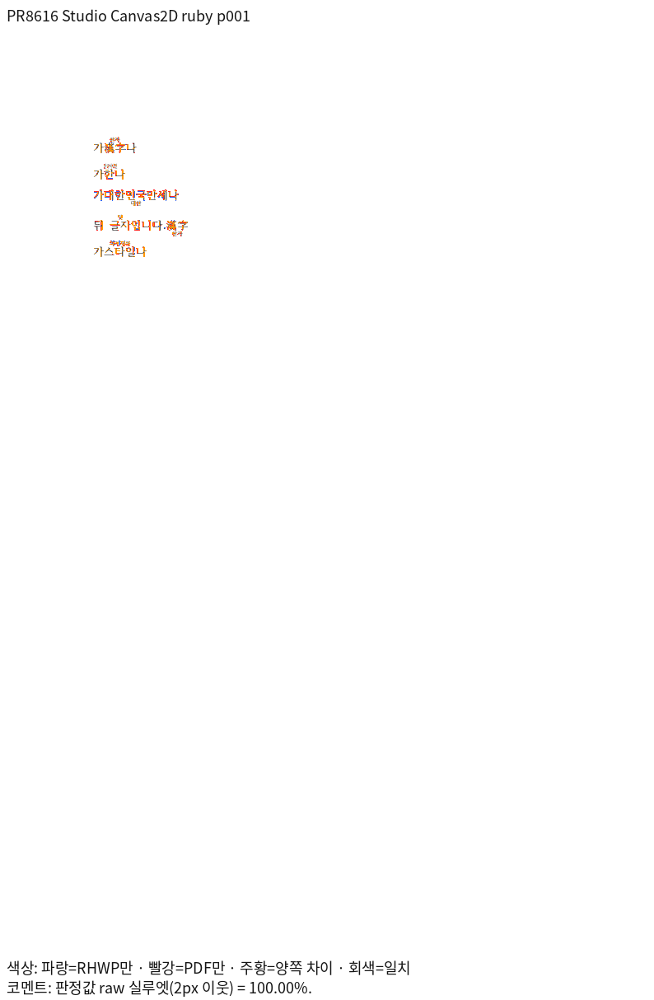
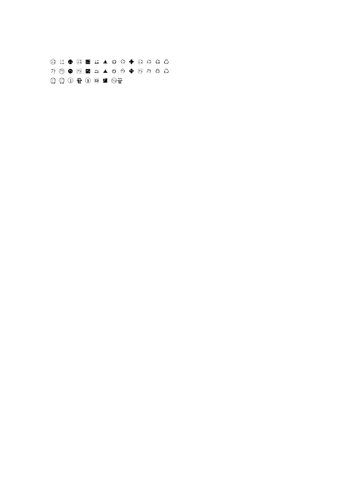
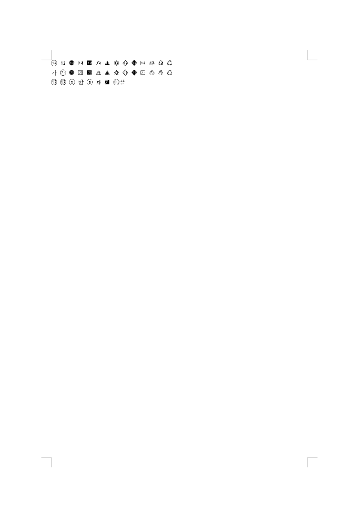
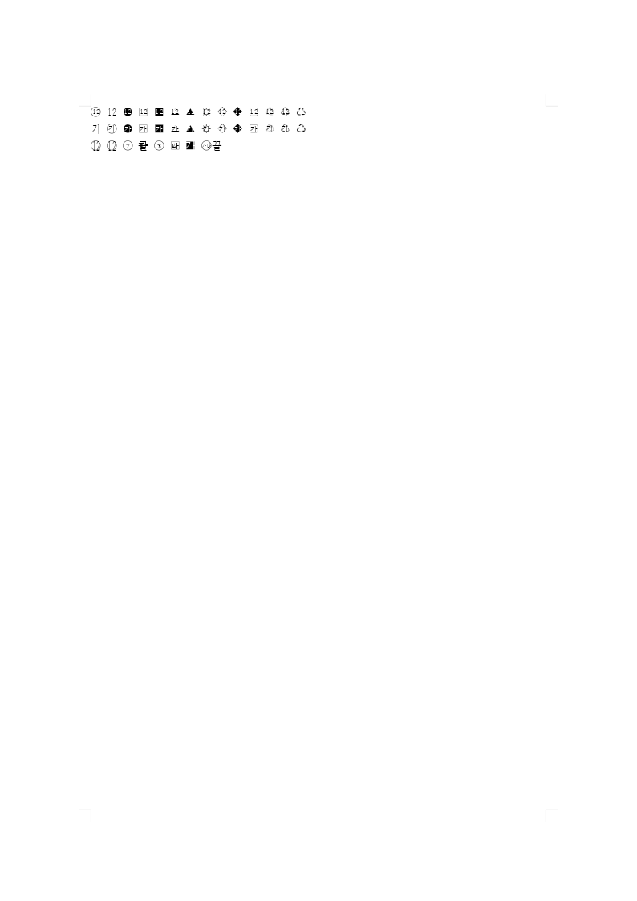

# PR #8616 실제 Studio 화면 확인

같은 원본·독립 Print의 전체 1쪽을 실제 Studio Canvas2D print 프로필로 비교했다.
최종 R8 소스의 Canvas2D, CanvasKit compatibility/default × screen/print 12캡처는
실제 backend/profile·최적화 WASM SHA를 확인했다. 겹침 6캡처의 색상 픽셀은 모두 0,
원래 파란 덧말 6캡처는 색상을 보존했다. 기호 크기가 작았던 R7 자료는 최종 증거로 재사용하지 않았다.

[생산→실제 소비·원인·관계형 회귀](../canvas-symbol-fallback-analysis.md)를 연결한다.
직접 WASM PNG exporter와 실제 Studio 캡처를 구분한다. 전체 페이지는 같은 96 DPI이며
쪽수는 두 원본 모두 독립 PDF와 1쪽으로 일치한다. 원시 캡처를 crop·이동해 점수를 맞추지 않았다.

| 같은 원본·쪽 | 실제 Canvas2D raw | 전체 TSV | review·overlay |
| --- | ---: | --- | --- |
| overlap 원본 HWPX · 1쪽 | 100.00000% | [원문](overlap/silhouette.tsv) | [review](overlap/review_001.png) · [overlay](overlap/overlay_001.png) |
| ruby 원본 HWPX · 1쪽 | 100.00000% | [원문](ruby/silhouette.tsv) | [review](ruby/review_001.png) · [overlay](ruby/overlay_001.png) |

## 직접 확대 판독

기존 원본의 전각 테두리와 같은 크기·단색을 기존 함초롬바탕 공급에서 소비한다. 앞뒤 글자·
다른 모양·내용 순서·덧말의 파란 본문을 유지했다. 모양의 획 농도·브라우저 hinting 차이는
raw와 구분하며 모든 backend가 픽셀 단위로 같다고 주장하지 않는다.

같은 내용 잉크에서 얻은 공통 bbox를 수정 전·후·PDF에 동일 적용한 4배 최근접 확대다.
정렬·획·색상을 바꾸지 않았으며 점수 산출에는 crop을 사용하지 않는다.

## overlap · 실제 1쪽

## ruby · 실제 1쪽

## 통합 PR의 실제 backend 화면

같은 겹침 HWPX 1쪽이다. Native 실제 binary·WASM SHA와 원본/PDF 신원은 기존 정식 기록을 따른다.

| Native Skia print | Studio Canvas2D screen | Studio CanvasKit software screen |
| --- | --- | --- |
|  |  |  |

## 보존과 후속 코멘트

통합 완료 후 PR #8616 기존 코멘트에는 같은 두 원본 1쪽의 review·overlay·TSV·확대판독과
위 실제 backend 화면을 사용한다. 원 기여와 추가 메인터너 글꼴 후보 보정을 구분한다.
원본·PDF SHA와 직접 exporter Native/fresh WASM 전쪽 TSV는
[기존 정식 측정](../validation-r6/measurements.md)을 연결한다. 새 글꼴 파일·프로그램을 추가하지 않았다.

- `canvas2d-screen.png`: SHA-256 `74f874ac63b40cb08d5899ff84a6d89108609844fd24777fb05f99a518c41985`, 15496 bytes.
- `canvaskit-software-screen.png`: SHA-256 `d65272d1f7e695166e3f37f7fb2ea17cc8c9289ff50b259770f39650584bc9cc`, 13475 bytes.
- `monochrome-detail.png`: SHA-256 `6cb1c416b1c0f7082692ea047989b2cb9766d33b6e03c014fea11c985270e906`, 65196 bytes.
- `native-print.png`: SHA-256 `4dac030da7db6ee86a4b1beab06e457bea0a3aeb8a1a18c5aece8ac6de837af2`, 29285 bytes.
- `overlap/overlay_001.png`: SHA-256 `f4ec56bd63fc8b617c853290ff69ab2265a4b8e4f74553879c9cffe3358b19c8`, 35017 bytes.
- `overlap/review_001.png`: SHA-256 `a91fbf59158a8262e6cf53d86a164fae9fd82413d84ab0afb58752ff4c689df9`, 65148 bytes.
- `overlap/silhouette.tsv`: SHA-256 `75764217b6231001246ab7d8b934bdc683297f16bd9ca4c983fffc90aa768466`, 132 bytes.
- `ruby/overlay_001.png`: SHA-256 `08896139c679c180235edef4dc030b2a6d67da500c5992ce6d54a883fd9212b4`, 34111 bytes.
- `ruby/review_001.png`: SHA-256 `71d14a2395ba0b0f1ceb28c330a34c574213188aa232a4e2edc9397fc0505d4c`, 58436 bytes.
- `ruby/silhouette.tsv`: SHA-256 `75764217b6231001246ab7d8b934bdc683297f16bd9ca4c983fffc90aa768466`, 132 bytes.
