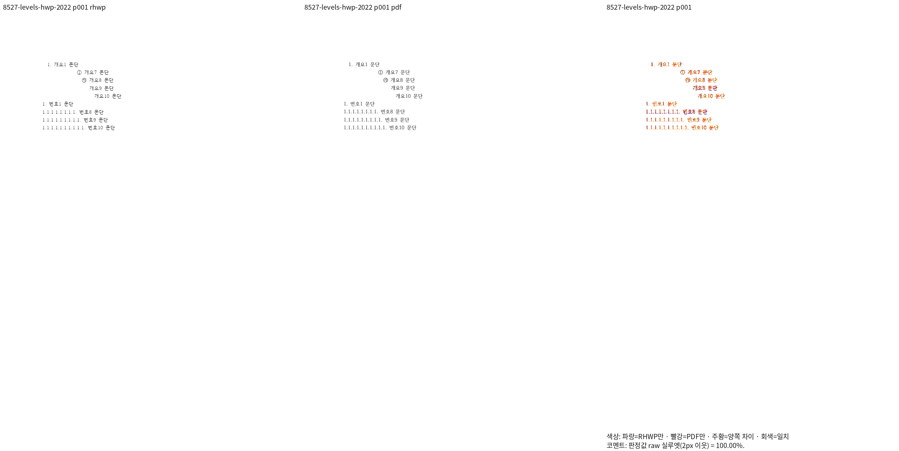
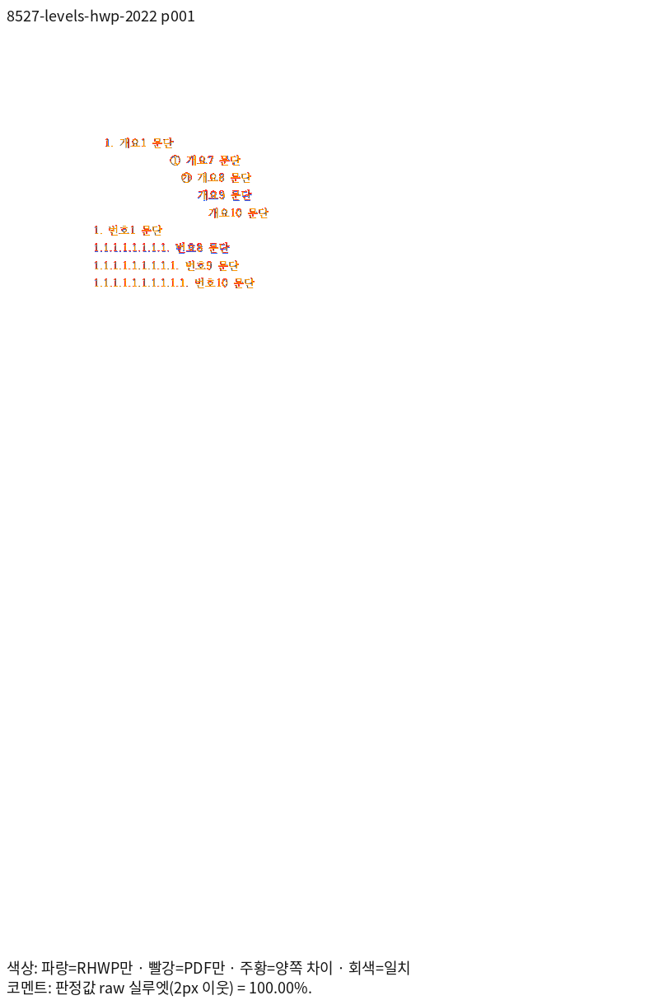
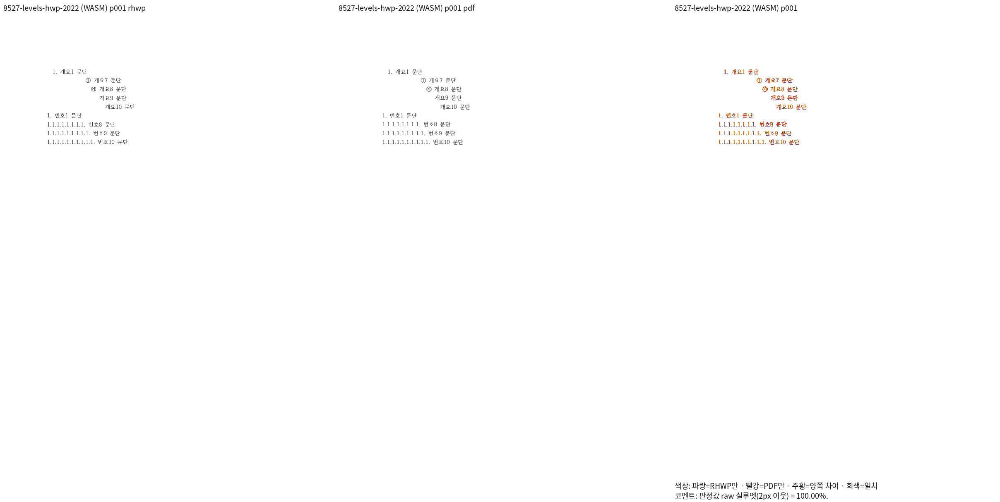
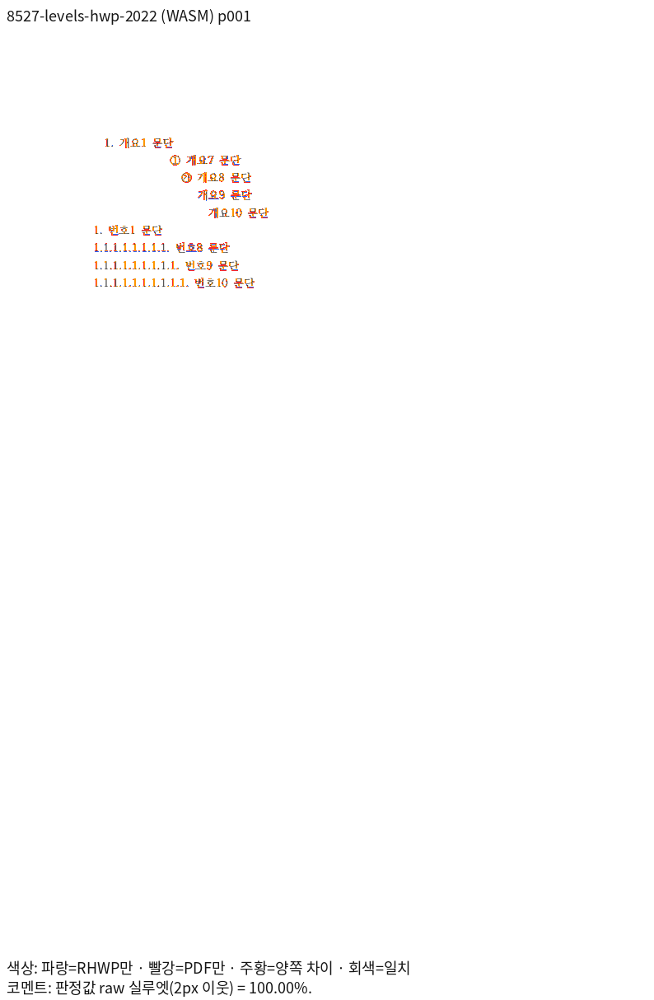

# 빈 번호 머리의 본문 간격 보정: Native·fresh WASM 확인

제품 보정은 `86709ac16711820e61baa3b87e2c4ddaac23573e`다. 실제 Native 빌드 HEAD는 문서·증적 커밋 `1da15804ebb5d6fc8f63b7ccb8410018bd42c29d`이며 제품 소스가 같은지 별도로 확인했다. 최종 전체 검증 완료 기록이 아니다.

[원인·사양·소비 경로 분석](../../empty-numbering-head-analysis.md)에 따라 빈 번호 문자열에서도 원본 `MarkerHead.text_distance`를 측정과 실제 배치에 함께 반영했다. 빈 마커의 TextRun은 만들지 않는다.

| 같은 원본, 전 1쪽 | 보정 전 Native | 보정 후 Native | 보정 전 fresh WASM | 보정 후 fresh WASM |
| --- | ---: | ---: | ---: | --- |
| `tests/fixtures/numbering_levels/levels.hwp` | 95.17% | [100.00000%](8527-levels-hwp-2022-native.tsv) | 95.65% | [100.00000%](8527-levels-hwp-2022-wasm.tsv) |
| `tests/fixtures/numbering_levels/levels.hwpx` | 95.17% | [100.00000%](8527-levels-hwpx-2022-native.tsv) | 95.65% | [100.00000%](8527-levels-hwpx-2022-wasm.tsv) |

보정 전은 R5 제품 `71e5e0ae2a72a6b8f51682d131077bd4df44994f`이다. 보정 후는 같은 독립 한컴 Print PDF를 재출력하지 않고 사용했다. 정본 Visual Sweep Print 프로필·96 DPI·PDFium·색상 경계 보정 전 2px raw 측정이며 원본과 PDF의 전체 쪽수는 모두 1쪽이다. 실제 입력·PDF·PNG 해시와 producer는 [Native 판독 기록](native-after-reading.json)에 연결했다.

HWP의 review·overlay를 함께 열어 개요 9·10수준 본문 시작, 기존 가시 번호 7개, 아래 번호 1·8·9·10수준의 순서·간격을 대조했다. HWPX의 새 실제 RHWP PNG와 독립 PDF raster는 HWP와 각각 해시가 같아 동일 영역 판독을 재사용했다. 100%는 2px 실루엣 지표이며 완전한 픽셀 일치를 뜻하지 않는다.

최소 글꼴 5개만 노출한 환경에서 기존 집중 회귀 [184건 모두 통과](focused-tests.txt)했다. 같은 원본의 상대 거리 비율·가시 마커 수 검사도 보정 전 HWP/HWPX 2건 실패에서 [보정 후 2건 통과](minimal-after-tests.txt)로 바뀌었다. 이 상대 거리 검사의 기대값은 원본 단위에서 정한다. 추가로 본문 거리를 0으로 둔 입력 개입 대조군 2건도 통과해, 원본 2건과 합쳐 [4건이 모두 통과](minimal-after-with-zero-controls.txt)했다. 입력 개입은 `set_document`로 번호 머리·스타일의 파생 상태까지 다시 만들었으며, 이 거리 0 대조군을 독립 Print 시각 측정 결과로 주장하지 않는다. 이후 같은 원본의 fresh WASM도 100.00000%와 직접 판독을 완료해 정식 회귀에 반영했다. `numbering_levels_eight_to_ten.rs`의 기존 3건을 유지하고 관계·대조군 4건과 독립 Print 좌표 1건을 추가했으며, [최소 글꼴에서 8건 모두 통과](registered-regression-minimal.txt)했다.

같은 페이지의 Native/fresh WASM 양쪽 raw가 100.00%이고 직접 확대 판독도 완료돼, [독립 Print에서 추출한 본문 시작 좌표](independent-print-origins.json) 2개를 ±1 CSSpx로 보호한다. 원본 단위의 간격 관계와 본문 순서·누락·중복 검사도 함께 유지한다.

[WASM 실제 판독과 producer 교차 확인](wasm-after-reading.json)에는 정본 원문 실행과 별도 export+PNG-pair의 두 raster 해시가 같고 HWP/HWPX의 두 raster도 각각 같음을 기록했다.

남은 항목은 R6 통합 후보의 전쪽·보호 PR 비교와 전체 필수 검증이다. R5의 전체 Rust 통과를 R6 결과로 쓰지 않는다.
