# seo-rii P111–P116 로컬 검증 원장

## 정확한 소스와 수용 범위

- 접수 기준 devel: `5f4e95c187f64116f48f710c3c048162786c1c14`.
- 최종 검증 기준 devel: `411d4a91fd692f88fdeebd6b323eca0b295318b1`.
- 원 head 6개·순서와 담당: [누적 검토 계획](../../archives/seo_rii_20261110_review_impl.md).
- 원 head를 모두 보존한 초기 제품 소스: `4f6bc33f8e3940947f3d942cdb3af26bb1d6f7cb`.
- 승인한 Mac 제외: `1bfa7b298272249ef533310ea4f07ade944e2e09`.
  Mac native plugin 전체는 기준 devel과 같다. 새 Mac 타일 구현은 #8701 후속으로 남긴다.
- 승인한 Linux 인수 확인 보정: `9e02baf1a17fbd8c8b57eb44e3890e5c2325c32d`.
  `Shared::submit`과 group 인수 상태가 소유권 이전 전에 고유 ID 목록을 마련하고,
  같은 lock의 stamp·serial·receipt를 `status_value`가 submit/status에 직렬화한다.
- 최신 devel 통합 제품 소스: `857594293fc7d8e8aec83fcc13a0b40a32a8f037`.
  #8899의 삭제 서식 보정 17줄을 보존했다. 최소 글꼴 파일 시스템 격리에서 기존 정식 회귀
  `regression_suite_022`의 #8863 8개가 모두 통과했다. 원본의 유효 글자 모양과 삭제·치환·저장
  재열기 관계를 검사하며 현재 후보와 새 base의 Rust/Native 입력은 같다.
- Rust parser·조판·paint·Native 생산자·ABI·WASM 코드는 기준 devel과 같다. Flutter 소비 경로를
  실제로 검증하며 공통 생산자 수정이나 편람 조판 개선을 주장하지 않는다.

이 문서는 실행한 최종 사실을 보존한다. 원시 API JSON·빌드 영수증·로그·raw RGBA는
ignored `output/pr-review/seo-rii-20261110`에만 두며 최종 댓글에 사용할 대표 PNG만 포함한다.
로컬 검증 뒤 작업지시자의 원격 처리 승인을 받아 [통합 PR #8907](https://github.com/edwardkim/rhwp/pull/8907)을 `0f91d29ca81f00be3d5adb91857875b40ec5e355`로 머지했다. 원 PR 6건은 모두 MERGED다. 아래 증적은 제출한 정확한 code head `6e2a37ea860aba30ecc80b14758f25ebb534683a`와 같은 제품 입력의 결과다.

## 환경과 Native 입력

Flutter 3.47.9, framework `c197ca5199e9ee5661e865596c9c07294dfab51c`,
engine `89c39edfdfae2949f6806e4a315c0c08522238b7`, Dart 3.13.7이다.
Linux는 Ubuntu 24.04 WSL과 실제 GTK/X11 compositor를 사용했다. 임시 Xvfb는 별도 mount
namespace의 socket을 사용하며 호스트 WSLg 설정은 바꾸지 않았다. 실제 GL renderer는
`llvmpipe (LLVM 20.1.2, 256 bits)`, GLES 3.2 Mesa 25.2.8이다.

```sh
CARGO_TARGET_DIR=/home/edward/mygithub/rhwp/target/pr-review CARGO_BUILD_JOBS=6 \
  cargo build --locked --manifest-path bindings/Native/Cargo.toml \
  --features native-skia-gl --release
```

Native 빌드는 초기 제품 소스 `4f6bc33f8e`에서 exit 0, 1195.19초다. 실제 라이브러리 SHA-256은
`397223df7aa3ff9a2a622651d4c01210b3c02aa9f906897f66c30568e6868424`다. 이후 Mac 제외와 Linux
소비 보정은 Rust/Native 입력을 바꾸지 않았다. 이 라이브러리를 새 source에서 다시 빌드했다고
쓰지 않고, 동일한 생산자 입력과 실제 새 소비 plugin을 연결해 실행했다.

최신 devel 통합 뒤에는 위 초기 라이브러리로 완료를 대신하지 않고 아래 명령으로 Native·CLI를
다시 빌드했다. source `857594293fc7d8e8aec83fcc13a0b40a32a8f037`, exit 0, 392.73초다.
`release-test`는 저장소의 최적화 로컬 검증 profile이며 LTO false·codegen units 16이다.
빌드 profile 차이를 성능 개선으로 해석하지 않는다.

```sh
CARGO_TARGET_DIR=/home/edward/mygithub/rhwp/target/pr-review CARGO_BUILD_JOBS=6 \
  cargo build --locked --profile release-test -p rhwp -p rhwp-native-ffi \
  --features native-skia-gl
```

- 실제 새 Native SHA-256: `e6b4a6b42dd517e2b3811042dbe1e5d686569eee9aecfe52545a43ffee172f70`.
- 실제 새 CLI SHA-256: `ff6d3ae51fe77764723bc3a311a700118c78768deb4561bdf6e832d9301d3441`.
- 아래 최종 다중 페이지 4단계·복구/수명 5단계·두 타일 3단계와 이동 bundle은 모두 이 새
  Native와 같은 source의 새 GTK runner로 재실행했다. 대표 PNG도 이 최종 캡처에서 다시 생성했다.
  초기 source의 캡처를 새 빌드 결과로 바꿔 표시하지 않았다.

## 실제 GPU 인수·표시·수명

| 범위 | 실제 결과 |
| --- | --- |
| #8869 보정 전 | 실제 6쪽 문서의 첫 snapshot `[2,3,4]` 인수 후 목록이 누락돼 `ambiguousOwnership`. wire 추적을 포함한 2회 재현 |
| #8869 보정 후 | 실제 `NativePagedDocumentView`의 1–3쪽·3–5쪽 GPU 표시, 전체 ID receipt·full source check·같은 editor owner·CPU 출력 대조 통과 |
| #8870 두 타일 | 4098×480 초기·편집 revision 1·4097×496 resize의 실제 GTK 표시 3회 통과. 보정 전후 해당 compositor RGBA 3쌍이 모두 동일 |
| #8871 명시적 복구 | mount를 유지한 close 확인 뒤 `NativeGpuSession.recover()`로 새 controller·새 texture ID를 연결하고 같은 문서·editor에서 다중 페이지 게시 통과 |
| #8872 lifecycle | 숨김·재개 이벤트를 주입한 실제 controller에서 숨김 중 새 submit 정지·재개 후 게시 확인. X11의 실제 창 크기 800×1000→840×1040 변경 뒤 같은 geometry/stamp의 GPU·CPU 출력 확인. 별도 GDK scale 2 시작에서도 실제 DPR 2·1200×1600 출력의 여러 페이지와 CPU 대조 통과 |
| #8873 진단 | 최종 실제 두 controller에서 각각 producerReady 2회, ring 32개 유지·199/138개 축출, 계측/observer 오류 0. 실제 trace에 경로·원문·snapshot ID가 없음을 확인 |
| 종료 | 두 타일과 다중 페이지·복구 실행 모두 등록 해제·종료 확인 뒤 Native 자원 계수 9개 전부 0 |

다중 페이지 GPU/CPU 대조는 600×800 화면이다. 최초 화면의 정확히 같은 픽셀은
476,907/480,000, 이동 후는 477,296/480,000이며 채널 ±1 이내는 각각 478,529와 478,033개다.
같은 페이지·물리 원점과 내용 위치를 직접 판독했다. 이 값은 한컴 PDF raw 실루엣 점수가 아니며,
CPU/GPU 전체 픽셀 동일성으로 바꿔 쓰지 않는다. 그림 외곽·방향·종횡비·여백·페이지 간격에
새 누락·중복·이동은 보이지 않았다. 그림 위 tiny label의 래스터화 차이를 보존한다.

실행 입력은 기존 공개 `tests/fixtures/gradient/radial-corner-print-contract.hwpx`와
`bindings/Flutter/test/fixtures/desktop-consumer.hwpx`다. radial 문서 하단의
`inline-object affinity is not supported by scalar interaction positions`는 CPU/GPU 양쪽에
같이 표시되는 해당 입력의 scalar interaction 제한이다. 이를 GPU 오류로 분류하거나 숨기지
않으며 이 그림 중심 문서의 본문 편집 지원 완료를 주장하지 않는다. 실제 Native 입력·IME
연동의 별도 6개 검사와 GPU 소유·배치 검증을 구분한다.

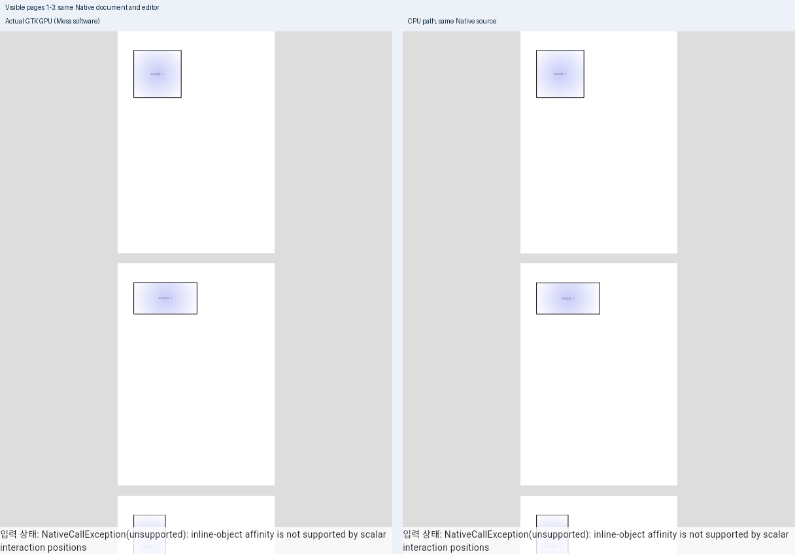

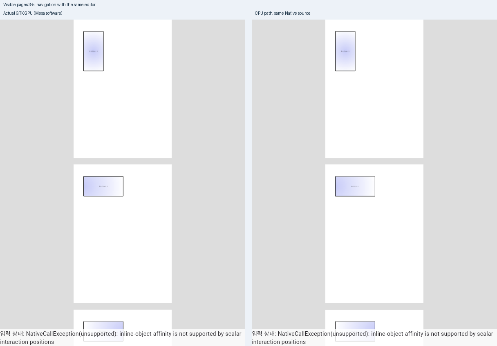

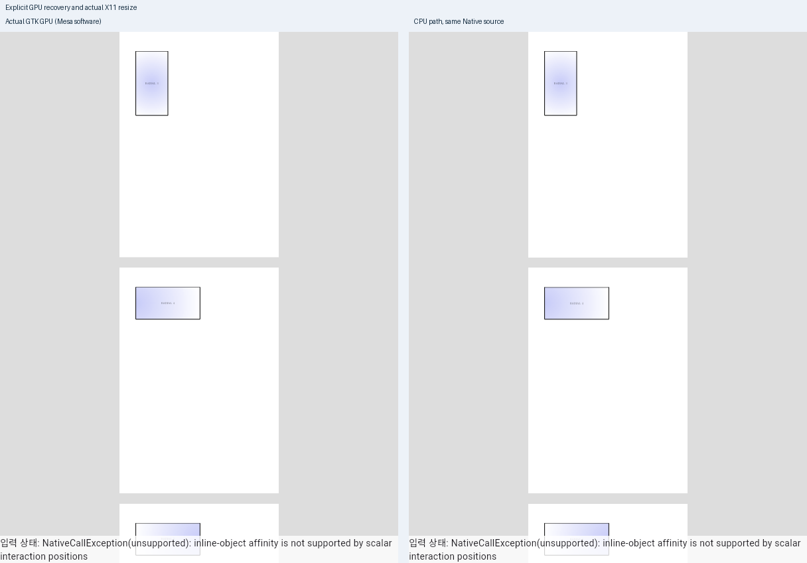

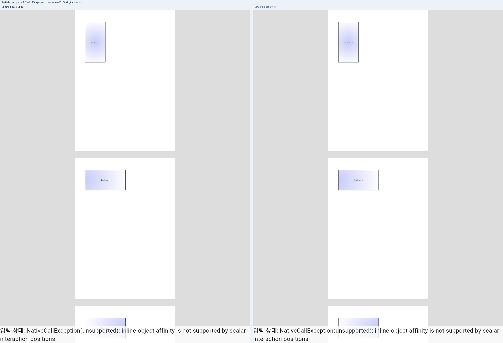

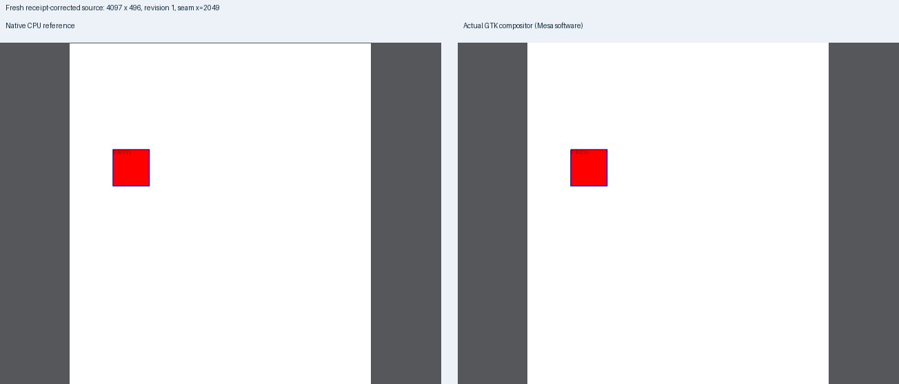

창 resize의 첫 진단 실행은 resize를 받은 뒤 이전 크기를 저장하는 probe 순서 때문에 대기
시간 초과였다. 제품은 이미 새 frame을 게시했다. 관측 순서를 고친 최종 probe에서 5단계·exit 0과
자원 해제를 확인했다. 생성 runner의 검증 metadata 경로 보완도 제품 수정과 구분했다.

`hardwareAccelerationVerified:false`, `consumerGpuCompletionVerified:false`는 유지한다.
실제 X11 resize와 widget lifecycle 신호 주입을 OS 최소화·다중 모니터 DPR 변경·실제 장치 상실·
물리 GPU 성능·소비 완료 fence 검증으로 확대하지 않는다.

DPR 2 별도 실행은 GDK의 실제 시작 배율이며 모니터 이동을 주입한 결과는 아니다. 같은
논리 viewport 600×800을 물리 1200×1600으로 표시했고 최초·이동 후 GPU/CPU의 페이지·원점이
같았다. 동일 픽셀은 1,914,124/1,920,000 및 1,914,563/1,920,000이며 종료 후 Native 9개 계수는
모두 0이었다. 물리 좌표 변환이 한 번 적용되는지 실제 출력으로 확인했다.

## 계약·SDK·번들 검사

| 검사 | source와 결과 |
| --- | --- |
| Dart format·package/example analyze | 초기 `4f6bc33f8e`의 변경 파일·package/example 모두 exit 0; 보정 후 `9e02baf1a1` package analyze도 exit 0 |
| 전체 Flutter 계약/위젯 | 초기 및 보정 후 각 269개 통과, 실제 Native 입력이 없는 6개는 명시 skip |
| 실제 Native 연동 | 최종 source `857594293f`의 fresh Native·owner로 최소 글꼴 격리에서 document lifecycle/file store/IME/multipage/oracle 6개 별도 통과, skip 0, 13.61초. 합계 275개를 확인했으며 skip을 통과로 세지 않음 |
| Linux 공통 C++ | 보정 후 `check_linux_plugin.py`의 18 cases/292 checks와 tile helper 4 cases/25 checks 통과 |
| 새 receipt 음성 대조 | 격리 사본에서 단일 target receipt commit만 제거하면 컴파일 성공 뒤 새 인수 목록 assertion에서 실패 |
| 실제 Linux SDK/GLES | 보정 후 public header compile/link·GLES state handoff 모두 exit 0, 12.42초 |
| Windows portable | frame 8/51, immutable ownership 12/4224, close 6/1683, tile 4/25, disabled ABI와 실제 production group 오류 35조건 통과 |
| 실제 Windows SDK | VS 2022/MSVC/Windows SDK·고정 Flutter Windows public header/wrapper로 현재 plugin 3개 단위와 등록 코드의 엄격 compile/link exit 0, 12.82초. 해당 Windows 입력은 최종 보정과 같음 |
| 타일 qualification 계약 | `native_gpu_tile_qualification_contract.py` 4개 통과 |
| 번들 Python/Dart FFI fixture | Python 11개, 실제 owner+C ABI fixture의 정상 연결·지원 불가·잘못된 ABI 3경로 통과 |
| 최종 실제 이동 번들 | 제품·Native·owner source `857594293f`의 새 산출물을 포장. 공백이 있는 새 경로로 이동하고 원 staging 삭제 후 실제 Native open/render/snapshot/release/close 통과, 6.78초·계수 9개 전부 0 |

번들 smoke는 `/proc/self/maps`의 실제 이동 라이브러리 경로와 256×256 RGBA 두 번의 동일 hash
`6113a54f50d27ae17181184398a44a646992de2367641e48e72dcdf95cb4b7f8`를 확인했다.
원래 공유 target의 Native 라이브러리는 보존했다. 이동 bundle의 GTK runner 실행까지 수행한
검사로 바꾸지 않는다. 별도 실제 GTK 검증은 위의 새 source runner 실행이다.

실제 이동 root에서 반환한 256×256 RGBA를 추가로 보존하고 같은 hash·해제 결과를 확인했다.
아래는 그 Native frame을 2배로 표시한 이미지이며 이동된 GTK runner의 화면은 아니다.

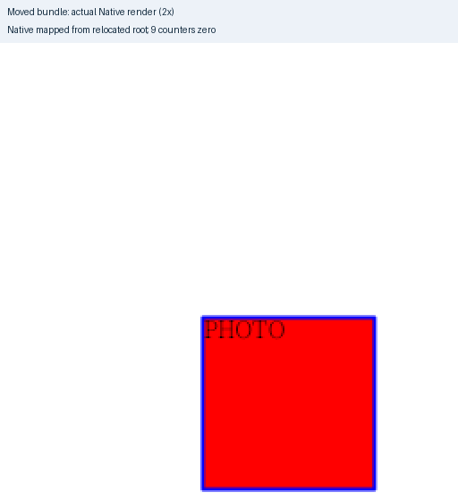

Windows SDK link 산출물 SHA-256은
`a625d7ede56acd13950b58941c1d2d670acc3a1caed731ffeb9e2bc6309ac4a2`다.
이번 후보의 실제 Windows GPU 화면을 수집한 결과는 없으며 SDK 검증을 물리 GPU 검증으로
표시하지 않는다. 새 Mac 타일 두 파일은 승인에 따라 제외했다. #536·#8701 전체 로드맵은 OPEN이다.

## 최종 fresh WASM과 전쪽 시각 검증

source `857594293fc7d8e8aec83fcc13a0b40a32a8f037`에서 아래 빌드와 wasm-opt를 끝냈다.
exit 0, 728.39초이며 최적화 전 패키지나 `--no-opt`를 완료 증거로 쓰지 않았다.

```sh
RHWP_WASM_CDYLIB_ONLY=1 CARGO_PROFILE_RELEASE_CODEGEN_UNITS=16 \
CARGO_BUILD_JOBS=6 CARGO_TARGET_DIR=/home/edward/mygithub/rhwp/target/pr-review \
  scripts/wasm-pack-locked.sh --target web --out-dir pkg --release
```

이는 개발 환경 가이드에 있는 cdylib-only 경로이며 실효 LTO false·codegen units 16이다.
기본 배포 빌드와의 크기·속도 차이를 제품 성능 효과로 주장하지 않는다.

- JS SHA-256: `cb4d7fea693a432c873a47f3cd0605b6c0cad2eb92a33523d1789eb28e0c50ed`.
- WASM SHA-256: `325c57419a5c152adb5809afbb942e428c3ae1a39225071eaabcd10e376e3b55`.
- 실제 브라우저: Chrome for Testing `156.0.8078.47`, `VISUAL_SWEEP_CHROME`으로 실행 경로 고정.
  최초 경로 자동 탐색 실패는 브라우저 실행 전 환경 오류였으며 명시 경로의 성공 실행과 구분한다.
- 최종 WASM의 실제 모델·저장 API에서도 #8863 원본의 1구역·411문단·잔여 10,456문자 전체의
  굵기·색상 관계를 확인했다. 삭제 직후와 HWP/HWPX 저장 재열기가 모두 일치했다.

Print 96 DPI, 색상 경계 보정 전 2px `silhouette_raw_match_percent`다. 각 원본·독립 PDF는
기존 커밋에 있으며 새 사본을 만들지 않았다. Native와 WASM의 전체 쪽수는 각각 PDF와 같다.

| 입력·독립 Print PDF | 전체 쪽수 | Native 전쪽 최저 | fresh WASM 전쪽 최저 | 전체 원본 TSV |
| --- | ---: | ---: | ---: | --- |
| `tests/fixtures/gradient/radial-corner-print-contract.hwpx` / `radial-corner-print-contract-2020.pdf`, compat 2022 | 6 | 100.00% | 100.00% | [Native](native-radial.tsv) · [WASM](wasm-radial.tsv) |
| `samples/issue8160/bitmap-channel-transfer-independent.hwpx` / `pdf/issue8160/bitmap-channel-transfer-independent-2024.pdf`, compat 2024 | 1 | 100.00% | 100.00% | [Native](native-bitmap.tsv) · [WASM](wasm-bitmap.tsv) |

각 radial TSV는 232바이트, SHA-256
`cdcf3e026b8de27abee1649a14fc0767bd3b6d02806046e34dcc9164c24df91f`다.
각 bitmap TSV는 132바이트, SHA-256
`75764217b6231001246ab7d8b934bdc683297f16bd9ca4c983fffc90aa768466`다.
생성 원본의 탭·개행·전체 열·행을 바이트 그대로 복사했다. 원시 manifest·로그는 커밋하지 않는다.

실제 명령은 원본별로 `--compat`를 위 표처럼 지정한다. WASM에는 같은 명령의
`--wasm-pkg pkg`와 Chrome 경로 환경 변수를 추가한다.

```sh
/home/edward/mygithub/rhwp/venv/bin/python scripts/visual_sweep.py \
  --silhouette-only --rasterizer png --dpi 96 --page-workers 2 --compat 2022 \
  --hwp tests/fixtures/gradient/radial-corner-print-contract.hwpx \
  --pdf tests/fixtures/gradient/radial-corner-print-contract-2020.pdf --key radial \
  --rhwp-bin /home/edward/mygithub/rhwp/target/pr-review/release-test/rhwp \
  --out /home/edward/mygithub/rhwp/output/pr-review/seo-rii-20261110/final-visual/native-radial
```

### 기본 출력의 devel 대조와 직접 판독

최신 base `411d4a91fd`와 후보 `857594293f`는 Flutter 소비자 및 이 묶음의 정확한 검토 파일만
제외하면 Git mode·object ID·path 86,859개가 같다. 이 동일 입력 manifest SHA-256은
`10d732cff21de9a9e45d76c19a6e64e829bca40c1229e19556be75e1757483ee`다. Rust·Native·WASM·
vendor·assets·Cargo·기존 compile-time 문서는 모두 같은 실제 생산자 입력이다. 따라서 기본
Native/Canvas 출력의 base·후보 대조에는 위 동일 생산자의 전쪽 결과를 공통 근거로 사용한다.
base를 별도로 빌드했다고 쓰지 않는다. 이 재사용은 변경된 Flutter GPU 소비 경로를 대신하지
않으며 그 경로는 위 실제 GTK·CPU 대조로 검증했다. 기본 생산자의 전쪽 하락은 0.00%p다.

추가로 통합 전 source `9e02baf1a1`의 최적화 WASM과 최종 source의 실제 브라우저 PNG 7쌍이
바이트 단위로 같다. GTK의 다중 페이지 4개·복구/수명 5개 화면도 통합 전후 같다. 새 devel의
모델 보정을 제외하거나 오래된 Native 입력으로 최종 결과를 대신하지 않았다.

전 6쪽 gradient의 내용 전체를 독립 PDF·Native·fresh WASM 같은 2배 배율로 판독했다.
외곽·종횡비·명암 중심·좌우 방향·문자 내용과 기준선·앞뒤 여백을 확인했다. Native의 글자
래스터화와 가는 테두리 AA 차이는 남지만 새 배치·내용 누락·중복은 없다. 이번 범위에 수식·첨자는
없다. bitmap의 세 회색 계조 그림 순서·색 채널·경계와 간격도 직접 대조했다. 숫자 100%를
픽셀 전체 동일성이나 다른 문서의 조판 품질 보증으로 확대하지 않는다.

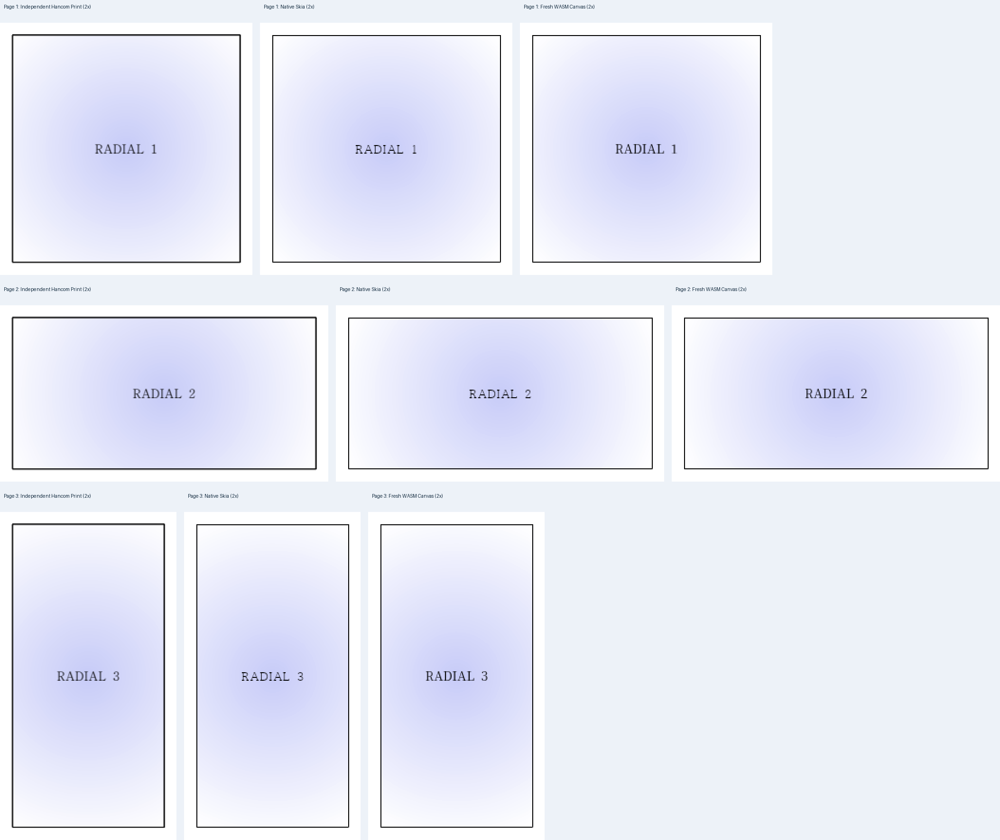

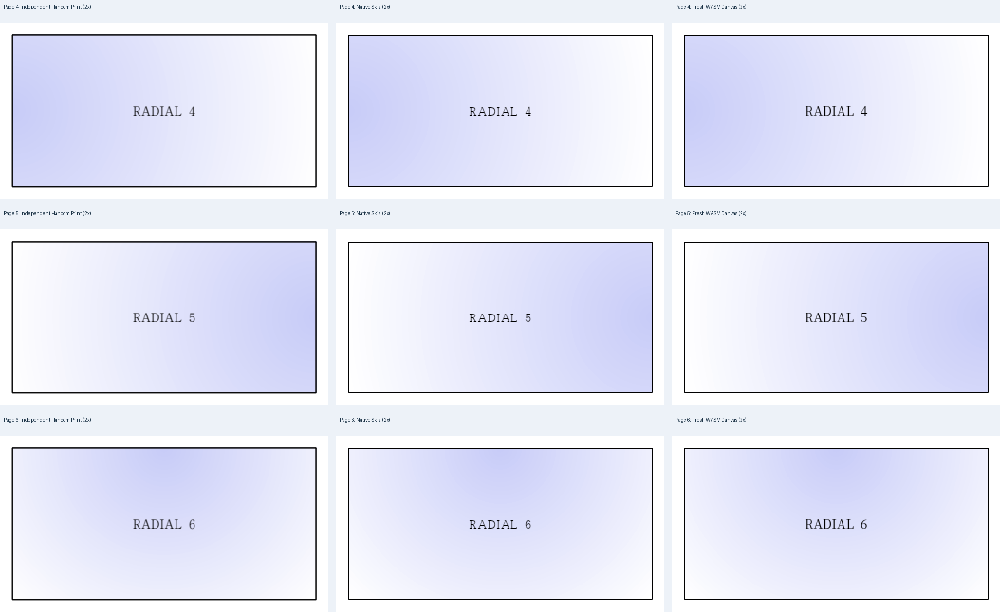

| 출력 | bitmap 1쪽 review | standalone overlay |
| --- | --- | --- |
| Native | 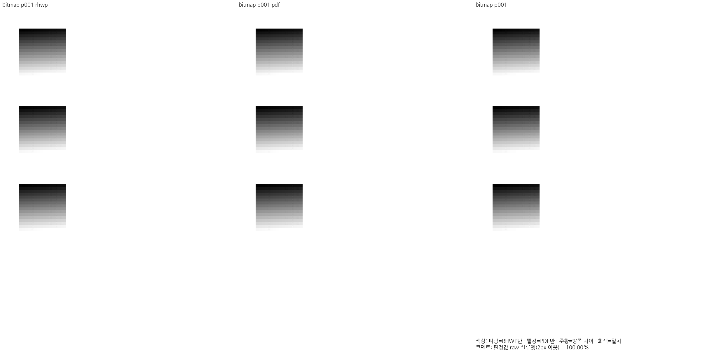 | 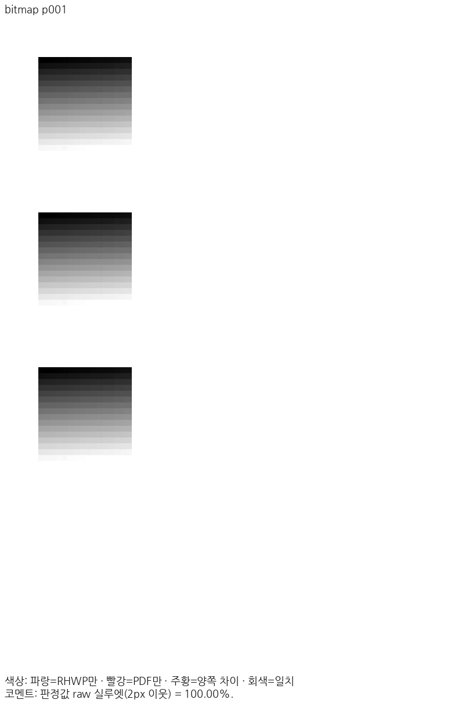 |
| fresh WASM | 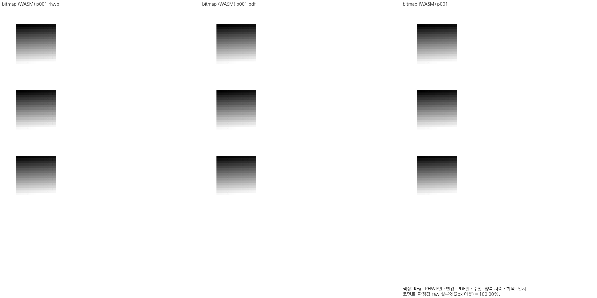 | 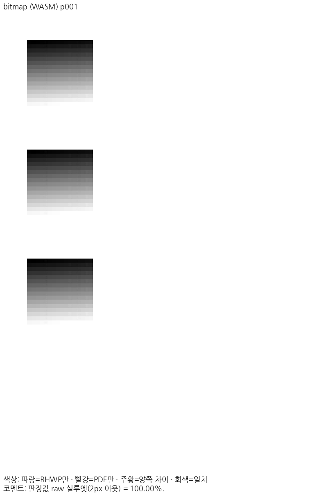 |

Native Print는 정본 Visual Sweep의 `automatic_local_and_web` 공급을 사용했다. radial의
명시적 환경 SHA-256은 `35603cc371092c337f3ce64dd3d5f25d224d76963881244037c0cf721dd52e36`,
웹 대체 registry SHA-256은 `35f3e1ac64348a6497b50cc98c7235a8adcb4c99bfa78fec6302bde6f525a299`다.
HCRDotum native program은 `9d0ccb452d2d1b3f585b0179a52be072db95b2a05cd9e47f9be76e594a15fe57`,
HCRBatang은 `2d9a6fc7545efc7eef039c1134ebead1c981bec47b5caafe3239e28b50de09ee`다.
Canvas는 시스템 catalogue 120개 중 실제 요청 `한컴바탕`·`Noto Serif KR`에 Noto Serif KR
9개 weight를 로드했다. 400 normal program SHA-256은
`78e2a43d067065fa0934765ddf27b7c051a6a43a8407c1dbf6774d3e71b489f4`다.
bitmap에는 실제 Canvas 요청·로드 글꼴이 없다. 두 backend의 공급 경로를 같은 것으로 쓰지
않으며 공급 환경은 회귀의 최소 글꼴 격리와 구분한다. 글꼴 프로그램은 새로 커밋하지 않는다.

`silhouette-only`의 자동 review 상태 `not_evaluated`와 사람의 직접 판독·최종 수용 판단을
구분한다. 전체 페이지 수치·출처·직접 판독을 확인한 로컬 결론은 [개별 review](../../archives/pr_8869_review.md)부터
원 PR별로 기록한다. 원격 CI·self-review·merge는 이후 별도 승인 범위다.

## 원격 CI와 병합 결과

- [CI](https://github.com/edwardkim/rhwp/actions/runs/42786011478)·[CodeQL](https://github.com/edwardkim/rhwp/actions/runs/42786011727)·[Adapter](https://github.com/edwardkim/rhwp/actions/runs/42786011685)·[Proptest](https://github.com/edwardkim/rhwp/actions/runs/42786011397)·[최종 정책 감사](https://github.com/edwardkim/rhwp/actions/runs/42789964690)가 제출 head에서 성공했다. 31개 check 성공·정상 skip 5개, PR ref CodeQL OPEN 0건이다.
- [공개 self-review](https://github.com/edwardkim/rhwp/pull/8907#pullrequestreview-5839510481), tested merge `74de0c72e6a86195ac9692ea4d0516a42e4b12bb`, 실제 merge `0f91d29ca81f00be3d5adb91857875b40ec5e355`. source tree 일치와 원 head 6개의 보존을 확인했고 일반 merge commit을 사용했다.
- 기존 원 PR의 Adapter 취소를 성공으로 재분류하지 않았다. 이번 통합 CI는 1회 실행으로 성공했고 workflow·보호 설정·탐지 정책을 바꾸지 않았다.
- 병합 후 duration 갱신 결과: [duration 갱신](https://github.com/edwardkim/rhwp/actions/runs/42790354529) success. 동일 head의 B/C/D/E 실제 attempt 1 자료를 확인해 `ci-metrics/nextest-target-durations`의 `a24a89464c33dba74366876c3d625fb95b365bb1`로 게시했다. 제품 검증 CI는 새로 시작하지 않는다.
