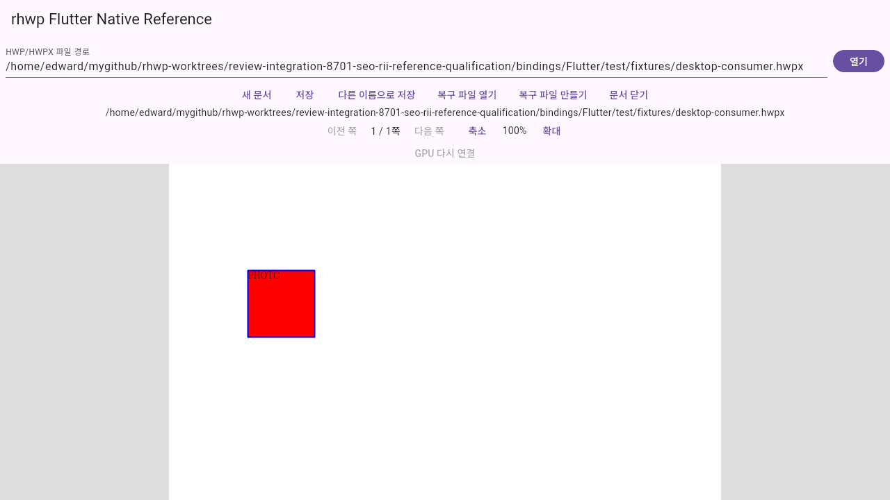
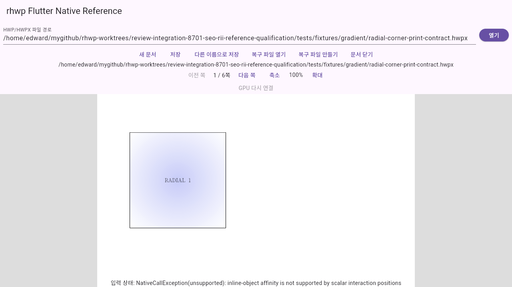
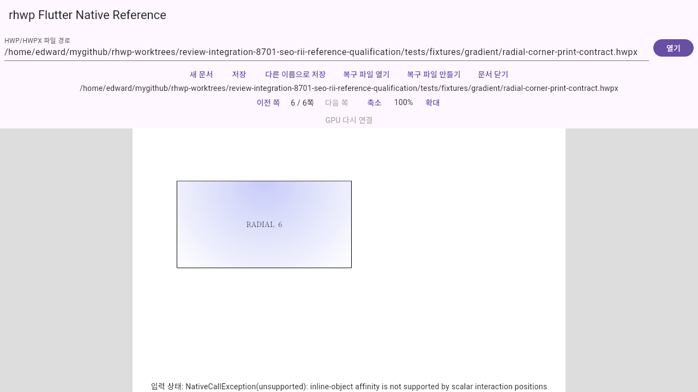
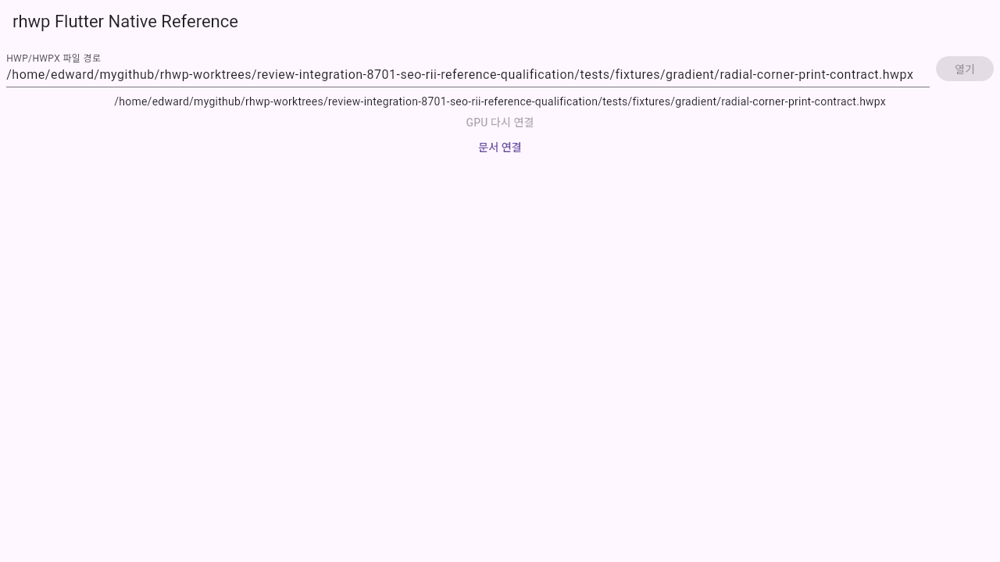
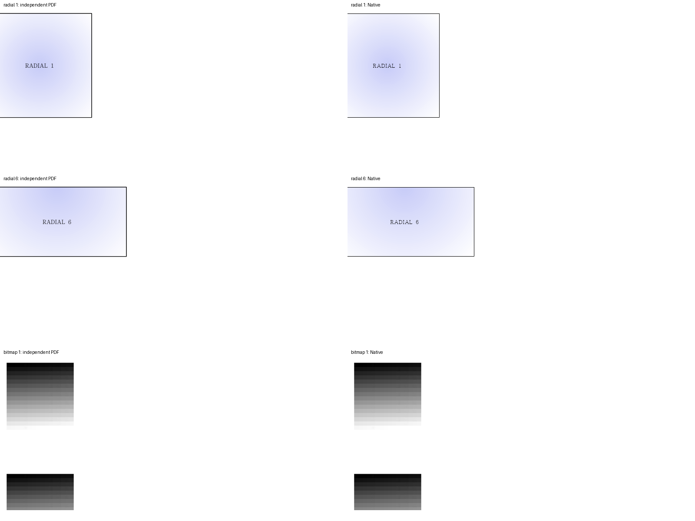
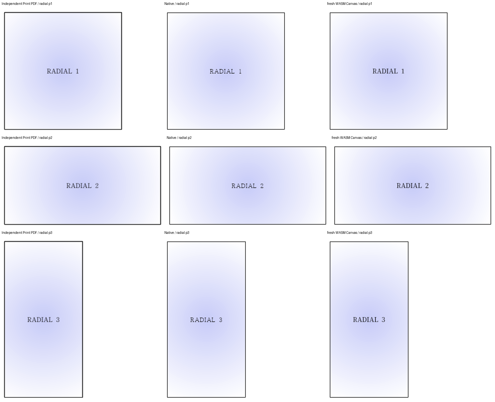
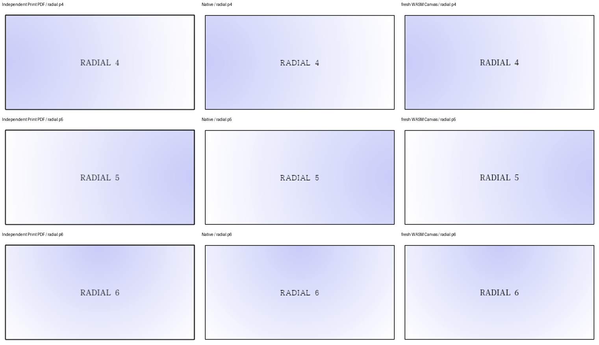
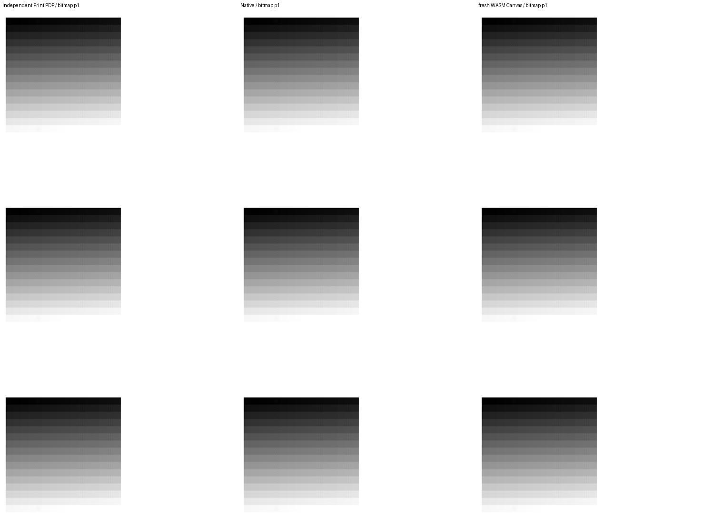

# seo-rii P117–P119 검증 원장

## 고정 source와 범위

기준 `a85d3265dd10b316d1a0ae029ca3f67245b38b77`, 실제 제품 검토 head `1e819721fe789b6b3b5c6db600635245039c9f98`다. Ready #8952·#8953·#8954의 원 head를 merge ancestry로 보존했고 Draft 6개의 tip은 포함하지 않았다. [생산 입력 판정](production-scope.json)에서 변경 제품 파일 30개가 모두 `bindings/Flutter` 아래임을 확인했다. Rust parser/IR/조판/Native·WASM 생산자·Cargo·vendor·assets는 기준과 같다. 조판 규칙·저장 정보·회귀 기대값은 수정하지 않았다.

## macOS 결정

사용자는 메인테이너 Mac 환경 부재를 이유로 이번 macOS의 기여자 주장을 수용했다. [결정 원문](macos-maintainer-decision.json)을 적용하며 실제 Apple SDK·Metal/AppKit·ScreenCaptureKit 실행은 미실행이다. Portable 검사를 실제 Mac GPU 검증으로 확대하지 않는다. Windows에서 재현한 빌드 실패는 이 결정에 포함하지 않는다.

Windows JSON 영수증은 값을 바꾸지 않고 줄바꿈만 LF로 정규화해 보존했다.

## 완료한 검사

- [공통 19개 명령](local-gates.json): 모두 exit 0. Python 9개 suite의 186개 검사가 통과했다.
- 실제 공통 Metal tile policy 1,669개 검사: 일반 실행과 ASan/UBSan 실행이 모두 통과했다.
- package/example의 strict analyze와 변경 Dart 7개 파일의 format 검사: 통과, 변경 0개.
- runtime bundle의 별도 C/Dart FFI 3개 대조군: 통과. 이 작은 합성 ABI 대조군과 실제 Native 실행을 구분한다.
- 초기 Flutter suite는 Native가 필요한 6개를 명시 skip했다. 이후 새 Native·owner shim을 공급한 [전체 Flutter 280개](linux-flutter-native-tests.json)는 skip 없이 모두 통과했다.
- [Linux Native 빌드](linux-native-build-receipt.json): `native-skia-gl`, release-test, exit 0.
- [Windows Native 빌드](windows-native-build-receipt.json): `native-skia-d3d`, release-test, exit 0. [실제 MSVC SDK 검사](windows-sdk-compile-receipt.json)의 등록 코드·plugin·Producer·NativeApi 4개 단위도 엄격 컴파일에 통과했다.

## Linux 이동 참조앱

Flutter 3.47.9 / framework `c197ca5199e9ee5661e865596c9c07294dfab51c`, engine `89c39edfdfae2949f6806e4a315c0c08522238b7`, Dart 3.13.7이다. 실제 GTK release bundle을 만든 뒤 공백이 있는 `moved reference app/runtime bundle`로 이동했다. 생성한 source·runner 사본을 제거하고 cwd `/tmp`, RHWP 환경 변수 없이 직접 실행했다.

[실제 build](linux-reference-build-summary.json)와 [UI 실행](linux-reference-ui-receipt.json), [커널 module mapping](linux-reference-loaded-mappings.json)을 구분한다. 실행 파일·Native·dispatcher·plugin·Flutter engine의 실제 inode가 모두 이동 번들과 일치했다. 공개 desktop-consumer 1쪽과 radial 6쪽을 열고, 1→6쪽 이동·문서 닫기·WM_DELETE_WINDOW의 exit 0을 확인했다. 실제 GTK/X11과 Mesa 소프트웨어 환경이며 물리 GPU 성능·consumer fence를 입증하지 않는다.

- 
- 
- 
- 

radial 하단의 `inline-object affinity is not supported by scalar interaction positions`는 [선행 검토](../seo-rii-20261110/README.md)의 CPU/GPU 공통 scalar interaction 제한과 같다. 그림 표시·페이지 이동을 본문 편집 지원 완료로 표현하지 않는다. 별도 Native 입력·IME 6개 검사는 위 실제 280개 suite에 포함된다.

## 기본 출력과 시각 검증

Native의 독립 Print 96 DPI, 색상 경계 보정 전 2px `silhouette_raw_match_percent` 전쪽 TSV는 [radial 6쪽](native-radial.tsv)·[bitmap 1쪽](native-bitmap.tsv)이며 최저 모두 100.00%다. 입력과 독립 Print는 기존 저장소 자원을 사용했다.

- `tests/fixtures/gradient/radial-corner-print-contract.hwpx` / `tests/fixtures/gradient/radial-corner-print-contract-2020.pdf`, compat 2022.
- `samples/issue8160/bitmap-channel-transfer-independent.hwpx` / `pdf/issue8160/bitmap-channel-transfer-independent-2024.pdf`, compat 2024.

[Fresh WASM 최적화 빌드](fresh-wasm-build-receipt.json)는 exit 0이며 실제 Chrome 156 Canvas의 [radial 6쪽](wasm-radial.tsv)·[bitmap 1쪽](wasm-bitmap.tsv)도 전쪽 최저 100.00%다. 두 경로의 쪽수는 독립 PDF와 각각 6·1쪽으로 같다. [공통 생산 입력](common-producer-identity.json)이 base·후보에서 완전히 같으므로 이 동일 생산자의 실제 출력을 base·후보 대조에 공통 사용했다. base를 별도로 빌드했다고 쓰지 않으며 기본 출력의 페이지별 하락은 0.00%p다.

전체 7쪽의 같은 내용 영역을 1.5배 확대해 그라데이션 방향·색 채널·숫자/글자·외곽선·순서·간격을 직접 대조했다. PDF 경계의 래스터화 차이와 실루엣 점수는 구분하며 새 내용 누락·잘림·이동은 관측되지 않았다. 이 기본 출력 검사는 미실행 Mac과 실패한 Windows의 실제 GPU 소비 증거를 대신하지 않는다.

## Windows 미완료 경로

[Windows junction 진단과 제한 보정안](../../seo_rii_20261112_windows_build_finding.md)을 따른다. 실제 runner의 C1083을 수정·재검증하기 전에는 #8953·#8954의 Windows 빌드·두 타일 표시·편집·resize·복구·이동 번들 성공을 주장하지 않는다. 현재 호스트는 단일 3840×2160 모니터·실제 DPI 96(DPR 1)이다. 다른 OS DPR을 주입하거나 전역 배율을 변경하지 않았다.

#536·#8701의 전체 로드맵은 OPEN을 유지한다. 원격 push·PR·승인 리뷰·공개 댓글·merge는 수행하지 않았다.
