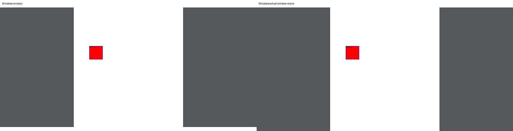
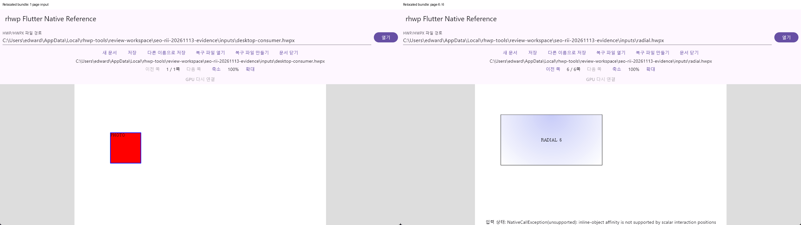
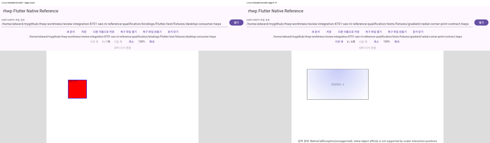
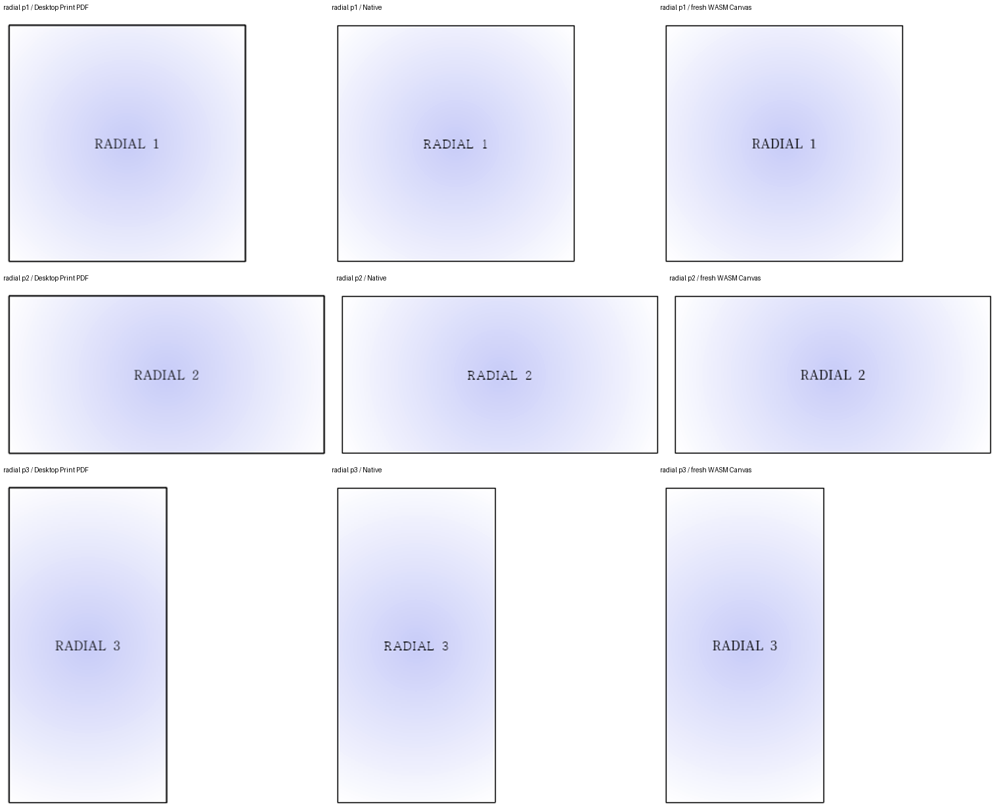
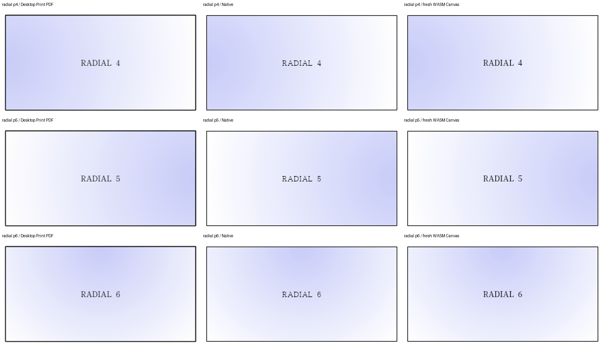
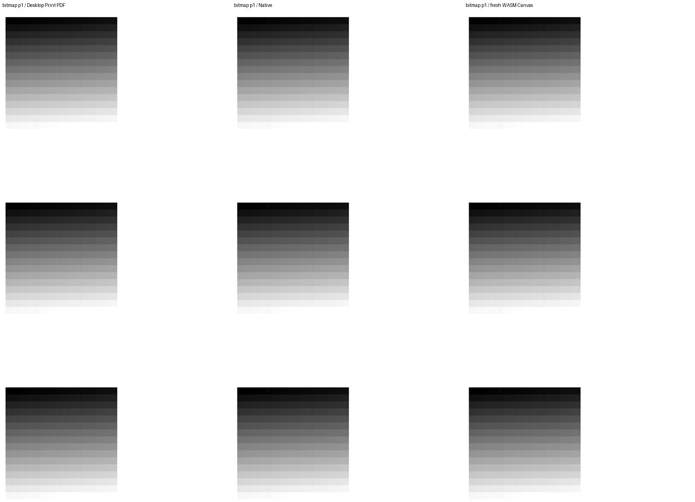
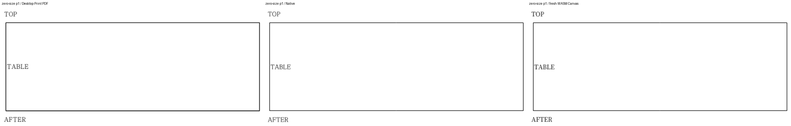

# 2026-11-13 Windows 보정과 최종 로컬 검증

수용 PR [#9037](https://github.com/edwardkim/rhwp/pull/9037)의 CI·self-review·merge를 완료했다. [최종 원격·종료 기록](../../../archives/pr_9037_review.md)을 따른다. 아래는 source별 실행을 구분한 제출 전 로컬 검증 기록이며, 당시의 원격 미실행 문구를 현재 상태로 읽지 않는다.

## 소스·승인·판정

현재 base는 `41c889cfd8a869ad23199d6018f8b569879a575c`, 최종 제품 소스는 `4ab994ee67ff66e35aa9168ac6fae506b6b26122`다. 초기 `a85d3265dd`에서 #9025·#9033을 반영한 최신 devel을 clean merge했다. 원 #8952·#8953·#8954의 SHA를 모두 유지했고 Draft #8962–#8967은 포함하지 않았다. 원격 공개 댓글·승인 리뷰·source push·새 PR·merge는 아직 수행하지 않았다.

사용자가 승인한 Windows CMake 보정과 실제 runner·타일·이동 번들 재검증을 완료했다. Mac은 앞서 확정한 기여자 주장 수용 결정을 적용하며 Apple SDK·Metal·ScreenCaptureKit 실기는 미실행이다. #536·#8701의 전체 로드맵은 OPEN을 유지한다.

## 세 가지 실제 경계 보정

1. `60f5659d5b`: CMake가 Flutter 디렉터리 junction을 그대로 유지하던 C1083을 공통 헤더의 실제 경로로 해결했다. [직접 checkout·junction·상대 링크·UNC 링크 4건](validation-record.md)이 모두 통과했다. 헤더를 복사하거나 include 환경으로 우회하지 않는다.
2. `7e576a18ca`: 실제 Windows Python의 경로 `.exe` stat과 fd fstat 사이 합성 실행 비트 차이를 공통 identity에서 정규화했다. 원시 path·fd의 각 전후 metadata와 파일 종류·읽기/쓰기·inode·size·mtime·birthtime·link·hash 검사는 유지했다. [기존 코드의 두 새 양성 검사 FAIL](validation-record.md) → [Linux 13+27+10개 PASS](validation-record.md), [Windows 13개 중 11 PASS·POSIX 전용 2 skip 및 27개 PASS](validation-record.md)를 확인했다. Windows용 대조군에서 대소문자 파일의 실제 덮어쓰기와 disposable Git tree의 읽기 전용 속성도 플랫폼에 맞게 수정했다. 보호 조건은 완화하지 않았다.
3. `4ab994ee67`: 실제 창 종료의 `FlutterDesktopMessengerSetCallback` access violation을 보정했다. [수정 전 종료 코드](validation-record.md)는 `0xc000041d`이며, 고정 SDK의 소멸 순서·비소유 messenger와 실제 DLL export/오류 RVA를 추적했다. C messenger를 소유하고 SDK의 lock/availability 계약에 따라 살아 있는 엔진에서만 handler를 해제한다. [상세 진단](../../../archives/seo_rii_20261112_windows_build_finding.md)을 따른다.

Windows bundle에서 fixture에 없는 조합 경로를 입력한 검증 하네스의 실패와 종료 직전 캡처 race도 제품 결함과 구분했다. 최종 UI 검증은 실제 키 입력 간격·필드 선택과 WM_CLOSE 뒤 process wait를 사용하며 실패 종료를 허용하지 않는다.

## 실제 Windows 최종 재실행

Windows 11 build 26300·VS 2022 17.14.21·MSVC·Windows Python 3.12.3·Flutter 3.47.9에서 실행했다. Flutter framework `c197ca5199e9ee5661e865596c9c07294dfab51c`, engine `89c39edfdfae2949f6806e4a315c0c08522238b7`, Dart 3.13.7이다. [Native D3D 빌드](validation-record.md)는 source `60f5659d5b`, release-test exit 0이며 이후 Rust 입력이 같다. 외부 공급 Native를 reference builder 자체가 다시 빌드했다는 주장은 하지 않는다.

최종 제품 소스로 [release 참조앱](validation-record.md)과 [debug 두 타일 runner](validation-record.md)를 모두 새로 만들었다. [실제 두 타일 검사](validation-record.md)는 `windows-two-tile-consumer-passed`, exit 0이다. 최초 표시 → revision 편집 → 실제 창 resize → renderer 복구를 변경 없는 collector·CPU 1x/2x 독립 replay·전체 영역과 seam 검사로 확인했다. 창은 1264×681에서 1296×713으로 변경됐으며 Win32·FlutterView DPR은 모두 실제 1.0이다. Native 9개 teardown 계수와 종료 owner·import/ticket 계수도 0으로 회수됐다.

[foreground 보조 동작](validation-record.md)은 해당 probe PID의 창만 활성화했다. collector의 foreground·occlusion·source hash 검사는 그대로다. 사용자 설정·전역 배율은 변경하지 않았다. 다른 실제 OS DPR 간 비교는 미실행이며 `actualDprComparison:false`를 유지한다. `consumerGpuCompletionVerified`·`hardwareAccelerationVerified`·`targetReuse`·`consumerAndDriverMemoryIncluded`도 모두 false다.

Release 번들을 공백이 있는 다른 폴더로 이동한 뒤 builder의 생성 source·runner를 제거하고, 별도 Temp cwd에서 RHWP 환경 변수 없이 직접 실행했다. [실제 UI 영수증](validation-record.md)의 5개 로딩 경로는 실행 파일·Native·dispatcher·plugin·Flutter engine 모두 이동 번들 안이다. 공개 1쪽·6쪽 문서 열기, 1→6쪽 이동, 문서 닫기, WM_CLOSE **exit 0**을 모두 최종 재실행했다. Native DLL·Flutter 엔진과 라이선스 고지는 bundle manifest로 검증했다.

## Linux·공통 검사

[최신 base의 Linux Native 빌드](validation-record.md)와 [실제 Flutter 280개, skip 0·참조앱 빌드](validation-record.md)가 통과했다. [이동 참조앱 UI](validation-record.md)도 1쪽·6쪽 열기·1→6쪽 이동·문서 닫기·정상 exit 0이다. 초기 base의 module inode 증거와 최신 base의 UI 영수증은 서로 다른 실행이며 혼용하지 않는다.

[공통 19개 명령](validation-record.md)의 Python 9개 suite 186개, portable Metal 1,669개 일반/ASan/UBSan, package/example strict analyze·변경 Dart 7개 format이 통과했다. 이후 변경한 metadata/번들 관련 50개는 위 최종 소스에서 재실행했다. [Windows portable bridge](validation-record.md)는 frame lifetime 51개·import lifetime 4,224개·close registry 1,683개·bounded tile 25개·group error 35개 및 disabled ABI 5개 대조를 통과했다. 실제 MSVC 빌드와 portable 검사 범위를 구분한다. runtime C/Dart FFI의 별도 3개 ABI 시나리오도 통과했으며 실제 Native 렌더링으로 바꾸어 세지 않는다.

## 최신 devel 기능 보존과 기본 출력

[공통 producer 전체 tree](validation-record.md)는 최신 base와 후보가 같다. [source60에서 최종 소스까지 생산 입력 동일성](validation-record.md)도 확인했다. Rust parser/IR/조판·Native/WASM 생산자·Cargo·vendor·assets·공통 C ABI를 바꾸지 않았다. C++ plugin 종료 보정 후 실제 Windows 소비자는 위와 같이 재빌드했다. 동일 Rust 생산자를 불필요하게 재빌드하거나 별도 base 빌드를 했다고 쓰지 않는다.

[최적화 포함 fresh WASM 빌드](validation-record.md)는 source60·최신 base41에서 exit 0이다. 문서화된 `RHWP_WASM_CDYLIB_ONLY=1`, release lto=false 경로와 wasm-opt를 사용했다. [전쪽 결과](validation-record.md)는 아래와 같으며 96 DPI·색상 경계 보정 전 2px raw 값이다. TSV 원본 6개를 함께 보존했다.

| 입력 | 독립 기준 | 쪽수 | Native 최저 | fresh WASM 최저 |
| --- | --- | --- | --- | --- |
| radial-corner-print-contract | 기존 Desktop Print `radial-corner-print-contract-2020.pdf`, compat 2022 | 6 | 100.00% | 100.00% |
| bitmap-channel-transfer-independent | Desktop Print 2024 | 1 | 100.00% | 100.00% |
| zero_size_para_before_table.hwp | 한컴 2024 13.0.0.3901 사용자 수동 Print | 1 | 99.75% | 99.86% |

Zero-size 기준은 `pdf/issue8664/zero_size_para_before_table-hwp-2024.pdf`와 `mydocs/pr/assets/hyunmyungjanelee_20261112/mcp-print-reference/receipts.json`이다. Cairo/webhwp PDF는 제외했다. 저장 문서의 호환 연도와 실제 Print 제품 버전을 구분한다. 새 base #9025의 TOP→표→AFTER 배치를 직접 확대 판독했다. [#9033 실제 중첩 셀 search/extract](validation-record.md)는 두 단계 cellPath와 원본 값 42,360·4,676·1,234,000의 누락·중복 없는 보존을 확인했다.

초기 base 출력과 현재 출력은 14쌍 중 10쌍이 바이트 동일하며 radial 4·5쪽의 양쪽 4쌍은 다르다. 이를 모두 동일하다고 쓰지 않는다. 현재의 독립 Print·Native·Canvas 확대 패널에서 방향·음영·문자/간격·외곽선을 직접 확인했고 기본 raw 하락은 없다. 최신 base와 후보는 동일 producer이므로 이 출력을 공통 소비한다. 점수는 실제 GPU 완료 fence나 Mac 실기 증거가 아니다.

## 제출 전 상태

[본인 계정 열린 PR](validation-record.md)은 0건이다. [현재 base/head 병합 시뮬레이션](validation-record.md)은 exit 0이다. 원 PR 세 건은 같은 원 head에서 각각 33개 성공·6개 정상 skip이며, 최신 조회의 GitHub mergeable은 계산 중 UNKNOWN이었다. 새 수용 PR 생성·해당 head CI·최종 self-review·머지는 원격 처리 승인과 실제 새 검증 뒤에만 진행한다. 기존 원 CI를 새 통합 후보의 CI 성공으로 바꾸어 기록하지 않는다.
