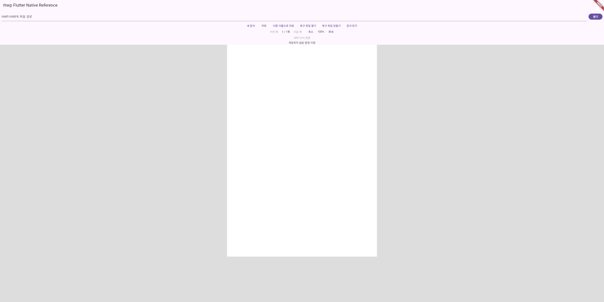
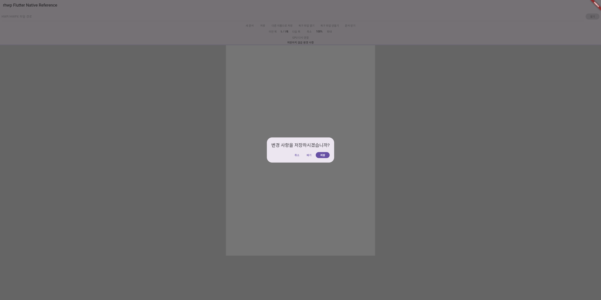

## 원 PR #8962 감사 댓글 문안

기여해 주셔서 감사합니다. **Linux 참조 앱 resize**의 원 기여 `469ca8c04f`를 보존해 누적 PR [#9132](https://github.com/edwardkim/rhwp/pull/9132)에서 merge commit [`9757581699`](https://github.com/edwardkim/rhwp/commit/97575816999577744f0e2e7f2e16a41d5961bebf)으로 수용했습니다. 이 원 PR도 GitHub에서 MERGED로 확인했습니다. source와 fork branch를 재작성하거나 삭제하지 않았습니다.

[승인 리뷰](https://github.com/edwardkim/rhwp/pull/8962#pullrequestreview-5919913090)와 [같은 원 head의 CI](https://github.com/edwardkim/rhwp/pull/8962/checks)를 확인했습니다. 누적 검토에서는 Flutter Native 연결 360건·Rust 집중 21건, 실제 Linux GL/Windows D3D 표시·편집·resize·복구·캐시 축소·메모리 압력·metrics·종료를 확인했습니다. 전체 Rust/Native 광범위 회귀는 같은 원 code head의 성공한 GitHub Full CI를 재사용했습니다.

[이 PR의 검토 기록](https://github.com/edwardkim/rhwp/blob/devel/mydocs/pr/archives/pr_8962_review.md) · [검증 원장](https://github.com/edwardkim/rhwp/blob/devel/mydocs/pr/assets/seo-rii-20261116/README.md) · [문서 시각 검증과 소비 경로의 구분](https://github.com/edwardkim/rhwp/blob/devel/mydocs/manual/verification/visual_sweep_guide.md#github-merge-comment).

아래는 실제 Linux 참조 앱의 3200×1600 resize입니다. 같은 불변 snapshot의 독립 CPU replay와 실제 consumer 화면을 대조한 증거이며 한컴 Print 일치율이 아닙니다.

macOS는 메인테이너 환경 부재로 기여자 주장을 수용한 결정에 따랐으며 Apple SDK/Metal 실기를 실행했다고 표시하지 않았습니다. consumer GPU 완료·물리 가속·전체 VRAM/RSS·FPS 개선이나 모든 문서의 조판 일치를 주장하지 않습니다. 부모 #536·#8701의 전체 로드맵은 OPEN을 유지합니다.

## 원 PR #8963 감사 댓글 문안

기여해 주셔서 감사합니다. **producer-ready EventChannel**의 원 기여 `05d303178b`를 보존해 누적 PR [#9132](https://github.com/edwardkim/rhwp/pull/9132)에서 merge commit [`9757581699`](https://github.com/edwardkim/rhwp/commit/97575816999577744f0e2e7f2e16a41d5961bebf)으로 수용했습니다. 이 원 PR도 GitHub에서 MERGED로 확인했습니다. source와 fork branch를 재작성하거나 삭제하지 않았습니다.

[승인 리뷰](https://github.com/edwardkim/rhwp/pull/8963#pullrequestreview-5919913882)와 [같은 원 head의 CI](https://github.com/edwardkim/rhwp/pull/8963/checks)를 확인했습니다. 누적 검토에서는 Flutter Native 연결 360건·Rust 집중 21건, 실제 Linux GL/Windows D3D 표시·편집·resize·복구·캐시 축소·메모리 압력·metrics·종료를 확인했습니다. 전체 Rust/Native 광범위 회귀는 같은 원 code head의 성공한 GitHub Full CI를 재사용했습니다.

[이 PR의 검토 기록](https://github.com/edwardkim/rhwp/blob/devel/mydocs/pr/archives/pr_8963_review.md) · [검증 원장](https://github.com/edwardkim/rhwp/blob/devel/mydocs/pr/assets/seo-rii-20261116/README.md) · [문서 시각 검증과 소비 경로의 구분](https://github.com/edwardkim/rhwp/blob/devel/mydocs/manual/verification/visual_sweep_guide.md#github-merge-comment).

아래는 EventChannel이 연결된 실제 Windows 두 타일 복구 화면입니다. 같은 불변 snapshot의 독립 CPU replay와 실제 consumer 화면을 대조한 증거이며 한컴 Print 일치율이 아닙니다.

macOS는 메인테이너 환경 부재로 기여자 주장을 수용한 결정에 따랐으며 Apple SDK/Metal 실기를 실행했다고 표시하지 않았습니다. consumer GPU 완료·물리 가속·전체 VRAM/RSS·FPS 개선이나 모든 문서의 조판 일치를 주장하지 않습니다. 부모 #536·#8701의 전체 로드맵은 OPEN을 유지합니다.

## 원 PR #8964 감사 댓글 문안

기여해 주셔서 감사합니다. **창 종료와 GPU retirement**의 원 기여 `d8251257d5`를 보존해 누적 PR [#9132](https://github.com/edwardkim/rhwp/pull/9132)에서 merge commit [`9757581699`](https://github.com/edwardkim/rhwp/commit/97575816999577744f0e2e7f2e16a41d5961bebf)으로 수용했습니다. 이 원 PR도 GitHub에서 MERGED로 확인했습니다. source와 fork branch를 재작성하거나 삭제하지 않았습니다.

[승인 리뷰](https://github.com/edwardkim/rhwp/pull/8964#pullrequestreview-5919914638)와 [같은 원 head의 CI](https://github.com/edwardkim/rhwp/pull/8964/checks)를 확인했습니다. 누적 검토에서는 Flutter Native 연결 360건·Rust 집중 21건, 실제 Linux GL/Windows D3D 표시·편집·resize·복구·캐시 축소·메모리 압력·metrics·종료를 확인했습니다. 전체 Rust/Native 광범위 회귀는 같은 원 code head의 성공한 GitHub Full CI를 재사용했습니다.

[이 PR의 검토 기록](https://github.com/edwardkim/rhwp/blob/devel/mydocs/pr/archives/pr_8964_review.md) · [검증 원장](https://github.com/edwardkim/rhwp/blob/devel/mydocs/pr/assets/seo-rii-20261116/README.md) · [문서 시각 검증과 소비 경로의 구분](https://github.com/edwardkim/rhwp/blob/devel/mydocs/manual/verification/visual_sweep_guide.md#github-merge-comment).

아래는 실제 Linux WM_DELETE_WINDOW의 저장 결정 창입니다. 같은 불변 snapshot의 독립 CPU replay와 실제 consumer 화면을 대조한 증거이며 한컴 Print 일치율이 아닙니다.

macOS는 메인테이너 환경 부재로 기여자 주장을 수용한 결정에 따랐으며 Apple SDK/Metal 실기를 실행했다고 표시하지 않았습니다. consumer GPU 완료·물리 가속·전체 VRAM/RSS·FPS 개선이나 모든 문서의 조판 일치를 주장하지 않습니다. 부모 #536·#8701의 전체 로드맵은 OPEN을 유지합니다.

## 원 PR #8965 감사 댓글 문안

기여해 주셔서 감사합니다. **공통 GPU 타일 정책과 Metal cache**의 원 기여 `2023cd3d27`를 보존해 누적 PR [#9132](https://github.com/edwardkim/rhwp/pull/9132)에서 merge commit [`9757581699`](https://github.com/edwardkim/rhwp/commit/97575816999577744f0e2e7f2e16a41d5961bebf)으로 수용했습니다. 이 원 PR도 GitHub에서 MERGED로 확인했습니다. source와 fork branch를 재작성하거나 삭제하지 않았습니다.

[승인 리뷰](https://github.com/edwardkim/rhwp/pull/8965#pullrequestreview-5919915268)와 [같은 원 head의 CI](https://github.com/edwardkim/rhwp/pull/8965/checks)를 확인했습니다. 누적 검토에서는 Flutter Native 연결 360건·Rust 집중 21건, 실제 Linux GL/Windows D3D 표시·편집·resize·복구·캐시 축소·메모리 압력·metrics·종료를 확인했습니다. 전체 Rust/Native 광범위 회귀는 같은 원 code head의 성공한 GitHub Full CI를 재사용했습니다.

[이 PR의 검토 기록](https://github.com/edwardkim/rhwp/blob/devel/mydocs/pr/archives/pr_8965_review.md) · [검증 원장](https://github.com/edwardkim/rhwp/blob/devel/mydocs/pr/assets/seo-rii-20261116/README.md) · [문서 시각 검증과 소비 경로의 구분](https://github.com/edwardkim/rhwp/blob/devel/mydocs/manual/verification/visual_sweep_guide.md#github-merge-comment).

아래는 공통 타일 정책을 소비한 Linux 실행 참고 — Metal 실기 아님입니다. 같은 불변 snapshot의 독립 CPU replay와 실제 consumer 화면을 대조한 증거이며 한컴 Print 일치율이 아닙니다.

macOS는 메인테이너 환경 부재로 기여자 주장을 수용한 결정에 따랐으며 Apple SDK/Metal 실기를 실행했다고 표시하지 않았습니다. consumer GPU 완료·물리 가속·전체 VRAM/RSS·FPS 개선이나 모든 문서의 조판 일치를 주장하지 않습니다. 부모 #536·#8701의 전체 로드맵은 OPEN을 유지합니다.

## 원 PR #8966 감사 댓글 문안

기여해 주셔서 감사합니다. **D3D bounded tile cache**의 원 기여 `80062f4d0d`를 보존해 누적 PR [#9132](https://github.com/edwardkim/rhwp/pull/9132)에서 merge commit [`9757581699`](https://github.com/edwardkim/rhwp/commit/97575816999577744f0e2e7f2e16a41d5961bebf)으로 수용했습니다. 이 원 PR도 GitHub에서 MERGED로 확인했습니다. source와 fork branch를 재작성하거나 삭제하지 않았습니다.

[승인 리뷰](https://github.com/edwardkim/rhwp/pull/8966#pullrequestreview-5919915924)와 [같은 원 head의 CI](https://github.com/edwardkim/rhwp/pull/8966/checks)를 확인했습니다. 누적 검토에서는 Flutter Native 연결 360건·Rust 집중 21건, 실제 Linux GL/Windows D3D 표시·편집·resize·복구·캐시 축소·메모리 압력·metrics·종료를 확인했습니다. 전체 Rust/Native 광범위 회귀는 같은 원 code head의 성공한 GitHub Full CI를 재사용했습니다.

[이 PR의 검토 기록](https://github.com/edwardkim/rhwp/blob/devel/mydocs/pr/archives/pr_8966_review.md) · [검증 원장](https://github.com/edwardkim/rhwp/blob/devel/mydocs/pr/assets/seo-rii-20261116/README.md) · [문서 시각 검증과 소비 경로의 구분](https://github.com/edwardkim/rhwp/blob/devel/mydocs/manual/verification/visual_sweep_guide.md#github-merge-comment).

아래는 실제 Windows D3D 두 타일 복구 화면입니다. 같은 불변 snapshot의 독립 CPU replay와 실제 consumer 화면을 대조한 증거이며 한컴 Print 일치율이 아닙니다.

macOS는 메인테이너 환경 부재로 기여자 주장을 수용한 결정에 따랐으며 Apple SDK/Metal 실기를 실행했다고 표시하지 않았습니다. consumer GPU 완료·물리 가속·전체 VRAM/RSS·FPS 개선이나 모든 문서의 조판 일치를 주장하지 않습니다. 부모 #536·#8701의 전체 로드맵은 OPEN을 유지합니다.

## 원 PR #8967 감사 댓글 문안

기여해 주셔서 감사합니다. **완료된 D3D private target 재사용**의 원 기여 `41e8618fdf`를 보존해 누적 PR [#9132](https://github.com/edwardkim/rhwp/pull/9132)에서 merge commit [`9757581699`](https://github.com/edwardkim/rhwp/commit/97575816999577744f0e2e7f2e16a41d5961bebf)으로 수용했습니다. 이 원 PR도 GitHub에서 MERGED로 확인했습니다. source와 fork branch를 재작성하거나 삭제하지 않았습니다.

[승인 리뷰](https://github.com/edwardkim/rhwp/pull/8967#pullrequestreview-5919916571)와 [같은 원 head의 CI](https://github.com/edwardkim/rhwp/pull/8967/checks)를 확인했습니다. 누적 검토에서는 Flutter Native 연결 360건·Rust 집중 21건, 실제 Linux GL/Windows D3D 표시·편집·resize·복구·캐시 축소·메모리 압력·metrics·종료를 확인했습니다. 전체 Rust/Native 광범위 회귀는 같은 원 code head의 성공한 GitHub Full CI를 재사용했습니다.

[이 PR의 검토 기록](https://github.com/edwardkim/rhwp/blob/devel/mydocs/pr/archives/pr_8967_review.md) · [검증 원장](https://github.com/edwardkim/rhwp/blob/devel/mydocs/pr/assets/seo-rii-20261116/README.md) · [문서 시각 검증과 소비 경로의 구분](https://github.com/edwardkim/rhwp/blob/devel/mydocs/manual/verification/visual_sweep_guide.md#github-merge-comment).

아래는 private target 재사용 후 실제 Windows D3D 화면입니다. 같은 불변 snapshot의 독립 CPU replay와 실제 consumer 화면을 대조한 증거이며 한컴 Print 일치율이 아닙니다.

macOS는 메인테이너 환경 부재로 기여자 주장을 수용한 결정에 따랐으며 Apple SDK/Metal 실기를 실행했다고 표시하지 않았습니다. consumer GPU 완료·물리 가속·전체 VRAM/RSS·FPS 개선이나 모든 문서의 조판 일치를 주장하지 않습니다. 부모 #536·#8701의 전체 로드맵은 OPEN을 유지합니다.

## 원 PR #9128 감사 댓글 문안

기여해 주셔서 감사합니다. **프로세스 Metal context admission**의 원 기여 `2074762138`를 보존해 누적 PR [#9132](https://github.com/edwardkim/rhwp/pull/9132)에서 merge commit [`9757581699`](https://github.com/edwardkim/rhwp/commit/97575816999577744f0e2e7f2e16a41d5961bebf)으로 수용했습니다. 이 원 PR도 GitHub에서 MERGED로 확인했습니다. source와 fork branch를 재작성하거나 삭제하지 않았습니다.

[승인 리뷰](https://github.com/edwardkim/rhwp/pull/9128#pullrequestreview-5919917318)와 [같은 원 head의 CI](https://github.com/edwardkim/rhwp/pull/9128/checks)를 확인했습니다. 누적 검토에서는 Flutter Native 연결 360건·Rust 집중 21건, 실제 Linux GL/Windows D3D 표시·편집·resize·복구·캐시 축소·메모리 압력·metrics·종료를 확인했습니다. 전체 Rust/Native 광범위 회귀는 같은 원 code head의 성공한 GitHub Full CI를 재사용했습니다.

[이 PR의 검토 기록](https://github.com/edwardkim/rhwp/blob/devel/mydocs/pr/archives/pr_9128_review.md) · [검증 원장](https://github.com/edwardkim/rhwp/blob/devel/mydocs/pr/assets/seo-rii-20261116/README.md) · [문서 시각 검증과 소비 경로의 구분](https://github.com/edwardkim/rhwp/blob/devel/mydocs/manual/verification/visual_sweep_guide.md#github-merge-comment).

macOS는 메인테이너 환경 부재로 기여자 주장을 수용한 결정에 따랐으며 Apple SDK/Metal 실기를 실행했다고 표시하지 않았습니다. consumer GPU 완료·물리 가속·전체 VRAM/RSS·FPS 개선이나 모든 문서의 조판 일치를 주장하지 않습니다. 부모 #536·#8701의 전체 로드맵은 OPEN을 유지합니다.

## 원 PR #9129 감사 댓글 문안

기여해 주셔서 감사합니다. **유휴 상태 polling 억제**의 원 기여 `720c161b9b`를 보존해 누적 PR [#9132](https://github.com/edwardkim/rhwp/pull/9132)에서 merge commit [`9757581699`](https://github.com/edwardkim/rhwp/commit/97575816999577744f0e2e7f2e16a41d5961bebf)으로 수용했습니다. 이 원 PR도 GitHub에서 MERGED로 확인했습니다. source와 fork branch를 재작성하거나 삭제하지 않았습니다.

[승인 리뷰](https://github.com/edwardkim/rhwp/pull/9129#pullrequestreview-5919917957)와 [같은 원 head의 CI](https://github.com/edwardkim/rhwp/pull/9129/checks)를 확인했습니다. 누적 검토에서는 Flutter Native 연결 360건·Rust 집중 21건, 실제 Linux GL/Windows D3D 표시·편집·resize·복구·캐시 축소·메모리 압력·metrics·종료를 확인했습니다. 전체 Rust/Native 광범위 회귀는 같은 원 code head의 성공한 GitHub Full CI를 재사용했습니다.

[이 PR의 검토 기록](https://github.com/edwardkim/rhwp/blob/devel/mydocs/pr/archives/pr_9129_review.md) · [검증 원장](https://github.com/edwardkim/rhwp/blob/devel/mydocs/pr/assets/seo-rii-20261116/README.md) · [문서 시각 검증과 소비 경로의 구분](https://github.com/edwardkim/rhwp/blob/devel/mydocs/manual/verification/visual_sweep_guide.md#github-merge-comment).

macOS는 메인테이너 환경 부재로 기여자 주장을 수용한 결정에 따랐으며 Apple SDK/Metal 실기를 실행했다고 표시하지 않았습니다. consumer GPU 완료·물리 가속·전체 VRAM/RSS·FPS 개선이나 모든 문서의 조판 일치를 주장하지 않습니다. 부모 #536·#8701의 전체 로드맵은 OPEN을 유지합니다.

## 원 PR #9130 감사 댓글 문안

기여해 주셔서 감사합니다. **owner thread cache trim**의 원 기여 `c1d53287a6`를 보존해 누적 PR [#9132](https://github.com/edwardkim/rhwp/pull/9132)에서 merge commit [`9757581699`](https://github.com/edwardkim/rhwp/commit/97575816999577744f0e2e7f2e16a41d5961bebf)으로 수용했습니다. 이 원 PR도 GitHub에서 MERGED로 확인했습니다. source와 fork branch를 재작성하거나 삭제하지 않았습니다.

[승인 리뷰](https://github.com/edwardkim/rhwp/pull/9130#pullrequestreview-5919918553)와 [같은 원 head의 CI](https://github.com/edwardkim/rhwp/pull/9130/checks)를 확인했습니다. 누적 검토에서는 Flutter Native 연결 360건·Rust 집중 21건, 실제 Linux GL/Windows D3D 표시·편집·resize·복구·캐시 축소·메모리 압력·metrics·종료를 확인했습니다. 전체 Rust/Native 광범위 회귀는 같은 원 code head의 성공한 GitHub Full CI를 재사용했습니다.

[이 PR의 검토 기록](https://github.com/edwardkim/rhwp/blob/devel/mydocs/pr/archives/pr_9130_review.md) · [검증 원장](https://github.com/edwardkim/rhwp/blob/devel/mydocs/pr/assets/seo-rii-20261116/README.md) · [문서 시각 검증과 소비 경로의 구분](https://github.com/edwardkim/rhwp/blob/devel/mydocs/manual/verification/visual_sweep_guide.md#github-merge-comment).

아래는 cache trim 뒤 보존된 실제 Windows D3D 화면입니다. 같은 불변 snapshot의 독립 CPU replay와 실제 consumer 화면을 대조한 증거이며 한컴 Print 일치율이 아닙니다.

macOS는 메인테이너 환경 부재로 기여자 주장을 수용한 결정에 따랐으며 Apple SDK/Metal 실기를 실행했다고 표시하지 않았습니다. consumer GPU 완료·물리 가속·전체 VRAM/RSS·FPS 개선이나 모든 문서의 조판 일치를 주장하지 않습니다. 부모 #536·#8701의 전체 로드맵은 OPEN을 유지합니다.

## 원 PR #9131 감사 댓글 문안

기여해 주셔서 감사합니다. **메모리 압력과 typed trim receipt**의 원 기여 `3798dd2367`를 보존해 누적 PR [#9132](https://github.com/edwardkim/rhwp/pull/9132)에서 merge commit [`9757581699`](https://github.com/edwardkim/rhwp/commit/97575816999577744f0e2e7f2e16a41d5961bebf)으로 수용했습니다. 이 원 PR도 GitHub에서 MERGED로 확인했습니다. source와 fork branch를 재작성하거나 삭제하지 않았습니다.

[승인 리뷰](https://github.com/edwardkim/rhwp/pull/9131#pullrequestreview-5919919187)와 [같은 원 head의 CI](https://github.com/edwardkim/rhwp/pull/9131/checks)를 확인했습니다. 누적 검토에서는 Flutter Native 연결 360건·Rust 집중 21건, 실제 Linux GL/Windows D3D 표시·편집·resize·복구·캐시 축소·메모리 압력·metrics·종료를 확인했습니다. 전체 Rust/Native 광범위 회귀는 같은 원 code head의 성공한 GitHub Full CI를 재사용했습니다.

[이 PR의 검토 기록](https://github.com/edwardkim/rhwp/blob/devel/mydocs/pr/archives/pr_9131_review.md) · [검증 원장](https://github.com/edwardkim/rhwp/blob/devel/mydocs/pr/assets/seo-rii-20261116/README.md) · [문서 시각 검증과 소비 경로의 구분](https://github.com/edwardkim/rhwp/blob/devel/mydocs/manual/verification/visual_sweep_guide.md#github-merge-comment).

아래는 메모리 압력 처리 뒤 보존된 실제 Windows D3D 화면입니다. 같은 불변 snapshot의 독립 CPU replay와 실제 consumer 화면을 대조한 증거이며 한컴 Print 일치율이 아닙니다.

macOS는 메인테이너 환경 부재로 기여자 주장을 수용한 결정에 따랐으며 Apple SDK/Metal 실기를 실행했다고 표시하지 않았습니다. consumer GPU 완료·물리 가속·전체 VRAM/RSS·FPS 개선이나 모든 문서의 조판 일치를 주장하지 않습니다. 부모 #536·#8701의 전체 로드맵은 OPEN을 유지합니다.

## 원 PR #9132 감사 댓글 문안

기여해 주셔서 감사합니다. **게시 세대의 cache metrics와 JSON CLI**의 원 기여 `4379aa080b`를 보존해 누적 PR [#9132](https://github.com/edwardkim/rhwp/pull/9132)에서 merge commit [`9757581699`](https://github.com/edwardkim/rhwp/commit/97575816999577744f0e2e7f2e16a41d5961bebf)으로 수용했습니다. 이 원 PR도 GitHub에서 MERGED로 확인했습니다. source와 fork branch를 재작성하거나 삭제하지 않았습니다.

[승인 리뷰](https://github.com/edwardkim/rhwp/pull/9132#pullrequestreview-5919919968)와 [같은 원 head의 CI](https://github.com/edwardkim/rhwp/pull/9132/checks)를 확인했습니다. 누적 검토에서는 Flutter Native 연결 360건·Rust 집중 21건, 실제 Linux GL/Windows D3D 표시·편집·resize·복구·캐시 축소·메모리 압력·metrics·종료를 확인했습니다. 전체 Rust/Native 광범위 회귀는 같은 원 code head의 성공한 GitHub Full CI를 재사용했습니다.

[이 PR의 검토 기록](https://github.com/edwardkim/rhwp/blob/devel/mydocs/pr/archives/pr_9132_review.md) · [검증 원장](https://github.com/edwardkim/rhwp/blob/devel/mydocs/pr/assets/seo-rii-20261116/README.md) · [문서 시각 검증과 소비 경로의 구분](https://github.com/edwardkim/rhwp/blob/devel/mydocs/manual/verification/visual_sweep_guide.md#github-merge-comment).

macOS는 메인테이너 환경 부재로 기여자 주장을 수용한 결정에 따랐으며 Apple SDK/Metal 실기를 실행했다고 표시하지 않았습니다. consumer GPU 완료·물리 가속·전체 VRAM/RSS·FPS 개선이나 모든 문서의 조판 일치를 주장하지 않습니다. 부모 #536·#8701의 전체 로드맵은 OPEN을 유지합니다.
