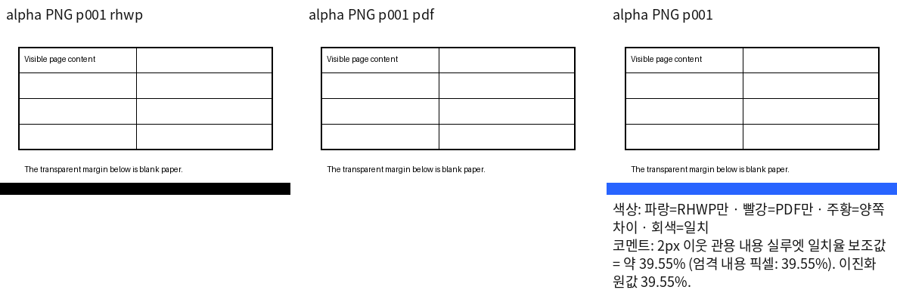
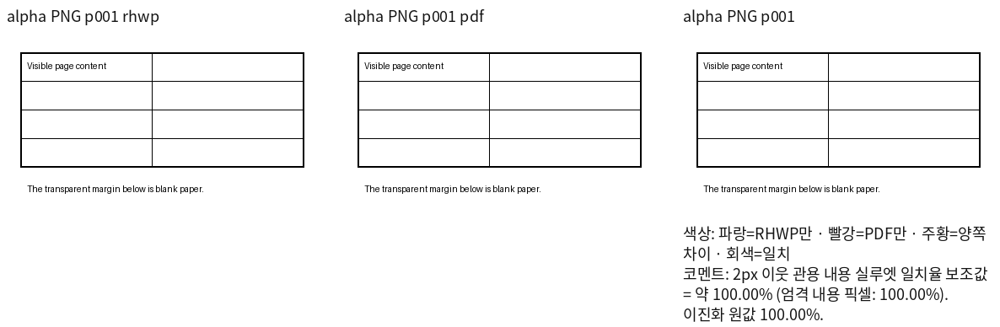

# PNG 투명 여백 판독 교정

이 자료는 비교 도구의 합성 입력 예시다. 실제 HWP/HWPX의 렌더링 완료나 #7902 해결 증거로 사용하지 않는다.

같은 384×224 PNG에서 보이는 표·문구는 동일하며, 입력의 아래16행에만 검정 RGB와 alpha0을
넣었다. 독립 RGB 정답에서는 해당 영역이 흰 종이다. 비교 좌표·크기·2px 반경·색상 임계값32는 같다.

| 판독 | 실루엣 일치율 | 오차 픽셀 | 판독 결과 |
| --- | --- | --- | --- |
| 기존 `e4e6d0c8d` | 39.55136% | 6,144 | 보이지 않는 여백을 검은 띠로 읽음 |
| 흰 종이 합성 후 | 100.00000% | 0 | 보이는 내용과 여백 모두 동일 |

입력 SHA-256:

- [RGBA 입력](rhwp_001.png): `93da6d3d8600326f58e05a4325bf71e5459dfd5173fc2b3c61a8903a22e46180`
- [독립 RGB 정답](expected_001.png): `66b9710508dea23dd274e14e6b5fabb01718b4889be7a3d887840473ad2db299`

기존 판독:

수정 판독:

원본 PNG 바이트는 변경하지 않았다. 별도로 보존된 실제 Native/fresh WASM PNG3,340쌍을
재평가했으며 기존 TSV와 모두 바이트 단위로 같았다. 이 검사는 과거 producer의 판독 보존을
검증한 것으로, 최신 devel에서 문서를 재렌더링한 결과와 구분한다.
