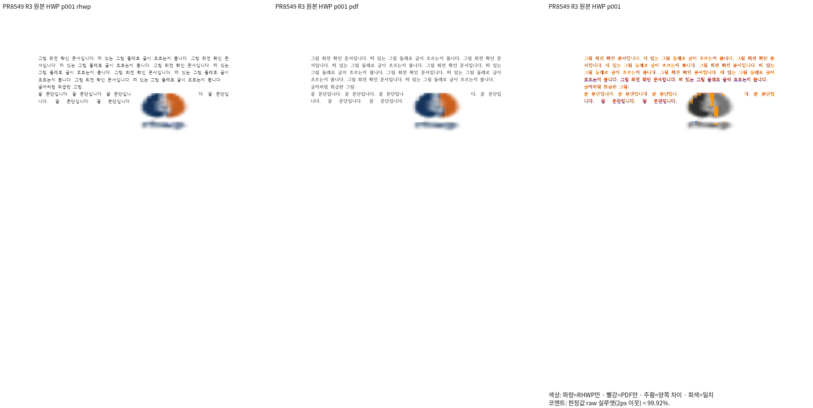
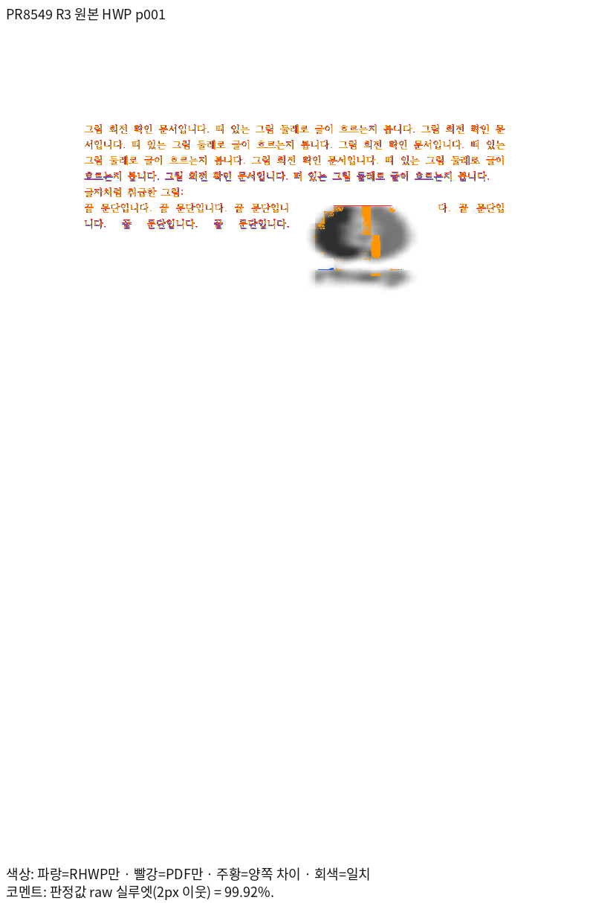
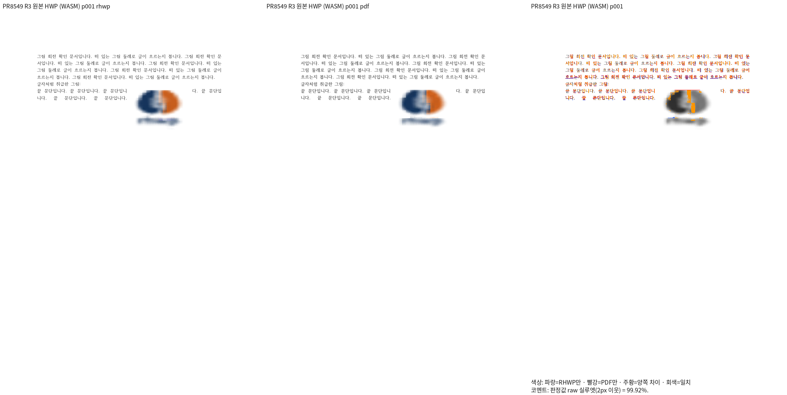

# PR #8549 리뷰 — fix(save): 저장 줄 시작이 탭·글자처럼 취급 개체의 제어 문자 가운데를 가리키지 않게 한다

## 최종 판정

**머지 보류 — 개별 원본의 Native/fresh WASM 99.92% 보정 검증 완료. 통합 전체 회귀·보호 문서 등 필수 게이트 완료 뒤 최종 수용 판정을 갱신한다.**

원 PR head와 메인터너 보정 제품을 구분한다. 원격 comment·approve·push·merge·close는 실행하지 않았다. 검증 완료 뒤 판정과 증적을 갱신한다.

## 접수 정보

- 원 PR: [PR #8549](https://github.com/edwardkim/rhwp/pull/8549), 작성자 `semanticist21`, reviewer `jangster77`.
- 원 head: `5ccd6da2adbf628b8a885bf2b2b4fa0e2eb7191b`. 2026-11-05 재조회에서 검토 시작 때와 같고 Open·Non-Draft다.
- 고정 base: `170b886f167b705b6e630c5b34bb638d92fae0a9`(PR #8542 포함).
- 현재 리베이스 제품: `71e5e0ae2a72a6b8f51682d131077bd4df44994f`. 리베이스 전 셀 첫 줄 간격 보정 제품은 `2de033b4e42be406a01ea0b9053a4531247e147c`다. 직전 행 조각 보정 제품은 `a314d7a24d3234305abff43149f575853db31105`다. 아래 실제 측정 제품 source다. 증적·관계형 회귀 commit은 `f67c60789971e8ababfc55257ff779909b2e0d1d`이며 제품 코드는 같다.
- 통합 브랜치: `review/integration-20261105-semanticist21-open`.

## 원 주장과 실제 검증 범위

실행 트리거: 떠 있는 그림을 옮긴 뒤 탭·인라인 그림이 끝에 있는 문단 저장.

독립 기대 동작: 저장 줄 시작이 8유닛 제어 문자 안에 들지 않음, 내용·쪽수 보존 및 한컴 열기.

원본 열기·모델 저장 검사와 실제 편집·저장·한컴 Print 시각 증거를 구분한다. 보충 입력은 원 PR 원본을 검증한 것으로 표현하지 않는다.

추가 보정 대상: HWP 저장본의 완결 FIRST..LAST 행 조각을 bit31 때문에 별도 줄로 쌓아 Native 91.36%였고, HWPX는 99.92%였다. 원본·PDF를 바꾸지 않고 공통 측정·배치의 행 소유를 보정한 제품에서 다섯 입력 모두 두 경로 99.92%를 확인했다. 진단 사본의 수치와 실제 제품 측정을 구분한다.

## 체리픽과 메인터너 보정

| 원 commit | 170b 리베이스 후 적용 commit |
| --- | --- |
| `560014d4554a6798f8524c00d1e261f89fcdca17` | `7f458dfb0e3bdbd1427d78489e80c5f0f41b5f24` |
| `5ccd6da2adbf628b8a885bf2b2b4fa0e2eb7191b` | `931a708e9e54174b6078d2a4ac266c962e1d021b` |

공통 보정의 원인·소비 경로·리베이스 충돌 해소는 [통합 분석](assets/semanticist21_20261105/integration-plan.md)에 기록했다.

## 검증 입력과 전쪽 결과

아래는 제품 `a314d7a24d3234305abff43149f575853db31105`의 실제 Native와 wasm-opt 최적화 fresh WASM 측정이다. 2026-11-06 KST, compat 2022, 96dpi PDFium, 보정 전 2px raw를 사용했다.

| 실제 입력 | 독립 Print | 전체 쪽수 | Native 전쪽 최저·TSV | fresh WASM 전쪽 최저·TSV |
| --- | --- | ---: | --- | --- |
| [rhwp-after.hwp](assets/line-seg-start-outside-control/rhwp-after.hwp) | [PDF](../../pdf/semanticist21-20261105/pr8549/rhwp-after-hwp-2020.pdf) | 1 | [99.92%](assets/semanticist21_20261105/validation-r3/pr8549/8549-rhwp-after-hwp-2022-native.tsv) | [99.92%](assets/semanticist21_20261105/validation-r3/pr8549/8549-rhwp-after-hwp-2022-wasm.tsv) |
| [rhwp-after.hwp](assets/line-seg-start-outside-control/rhwp-after.hwp) | [PDF](../../pdf/semanticist21-20261105/pr8549/moved-inline-picture-hwp-2020.pdf) | 1 | [99.92%](assets/semanticist21_20261105/validation-r3/pr8549/api-8549-moved-inline-picture-hwp-native.tsv) | [99.92%](assets/semanticist21_20261105/validation-r3/pr8549/api-8549-moved-inline-picture-hwp-wasm.tsv) |
| [moved-inline-picture.hwpx](../../tests/fixtures/semanticist21_integration_review/pr8549/moved-inline-picture.hwpx) | [PDF](../../pdf/semanticist21-20261105/pr8549/moved-inline-picture-hwpx-2020.pdf) | 1 | [99.92%](assets/semanticist21_20261105/validation-r3/pr8549/api-8549-moved-inline-picture-hwpx-native.tsv) | [99.92%](assets/semanticist21_20261105/validation-r3/pr8549/api-8549-moved-inline-picture-hwpx-wasm.tsv) |
| [moved-terminal-tab.hwp](../../tests/fixtures/semanticist21_integration_review/pr8549/moved-terminal-tab.hwp) | [PDF](../../pdf/semanticist21-20261105/pr8549/moved-terminal-tab-hwp-2020.pdf) | 1 | [99.92%](assets/semanticist21_20261105/validation-r3/pr8549/api-8549-moved-terminal-tab-hwp-native.tsv) | [99.92%](assets/semanticist21_20261105/validation-r3/pr8549/api-8549-moved-terminal-tab-hwp-wasm.tsv) |
| [moved-terminal-tab.hwpx](../../tests/fixtures/semanticist21_integration_review/pr8549/moved-terminal-tab.hwpx) | [PDF](../../pdf/semanticist21-20261105/pr8549/moved-terminal-tab-hwpx-2020.pdf) | 1 | [99.92%](assets/semanticist21_20261105/validation-r3/pr8549/api-8549-moved-terminal-tab-hwpx-native.tsv) | [99.92%](assets/semanticist21_20261105/validation-r3/pr8549/api-8549-moved-terminal-tab-hwpx-wasm.tsv) |

각 입력·두 경로 모두 독립 PDF와 1쪽으로 일치하고 누락·90% 미달은 없다. [입력 SHA·정식 경로](assets/semanticist21_20261105/validation-r3/pr8549/inputs.json), [실제 측정 기록](assets/semanticist21_20261105/validation-r3/pr8549/measurements.json), [Native producer](assets/semanticist21_20261105/validation-r3/pr8549/pr8549-r3-native-producer.json), [fresh WASM producer](assets/semanticist21_20261105/validation-r3/pr8549/pr8549-r3-wasm-producer.json)를 보존한다. 이 다섯 입력의 통과를 다른 통합 대상·보호 문서·전체 회귀의 완료로 확대하지 않는다.

## 주장에 대응하는 페이지 증적

같은 원본 HWP 1쪽의 마지막 문단·그림 양옆 조각·탭 문단을 독립 Print와 직접 확대 대조했다. 마지막 문단은 두 물리 행이고, 오른쪽 조각을 다음 행으로 쌓던 문제가 해소됐다. 내용 누락·중복·줄바꿈·순서 차이가 없음을 확인했다. 그림 보간 가장자리 차이와 이 조판 수정의 효과를 구분한다.

### native

### wasm

## 회귀와 조판 원칙 준수

- [tests/cases/line_seg_start_outside_control.rs](../../tests/cases/line_seg_start_outside_control.rs)

- 제품 R3의 최소 글꼴 집중 171건 PASS. 새 물리 행 관계 검사도 같은 격리에서 수정 전 2 FAIL / 수정 후 2 PASS를 확인했다.
- [관계형 회귀](../../tests/cases/physical_row_fragment_flow.rs)와 [독립 시각·반증 근거](assets/semanticist21_20261105/validation-r3/pr8549/README.md)를 연결한다. 전체 nextest 통과와 구분한다.
- R2 전체 nextest는 행 조각 제품 보정이 필요해 컴파일 중 종료 코드 130으로 중단했으며 최종 후보에서 다시 실행한다.
- 새 base PR #8640의 실제 46상태·124쪽을 포함한 R3 Native 108입력·268쪽은 모두 90% 이상이다. 최저 91.81%, 새 base 같은 268쪽 대비 표시값 하락 0쪽, 리베이스 전 136쪽 표시값 하락 0쪽이다.
- 현재 진행 중인 fresh WASM·기존 PR #8389/#8397 보호 문서·편람 필수 gate·Rust lint·Native Skia·필요한 브라우저 검증을 완료한 뒤 최종 수용 여부를 갱신한다. 웹폰트 시간 제한 검사는 사용자 지시에 따라 충돌이 없으므로 반복하지 않는다.
- 원본 단위·참조 보존 계약과 실물 배치 좌표 고정을 구분한다. 새 회귀·기존 좌표 핀은 실제 Native/fresh WASM·확대 판독 조건에 맞춰 점검하고 첫머리 근거를 갱신한다.

## Merge 후 처리 계획

통합 PR의 검증·CI·작업지시자 승인 후 원 PR별 해결 범위와 같은 원본·페이지의 증적을 연결한다. 한국어 존댓말의 기존 comment 수정안을 준비하고, 원격 게시·close·merge는 승인 범위에 따라 별도로 수행한다.
