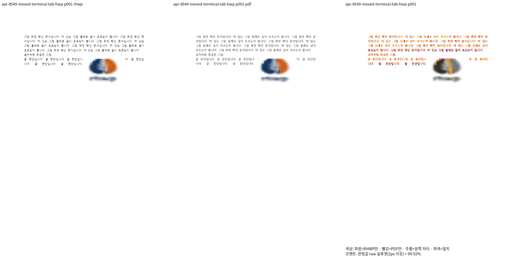
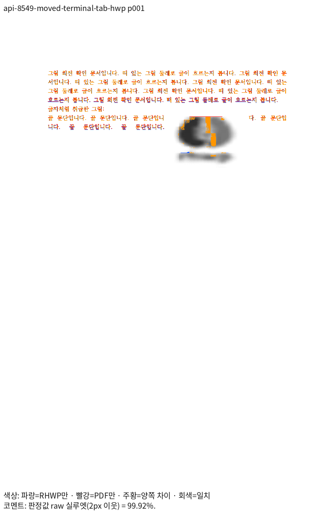
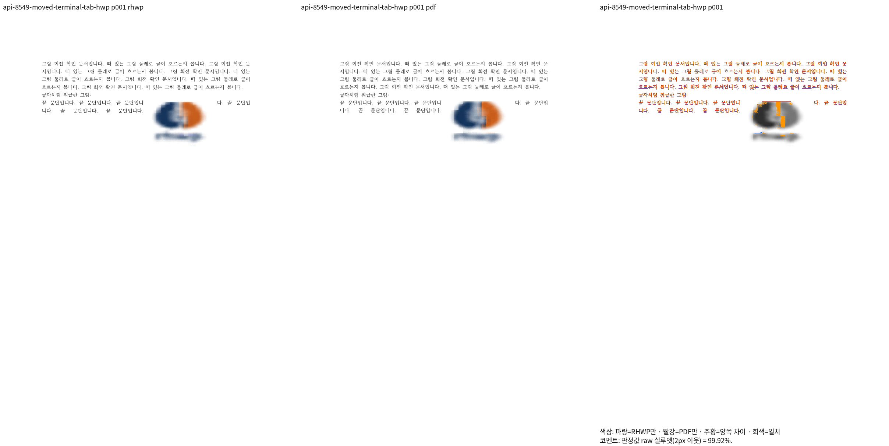
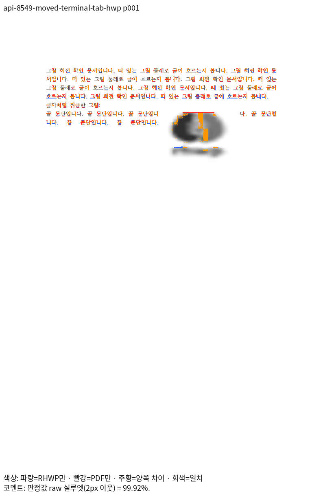

# PR #8549 리뷰 — fix(save): 저장 줄 시작이 탭·글자처럼 취급 개체의 제어 문자 가운데를 가리키지 않게 한다

## 최종 판정

**머지 보류 — R5 통합 제품의 최종 검증 진행 중.**

아래 입력의 Native/fresh WASM·직접 판독과 전체 필수 게이트를 완료한 뒤 최종 수용 판정을 갱신한다. 원격 comment·approve·push·merge·close는 실행하지 않았다.

## 접수 정보

- 원 PR: [PR #8549](https://github.com/edwardkim/rhwp/pull/8549), 작성자 `semanticist21`, reviewer `jangster77`.
- 원 head: `5ccd6da2adbf628b8a885bf2b2b4fa0e2eb7191b`. 2026-11-06 재조회에서 검토 시작 때와 같고 Open·Non-Draft다.
- 고정 base: `170b886f167b705b6e630c5b34bb638d92fae0a9`(PR #8542 포함).
- 현재 제품 source: `71e5e0ae2a72a6b8f51682d131077bd4df44994f`. 아래 표는 R5 실제 측정이며, 리베이스 전 R2/R3/R4 결과는 통합 분석과 기존 증적에서 구분한다.
- 통합 브랜치: `review/integration-20261105-semanticist21-open`.

## 원 주장과 실제 검증 범위

실행 트리거: 떠 있는 그림을 옮긴 뒤 탭·인라인 그림이 끝에 있는 문단 저장.

독립 기대 동작: 저장 줄 시작이 8유닛 제어 문자 안에 들지 않음, 내용·쪽수 보존 및 한컴 열기.

원본 열기·모델 저장 검사와 실제 편집·저장·한컴 Print 시각 증거를 구분한다. 보충 입력은 원 PR 원본을 검증한 것으로 표현하지 않는다.

추가 보정 대상: HWP 저장본의 완결 FIRST..LAST 행 조각을 bit31 때문에 별도 줄로 쌓아 Native 91.36%였고, HWPX는 99.92%였다. 원본·PDF를 바꾸지 않고 공통 측정·배치의 행 소유를 보정한 선행 R3 제품에서 다섯 입력 모두 두 경로 99.92%를 확인했다. 현재 R5의 완료 여부는 아래 표로 구분한다. 진단 사본의 수치와 실제 제품 측정을 구분한다.

## 체리픽과 메인터너 보정

| 원 commit | 170b 리베이스 후 적용 commit |
| --- | --- |
| `560014d4554a6798f8524c00d1e261f89fcdca17` | `7f458dfb0e3bdbd1427d78489e80c5f0f41b5f24` |
| `5ccd6da2adbf628b8a885bf2b2b4fa0e2eb7191b` | `931a708e9e54174b6078d2a4ac266c962e1d021b` |

공통 보정의 원인·소비 경로·리베이스 충돌 해소는 [통합 분석](assets/semanticist21_20261105/integration-plan.md)에 기록했다.

## 검증 입력과 전쪽 결과

아래는 제품 `71e5e0ae2a72a6b8f51682d131077bd4df44994f`의 실제 R5 측정이다. Native·fresh WASM을 구분하고 아직 끝나지 않은 행은 진행 중으로 표시한다. 최종 수용은 전체 필수 검증 뒤 판정한다.

| 같은 원본·용도 | 전체 쪽수 | Native 최저 raw·TSV | fresh WASM 최저 raw·TSV | 독립 Print PDF |
| --- | ---: | --- | --- | --- |
| [rhwp-after.hwp](../../mydocs/pr/assets/line-seg-start-outside-control/rhwp-after.hwp) — 제출된 정상 저장본 읽기; 현재 엔진 편집 저장 생성과 구분 | 1 | [99.91686%](assets/semanticist21_20261105/validation-r5/tsv/8549-rhwp-after-hwp-2022-native.tsv) | 진행 중 | [PDF](../../pdf/semanticist21-20261105/pr8549/rhwp-after-hwp-2020.pdf) |
| [rhwp-after.hwp](../../mydocs/pr/assets/line-seg-start-outside-control/rhwp-after.hwp) — 새 후보의 실제 공개 API 생성·저장 후 한컴 Print | 1 | [99.91686%](assets/semanticist21_20261105/validation-r5/tsv/api-8549-moved-inline-picture-hwp-native.tsv) | [99.91794%](assets/semanticist21_20261105/validation-r5/tsv/api-8549-moved-inline-picture-hwp-wasm.tsv) | [PDF](../../pdf/semanticist21-20261105/pr8549/moved-inline-picture-hwp-2020.pdf) |
| [moved-inline-picture.hwpx](../../tests/fixtures/semanticist21_integration_review/pr8549/moved-inline-picture.hwpx) — 새 후보의 실제 공개 API 생성·저장 후 한컴 Print | 1 | [99.91678%](assets/semanticist21_20261105/validation-r5/tsv/api-8549-moved-inline-picture-hwpx-native.tsv) | [99.91787%](assets/semanticist21_20261105/validation-r5/tsv/api-8549-moved-inline-picture-hwpx-wasm.tsv) | [PDF](../../pdf/semanticist21-20261105/pr8549/moved-inline-picture-hwpx-2020.pdf) |
| [moved-terminal-tab.hwp](../../tests/fixtures/semanticist21_integration_review/pr8549/moved-terminal-tab.hwp) — 새 후보의 실제 공개 API 생성·저장 후 한컴 Print | 1 | [99.92003%](assets/semanticist21_20261105/validation-r5/tsv/api-8549-moved-terminal-tab-hwp-native.tsv) | [99.92149%](assets/semanticist21_20261105/validation-r5/tsv/api-8549-moved-terminal-tab-hwp-wasm.tsv) | [PDF](../../pdf/semanticist21-20261105/pr8549/moved-terminal-tab-hwp-2020.pdf) |
| [moved-terminal-tab.hwpx](../../tests/fixtures/semanticist21_integration_review/pr8549/moved-terminal-tab.hwpx) — 새 후보의 실제 공개 API 생성·저장 후 한컴 Print | 1 | [99.91994%](assets/semanticist21_20261105/validation-r5/tsv/api-8549-moved-terminal-tab-hwpx-native.tsv) | 진행 중 | [PDF](../../pdf/semanticist21-20261105/pr8549/moved-terminal-tab-hwpx-2020.pdf) |

[원본·PDF SHA와 보존 경로](assets/semanticist21_20261105/validation-r5/inputs.json), [페이지별 정밀 raw·쪽수·producer](assets/semanticist21_20261105/validation-r5/measurements.json)를 연결한다. 실제 실행 파일과 커밋 파일의 동일성을 확인했으며, 다른 문서의 높은 수치로 미달 쪽을 상쇄하지 않는다.

## 주장에 대응하는 페이지 증적

다음 이미지는 같은 R5 측정의 실제 PNG로 현재 Visual Sweep 함수를 실행해 만들었다. 원본과 PDF를 다시 출력하지 않았고, 해당 입력·쪽의 raw가 TSV와 같은지 확인했다. 직접 판독 완료 여부와 전체 통과 판정은 별도로 기록한다.

### native · api-8549-moved-terminal-tab-hwp · 1쪽

그림 이동 뒤 탭·글자처럼 취급 개체가 있는 문단의 두 물리 행과 저장 줄 시작

### wasm · api-8549-moved-terminal-tab-hwp · 1쪽

그림 이동 뒤 탭·글자처럼 취급 개체가 있는 문단의 두 물리 행과 저장 줄 시작

## 회귀와 조판 원칙 준수

- [tests/cases/line_seg_start_outside_control.rs](../../tests/cases/line_seg_start_outside_control.rs)
- [tests/cases/physical_row_fragment_flow.rs](../../tests/cases/physical_row_fragment_flow.rs)

- [최소 글꼴 집중 회귀](assets/semanticist21_20261105/validation-r5/focused-regression.txt)는 184건 PASS다. 전체 Rust 회귀 완료로 대신하지 않는다.
- R5 Native 전체는 128개 입력·301쪽, 최저 91.81%다. [전체 Rust 목록 대조](assets/semanticist21_20261105/validation-r5/full-rust-inventory-audit.json)에서 최소 글꼴 5개·55개 binary·12,735건 PASS·45건 ignored를 확인했고 누락·중복은 없다. [실제 브라우저·생성 타입 검증](assets/semanticist21_20261105/validation-r5/ui/README.md)도 완료했다. fresh WASM·새 base 대비 비교·보호 PR #8389/#8397·편람 게이트·lint·Native Skia의 최종 결과는 계속 통합한다.
- 원본 단위·참조 보존과 실물 배치의 절대 좌표 고정을 구분한다. 완료 페이지의 Native/fresh WASM 양쪽 raw 98% 이상과 독립 PDF 확대 판독을 확인한 핀만 유지하며, 회귀 첫머리를 실제 측정 근거로 갱신한다.
- 리베이스 전 R2/R3의 성공 기록과 현재 R5를 구분한다. source·측정 조건이 같은 완전한 증거만 재사용하고 현재 제품의 실패를 과거 통과로 덮지 않는다.
- 웹폰트 시간 제한·오프라인 검사는 관련 충돌이 없으므로 작업지시자 지시에 따라 반복하지 않는다.

### 보정 근거

선행 R3에서 물리 행 관계 검사 2건의 수정 전 FAIL·수정 후 PASS를 확인했다. [행 조각 보정 증거](assets/semanticist21_20261105/validation-r3/pr8549/README.md)와 현재 R5를 구분하며, 현재 완료한 같은 입력의 원본 렌더 PNG·PDF PNG가 모두 같을 때만 기존 확대 판독을 재사용한다.

## Merge 후 처리 계획

통합 PR의 검증·CI·작업지시자 승인 후 원 PR별 해결 범위와 같은 원본·페이지의 증적을 연결한다. 한국어 존댓말의 기존 comment 수정안을 준비하고, 원격 게시·close·merge는 승인 범위에 따라 별도로 수행한다.
