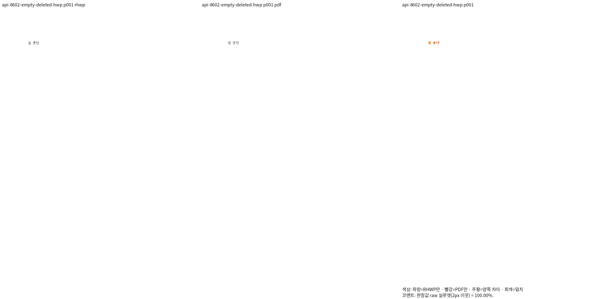
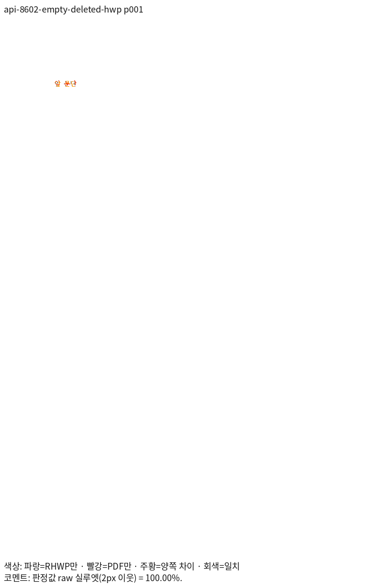
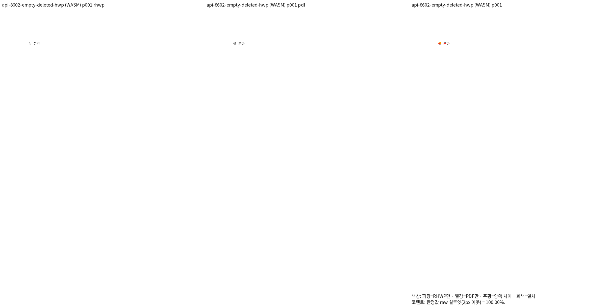
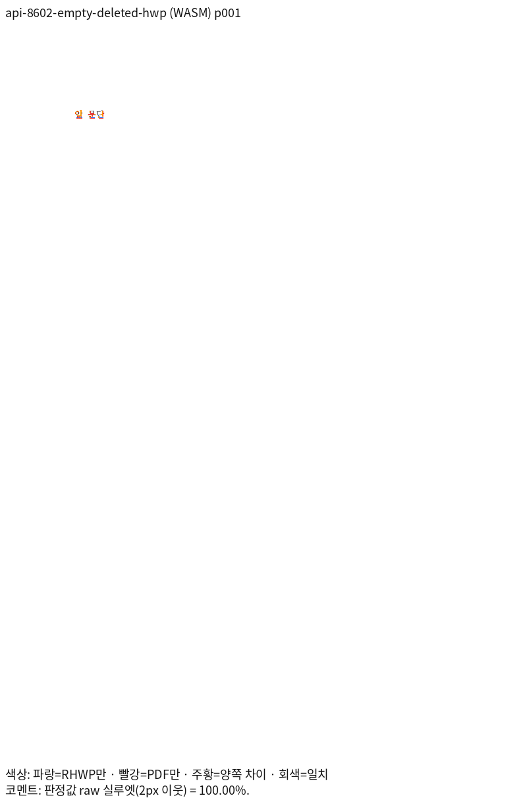

# PR #8602 리뷰 — fix(save): 편집으로 빈 문단이 되면 끝 표시만 든 PARA_TEXT를 남기지 않는다

## 최종 판정

**머지 보류 — R6 전쪽 시각 검증과 개별 동작 판독 완료, 최종 편람·Rust 게이트 진행 중.**

원본별 Native/fresh WASM 전쪽 TSV와 같은 주장 페이지의 review·overlay를 아래에 연결했다. 원격 PR 생성·CI·merge·close는 실제 실행 뒤 별도로 기록한다.

## 접수 정보

- 원 PR: [PR #8602](https://github.com/edwardkim/rhwp/pull/8602), 작성자 `semanticist21`, reviewer `jangster77`.
- 원 head: `338a75a1afd5bbe62843d71784a5c82b89613620`. 2026-11-06 재조회에서 검토 시작 때와 같고 Open·Non-Draft다.
- 고정 base: `170b886f167b705b6e630c5b34bb638d92fae0a9`(PR #8542 포함).
- 현재 제품 source: `86709ac16711820e61baa3b87e2c4ddaac23573e`. 아래 표는 R6 새 Native·fresh WASM 실제 측정이다. R5 과거 증거는 출처를 구분해 보존한다.
- 통합 브랜치: `review/integration-20261105-semanticist21-open`.

## 원 주장과 실제 검증 범위

실행 트리거: 개체·전체 글을 지워 빈 문단으로 만든 뒤 저장.

독립 기대 동작: 끝 표시만 든 PARA_TEXT를 남기지 않음, 빈 문단 줄 정보와 한컴 열기 보존.

원본 열기·모델 저장 검사와 실제 편집·저장·한컴 Print 시각 증거를 구분한다. 보충 입력은 원 PR 원본을 검증한 것으로 표현하지 않는다.

## 체리픽과 메인터너 보정

| 원 commit | 170b 리베이스 후 적용 commit |
| --- | --- |
| `cad70bbaa4da6edbfb5348aa0fb91c83f1367241` | `228e426fd19b342b8c525beeca18c27152e0caa7` |
| `338a75a1afd5bbe62843d71784a5c82b89613620` | `6b6f2d60925d3db6506a1f49ba41194bcfad4a40` |

공통 보정의 원인·소비 경로·리베이스 충돌 해소는 [통합 분석](assets/semanticist21_20261105/integration-plan.md)에 기록했다.

## 검증 입력과 전쪽 결과

제품 R6의 실제 전체 페이지 측정이다. 두 출력 경로와 독립 Print PDF의 전체 쪽수가 일치하며,
모든 페이지가 90% 이상이다. 96 DPI·Print 프로필·색상 경계 보정 전 2px raw를 사용했다.

| 같은 원본·용도 | 전체 쪽수 | Native 최저 raw·TSV | fresh WASM 최저 raw·TSV | 독립 Print PDF |
| --- | ---: | --- | --- | --- |
| [rhwp-after.hwp](../../mydocs/pr/assets/emptied-paragraph-para-text/rhwp-after.hwp) — 제출된 정상 빈 문단 저장본 읽기; 현재 삭제 저장 생성과 구분 | 1 | [100.0%](assets/semanticist21_20261105/validation-r6/tsv/8602-rhwp-after-hwp-2022-native.tsv) | [100.0%](assets/semanticist21_20261105/validation-r6/tsv/8602-rhwp-after-hwp-2022-wasm.tsv) | [PDF](../../pdf/semanticist21-20261105/pr8602/rhwp-after-hwp-2020.pdf) |
| [rhwp-after.hwp](../../mydocs/pr/assets/emptied-paragraph-para-text/rhwp-after.hwp) — 새 후보의 실제 공개 API 생성·저장 후 한컴 Print | 1 | [100.0%](assets/semanticist21_20261105/validation-r6/tsv/api-8602-empty-deleted-hwp-native.tsv) | [100.0%](assets/semanticist21_20261105/validation-r6/tsv/api-8602-empty-deleted-hwp-wasm.tsv) | [PDF](../../pdf/semanticist21-20261105/pr8602/empty-deleted-hwp-2020.pdf) |
| [empty-deleted.hwpx](../../tests/fixtures/semanticist21_integration_review/pr8602/empty-deleted.hwpx) — 새 후보의 실제 공개 API 생성·저장 후 한컴 Print | 1 | [100.0%](assets/semanticist21_20261105/validation-r6/tsv/api-8602-empty-deleted-hwpx-native.tsv) | [100.0%](assets/semanticist21_20261105/validation-r6/tsv/api-8602-empty-deleted-hwpx-wasm.tsv) | [PDF](../../pdf/semanticist21-20261105/pr8602/empty-deleted-hwpx-2020.pdf) |

[원본·PDF SHA·producer·정밀 raw](assets/semanticist21_20261105/validation-r6/measurements.md), [측정 명령·환경](assets/semanticist21_20261105/validation-r6/README.md)를 연결한다. 원 PR 원본·실제 API 저장본·보충 대조군의 용도를 구분한다.

## 주장에 대응하는 페이지 증적

같은 원본·독립 PDF·페이지의 실제 PNG다. 직접 판독과 실제 API 검증을 구분한다. 일부 Native 패널은 현재 RHWP/PDF PNG 쌍의 SHA가 이전 판독 쌍과 각각 같음을 확인해 재사용했다.

### api-8602-empty-deleted-hwp · 1쪽

실제 삭제 후 빈 문단의 한컴 열기·Print 결과. PARA_TEXT 유무는 원문 레코드 검사로 입증한다.

**native raw 100.0%** — 삭제 후 빈 문단은 인쇄에서 별도 글자를 만들지 않고 앞 문단을 보존한다. PARA_TEXT 삭제 자체는 그림의 차이가 아니라 독립 CFB 레코드 검사로 입증한다.

**wasm raw 100.0%** — 삭제 뒤 앞 문단이 보존되고 불필요한 글자·페이지가 생기지 않는다. 빈 PARA_TEXT 생략은 그림이 아닌 별도의 독립 CFB 원시 레코드 검사로 입증한다.

## 저장 손상의 독립 검출

RHWP 자체 재열기는 base·후보가 모두 통과하므로 원래 손상 검출의 증거로 사용하지 않는다.
[원시 CFB 레코드 대조](assets/semanticist21_20261105/validation-r6/runtime-checks.md)는
rhwp 파서 없이 `olefile`·`zlib`·`struct`로 같은 공개 API 저장본을 읽었다.
삭제 대상 문단은 base에서 `char_count=1`·`PARA_TEXT=[0x000d]`, 후보에서는
`char_count=1`·`PARA_TEXT 없음`이며 줄 시작 `[0]`은 양쪽 보존된다.
이는 원 PR이 한컴에서 확인한 빈 문단 저장 계약과 정식 회귀의 기대값에 대응한다.

## 회귀와 조판 원칙 준수

- [tests/cases/emptied_paragraph_para_text.rs](../../tests/cases/emptied_paragraph_para_text.rs)

- 현재 전쪽 검증은 Native 128입력·301쪽 최저 91.81401%, fresh WASM 128입력·301쪽 최저 91.17272%다. 같은 새 base의 각 301쪽 대비 하락 0쪽이다. [현재 증거](assets/semanticist21_20261105/validation-r6/README.md)를 연결한다.
- 실제 API 12그룹·브라우저 동작·TypeScript/production build·생성 타입 export와 소비 검사는 [API](assets/semanticist21_20261105/validation-r6/api/README.md)·[UI](assets/semanticist21_20261105/validation-r6/ui/README.md)에 연결했다. 원래 R5 전체 Rust 12,735건을 R6 새 실행으로 표현하지 않는다.
- 최종 코드 커밋 `5172f2d55c73b2ed33d4d3657d81e769bc9004c2`의 공식 편람 게이트와 최소 글꼴 전체 Rust·lint·Native Skia·release·doctest를 진행 중이다. 이 필수 단계 전에는 최종 승인·PR 생성으로 넘어가지 않는다.
- 실제 assertion을 확인해 관계형·고정형을 구분하고 27개 파일 첫머리를 실제 측정값으로 갱신했다. 원본 단위·비율 계약은 유지하며, [17개 완료 페이지](assets/semanticist21_20261105/validation-r6/qualification.md)는 양쪽 98% 이상과 독립 확대 판독 근거로 기존 고정 좌표를 유지한다.
- 웹폰트 시간 제한·오프라인 검사는 관련 충돌이 없으므로 작업지시자 지시에 따라 반복하지 않는다.

## Merge 후 contributor PR comment 계획

통합 PR의 실제 CI URL·code/trailing head와 확정 merge SHA를 기록한 뒤 원 PR에 한국어 존댓말로 결과를 게시한다. 기존 comment가 있으면 해당 comment를 수정하고 API로 다시 확인한다. 원 기여의 해결 범위와 위 공통 메인터너 보정을 구분한다.

- 실제 확인 페이지: api-8602-empty-deleted-hwp p1.
- Native/fresh WASM의 위 같은 원본·쪽 review와 overlay를 사용한다. 수치와 직접 판독 결론·한계는 본문 관측을 그대로 반영한다.
- 대표 이미지 안정 경로: `mydocs/pr/assets/semanticist21_20261105/validation-r6/png/pr8602/<backend>/<key>/<review 또는 overlay>_NNN.png`. 같은 PR의 추가 완료 페이지는 [패널 목록](assets/semanticist21_20261105/validation-r6/panels.md)을 따른다.
- URL은 `https://raw.githubusercontent.com/edwardkim/rhwp/<merge-commit-sha>/` 뒤에 위 실제 경로를 붙인다. devel 포함 확인 후 `--body-file` 게시·API 재조회한다.
- 문서 비교는 [Visual Sweep 정본](https://github.com/edwardkim/rhwp/blob/devel/mydocs/manual/verification/visual_sweep_guide.md#github-merge-comment)을 따른다. 원 PR·관련 이슈 close는 같은 해결 범위의 완료와 포함 관계를 확인한 뒤 처리한다.
