# PR #8642 리뷰 — fix(typeset): 앞 조각만 들어가는 각주는 앞 조각만 비용으로 잡고, 블록 표 각주 조각은 paint 측정으로 잰다 (#8468 후속)

## 최종 판정

**머지 보류 — 보고서 628의 전쪽 시각 미달과 최종 통합 검증이 남아 있다.**

수용된 제품 코드 `048f44da99d83e186f3a9e139563d20545c8bdb4`와 같은 소스의 실제 R11
출력에서 보고서 838은 Native/fresh WASM 전 109쪽이 90% 이상이다. 보고서 628은
전 195쪽을 측정했지만 양쪽 모두 7쪽이 미달이다. R12의 빈 꼬리 이월 시도는 다른 쪽을
후퇴시켜 수용하지 않는다. 아래 원 주장 페이지의 확인을 전체 PR 승인으로 확대하지 않는다.

## 접수 정보

- [원 PR #8642](https://github.com/edwardkim/rhwp/pull/8642), 작성자 `planet6897`, reviewer `jangster77` API 배정 확인.
- 원 head `7d40345bc014f3cb4eca4235783afcfb670899f9`, base `devel`.
- 최초 통합 base `08963f6825956984d38b0d9392f44777db7107ab`, 현재 고정 base
  `a7feb849e11642b1438b7e9ee460ff4c8a7c946e`.
- 통합 브랜치 `review/integration-20261106-planet6897-open`.
- Open·Non-Draft 및 head는 접수 시점 참고값이며 최종 원격 조치 전 재조회한다.

## 원 주장과 현재 검증 경계

원 PR은 각주 앞 조각의 비용을 실제 선택 조각으로 제한하고, 블록 표가 든 각주의 조각
높이를 paint와 같은 측정 결과에서 가져온다고 주장한다. 대표 실물 증거는 보고서 838의
91쪽, 보고서 628의 95·96쪽이다. 아래 이미지는 각각 같은 원본과 같은 PDF 쪽이다.
축약 입력이나 다른 보고서의 페이지로 대신하지 않았다.

| 원 주장과 실제 확인 | Native raw | fresh WASM raw | 직접 판독과 남은 차이 |
| --- | ---: | ---: | --- |
| 보고서 838, PDF 91쪽: 본문 아래 각주 표·각주 글줄 | 99.99681% | 99.99670% | 본문 끝·구분선·표의 행과 뒤 각주가 같은 위치에 있으며 겹침·누락을 발견하지 않았다. |
| 보고서 628, PDF 95쪽: 각주 56의 표와 표 뒤 글줄 | 99.20314% | 99.20365% | 각주 표와 뒤 글줄이 보존되고 본문과 겹치지 않는다. 본문 제목 `1. 개요`의 문자 간격 차이는 남는다. |
| 보고서 628, PDF 96쪽: 이어받은 각주·후속 본문 | 99.26111% | 99.24426% | 앞 쪽 각주 뒤 글줄과 다음 각주가 보존된다. `1) 법적근거에 의한 보장` 제목의 폭·간격 차이는 남는다. |

수치가 98%를 넘었다는 이유로 제목 차이를 해소된 것으로 기록하지 않는다. 이 표는
원 PR이 주장한 각주 소유·겹침 경계를 실제 확인한 결과이며, 제목·수식·전쪽 미달을
면제하거나 새 px 기대값을 등록한 결과가 아니다.

## 원본·전쪽 TSV·대표 이미지

- 보고서 838: [원본 HWP](assets/planet6897_20261106/pr8642/report-838-original.hwp),
  [독립 Print PDF](../../pdf/planet6897-20261106/pr8642/report-838-original-2020.pdf),
  [Native 109쪽 TSV](assets/planet6897_20261106/shape-header-r11/native/report-838.tsv),
  [fresh WASM 109쪽 TSV](assets/planet6897_20261106/shape-header-r11/wasm/report-838.tsv).
  전쪽 최저값은 각각 94.99379%·94.94289%, 미달 0쪽이다.
- 보고서 628: [원본 HWP](assets/planet6897_20261106/pr8642/report-628-original.hwp),
  [독립 Print PDF](../../pdf/planet6897-20261106/pr8642/report-628-original-2020.pdf),
  [Native 195쪽 TSV](assets/planet6897_20261106/shape-header-r11/native/report-628.tsv),
  [fresh WASM 195쪽 TSV](assets/planet6897_20261106/shape-header-r11/wasm/report-628.tsv).
  전쪽 최저값은 각각 33.38902%·33.56141%, 미달 쪽은 양쪽 모두
  16·18·120·122·123·124·125쪽이다.
- 2026-11-07 KST 측정, 96 DPI, `print` profile, `compat 2022`.
  실제 시스템 글꼴·원본별 웹 공급 글꼴을 사용했다. 최소 글꼴 환경은 시각 측정에 사용하지 않았다.
  [PNG·제품 소스 일치와 직접 판독 기록](assets/planet6897_20261106/pr8642/claim-pages-r11/provenance.json).
  아래 패널은 완료된 R11 PNG를 재사용해 만들었으며 재렌더 결과로 표시하지 않는다.

보고서 838, 91쪽 — Native / fresh WASM:

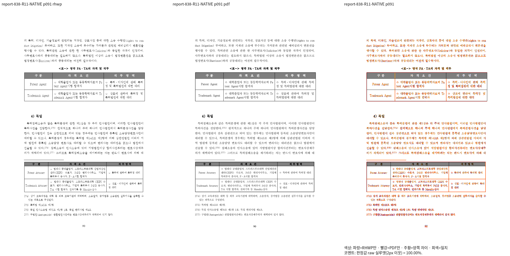
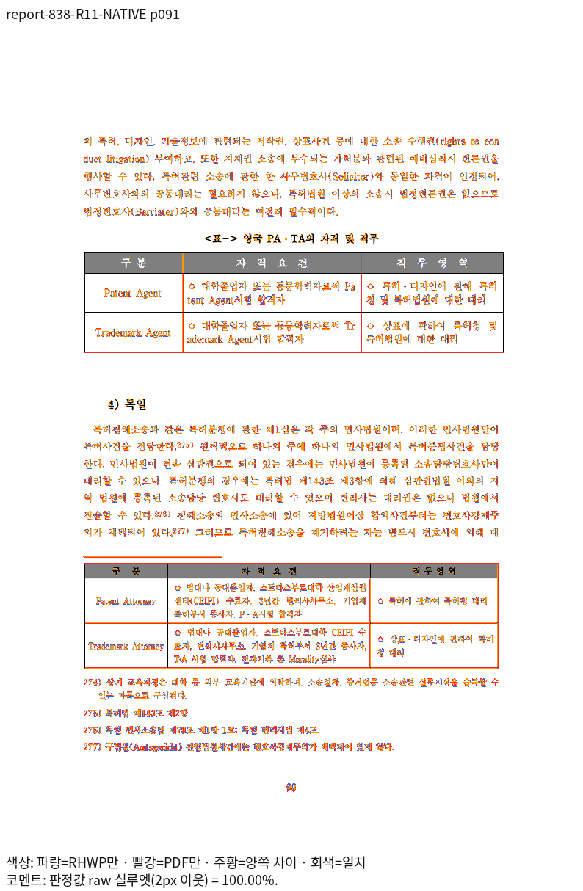
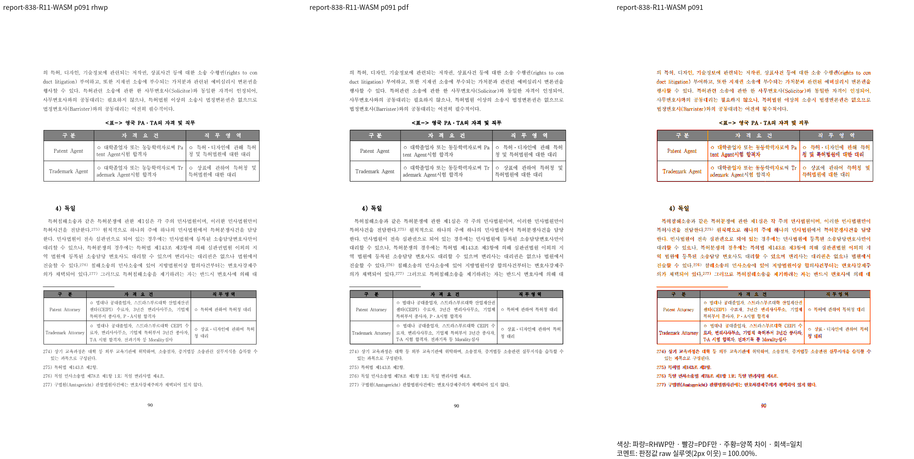
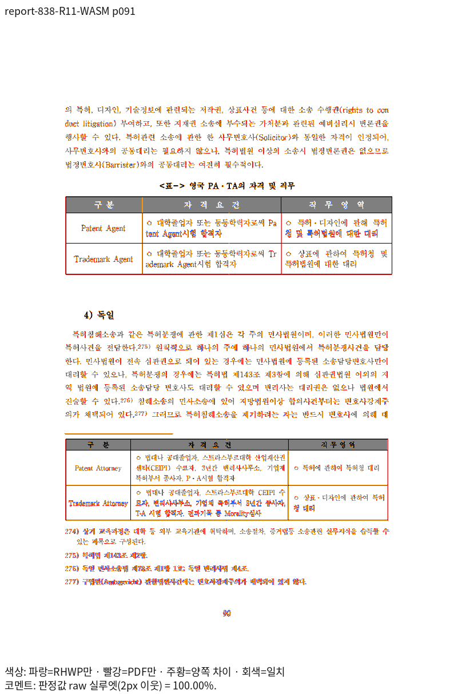

보고서 628, 95쪽 — Native / fresh WASM:

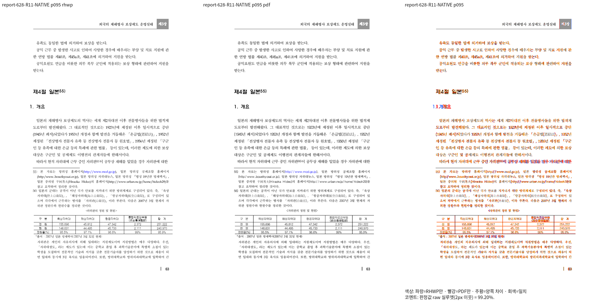
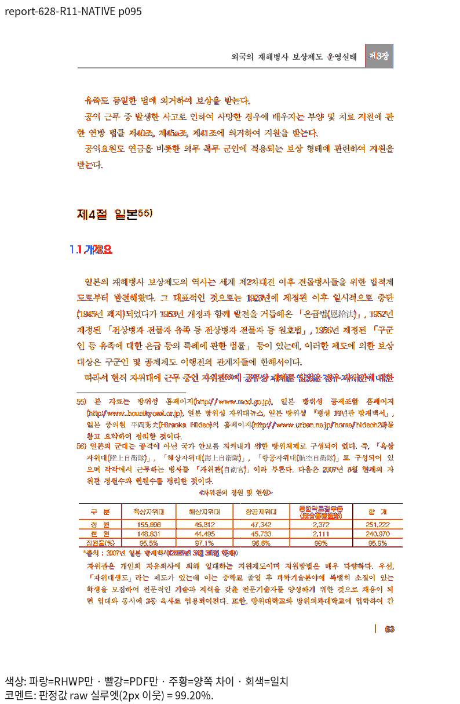

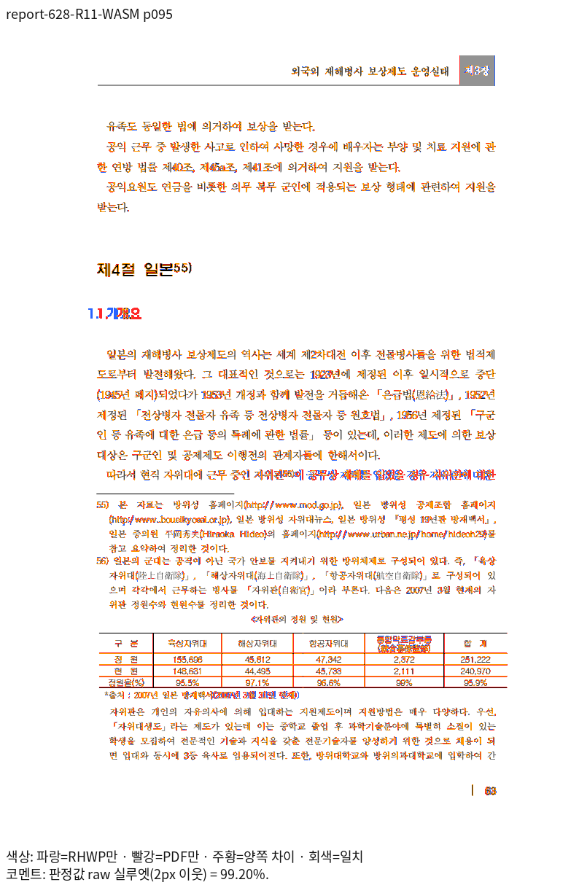

보고서 628, 96쪽 — Native / fresh WASM:

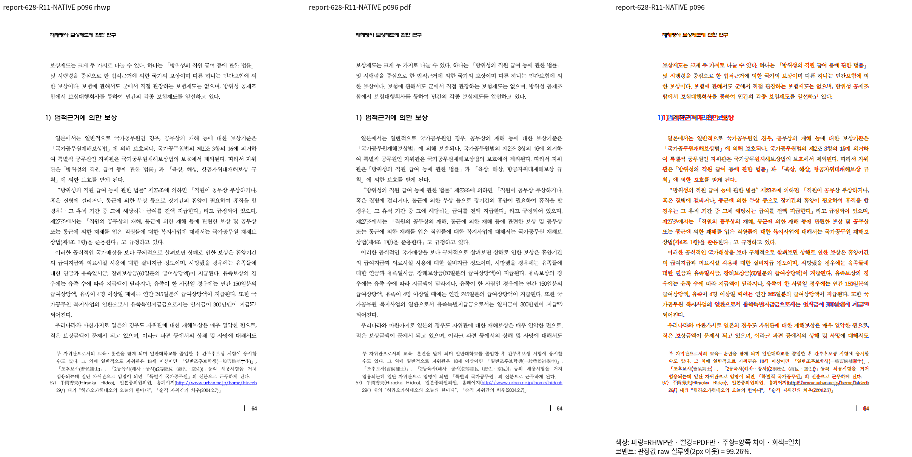
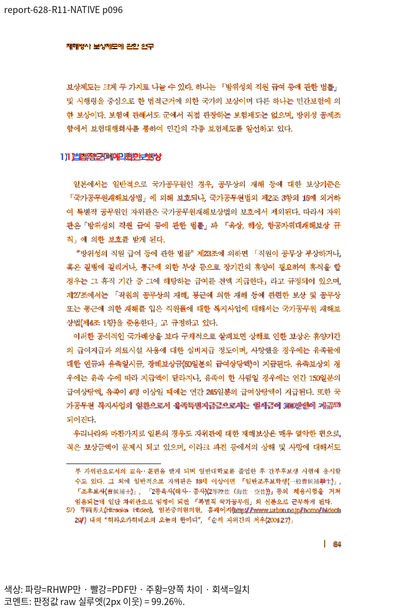
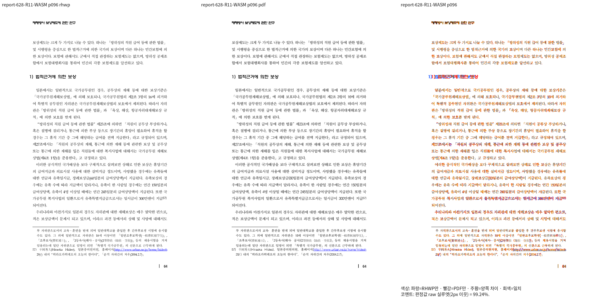
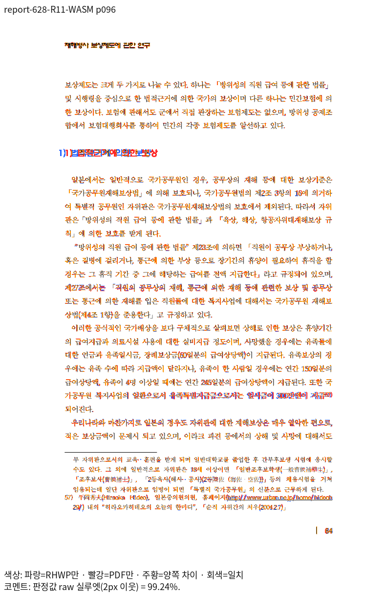

## 회귀·입력 확인

- [tests/cases/issue_8468_footnote_line_reserve.rs](../../tests/cases/issue_8468_footnote_line_reserve.rs)

통합 source `46aca162bcf7fbcbc114cc42a251e6047598b371`의 기본 feature 전체 Rust 회귀는 **12,796건 통과, 실패 0건, 기존 ignored 45건**이다. 공개 글꼴 5개만 노출한 최소 글꼴 환경에서 수행했다. 이는 최초 통합 source의 결과다. 이후 메인터너 보정으로 제품·테스트 코드가 바뀌었으므로 보정 후 head의 회귀 통과로 재사용하지 않는다. 새 보정본의 검증 결과와 원본·Print 추가를 구분한다.

Native Skia 공식 3종(라이브러리 4,040건 및 통합 24건)과 이번 PR의 추가 5개 모듈 14건이 모두 통과했다. 라이브러리의 기존 ignored는 12건이며, focused 실행에서 제외된 다른 테스트를 실패나 ignored로 합산하지 않는다. 전쪽 Native/fresh WASM·쪽수·확대 판독·lint는 별도 완료 조건이며, 회귀 통과로 대신하지 않는다.

## 적용과 보정 계획

[이 PR 구현 계획](pr_8642_review_impl.md) · [전체 순서·게이트](assets/planet6897_20261106/integration-plan.md).

## R25 보정의 전쪽 확인

수식 셀의 현재 줄 구성과 각주 예약을 포함한 빈 꼬리의 소속을 공통 프레임으로 보정했다.
R25에서 report-628 전195쪽 최저 Native92.99% / fresh WASM96.06%, report-838 전109쪽
최저94.99% /94.94%, 저장 밴드 전2쪽은 양쪽100%다. 전306쪽/backend에서 독립 Print와
쪽수 일치·90%미만0쪽·R11 표시값 하락0쪽을 확인했다.
[원본별 전쪽 TSV·직접 판독 PNG·실행 신원](assets/planet6897_20261106/pr8642/r25/README.md)을 보존했다.
원래 미달이던123~125쪽은 Native99.77/99.92/99.81%, fresh WASM99.77/99.91/99.79%다.
표4-12~4-14와 뒤 본문·각주72~74의 같은 쪽 소속을 양쪽 review/overlay에서 확인했다.
최종 R26·보호 문서·전체 회귀·lint 판정은 진행 중이며 이 R25 기록만으로 최종 승인을 선언하지 않는다.
