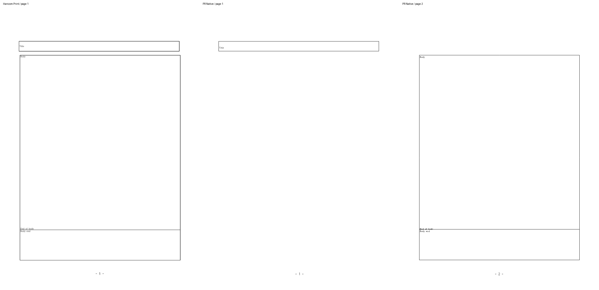

# PR #9042 리뷰 — 같은 문단의 제목·본문 표 배치

## 현재 판정

**머지 보류 — 원 합성본의 저장 줄 보정과 실제 편집·저장 경계를 포함한 최종 재검증 중이다.**
기존 차이 예외는 적용하지 않는다. 원격 제품 push·댓글·승인 리뷰·새 PR·merge는 승인받지 않았으며 수행하지 않았다.

현재 제품 후보는 `1506a1c34672931c4f5aa5cb6363fba776225949`, 반영한 devel은
`5cbcc9b451cf286e1b7c680426c857dc802e50f3`다. #9051의 다섯 기능과 새 #9012·#9053의
인쇄·컨트롤 삽입 계약을 보존하며 검증한다. 원 contributor head는 변경하지 않았다.

이전 제품 `47d5b71f32f6b26702768927d21ba34cde441959`에서 목표 8종 전 16쪽은 Native/fresh 최적화 WASM 모두 90% 이상이었다.
원 합성본은 양쪽 100.00%, 나머지 7종은 Native 100.00%·WASM 최저 99.59%다.
정본 보호 3,542쪽의 공식값 하락은 0건이고 편람 383쪽도 통과했다.
공개 CLI·브라우저의 무편집 저장 36건과 저장 출력 양쪽 전쪽 비교도 완료했다.
이 결과는 **이전 source의 결과**이며, 이후 발견한 편집 경계나 현재 후보의 필수 게이트를 대신하지 않는다.

실제 Body 뒤에 X를 추가하면 이전 source는 화면 2쪽·저장 재열기 3쪽이었다.
저장 높이의 원시 행 합과 수용한 닫힌 행 프레임이 달랐고, 미변경 제목의 저장 원점도 세션 전체의
편집 여부로 폐기됐다. 줄 프레임 생산 → format·fit·예약 → 실제 paint → 저장 writeback이
같은 결과를 소비하도록 연결했다. 한컴 2020의 같은 편집 모델 Print 전 2쪽을 확보해 비교한다.
현재 후보의 Native 선행 확인, fresh WASM·실제 반복 저장, 전체 회귀·필수 lint·편람·보호 검증을
완료한 뒤 최종 판정을 갱신한다. [보완 범위](pr_9042_review_impl.md)·[검증 원장](assets/pr9042/final-validation/README.md).

아래는 접수 시점의 **수정 전 진단**이다. 그 시점의 미실행·수치와 위 완료한 이전 source 결과를 구분한다.

## 접수·소스

- [원 PR #9042](https://github.com/edwardkim/rhwp/pull/9042), puckqook의 첫 rhwp 기여. 직접 연결한 해결 이슈는 없다.
- 원 head `3ae4eeb332c3b0edbb3a8fbe334daf2b0a48115b`, 원 base `180a4ec97205b67c4dc4f90416063c01ecfdf396`.
- 검토 기준 upstream/devel `00d09f773a2f6c21604a4e6394df7152bbb26e8c`.
- clean한 주 작업공간 `review/pr-9042-coanchored-table-pagination`에서 검토하며 별도 worktree는 만들지 않았다.
- 접수 기록 `1613d6c24338a3166fac4747295758528b703c2b` 뒤 원 기여를 충돌 없이 cherry-pick한 제품 head는 `637410dbfa8deb060d1c8739b0bf5e7ae8286c89`다. 원 ref와 author를 보존했다.
- reviewer edwardkim 지정과 같은 원 head를 API로 재확인했다. 최초 사전 조회/fetch가 지정 전에 실행된 순서 누락도 기록한다. 원격 제품 source는 변경하지 않았다.
- 기본 maintainer_general과 보조 intake_and_review·local_validation·visual_fixture_evidence·post_merge·first_time_contributor를 적용했다. 원본·메인테이너 보정 분리는 collaborator_external_pr도 확인했다.

## 실제 검증

아래는 검토자의 실행 결과다. 작성자의 원 head CI·WASM·전체 회귀 주장과 구분한다.
입력·기준 PDF·생성 경로·SHA와 실행 환경은 [증거 원장](assets/pr9042/README.md),
[해시·독립 작업 결과](assets/pr9042/evidence.json)에 보존했다.

| 입력 | 독립 한컴 Print | 최신 devel Native | 원 기여 적용 Native | 판정 |
| --- | ---: | ---: | ---: | --- |
| 원 공개 합성 HWP | Mac Viewer 2쪽 | 3쪽 | 2쪽 | 원 증상 유효, 개선 확인 |
| 같은 입력의 RHWP 저장·재열기 | Windows 2020 2쪽 | 미실행 | 2쪽 | 직렬화 대조군 |
| 빈 머리말 추가·저장·재열기 | Windows 2020 2쪽 | 미실행 | 3쪽 | 미해결 경계 |
| 빈 꼬리말 추가·저장·재열기 | Windows 2020 2쪽 | 미실행 | 3쪽 | 미해결 경계 |
| 실제 한컴 2020에서 재저장한 HWP | Windows 2020 2쪽 | 2쪽 | 2쪽 | 정상 대조군, PNG 2쌍 동일 |

- 원 입력과 첨부 Mac PDF의 SHA-256은 PR 본문과 일치한다. Mac Viewer Print는 독립 기준으로 유효하며 PDF 버전만으로 재변환하지 않았다.
- 원 입력 Native 전쪽 raw는 **94.20%, 96.08%**다. [2쪽 TSV 원본](assets/pr9042/original-native.tsv)을 보존했다.
- 한컴 재저장 대조군 Native 전쪽 raw는 **100.00%, 100.00%**다. [2쪽 TSV 원본](assets/pr9042/hancom-saved-native.tsv)과 base/후보 PNG 동일성을 기록했다.
- 빈 머리말·꼬리말·무변경 직렬화 3종의 독립 Print는 모두 2쪽이며, 96 DPI RGB 해시가 두 쪽 모두 같다. 빈 비본문 제어가 본문 배치를 바꾸지 않는 독립 근거다.
- 빈 머리말 Native 1쪽 raw는 **26.64%**다. 전체 측정은 Native 3쪽/기준 PDF 2쪽 불일치로 종료했다. [부분 TSV](assets/pr9042/empty-header-p001-native-partial.tsv)는 1쪽 자료이며 전쪽 완료로 세지 않는다.
- 최소 글꼴 환경에서 원 신규 회귀 `coanchored_title_and_body_stay_on_the_first_page` **1건 통과**, 선택되지 않은 313건 skip. 시스템·개인 글꼴을 숨기고 저장소 공개 라이선스 글꼴 5개만 노출했다.
- 두 Native producer를 `release-test`, `native-skia`, 동일 shared target에서 순차 빌드했다. 후보 빌드 최종 재확인 exit 0이다. 최초 wrapper 종료 143을 성공 코드로 치환하지 않았다.
- 검토자의 fresh 최적화 WASM, 전체 회귀·lint·Native 공식 검사, 편람 383쪽 gate·정본 보호 3,542쪽은 **아직 미실행**이다. 경계 결함을 해결한 뒤 최종 제품 head에서 완료해야 한다.

직접 판독에서도 독립 Print의 첫 쪽에는 제목·본문 표가 함께 있고, PR의 첫 쪽에는 제목만 있다.
본문은 2쪽, 명시적 쪽 나누기 뒤의 `Next page`는 3쪽으로 밀렸다.

## 원인·호출 경로

| 범위 | 생산 → 수용·소비 | 확인 결과 |
| --- | --- | --- |
| 공동 호스트 원점 | `float_placement.rs::stored_inline_host_has_separate_float_frame` → `ParagraphFloatPlacement::from_stored_inline_host` | 한 저장 줄의 TAC band와 별도 float 원점을 확인한다. PageNumberPos는 무시하지만 Header/Footer는 wildcard로 거절한다. |
| 제목 줄 준비 | `typeset/controls/stored_tac.rs::prepare_coanchored_first_line` | 같은 문단의 Header/Footer는 이미 비본문 제어로 처리한다. 위 공통 판정과 수용 조건이 다르다. |
| fit와 배치 | `typeset/table/block/entry.rs`의 새 whole-fit 경로 → `record_paragraph_float_placement` → `place_table_with_text` → `record_inline_flow_bottom` | 제목 줄 시작 원점으로 만든 frame을 fit와 배치에 전달한다. 위 판정이 거절되면 새 경로를 사용하지 못한다. |
| 마지막 행 빈 높이 | `table_row_frame.rs::declared_tail_row_height` → `height_measurer.rs`와 `layout/table_layout/reflowed_nested_row.rs` | 공통 결과 소비 경로는 존재한다. 추가한 중첩 TAC tail 수용 조건은 이번 원 입력에서 실행되지 않는다. |

기존 마지막 행 공통 계약의 메인테이너 보정은 `c33037bf2ff187ab1d80dd6b73537f55b61335d8`(PR #8187)이다.
기존 `issue_8682_declared_excess_tail_row`의 nested-tail 보호도 유지해야 한다.
보정 전 원 해결 PR·현재 base의 적용 경로·독립 검증을 함께 대조하고, 기대값부터 바꾸지 않는다.

## 입력 성격·남은 증거

원 HWP는 RHWP 빈 문서에서 생성한 공개 합성 입력이다. `RhwpLineSegTags`가 있고 본문 셀에는 중첩 표가 없다.
문서 metadata의 한컴 버전은 실제 생성 제품 증거로 사용하지 않는다. 한컴 SaveAs 뒤에는 해당 stream이 없어지고
최신 devel에서도 이미 정상 2쪽이므로, 이번 원 사례를 모든 한컴 저장 문서의 재현으로 확대하지 않는다.

1. **빈 머리말·꼬리말 경계:** 공통 비본문 제어 분류를 보정하고 실제 저장·재열기와 최종 배치까지 재검증해야 한다.
2. **중첩 표 tail 증거:** 별도 확장 변경은 원 fixture·새 검사로 실행되지 않는다. 결함으로 단정하지 않되 실제 발동 입력·독립 Print·비적용 대조군을 보강해야 한다. 이 부분을 임의로 제거하지 않았다.
3. **회귀 파일 첫머리:** 신규 파일이 `use`로 시작한다. 최종 Native/fresh WASM 측정 뒤 `//!` 유형·시각·전체 최저값·근거를 기록해야 한다. 값을 추정하지 않는다.
4. **Mac Print와 미세 차이:** 제목 기준선과 `End of body` 부근 괘선·글자의 차이는 이전 base의 본문과 후보 본문을 대조해도 같은 geometry다. 새 악화로 단정하지 않는다. Native는 실제 HCRDotum/HCRBatang을 공급했고 미공급·generic/glyph fallback이 없다. Mac/웹 글꼴 프로그램 차이가 원인인지는 아직 입증하지 않았다. 수용 예외를 적용하지 않았다.

## 원 head CI·보안

원 head 제품 CI와 CI Impact Policy는 success다. CodeQL run
[43352464141](https://github.com/edwardkim/rhwp/actions/runs/43352464141)도 success이며
selective `ql=rs`에 맞는 Rust 분석이 업로드됐다. 실제 분석 error는 없고 results_count는 0이다.
종합 neutral의 `3 configurations not found`는 Actions·JavaScript·Python 미실행 구성 안내다.
실패한 Rust 분석이나 새 취약점으로 해석하지 않았으며 재실행·경고 분류 변경도 하지 않았다.

## 다음 처리와 승인 경계

보완 담당 결정은 [보완 제안](pr_9042_review_impl.md)에 따른다.
현재 원격 변경은 reviewer 지정뿐이다. 추가 제품 보정·공개 댓글·승인 리뷰·push·새 PR·merge는 수행하지 않았다.
검토 자료와 반례는 로컬에 보존하고 담당 결정을 기다린다. 수용 시 첫 기여 감사와 실제 최종 head의
검증·이미지를 contributor comment에 준비한다.
