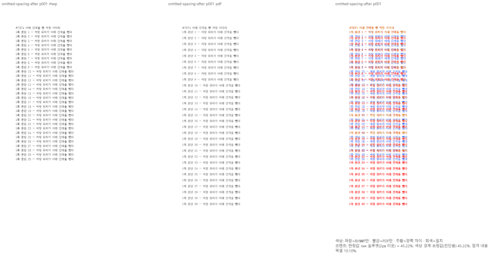
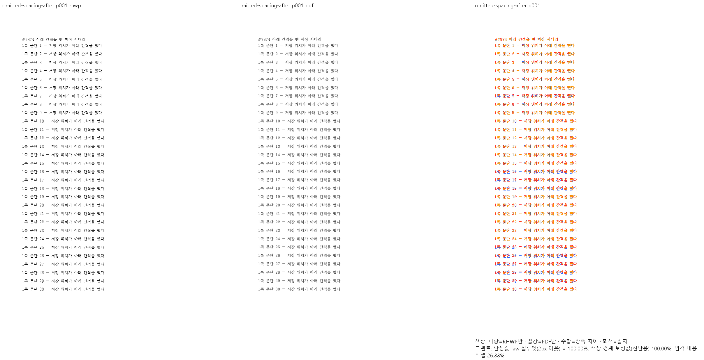
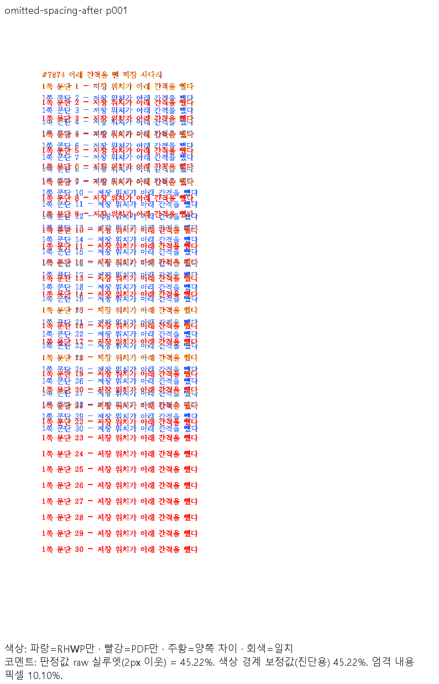
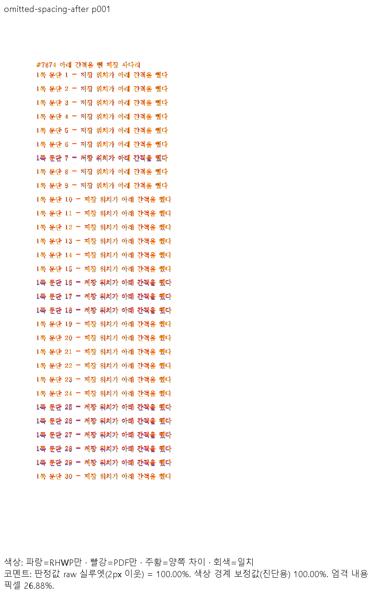

# #7874 저장 사다리가 뺀 문단 아래 간격 — 조판·배치 공용 판정 시각 증적

- base: `upstream/devel` `605ccfd92`
- head: `fix/7874-omitted-spacing-after-v2` code `5caaf011e`
- 입력: `samples/issue7874/omitted-spacing-after.hwpx` (SHA-256 `b1905e369c93f4086047e3c68b77474eab0468491fae7da97bcbd4d944ac0cbf`)
- 기준 PDF: `pdf/issue7874/omitted-spacing-after-2024.pdf` (한/글 2024 Print, 2쪽, SHA-256 `8a15a05c3f7c7f43e999e4bfa75971255a1892e03643f54f0ffc7cf848da2bce`)
- 대조군: `samples/HWP5-nopassword-123456.hwp` ↔ `pdf/issue7994/HWP5-nopassword-123456-source-2024.pdf` (24쪽)
- 비교: 96dpi, `--compat 2024`, `scripts/visual_sweep.py --silhouette-only`, 판정값 `silhouette_raw_match_percent`(2px 이웃, 색상 경계 보정 전)

## 전쪽 TSV 요약

| 문서 | 경로 | 쪽수 (rhwp/PDF) | raw 최저 | 90% 미만 |
| --- | --- | ---: | ---: | --- |
| omitted-spacing-after | base Native | 2/2 | 45.21582 | 1쪽 |
| omitted-spacing-after | head Native | 2/2 | 100.00000 | 없음 |
| omitted-spacing-after | head fresh WASM | 2/2 | 100.00000 | 없음 |
| HWP5-nopassword (hwp) | base Native | 24/24 | 87.63163 | 2쪽 |
| HWP5-nopassword (hwp) | head Native | 24/24 | 87.63163 | 2쪽 |
| HWP5-nopassword (hwp) | head fresh WASM | 24/24 | 87.40487 | 2쪽 |

HWP5-nopassword 는 수정 전후 조판 결과(`dump-pages` 전 쪽)가 같고 Native 24쪽 점수도 쪽마다 같다.
2쪽 미달은 base 에 이미 있는 차이로 이 변경과 무관하다(base fresh WASM 은 산출하지 않았다).
원 TSV 는 `tsv/` 에 있다.

## 대표 이미지 (1쪽)

| base | head |
| --- | --- |
|  |  |
|  |  |

직접 판독: head 는 1쪽 문단 1~30 이 한/글 PDF 와 같은 줄 위치(28.9px 피치)다. base 는 문단마다 아래
간격(7.57px)만큼 위로 붙어 문단 30 이 PDF 보다 약 180px 위에 그려진다.
