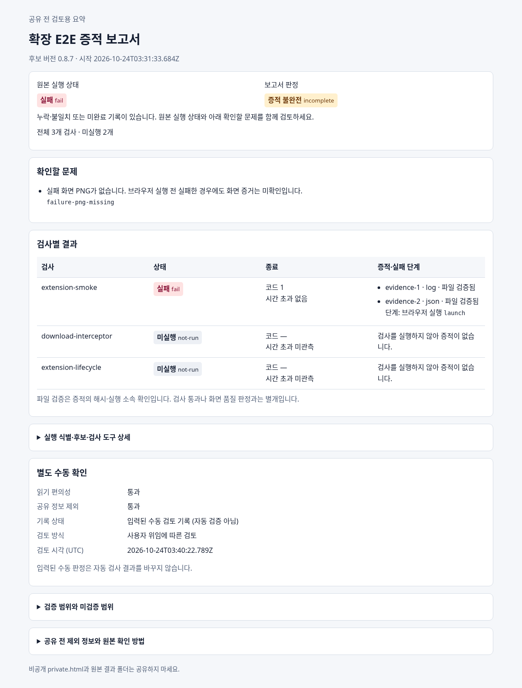

# 실제 확장 E2E 실행 시도의 공유 보고서

PR #8178 · Issue #7449

**실제 후보로 실행을 시도했지만 Chrome for Testing 미설치로 브라우저 실행 전에 실패한 결과다.**
원본 실행은 fail, 보고서는 PNG 누락으로 incomplete이며 후속 두 검사는 not-run이다.
확장 동작이나 전체 E2E가 통과한 증거가 아니다.

## 열어 보기

1. [공유 보고서 ZIP](shared-report.zip)을 다운로드하고 압축을 푼다.
2. report.html을 브라우저로 연다. [report.json](report.json)은 편집기나 GitHub에서 데이터로 확인한다.
3. 상태·문제·검사 결과를 먼저 읽고, 후보/도구 SHA와 환경은 상세를 펼쳐 확인한다.

[HTML 원본](report.html)도 내려받아 열 수 있다. ZIP에는 이 HTML과 JSON 두 파일만 들어 있다.

아래 이미지는 **보고서 HTML의 미리보기**이며 확장 프로그램의 실패 화면 PNG가 아니다.

## 공유 범위와 판정

사용자가 판단을 위임한 뒤 에이전트가 가독성과 공유 정보 제외를 통과로 판정했다.
report.json의 reviewMode=delegated와 같은 원본 SHA에 묶인 수동 기록을 확인할 수 있다.
사용자 본인의 직접 판정이나 자동 인증을 주장하지 않으며 수동 통과도 실제 fail/incomplete를 바꾸지 않는다.

공유본에는 추적용 SHA·버전·시각이 포함된다. 후보/브라우저 절대 경로·다운로드 ID/URL·원본 로그·
진단·PNG·자유 텍스트는 제외했다. **private.html과 원본 결과·로그·진단은 이 디렉터리와 ZIP에 없다.**
비공개 원본 ZIP은 작업 세션에만 보존한다.

## 추적 정보

- 보고서 생성기 code candidate: `393a59dc5e3991a1b90ac15589322eab53e90b8b`.
- 원본 실행 도구 SHA: `e32f63d2aac839190d2b8085f0ec5346fa4e0479`, dirty=false.
- 원본 result.json SHA-256: `fabdb4c1b313eed53cf752dd583b91ae022dd0dab3cce5e966ea8c6d15d23609`.
- 후보 inventory SHA-256: `8ccccb9e9ee3a802f6436b7fe0615bc1af93ada2d0039c38c58f2d0ffe600295`.
- 공유 HTML SHA-256: `0dd238562ea03e7f8b20b08336ed3d30e1ba26bb3759128938c13f8e23aa5a06`.
- 공유 JSON SHA-256: `a7d15ce9c66e48fcc7330093d1e892e25787beaeffc1502c4637fda9fcf65fda`.

현재 환경의 지정 프록시가 Chrome 다운로드를 403으로 거부한다. 시스템 Chromium은 확장 설치
금지 정책이 있어 대체하지 않았다. Chrome 버전 값은 설치 대상 기록이며 실행 관측값이 아니다.
후보 WASM은 기존 pkg 산출물이고 이번에 fresh 빌드하지 않았으며 빌드 SHA는 미관측이다.

[전체 검증 결과와 실행 명령](../../task_m100_7449_report.md) ·
[보고서 사용 매뉴얼](../../../manual/chrome_edge_extension_build_deploy.md#310-선택-실행-증적-보고서-7449)
