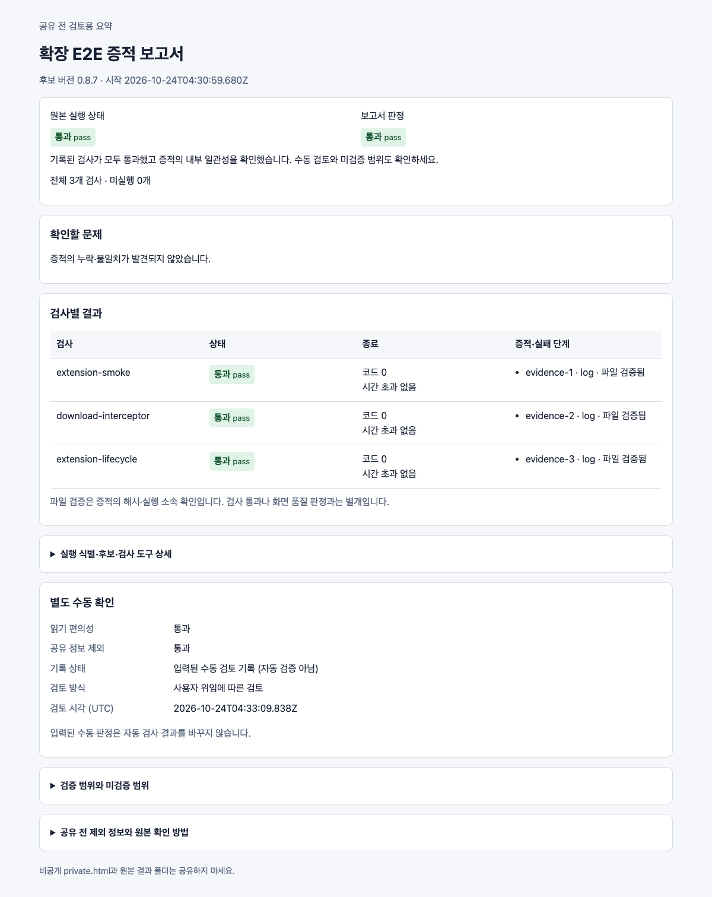
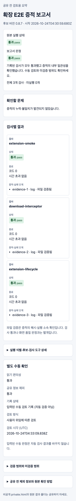

# PR #8178 로컬 실제 확장 E2E 성공 증적

2026-10-24 로컬 Chrome for Testing에서 최초 공식 실행 1회가 모두 통과했다.
아래는 실제 결과에서 생성한 공유 요약이며, 원본 로그와 private.html은 공개하지 않는다.

1. [공유 ZIP](shared-report.zip)을 내려받아 report.html을 연다.
2. [공유 JSON](report.json)에서 원본 pass, 보고서 pass, issues 0, 검사 3개와 출처를 확인한다.
3. 아래 이미지는 보고서 화면이다. 확장 문서 출력 품질의 기준 이미지가 아니다.





## 이전 보류와 이번 검증

클라우드의 Chrome 다운로드 403 및 관리 Chromium 확장 설치 제한을 우회하지 않고,
로컬 macOS arm64에 공식 Chrome for Testing 155.0.8059.79를 설치해 실행했다.
사용자 개인 프로필 대신 공식 실행기의 임시 프로필·다운로드 폴더를 사용했다.
이전 클라우드 실패 증거는 그대로 유효한 이력이며 이번 성공으로 덮어쓰지 않는다.

정확한 PR 소스에서 release 최적화·wasm-opt를 포함한 fresh WASM을 빌드한 뒤 확장 후보를 빌드했다.
`pkg/rhwp.js`, `pkg/rhwp_bg.wasm`과 후보 dist/wasm의 바이트·해시가 일치했다.
후보 inventory는 실제 검사 전후 및 보존 사본에서 동일했다. 실행기 dirty=false다.

| 검사 | 실제 결과 | 시간 |
| --- | --- | --- |
| extension-smoke | viewer/options/print/service worker/content script PASS | 2.425초 |
| download-interceptor | XLSX 2건 탭 0, HWP 8건 download별 탭 1, 초기 저장 지연 3건, 자체 Blob 보존 PASS | 15.012초 |
| extension-lifecycle | 재진입·worker 중단·브라우저 재시작·자동 열기 on/off·HWP/HWPX·과거 다운로드 등 10개 시나리오 PASS | 34.116초 |
| 원본 실행기 | pass / exit 0 / timeout 0 / not-run 0 / 재시도 없음 | 전체 약 52초 |
| 최신 보고서 생성기 | pass / issues 0 / exit 0 / 로그 3개 실행 ID·해시 검증 | 완료 |
| 보고서 직접 판독 | 1200px·390px 상태/결과 표시와 가로 넘침 없음 | 완료 |
| 공유 정보 제외 | HTML/JSON에 절대 경로·다운로드 ID·원본 로그·확장 ID가 없음. ZIP은 요약 2개만 포함 | 완료 |

기존 사용자 위임에 따른 가독성·공유 제외 판정은 새 원본 result.json 해시에 묶인
`manual-review.json`의 delegated 기록이다. 사용자 본인의 직접 판정이나 자동 인증으로 표시하지 않는다.

## 실행 명령

검증 checkout 루트에서 다음을 실행했다. 새 결과 폴더를 사용했고 실패를 숨기기 위한 재시도는 없었다.

```sh
PUPPETEER_SKIP_DOWNLOAD=true npm --prefix rhwp-chrome ci --no-audit
npm --prefix rhwp-studio ci --ignore-scripts --no-audit
(cd rhwp-chrome && npx puppeteer browsers install chrome)
CARGO_TARGET_DIR=<공유-checkout>/target/pr-review CARGO_BUILD_JOBS=10 scripts/wasm-pack-locked.sh --target web --out-dir pkg
npm --prefix rhwp-chrome run build
node rhwp-chrome/e2e/run.mjs --dist <후보>/rhwp-chrome/dist --output <증거>/run-1
node rhwp-chrome/e2e/report.mjs --input <증거>/run-1 --output <증거>/report-final --manual-review <증거>/manual-review.json
```

도구: Node v24.15.0, Puppeteer 25.14.0, Rust 1.93.1, Chrome for Testing 155.0.8059.79.
공유 target은 기본 checkout의 target/pr-review를 재사용했고 다른 Cargo 실행이 없음을 먼저 확인했다.
실제 입력 samples/hwp3-pagedef-1915.hwp와 samples/hwpx_sample2.hwpx는 PR head Git blob과 동일했다.
각 SHA-256은 `b272fdd218b4e91355167e63438a1605ef6902d75970c4ff5b8bae67087122d0`,
`188bdfe21f89e117d8897f4102aa6f741962b23a3019ad2aaf7bdc222d90fdb2`다.


### 고정 식별자

- sourceSha: `955fa1125fce67b9a5ad8db09ed8780a9eb1caab`
- candidateSha256: `eaa4e7d9d364fd6877eb0c840eeb551137876c86002520d5efb9b0ad2ac6af45`
- sourceResultSha256: `ce04aa534e95c6de3dc4ac06274171ac1468f1b2c3a70e366d015ff78af97f23`
- runId: `8f9b83c5-2747-4576-8229-ca242b295d7c`

- rhwp.js: `da00f4937f352731a2d24a1ba4b54629009aa5edc9c929815aed2cd069cca3bc`
- rhwp_bg.wasm: `8b482e281fc5e34ff18c01ebfb65d27ca0af7505cad88f1fc525335302849133`

## 공유 파일 해시

- report.html: `11170201c4193e6904c4a26976414622a372fbcc0e0d7d572bd4ab90b706946b`
- report.json: `11fca7a2be977290bd326dbbb64c5e0b518dee023001fa5f60da221ca1a43d09`
- shared-report.zip: `b0afde16671d91426a47dc1762fb9fae29a922d257de383ed91c720591058ce2`

## 검토 범위

가독성과 공유 정보 제외는 사용자 위임에 따른 에이전트의 직접 검토다. 자동 인증이나 사용자
본인의 판정으로 표시하지 않는다. 1200px·390px 화면을 읽고 가로 넘침이 없음을 확인했다.
공유 ZIP은 HTML/JSON 두 요약만 포함한다. 원본 결과·로그·private.html·후보 바이너리는 로컬에 보존한다.
스토어 설치/업데이트, Edge/Firefox, 실제 사용자 프로필, 문서 표시·인쇄 품질은 별도 미검증이다.
보조 화면 캡처 코드의 API 오류 수정은 공식 E2E 재시도가 아니다.

[이전 클라우드 실패 이력](../README.md) · [전체 리뷰](../../../../pr/archives/pr_8178_review.md)
