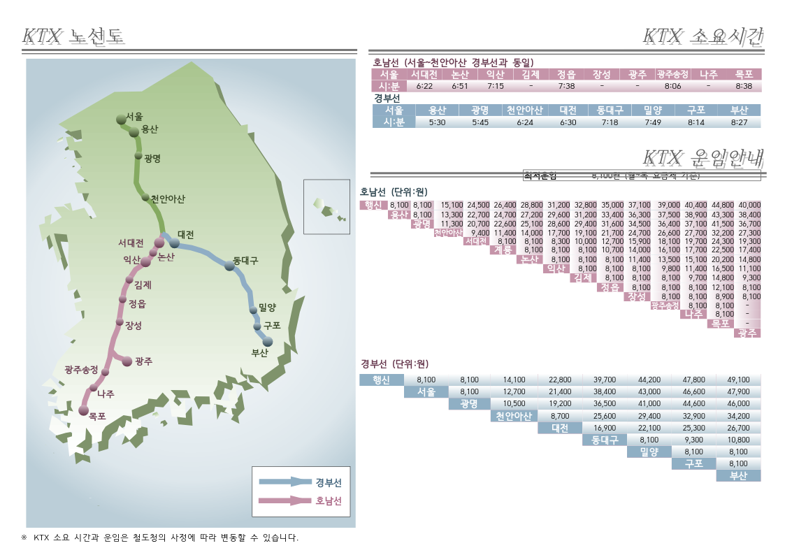
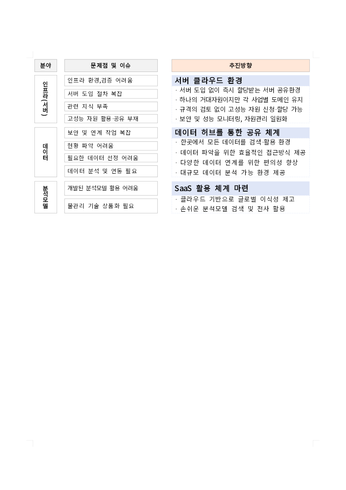

# #7473 PDF 기능 추가 후 PR Render Diff 재측정 — 2026-10-18

[PR #7474](https://github.com/edwardkim/rhwp/pull/7474) · [의존 PR #7488](https://github.com/edwardkim/rhwp/pull/7488)

## 결론

PDF import가 기본 feature인 최신 devel을 통합하고 #7488의 cdylib opt-in을 #7474에 적용했다.
dev·기존 release·cdylib release 각 3회, 총 9회가 성공했다. PNG 43개는 모든 실행에서 byte 단위로
같았고 실제 WASM 응답 162건도 각각 빌드 manifest와 일치했다.

동일 CPU별 WASM wrapper 시간은 cdylib 적용 후 **9V74 약 1.5%, 7763 약 6.7% 감소**했다.
그러나 CPU별 표본이 1~2회이고 서로 다른 VM이므로 확정 개선율이나 유의한 성능 개선으로 주장하지 않는다.
전체 job 감소는 각각 약 6초·41초다. dev 대비 release 검증 비용은 여전히 전체 job 기준 약 8분 증가한다.
#7488의 과거 warm n=1 결과인 9.48%를 이번 cold CI에 적용해서는 안 된다.

코드 검증은 통과했다. #7474는 추가 CI 비용과 명령 단위 LTO 정책을 검토할 수 있도록 Draft를 유지한다.
#7488은 메인테이너 직접 승인 후 반영 가능한 Ready 후보이며 아직 승인·병합되지 않았다.

## 통제 조건과 해석 범위

- 고정 base: `6ed1682c3267ea786734eb2e75252916a861d1fd`.
- 고정 코드 후보: `0eb4cc2ffde257a15080d0add104247c941fcbf9`.
- #7488 원 head: `e8e57b36d4703556128dae31e37eaa9acdceee0d`. merge로 원 이력을 보존했다.
- 동일 source·fixture·lockfile, `write-images=true`, 개별 GitHub hosted VM, 논리 CPU 4개.
- Ubuntu 24.04 image `20261012.334.1`, Linux `6.17.0-1022-azure`, Rust `1.93.1`, wasm-pack `0.15.0`.
- wasm-bindgen `0.2.127`, release wasm-opt `117 -O`; 도구 executable hash는 실행 간 같다.
- Cargo cache **9/9 miss**, matched key 없음. 측정 ref는 restore-only이며 seed를 저장하지 않았다.
- 새 cache key는 profile·crate type·LTO 정책을 구분한다. 캐시 hit 성능은 이번 측정 범위 밖이다.
- CPU는 EPYC 9V74·EPYC 7763·Xeon 6973P-C로 섞였다. 조건별 통합 중앙값을 최적화 효과로 비교하지 않는다.

`dev/auto`는 standard, `release/standard`는 기존 rlib+cdylib와 Cargo manifest LTO 설정,
`release/cdylib`는 cdylib와 명령 단위 `profile.release.lto=false`를 사용한다.
release 두 경로 모두 wasm-opt를 실제 수행하지만 **배포 빌드와 플래그까지 동일하다는 뜻은 아니다**.
PR 경로는 release/cdylib로 고정하며 수동 실행에서 세 조건을 재현할 수 있다.

wall은 helper 내부 빌드 시간, step은 metadata 수집 등을 포함하는 Actions 시간이다.
전체 job은 Canvas visual diff 시작부터 끝까지로 큐 대기·preflight는 제외한다.
Cargo·bindgen·opt 시간은 로그 수신 경계 근사이며 독점 CPU 시간으로 해석하지 않는다.
VM 부하·네트워크는 통제하지 못했다. PDF 기능만의 비용을 분리한 ablation 실험은 아니다.

## 실행별 결과

단위: 초. 모든 run은 attempt 1, 동일 코드 후보에서 성공했다.

| 조건·반복 | CPU | wrapper wall | WASM step | Cargo 근사 | opt/마무리 근사 | 전체 job |
| --- | --- | ---: | ---: | ---: | ---: | ---: |
| [dev 1](https://github.com/edwardkim/rhwp/actions/runs/39073001510) | 7763 | 149.144 | 160 | 134.617 | — | 627 |
| [release standard 1](https://github.com/edwardkim/rhwp/actions/runs/39072999119) | 9V74 | 599.171 | 609 | 423.772 | 167.863 | 1031 |
| [release cdylib 1](https://github.com/edwardkim/rhwp/actions/runs/39073003282) | 7763 | 662.695 | 674 | 484.543 | 169.738 | 1113 |
| [dev 2](https://github.com/edwardkim/rhwp/actions/runs/39073302072) | 9V74 | 121.112 | 130 | 107.922 | — | 542 |
| [release standard 2](https://github.com/edwardkim/rhwp/actions/runs/39073307122) | 9V74 | 597.802 | 607 | 423.602 | 166.039 | 1012 |
| [release cdylib 2](https://github.com/edwardkim/rhwp/actions/runs/39073312286) | 6973P-C | 702.087 | 712 | 457.709 | 235.571 | 1164 |
| [dev 3](https://github.com/edwardkim/rhwp/actions/runs/39073316898) | 7763 | 150.605 | 160 | 136.630 | — | 615 |
| [release standard 3](https://github.com/edwardkim/rhwp/actions/runs/39073320923) | 7763 | 710.405 | 722 | 526.245 | 174.667 | 1154 |
| [release cdylib 3](https://github.com/edwardkim/rhwp/actions/runs/39073325398) | 9V74 | 589.384 | 603 | 416.285 | 164.341 | 1016 |

## CPU별 비교

동일 모델 안에서도 대응 VM 비교가 아니며 표본이 작다. 단위: 초, 각 셀은 중앙값(표본 수).

| CPU | dev wall | standard wall | cdylib wall | standard→cdylib | 전체 job standard→cdylib |
| --- | ---: | ---: | ---: | ---: | ---: |
| EPYC 9V74 | 121.112 (1) | 598.487 (2) | 589.384 (1) | -9.103 / -1.52% | 1021.5→1016 (-5.5) |
| EPYC 7763 | 149.875 (2) | 710.405 (1) | 662.695 (1) | -47.710 / -6.72% | 1154→1113 (-41) |
| Xeon 6973P-C | 미측정 | 미측정 | 702.087 (1) | 비교 불가 | 비교 불가 |

dev→cdylib의 전체 job 차이는 9V74 542→1016초(+474), 7763 621→1113초(+492)다.
CPU 혼합 상태의 실제 관측 중앙값은 dev 615초, standard 1031초, cdylib 1113초이나,
**이 세 숫자로 cdylib가 느려졌다고 결론 내릴 수 없다**. 특히 Intel 표본은 cdylib에만 있다.
release opt/마무리는 약 164~236초이며 이번 wrapper 변경으로 제거되지 않는다.
추가 최적화 판단에는 같은 runner에서 순서를 교차한 반복 비교와 실제 cache hit 검증이 필요하다.

## 출력·검증 결과

- 9회 모두 Canvas 3/3, 직접 PDF gate 3/3, CanvasKit readiness 8/8 통과.
- 실제 앱에서 관측한 WASM 응답 각 18건, 총 162건이 해당 실행 manifest와 일치했다.
- 각 실행 PNG 43개(시각/PDF 27 + readiness 16)의 파일 집합과 SHA-256이 모두 같았다.
- 각 빌드 조건 안에서는 3회 WASM·JS bytes/hash가 재현됐다. standard/cdylib release의 JS는 같다.
- 두 release WASM 바이너리는 다르다. PNG 동등성을 바이너리 동등성으로 확대하지 않는다.
- report-only PDF 경고는 기존과 같은 4개다. 직접 PDF gate와 별개이며 기준값을 완화하지 않았다.
- 대표 KTX 1쪽의 지도·시간/요금표와 table-border-style의 표·세로 글줄을 직접 판독했다.
  KTX 요금표 머리글의 기존 겹침은 남아 있다. 출력 보존 검증이며 한컴 정합·기존 시각 결함 해결은 주장하지 않는다.
- 별도 한컴 기준 PDF나 전쪽 silhouette TSV를 새로 생성하지 않았다. 조판 알고리즘 수정은 비해당이다.

| 빌드 | WASM bytes | WASM SHA-256 |
| --- | ---: | --- |
| dev | 55707545 | `00989694eda270f5c579543a58a43fe23da5b6dd799b2840088512551dc1fdba` |
| release standard | 17809310 | `53d52a44ea3691fa3c774cdc749f96cce0d057d7ae596c8e45f5c4387a674087` |
| release cdylib | 17756530 | `39cc9e7587fabb776e80e5f30825a4694ebea2bba3745ba679b0b17b34df3caf` |

대표 이미지는 cdylib 1 실행의 원본 PNG다. 나머지 8회와 해시가 같다.

## 코드 검증과 리뷰

정확한 후보 `0eb4cc2ff`의 [Full CI](https://github.com/edwardkim/rhwp/actions/runs/39072973013),
[CodeQL](https://github.com/edwardkim/rhwp/actions/runs/39072973012),
[PR Render Diff](https://github.com/edwardkim/rhwp/actions/runs/39072973025),
[Adapter](https://github.com/edwardkim/rhwp/actions/runs/39072973002),
[Proptest](https://github.com/edwardkim/rhwp/actions/runs/39072973042)가 성공했다.
check 집계는 34 success·5 skipped, 실패·미완료 0건이다. 별도 PR Render Diff 실행은 위 9회 통계에 넣지 않았다.

로컬에서는 wrapper/render/workflow/Docker focused 28개, Python workflow 전체 192개,
Node CI 정책·WASM 소비 검사 102개를 통과했다. actionlint·shell/Python/Node 구문·변경 링크·공백도 검사했다.
로컬 Rust toolchain이 없어 로컬 전체 Rust 회귀는 실행하지 않았다. 실제 Rust 빌드와 브라우저 검증은 위 CI 결과다.
[검토 기록](../pr/archives/pr_7474_review.md) · [통합과 되돌리기](../pr/archives/pr_7474_review_impl.md)

## 이전 측정과 증적 보존

2026-09-28 후보의 dev/release WASM step 중앙값은 122/421초, 전체 job은 500/760초였다.
현재 standard release step은 609초 중앙값이다. 비용 증가 자체는 관측했지만 코드·PDF feature·runner image·CPU가
함께 바뀌었으므로 증가량 전부를 PDF에 귀속하지 않는다.
[이전 보고서](https://github.com/edwardkim/rhwp/blob/9d05998e09e4698391fe44f543abdd66ddc86c99/mydocs/report/task_m100_7473_report.md),
[이전 시간 원자료](assets/issue-7473/ci-results.json), [이전 출력 증거](assets/issue-7473/ci-evidence.json)는 과거 자료다.
과거 macOS readiness 7/8도 이번 Ubuntu 8/8 결과와 구분한다.

이번 9개 run의 `render-diff-artifacts`에 build log/manifest/consumption·PNG·baseline report가 있다.
artifact ZIP의 GitHub SHA-256을 다운로드 후 검증했다. 보존 기간은 14일이다.
다운로드 원본과 API 집계는 로컬 `output/pr-review/7474/`에 보관하며 원시 JSON/log를 새로 커밋하지 않는다.
위 표·WASM hash·대표 PNG는 저장소에 남긴다. 12개 입력의 blob/hash 확인은 검토 기록에 있다.
측정용 임시 ref를 정리해도 run URL과 source SHA로 실행을 식별할 수 있다.
