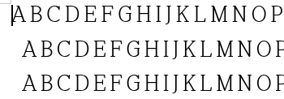
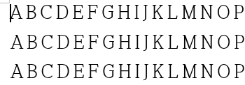

# #8860 Studio 문단 들여쓰기의 단위 보존

Studio v0.9.1(`981ce66b41`)과 작업 기준 `devel`(`c63b87b046`)에서 소수 pt 입력과 커서 거리 입력이 상대 단위로 저장되는 현상을 재현했다. 수정본은 절대 길이를 정수 HWPUNIT으로 반올림한 다음 단위 비트를 넣는다. 이미 저장한 상대 길이는 문단 모양에서 그 항목을 편집할 때만 절대 길이로 바뀐다. [이슈 #8860](https://github.com/edwardkim/rhwp/issues/8860) · [수정 전 재현](../plans/task_m100_8860.md) · [구현 계획](../plans/task_m100_8860_impl.md)

## 실제 Studio 입력 결과

같은 문단을 두 줄 이상으로 흘린 뒤 문단 모양 대화창, 키보드, 눈금자 드래그와 모양 복사를 실행했다. 브라우저가 만든 페이지에서 첫째 줄과 둘째 줄의 시작점을 읽고, HWP와 HWPX를 다시 열어 `Indentation`을 확인했다. 저장값의 부호는 방향을 나타내고, 최하위 비트는 절대 길이 또는 `CHAR`를 나타낸다. [절대 입력 12건](../tech/investigations/issue-8860-paragraph-units/browser-inputs.tsv) · [바탕글 크기별 측정](../tech/investigations/issue-8860-paragraph-units/browser-styles.tsv)

| 동작 | 수정 전 | 수정 후 |
| --- | --- | --- |
| 바탕글 10pt / 20pt에 내어쓰기 1.005pt 입력 | −201로 저장, 둘째 줄이 5.05 / 10.10pt 이동 | −202로 저장, 두 문서 모두 1.01pt 이동 |
| 내어쓰기 1.01pt 입력 | 두 문서 모두 1.01pt | 두 문서 모두 1.01pt |
| 기존 상대 내어쓰기 −201을 그대로 열기 | 바탕글에 따라 5.05 / 10.10pt | 같은 값과 위치 보존 |
| 본문에서 `AB` 뒤 17.50px 지점에 Shift+Tab | −2625로 저장, 87.53px 이동 | −2626으로 저장, 17.50667px 이동 |
| 기존 상대 내어쓰기 −203에서 문단 설정을 열고 확인 | −200으로 변경 | −203 보존 |
| 절대 들여쓰기 +202를 다른 문단으로 모양 복사 | 대상에 +195 저장 | 대상에 +202 저장 |

아래는 같은 HWP를 두 Studio에서 열고 1.005pt를 입력한 화면이다. 두 번째 줄이 시작되는 위치를 첫 번째 줄의 왼쪽과 비교할 수 있다. [편집 전 HWP](../../samples/issue8860/absolute-indent-20pt.hwp)

| 기존 `devel` | 수정 후 |
| --- | --- |
|  |  |

두 Studio에서 편집한 HWP를 각각 Windows 한컴 2020(11.0.0.9172)으로 열어 Hancom PDF로 직접 인쇄했다. 각 1쪽·16줄이며, PDF에 찍힌 첫 글자의 원점으로 측정한 둘째 줄의 이동 거리는 수정 전 10.07454pt, 수정 후 0.95948pt였다. 각 저장본을 해당 인쇄본과 대조한 Native·브라우저의 전쪽 raw 일치율은 모두 100.00%였다. [수정 전 PDF](../../pdf/issue8860/devel-1_005pt-2020.pdf) · [수정 후 PDF](../../pdf/issue8860/fixed-1_005pt-2020.pdf) · [각 줄의 PDF 원점](../tech/investigations/issue-8860-paragraph-units/hancom-line-origins.tsv)

두 인쇄 작업에서 한컴 빌드, 실제 드라이버 모드, 쪽수, 입력·다운로드 SHA-256을 확인했다. 기존 영수증 감사 도구가 요구하는 `preprocess` 대신 현재 서비스는 `input_preprocess: scripts_disabled`를 반환했다. 작업 기록에 실제 응답 필드를 보존했고 두 원본·PDF의 해시를 다시 읽어 다운로드 해시와 대조했다. [인쇄 작업·입출력 해시](../tech/investigations/issue-8860-paragraph-units/print-jobs.json) · [수정 전 HWP](../../samples/issue8860/devel-1_005pt.hwp) · [수정 후 HWP](../../samples/issue8860/fixed-1_005pt.hwp)

실제 가로 눈금자로 다섯 위치에 핀을 놓았다. 기존 Studio에서 세 위치가 홀수로 저장됐고 수정한 Studio에서는 다섯 위치 모두 짝수로 저장됐다. 확대된 눈금자의 정확히 반 HWPUNIT과 그 양옆에 대해서도 검증했다. [눈금자 드래그 결과](../tech/investigations/issue-8860-paragraph-units/browser-ruler.tsv) · [경계 검사](../../rhwp-studio/tests/ruler-pin-geometry.test.ts)

상대 길이를 양수·음수 홀수로 저장한 문단을 설정하거나 복사하고 양 형식에서 다시 읽었다. 본문의 실행 취소·다시 실행, 다른 항목만 편집할 때의 보존, 표시된 pt를 다시 입력할 때의 절대 길이 전환을 확인했다. 표 안에서는 문단 설정으로 들여쓰기를 적용한 뒤 Shift+Tab으로 이전 셀로 이동했다. 두 번 연달아 저장·재열기 한 뒤에도 문단의 내용과 세 길이 속성을 함께 대조했다. [모양 복사·설정 결과](../tech/investigations/issue-8860-paragraph-units/browser-copy.tsv) · [Studio E2E](../../rhwp-studio/e2e/paragraph-length-units-issue8860.test.mjs)

## 구현과 호환성

1. 새로 입력한 pt·화면 px와 눈금자 핀이 공통 절대 길이 변환을 사용한다. 1pt는 100 HWPUNIT이고 96 DPI의 1px는 75 HWPUNIT이다. 기존 Studio AI의 `format_paragraph`도 같은 변환식을 중복 구현하고 있어 함께 바꿨다. [공통 단위 변환](../../rhwp-studio/src/core/paragraph-spacing.ts) · [자동화 입력](../../rhwp-studio/src/ai/tools/write-tools.ts)
2. Rust 문단 속성 조회가 원래의 좌우 여백·들여쓰기 정수와 실제 px를 함께 제공한다. 문단 모양은 실제 길이를 표시하고, 모양 복사는 원래 정수를 전달한다. 구버전 WASM과 조합하면 기존 `getParaShapeSet`에서 저장값을 읽는다. 수정한 Studio에 기준 커밋의 WASM을 공급해서도 같은 브라우저 E2E를 통과했다. [Rust 문단 조회](../../src/document_core/commands/formatting.rs) · [Studio 연결](../../rhwp-studio/src/core/wasm-bridge.ts)
3. 편집으로 어떤 속성을 기록할지를 수정했다. 파서·직렬화·측정·페이지 배치·렌더러의 `CHAR` 해석 코드는 기존 경로를 사용한다. 같은 내용과 문단 속성을 읽는 경우의 대조는 아래 한컴 인쇄본으로 확인했다.

## 독립 한컴 인쇄본과 기존 회귀

기존 상대 단위를 검증했던 #7816의 세 HWPX를 96 DPI로 새로 렌더링했다. 홀수 내어쓰기 범위 3쪽, 기본 글자 모양 20pt 대조 1쪽, 바탕글 스타일 20pt 대조 1쪽 모두 한컴 2020 인쇄본과 Native Skia·fresh WASM의 2px 실루엣 raw 일치율이 100.00%였다. [원본](../../samples/issue7816) · [독립 인쇄본](../../pdf/issue7816) · [Native 쪽별 TSV](../tech/investigations/issue-8860-paragraph-units/native) · [브라우저 쪽별 TSV](../tech/investigations/issue-8860-paragraph-units/wasm) · [사용 글꼴과 SHA-256](../tech/investigations/issue-8860-paragraph-units/font-programs.tsv)

인접 #7490 Studio 검사에는 이미 단 정의가 있는 #6190 HWP를 정의가 없는 원본으로 보는 과거 기대값이 남아 있었다. 원본 Section0의 `cold` 컨트롤이 하나임을 확인했고, 이 계약을 구분한 기존 Rust 검토·검사와 대조했다. 명시된 단 정의, 입력한 글자와 저장 전후 위치는 #6190으로 확인한다. 정의가 없는 B5 원본에서는 저장 후 기본 단 한 개가 생기고 메모리의 원본과 입력한 첫 글자가 보존됨을 따로 확인한다. #6190은 두 경로 99.99%, B5 네 쪽은 모두 100.00%였다. [기존 Rust 검사](../../tests/cases/issue_7490_default_column_rebuild.rs) · [교정한 브라우저 검사](../../rhwp-studio/e2e/edited-indent-issue7490.test.mjs) · [편집본과 대조군 12쪽의 두 렌더러 결과](../tech/investigations/issue-8860-paragraph-units/visual-pages.tsv)

단 정의가 없는 다른 입력을 조사할 때 #6196 셀 자간 문서도 확인했다. 기존 2022 인쇄본에 대한 브라우저 수치는 기준과 후보 모두 52.56%였고, 두 PNG의 SHA-256은 `6bf663543c60306d37e4f690f98d338562b6772e5e12915867016b7c9bfb173a`로 같았다. #6196의 기존 Rust 검사는 그대로 실행했고, 브라우저의 단 정의 없는 저장 대조에는 독립 인쇄 4쪽이 일치하는 B5 문서를 사용했다.

## 제출 전 검사

| 검사 | 결과 |
| --- | --- |
| Studio 전체, 집중 단위 검사, E2E 등록 목록 | 새 Node WASM으로 전체 2,840건 통과, 생략 0건. 집중 62건 통과. E2E 파일과 등록 목록 204개 일치 |
| Studio 패키지 | TypeScript 타입 검사, Vite 배포 빌드와 PWA 생성 통과 |
| 새 브라우저 WASM | 최적화한 WASM SHA-256 `0e181d845d27dbfe9ad51bf2b1c6236609d8d096c72bed8a1d2a7feacc7b793a`. 실제 Studio 입력과 양 형식 저장 검증 통과 |
| Rust 전체 회귀 | 최소 글꼴 환경에서 14,219건 통과. 기존 실행 설정으로 45건 생략 |
| Native Skia | 라이브러리 4,033건과 지정 모듈 21개의 194건, 총 4,227건 통과. 기존 무시 항목 12건 |
| Rust 정적 검사·빌드 | `cargo fmt --all -- --check`, Native·WASM32 Clippy, workspace 빌드와 모든 target의 Clippy 통과. 모든 Clippy에 `-D warnings` 적용 |

Rust 회귀의 글꼴 환경에는 저장소 공개 글꼴 5개만 노출했다. 별도 한컴 인쇄 대조에는 각 문서에 맞는 글꼴을 공급했다. 실제 코드를 바꾼 커밋은 `d60cb1fc71`이며 이후 자동 검사와 증거를 보강했다. [Rust 검사별 결과](../tech/investigations/issue-8860-paragraph-units/rust-gates.tsv)
