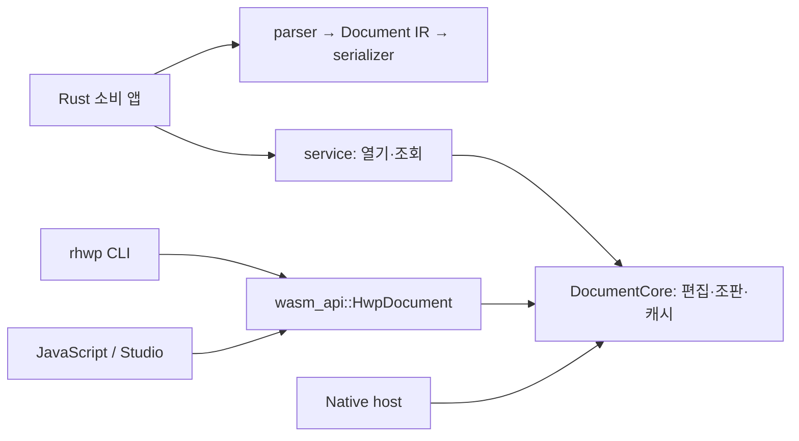

# #8174 — CLI·Rust 라이브러리 소비에 대한 구조 재조사

이 문서는 보완 전 `f4342c4f1` 기준 조사 기록이다. 승인 뒤의 실제 수정과 최종 package·registry
소비 검증은 [2단계 보완 결과](../../../working/task_m100_8174_stage2_corrections.md)에 기록했다.

- Issue: [#8174](https://github.com/edwardkim/rhwp/issues/8174).
- 요청: crates.io의 주 사용 대상을 CLI·라이브러리 소비자로 볼 때 현재 구조의 적합성과 수정 지점을 검토한다.
- 조사 head: `79be9627c3c01543e1507d907e222b6ccf72da6a`.
- 제품 source와 원격 `devel`: `def947c2149df5bc812d801e6e79be19a403b4d1`.
  `git ls-remote upstream refs/heads/devel`로 확인했으며, 조사 head와 제품 파일의 diff는 없다.
- 환경: Linux x86_64, Rust/Cargo 1.93.1, 공용 `target/pr-review`, Cargo jobs 8.
- 관련: [1단계](../../../working/task_m100_8174_stage1.md),
  [공통 선행 결과](../../../working/task_m100_8174_stage2.md),
  [메인테이너 결정](../../../plans/task_m100_8174_maintainer_decisions.md).

## 판정

**공통 엔진의 방향은 적합하다. 현재 구조를 유지하면서 외부 소비 계약과 게시 연결을 보완하는 것이 우선이다.**
독립 Cargo workspace의 path 소비 앱에서 JS facade 없이 파싱·저장·편집을 실행했고,
별도 경로에 CLI를 설치해 기계 판독 출력을 확인했다. GUI를 제거하거나 엔진을 새로 작성할 이유는 없다.

다만 **registry 제품으로의 준비는 미완료**다. 기존 패키징 차단점 외에 `HwpError`의 표준 오류
연동 실패를 재현했다. CLI의 WASM facade 의존, 최소 feature에서도 남는 렌더링 의존성,
넓은 공개 API와 설치 bin의 범위도 보완 대상으로 구분했다. 아래 검토안은 MD01–MD09의 채택이나 구현 승인이 아니다.

## 현재 구조에서 유지할 기반



| 기반 | 확인한 현재 코드와 의미 |
| --- | --- |
| 포맷과 IR | [parser](../../../../src/parser/mod.rs) → 공통 `model::Document` → [serializer](../../../../src/serializer/mod.rs). 직접 파싱하는 소비자는 `DocumentCore`를 만들 필요가 없다. |
| 어댑터와 코어 | [DocumentCore](../../../../src/document_core/mod.rs)는 Rust 상태를 소유하며, [HwpDocument](../../../../src/wasm_api.rs)가 이를 감싼다. 프로덕션 core에 JS 타입을 노출하는 구조로 단정할 근거는 없다. |
| 서비스 진입점 | [service](../../../../src/service/mod.rs)에 `DocumentService`·`OpenOptions`·`OpenedDocument`·`ServiceError`가 이미 있다. 바이트/경로 열기와 형식·크기·조회 결과를 제공하므로 같은 용도의 새 SDK 계층을 중복 작성할 필요가 없다. |
| 선택 가능한 바인딩 | [manifest](../../../../Cargo.toml)의 `wasm-api`를 끄면 facade와 자동 start/export를 제외한다. CLI는 이를 required feature로 사용한다. Native CLI라는 이유로 JavaScript 런타임이 필요한 것은 아니다. |
| 기존 공통 결과 | 렌더링은 `DocumentCore`·paint/backend의 공통 결과를 소비한다. CLI 사용자를 겨냥한다는 이유로 별도 조판·렌더 엔진을 만들지 않는다. |

선행 해결은 #7875 → 원 PR #7876 → 통합 [#7981](https://github.com/edwardkim/rhwp/pull/7981)
`42dade44e3a603015cecb7e9731928e3c3c8bd05`를 추적했다. 현재 head에 포함돼 있고,
[당시 Node/Chrome 소비 검증](../../../working/archives/task_m100_7875_stage2.md)과
현행 feature 주석을 대조했다. 당시 WASM 실행 결과를 이번 head의 새 브라우저 실행으로 표시하지 않는다.

서비스 축은 `462f8daf7cf4655d45a085c8ea279bf26d38f7d6`에서 도입됐다.
[서비스 계약](../../service_layer.md)과 [#5511 종료 기록](../../../report/archives/task_m100_5511_report.md)은
CLI 전체의 service 전환 완료를 주장하지 않는다. 현재 CLI·MCP·WASM에 `DocumentService` 호출이
없는 점을 재확인했다. 종료한 #5511의 전체 Stage 3·4를 이번 게시 작업의 필수 구현으로 되살리지 않는다.

## 수정 지점과 우선순위

| ID | 현재 관측과 소비자 영향 | 권고하는 처리 | 범위 판단 |
| --- | --- | --- | --- |
| A01 | 독립 소비 앱은 본체 root patch를 상속하지 않아 registry 원본 `svg2pdf 0.13.0`을 선택했다. 로컬에서 검증한 PDF 출력 보정이 외부 소비자에게 전달되지 않는다. 내부/fork의 게시 제한·버전 없는 path와 과도한 기본 파일 목록도 기존 차단점이다. | 승인할 게시 graph의 실제 dependency로 fork를 연결하고 registry 버전·파일 범위를 정규화한다. 소비자가 저장소용 patch를 복사해야 하는 계약으로 게시하지 않는다. | **게시 전 필수.** MD02에 연결. 기존 source 후보 검사는 실제 Cargo package/소비 검증을 대체하지 않는다. |
| A02 | `HwpError`에는 `Debug`·`Display`가 있지만 `std::error::Error` 구현이 없다. `DocumentCore`를 일반 Rust 오류 반환 함수에서 `?`로 쓰는 최소 앱이 E0277로 실패했다. | 현재 variant·표시 문구를 유지하는 표준 `Error` 구현을 우선 검토한다. 원인 타입 보존과 오류 코드 개선은 별도의 호환성 범위로 나눈다. | **핵심 Rust API를 지원할 때 우선 보완.** 단순 연동 보정과 오류 체계 전면 변경을 묶지 않는다. |
| A03 | 사용 가능한 `service`가 기존 MD03의 핵심 API 나열에서 빠져 있다. 루트에 28개 `pub mod`가 있고 core 하위에서 공개 함수 624개가 검색되지만, 이것이 모두 지원 계약인 것은 아니다. | 직접 parser/IR 경로와 service/core 경로를 용도별로 안내한다. 지원 경로·오류·형식별 저장·feature 예제와 호환 정책을 확정한다. 기존 공개 표면을 임의로 숨기거나 삭제하지 않는다. | **게시 전 계약·예제 필요.** MD03·MD04. 624는 단순 source 검색 수이며 고유 메서드나 공식 API 수가 아니다. |
| A04 | CLI 하위 22개 Rust 파일에 `wasm_api`/`HwpDocument` 참조가 있다. CLI 설치에 `wasm-api`가 필요하고 core와 facade 로더도 함께 존재한다. | 새 공통 작업은 기존 service/core를 활용하고, 승인한 절편에서 기존 명령의 JSON·종료 코드·저장 결과를 보존하며 점진적으로 연결한다. 먼저 feature 이름만 바꾸거나 CLI의 required feature를 제거하지 않는다. | **구조 개선 권고.** 현재 CLI 실행의 차단점은 아니다. 전체 CLI 재작성은 초회 게시의 필수 조건으로 확대하지 않는다. |
| A05 | feature를 전부 꺼도 renderer와 Native PDF 출력 의존성이 남는다. 별도 소비 graph의 non-dev 도달 패키지는 최소 203개, 기본 259개다. | 초기에는 `default-features = false`를 parser-only 빌드로 소개하지 않는다. 경량 소비를 지원하기로 하면 renderer/PDF export 등을 기존 기본 동작을 보존하는 additive feature로 분리할 범위를 정한다. | **경량 SDK를 약속할 때 필요.** MD04. 의존성 수만으로 속도·메모리 개선율을 주장하지 않는다. |
| A06 | 명시적인 bin은 `rhwp`, `rhwp-q`, `rhwp-agent`, 개발 도구 `font-metric-gen`의 4개다. 일반 `cargo install`은 기본적으로 모든 bin을 설치한다. | 초회 설치 안내는 `--bin rhwp`로 고정하고 다른 제품 bin의 지원 여부를 명시한다. 개발 도구는 승인한 tools feature나 별도 도구 경계로 옮기는 방안을 검토한다. | **설치 범위·문서 확정 필요.** MD02·MD04. 개발 도구 이동 전 기존 생성 workflow·호출을 추적한다. |
| A07 | 본체 `[lib]`가 `rlib`와 `cdylib`를 함께 선언하고 실제 최소 소비 빌드에서도 두 crate type의 rustc 호출을 관측했다. | 추가 출력의 빌드 비용을 측정한 뒤, 비용이 크면 바인딩용 crate 분리를 후속 검토한다. 기존 cdylib-only wrapper·FFI·npm 경로를 보존한다. | **후속 최적화 후보.** 현재 선언을 즉시 `rlib` 하나로 바꾸거나 새 대규모 crate 분리를 필수로 정하지 않는다. |

A01은 [Cargo의 workspace root patch 계약](https://doc.rust-lang.org/cargo/reference/overriding-dependencies.html#the-patch-section)과
실제 metadata 양쪽으로 확인했다. 임시 소비 앱의 성공을 확인할 때는 **소비 앱 root에도 patch를
명시**했다. 이것은 현재 source의 path 소비를 검증하기 위한 조건이며 A01을 해결한 결과가 아니다.

A02의 최소 재현은 다음과 같다. 같은 환경에서 parser·serializer·`ServiceError`는 표준 오류와
연동됐으며, 아래 실패는 `HwpError` 경계에 한정된다.

```rust
fn main() -> Result<(), Box<dyn std::error::Error>> {
    let _ = rhwp::DocumentCore::from_bytes(b"invalid")?;
    Ok(())
}
```

`cargo check --offline --locked --bin core-error`는 exit 101이며,
`the trait std::error::Error is not implemented for HwpError`를 보고했다.
표준 계약은 [Rust Error trait](https://doc.rust-lang.org/std/error/trait.Error.html)을 따른다.

### 추출·저장 용도의 API 안내에서 구분할 것

- **구조만 읽기:** `parse_document`/`parse_document_with_password`와 IR을 사용한다.
  표 추출에도 기존 `document_core::queries::table_extract::extract_tables(&Document)`가 있다.
  parser와 추출 알고리즘을 별도로 복제할 필요가 없다.
- **쪽·배치 기반 조회와 편집:** `service`/`DocumentCore`를 사용한다. `DocumentCore::from_bytes`는
  스타일 해소·recompose·`paginate()`까지 수행한다. `with_title_scan(false)`는 제목 추정을 끄며,
  core를 조판하지 않는 parser-only 세션으로 바꾸지 않는다. 이번 조사에서 처리 시간·RSS를 벤치마크하지 않았다.
- **저장 형식:** `serialize_document`는 입력 형식을 자동 유지하는 API가 아니라 HWP 출력이다.
  HWPX 출력은 `serializer::serialize_hwpx` 등을 선택한다. 변환 손실과 `*_with_report`가 보고하는
  범위도 문서화한다. 이번 HWP 출력에서는 기존 #4396의 필드 파라미터 손실 경고가 관측됐다.
  본문 문자열 보존을 모든 필드·개체·서식의 무손실 왕복으로 설명하지 않는다.
- **배포 기능:** 현재 PDF 기본 포함과 보안 제한을 유지한다. parser/service/backend의 입력·압축 해제·
  작업량 경계를 동일한 전체 메모리 한도로 설명하지 않는다. 서비스 업로드 지원 범위는
  [MD05·MD07](../../../plans/task_m100_8174_maintainer_decisions.md#md05--pdf-입력의-신뢰-범위와-보안-조건)에서 결정한다.

## 실제 소비 검증

원본·명령·stdout/stderr·exit·소비 앱 source/lock·metadata는 ignored
`output/pr-review/issue8174/architecture-review/`에 보존했다. 모든 Cargo 작업을 순차 실행했고,
임시 설치는 이 디렉터리의 `installed/`에 한정했다. 제품 manifest·lock·Rust source는 변경하지 않았다.

소비 앱은 별도 `[workspace]`에서 본체를 절대 path dependency로 사용한다.
root lock을 복사해 기존 dependency를 재사용한 실행과 lock 없는 신규 resolution을 구분했다.
아직 포장한 `.crate`나 registry에서 다운로드한 rhwp를 검증한 것이 아니다.

| 검사 | 실제 결과와 범위 | 증거 파일 |
| --- | --- | --- |
| patch 없는 Native metadata, 최소/기본 feature | exit 0. 최소 feature `[]`, 기본은 `default`·`console_error_panic_hook`·`pdf-import`·`wasm-api`. 양쪽에서 registry 원본 `svg2pdf` 선택 | `metadata-unpatched-*.stdout.log`, `dependency-summary.json` |
| 최소 구성 소비 앱: 빈 HWP/HWPX 2개 | PASS. 직접 파싱 → HWP/HWPX 각각 저장·재파싱 → service로 열기 → core에서 텍스트 삽입 → HWPX 저장·재파싱 | `consumer-min.*` |
| 최소 구성 소비 앱: 본문 문서 3개 | PASS. 같은 여정을 실제 본문 242/1,179/1,179자로 확인 | `consumer-content.*` |
| 기본 feature 소비 앱 | PASS. 본문 HWP/HWPX 2개에서 동일 여정과 잘못된 입력의 오류 반환을 재확인 | `consumer-default.*` |
| 표준 오류 연동 반례 | **예상한 사용성 결함 재현**. core-error bin만 E0277, exit 101 | `core-error-check.*` |
| CLI path 설치 | `cargo install --path <repo> --bin rhwp --debug --locked --offline --root <evidence>/installed --target-dir <shared-target>`, exit 0 | `cli-install-local.*` |
| 설치한 CLI 실행 | `--version`은 0.8.7. `info --json`·`export-text --json`·`capabilities` 모두 exit 0, stdout을 JSON으로 파싱 | `cli-version.*`, `cli-info.*`, `cli-text.*`, `cli-capabilities-corrected.*` |
| 기능 자기서술 | PDF read/import 가능, `native-skia`를 선택하지 않은 PNG·Sixel·Kitty는 `available=false` | `cli-smoke-summary.json` |
| lock 없는 신규 dependency resolution | 온라인 metadata exit 0. root lock과 다른 package/version 36개. 실제 컴파일·전체 소비 성공을 뜻하지 않는다. | `metadata-fresh-online.*`, `fresh-resolution-summary.json` |

본문 입력은 `samples/hwp_table_test.hwp`, `samples/143E433F503322BD33.hwp`,
`samples/hwpx/143E433F503322BD33.hwpx`다. 빈 문서와 함께 `inputs.json`에 bytes·SHA-256을 기록했다.
왕복 assertion은 **최상위 문단의 본문 문자열**과 삽입 marker의 재독을 확인했다.
모든 셀·개체·서식·페이지의 보존이나 렌더링 충실도를 검증한 결과는 아니다.

실행한 [소비 probe](probes/library_consumer.rs)와 [오류 연동 반례](probes/core_error.rs)를
보존했다. 독립 소비 workspace의 `src/main.rs`와 `src/bin/core-error.rs`에 각각 놓고 실행한다.
프로덕션 Cargo target이나 정식 회귀 suite에 추가한 source가 아니며, 이후 API 호환성을 보장하지 않는다.
최소 의존 선언은 `rhwp = { path = "<repo>", default-features = false }`이고,
조사 중에는 소비 workspace의 `[patch.crates-io]`에 `svg2pdf = { path = "<repo>/vendor/svg2pdf" }`를
명시했다. 기본 구성 대조에서는 `rhwp/default`를 활성화했다. 이 workaround는 게시용 해결안이 아니다.

dependency 203/259는 `cargo metadata --filter-platform x86_64-unknown-linux-gnu`의 resolve root에서
dev edge를 빼고 도달하는 고유 package ID 수다. build/proc-macro 의존성과 rhwp 본체를 포함하고
소비 앱은 제외한다. 크기·CPU·최종 binary에 포함되는 코드량과 같지 않다. 최소 구성에도
`wasm-bindgen`, `resvg`/`usvg`, `svg2pdf`, `image`, `rustybuzz`/`ttf-parser`, ML-DSA/ML-KEM이 남았다.

CLI 설치 중에는 기존 lock의 `chacha20 0.10.1` yank 경고가 발생했고 공식 registry API에서도
`yanked=true`를 확인했다(`chacha20-registry-status.json`). 신규 resolution은 0.10.2를 선택했다.
[Cargo는 기존 lock의 yank 버전을 재사용할 수 있다](https://doc.rust-lang.org/cargo/reference/resolver.html#yanked-versions).
두 resolution을 모두 점검해야 하며, yank 사실만으로 취약점이나 제품 결함을 확정하지 않는다.
제품 lock은 이번 조사에서 갱신하지 않았다.

최초 `capabilities --json`은 잘못된 조사 명령으로 exit 2였다. 매뉴얼대로 `capabilities`를 호출해
exit 0과 JSON을 확인했으며, 이 오호출을 제품 결함으로 세지 않았다.

## 권고 범위와 남은 경계

1. 먼저 A01의 게시 연결과 A02의 표준 오류 연동을 보완하고, A03·A06의 지원 API·feature·bin
   예제를 확정한다. 기존 C01–C04의 source 검사와 연결해 실제 Cargo package/소비 검증으로 이어간다.
2. `service`를 재사용하는 좁은 CLI 절편과 경량 feature가 필요하면 A04·A05를 별도로 승인한다.
   현재 기본 feature·CLI JSON/종료 코드·기존 WASM start/export를 보존한다.
3. A07의 바인딩 crate 분리는 추가 출력의 비용이 확인될 때 판단한다. 초회 게시를 위해 전체
   renderer 제거·GUI 코드 삭제·코어 재작성·대규모 crate 재분해를 선행 조건으로 만들지 않는다.

이번에 완료한 것은 구조 조사와 좁은 소비 재현이다. Windows/macOS·신규 lock 전체 빌드·
registry 패키지 설치·docs.rs·하위 MSRV·Native Skia 출력·fresh WASM 브라우저·Visual Sweep을
새로 완료한 것으로 표시하지 않는다. 제품 동작은 바꾸지 않았고, 이 조사 자체가 게시 준비 전체의 완료는 아니다.
