# 한글 문서 파일 구조 - 수식

Hwp Document File Formats - Equation<br>
revision 1.3:20181108

> 한컴 공식 [원본 PDF](https://cdn.hancom.com/link/docs/%ED%95%9C%EA%B8%80%EB%AC%B8%EC%84%9C%ED%8C%8C%EC%9D%BC%ED%98%95%EC%8B%9D_%EC%88%98%EC%8B%9D_revision1.3.pdf)의 전체 내용을 Markdown으로 옮긴 참조본입니다.
> 제목·저작권·본문·명령어·기호 이름·예제·변경 이력·발행 정보를 보존했습니다.
> PDF에서 텍스트로 추출되지 않는 결과 수식·기호는 원본 표/수식 이미지로 함께 보존했습니다.
> 기호 표의 기호 모양과 명령어 표의 결과 열은 각 표에 연결한 원본 이미지에서 확인합니다.
> 원문의 옛한글 제품명 “글”은 검색·표시를 위해 “한글”로 통일했습니다.
> 쪽을 넘어 이어지는 표는 합쳤고, 설명의 줄바꿈은 공백으로 합쳤으며, 서로 다른 입력 예시는 `<br>`로 구분했습니다. 원문의 오탈자·명령어 대소문자는 교정하지 않았습니다.
> 원본 PDF 2쪽은 빈 쪽입니다. PDF 쪽 대응은 HTML 주석에 기록했습니다. 다음 저작권과 본문은 원문 내용입니다.

<!-- PDF 1쪽: 표지 / PDF 2쪽: 빈 쪽 -->

## 차례

<!-- PDF 3~4쪽 -->

- 저작권 — 1쪽
- 본 문서에 대하여... — 4쪽
- 1. 수식 — 5쪽
  - 1.1. 수식 편집기의 기본 개념 — 5쪽
    - 1.1.1. 수식에 쓰이는 글씨체 — 5쪽
      - 1.1.1.1. 영문 글꼴 명령 — 5쪽
      - 1.1.1.2. 한글 글꼴 명령 — 6쪽
    - 1.1.2. 수식 편집기 고유 규칙 — 6쪽
      - 1.1.2.1. 항의 구분 — 6쪽
      - 1.1.2.2. 여러 항의 묶음 — 6쪽
      - 1.1.2.3. 한 항이 9자를 넘을 때 — 6쪽
      - 1.1.2.4. 줄 바꾸기 — 6쪽
      - 1.1.2.5. 사이띄개, 엔터 — 6쪽
      - 1.1.2.6. 세로 칸 맞춤 — 7쪽
      - 1.1.2.7. 빈칸 — 7쪽
    - 1.1.3. 수식에 쓰이는 기본 함수 — 7쪽
  - 1.2. 기본 명령어 — 8쪽
    - 1.2.1. 글자 장식 명령어 — 9쪽
    - 1.2.2. 입력 기호 요약 — 9쪽
    - 1.2.3. 스크립트 입력 창에서 입력 — 10쪽
    - 1.2.4. 기호 종류 — 10쪽
      - 1.2.4.1. 그리스 대문자() — 10쪽
      - 1.2.4.2. 그리스 소문자() — 10쪽
      - 1.2.4.3. 합/집합 기호() — 11쪽
      - 1.2.4.4. 연산/논리 기호() — 11쪽
      - 1.2.4.5. 화살표() — 12쪽
      - 1.2.4.6. 기타 기호() — 12쪽
- 2. 수식 작성 예제 (Examples) — 13쪽
  - 2.1. 분수식 만들기 — 13쪽
  - 2.2. De Morgan's 법칙 표현 — 13쪽
  - 2.3. 거듭제곱근이 들어간 식 만들기 — 13쪽
  - 2.4. 간단한 행렬 만들기 — 14쪽
  - 2.5. 극한과 총합이 들어간 식 만들기 — 14쪽
- 3. 변경 사항 이력 — 15쪽

## 저작권

<!-- PDF 5쪽 -->

(주)한글과컴퓨터(이하 ‘한컴’)는 문서 형식의 개방성과 표준화에 대하여 적극 찬성합니다. 한컴은 한글 97의 문서 형식을 무상으로 지원한 바 있으며, 한글 2002~2010 문서의 XML 형식은 HWPML에 대해서도 문서 형식을 공개한 바 있습니다. 개방형 문서 표준화 및 코드 관련 위원회에도 적극적으로 참여하여 파일 형식의 표준화와 개방성을 위해 노력해 왔습니다. 이러한 결과로 HWPML 스펙이 OWPML란 이름으로 한국산업표준(KS X 6101:2011)으로 제정되었습니다. 또한, 한컴오피스에서 기록물 장기보존 표준 포맷인 PDF/A-1의 지원과 ISO 국제 문서 형식인 ODF와 OOXML 파일 형식의 불러오기와 저장하기를 적극적으로 지원하였습니다.

본 문서를 열람하고자 하는 자라면 누구에게나 제공되는 것이며, 본 문서를 열람하는 것 외에 복사, 배포, 게재 및 본 문서에 기재되어 있는 내용을 사용하고자 하는 자는 한글과컴퓨터의 본 저작권을 충분히 인식하고 동의하여야 합니다.

본 문서를 누구나 열람, 복사, 배포, 게재 및 사용을 자유롭게 할 수 있습니다. 다만, 배포는 원 내용이 일체 수정되지 않은 원본 또는 복사본으로 제한됩니다. 원본 및 복사본은 한컴에서 제공하는 스펙의 최신 버전을 포함하고 있어야 합니다.

한컴은 한컴오피스 한글 문서 파일(.hwp) 공개 문서에 따라 얻은 결과물을 기초로 또 다른 독점적, 배타적 권리를 취득하고 이를 (주)한글과컴퓨터를 상대로 행사하고자 하는 자를 상대로는 적극적으로 권리행사를 할 수도 있습니다.

그리고, 본 문서 및 본 문서에 기재된 내용을 참고하여 개발한 결과물에 대한 모든 저작권은 결과물을 개발한 개인 또는 단체에 있을 것입니다. 그러나 반드시 개발 결과물에 “본 제품은 한글과컴퓨터의 한글 문서 파일(.hwp) 공개 문서를 참고하여 개발하였습니다.”라고 제품 내 유저인터페이스, 매뉴얼, 도움말 및 소스에 모두 기재하여야하며 제품이 이러한 구성물이 없을 시에는 존재하는 구성물에만 기재합니다. 한컴은 본 문서 및 본 문서에 기재된 내용을 참고하여 개발한 결과물에 대해서 어떠한 정확성, 진실성도 보증하지 아니합니다.

## 본 문서에 대하여...

<!-- PDF 6쪽 -->

본 문서는 한글 워드 프로세서의 파일 저장 형식 중, 한글 2002 이후 제품에서 사용되는 한글 문서 파일 형식의 수식에 관하여 설명한다.

본 문서는 한글 문서 파일 형식의 수식에 관한 주요한 명령어, 기호, 기호 종류에 대해서 설명한다.

한글 문서 파일형식 5.0, 차트, 배포용 문서, 한글 문서 파일 형식 3.0, HWPML에 관해서는 별도의 문서에서 설명한다.

## 1. 수식

<!-- PDF 7쪽 -->

### 1.1. 수식 편집기의 기본 개념

한글의 수식 편집기는 다양한 기호와 수식을 알아보기 쉽고 사용하기 편리하게 만들어진 수식 팔레트를 제공하여 템플릿(Template)을 통해 빈칸만 채우면 복잡한 수식도 간단하게 만들 수 있도록 구성되어 있다.

완성된 수식은 수식 편집기 창을 닫아 한글 문서에 삽입시킬 수 있으며, 이미 작성한 수식을 고치려면 수식 위에서 마우스 왼쪽 단추를 두 번 눌러 수식 편집기를 열 수 있다.

#### 1.1.1. 수식에 쓰이는 글씨체

한글의 수식 편집기에서는 영문으로 입력하면 기본적으로 이탤릭체로 입력받도록 되어 있다. 따라서 수식에서 쓸 수 있는 글자 모양에는 제한이 있다. 수식 안에서 사용되는 기본적인 글자 모양은 편집 화면의 첫 번째 글자의 글자 모양을 따라간다. 이 글자 모양은 글자 크기, 색깔, 글자체가 함께 따라간다. 하지만 SCALE 기능을 이용하면, 하나의 수식 내에서도 글자의 크기를 다양하게 변화시킬 수 있다. SCALE은 첫 번째 글자 크기를 100으로 보고 글자의 크기 비율(%)로 표현한 것이다.

입력 예시:

```text
유리수={ scale 70 분자 over 분모 }={ scale 90 m over n }
```

결과 예시:


##### 1.1.1.1. 영문 글꼴 명령

기본적으로 수식 편집기에서 입력하는 로마자들은 이탤릭체로 바뀌어 표현된다. 특별히 로만(영문-수식)체를 쓸 때에는 로만체 전환 명령어인 “rm”을 앞세워야 한다. 또 볼드체를 입력하기 위해서는 명령어 “bold”를 앞세워야 한다.

| 명령 | 글씨체 |
| --- | --- |
| 기본 | 이탤릭체 |
| `rm` | 로만체 |
| `it` | 로만체 입력중 이탤릭체로 다시 전환 |
| `bold` | 볼드체 |

입력 예시:

```text
Equation font test
Equation rm font it test
rm Equation~ bold Editor
```

결과 예시:

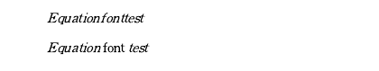

<!-- PDF 8쪽 -->


##### 1.1.1.2. 한글 글꼴 명령

수식 편집기에서 한글을 사용하고 글자 모양을 바꾸고 싶을 때에는 일반 문서 편집 화면에서와 마찬가지로 모양-글자 모양을 실행하여 글꼴의 종류나 크기를 바꿀 수 있다.

#### 1.1.2. 수식 편집기 고유 규칙

한글의 수식 편집기는 일반 문서 편집과는 달리 수식 편집기만의 고유한 규칙들을 가지고 있다. 따라서 수식 편집기의 보다 효율적인 사용을 위해서는 다음의 기본 규칙들을 알고 있어야 한다.

| 편집 화면 | 표시 화면 |
| --- | --- |
| ~ | 빈 칸(&lt;Space&gt; 효과) |
| <code>`</code> | 빈칸의 ¼ |
| { } | 여러 항의 묶음 |
| " " | 9 자 이상의 한 낱말 묶음 |
| # | 줄 바꾸기(&lt;Enter&gt; 효과) |
| & | 세로 칸 맞춤(&lt;Tap&gt; 효과) |

##### 1.1.2.1. 항의 구분

수식 편집기에서 항의 구분은 빈칸이나 줄 바꿈 표시(Enter), 탭 등으로 한다. 따라서 수식에서는 빈칸의 있고 없음에 주의해야 한다.

##### 1.1.2.2. 여러 항의 묶음

수식에 여러 항을 하나로 묶고 싶을 때는 항을 묶는 “{}”표시 안에 수식을 입력하면 된다.

##### 1.1.2.3. 한 항이 9자를 넘을 때

한 낱말(항)이 9 자를 넘어서면 수식 편집기는 두 개의 항으로 분리하여 인식합니다. 따라서 한 낱말이 9 자 이상 될 때에는 앞뒤에 영문 따옴표`<">`로 묶어야 하나의 낱말로 처리해 준다.

##### 1.1.2.4. 줄 바꾸기

수식 편집 화면에서 `<Enter>`를 누르는 것은 의미가 없다. 수식 결과에서 줄을 바꾸려면 `<#>`을 입력해 주어야 한다.

##### 1.1.2.5. 사이띄개, 엔터

수식 편집기에서는 사용자가 입력하는 `<Space>`와 `<Enter>` 등은 항을 구분하는 데만 쓰이고, 표시 화면에는 빈칸으로 나타나지 않는다. 즉 반복되는 사이 띄기나 줄 바꾸기 등은 무시된다.

<!-- PDF 9쪽 -->

##### 1.1.2.6. 세로 칸 맞춤

세로 칸 맞춤은 맞추고자 하는 기준 글자 앞에 `<&>`를 입력해 주어야 한다. 즉 글자 앞에서 `<Tab>`을 누른 것과 같은 효과를 준다.

##### 1.1.2.7. 빈칸

수식 결과에서 빈칸이 나타나게 하려면 `<~>`나 <code>&lt;`&gt;</code>를 입력해 주어야 한다.

- `~`: 정상적인 빈칸,
- <code>`</code>: 1/4 크기의 빈칸

빈칸이 여러 개 들어가는 긴 문장을 입력하려면 양쪽을 영문 따옴표`<">`로 묶어 주고 일반적인 화면에서와 같은 방법으로 입력하는 것이 편리하다.

#### 1.1.3. 수식에 쓰이는 기본 함수

한글의 수식 편집기는 수식에 쓰이는 기본 함수들을 자동으로 인식하여 이탤릭체로 변형하지 않고 로만체로 표현해 준다. 항상 로만(영문 신명조)체로 나타나는 기본 함수에는 다음과 같은 것들이 있다.

```text
sin     cos     coth    log     tan
cot     ln      lg      sec     cosec
max     min     csc     arcsin  limLim
arccos  arctan  exp     Exp     arc
sinh    det     gcd     cosh    tanh    mod
asin    acos    atan    lcm
```

그 밖에 언제나 로만체로 나오는 예약어에는 다음과 같은 것들이 있다.

```text
if      for     and     hom
ker     deg     arg     dim     Pr
```

입력 예시:

```text
f(x)= logx+sinx
```

결과 예시:


화학식은 항상 로만체로 쓰기 때문에 맨 앞에 “rm”을 입력하고 시작한다.

입력 예시:

```text
rm 2H_2 O = 2H_2 + O_2
```

결과 예시:


항상 로만체로 나오는 기본 함수와 예약어들을 이탤릭체로 쓰고 싶을 때에는 기본 함수 사이에 빈칸을 삽입하면 된다. 예를 들어 sin을 이탤릭체로 쓰려면 s in이나 si n또는 s i n을 입력한다.

입력 예시:

```text
si n, c os, a n d
```

결과 예시:


### 1.2. 기본 명령어

<!-- PDF 10~12쪽: 분할 표의 PILE/LONGDIV 이어지는 셀을 합침 -->

| 명령어 | 설명 | 입력 예 | 결과 |
| --- | --- | --- | --- |
| TIMES | 곱셈 기호를 표시합니다. | `2 times 5=10` | 아래 원본 표의 결과 열 참조 |
| OVER | 분수를 표시합니다. 분수는 기본적으로 가운데 맞춤으로 정렬하는데, 굳이 오른쪽이나 왼쪽 맞춤을 쓰려면 &lt;SpaceBar&gt;를 이용합니다. | `1 over 2` | 아래 원본 표의 결과 열 참조 |
| ATOP | "OVER" 명령과 같지만 분수를 나타내는 가로선을 생략합니다. | `x atop y` | 아래 원본 표의 결과 열 참조 |
| SQRT | 제곱근을 표시합니다. | `sqrt 2` | 아래 원본 표의 결과 열 참조 |
| ^ | 위 첨자를 표시합니다. 수식 편집 영역에서 "^"를 직접 입력하거나, 명령어 입력 창에 "SUP"를 입력합니다. | `E=mc^2` | 아래 원본 표의 결과 열 참조 |
| _ | 아래 첨자를 표시합니다. 수식 편집 영역에서 "_"를 직접 입력하거나, 명령어 입력 창에 "SUB"를 입력합니다. | `H_2 O` | 아래 원본 표의 결과 열 참조 |
| INT, OINT | 적분 기호를 표시합니다. | `int _1 ^2 {3x^2}dx` | 아래 원본 표의 결과 열 참조 |
| SUM | 총합 기호(Sigma)를 표시합니다. | `sum_{x=0} ^{inf}` | 아래 원본 표의 결과 열 참조 |
| BIGG 기호 | 뒤에 쓰인 기호의 크기를 확대합니다. | `{a+b} over {a-b} bigg / {x+y} over {x-y}` | 아래 원본 표의 결과 열 참조 |
| lim, Lim | 극한 기호를 표시합니다. 이때 lim과 Lim은 대소문자를 정확하게 가려 써야 합니다. | `y= lim _{x -> 0} {{1} over {x}}` | 아래 원본 표의 결과 열 참조 |
| UNION, INTER, PROD | 집합 기호를 표시합니다. 명령어 앞에 "SMALL"을 덧붙이면 첨자 없는 집합 기호를 입력합니다. | `U=(A SMALLUNION B) SMALLINTER C` | 아래 원본 표의 결과 열 참조 |
| NOT | 글자 앞에 not을 붙이면 그 글자에 사선을 그어줍니다. | `not =` | 아래 원본 표의 결과 열 참조 |
| REL | 두 항 간의 상호 관계를 상세히 표현할 수 있게 하는 기능으로, 두 항을 연결하는 화살표의 위, 아래에 관계식 등의 내용을 삽입할 수 있습니다. | `A REL <-> {+2} {-5} B` | 아래 원본 표의 결과 열 참조 |
| BUILDREL | REL과 유사한 기능으로, 화살표 아랫부분의 내용을 생략할 수 있습니다. | `A BUILDREL <-> {+2} B` | 아래 원본 표의 결과 열 참조 |
| CASES | 여러 개의 행 전체를 나타내는 묶음표{를 표시합니다. 묶음표의 크기는 상황에 따라 자동으로 확대되어 표시됩니다. | `cases {2x+y=4 # 3x-4y=-1}` | 아래 원본 표의 결과 열 참조 |
| PILE, LPILE, RPILE | 위에 있는 문자를 기준으로 가운데(PILE), 왼쪽(LPILE), 오른쪽(RPILE) 맞춤을 선택할 수 있습니다. |  | 아래 원본 표의 결과 열 참조 |
| EQALIGN | 칸 맞춤 표시인 "&"를 기준으로 수식의 세로 위치를 조절해 줍니다. |  | 아래 원본 표의 결과 열 참조 |
| CHOOSE 또는 BINOM | 조합 기호를 입력합니다. | `[전체항] CHOOSE [선택항] 또는 BINOM [전체항] [선택항]` | 아래 원본 표의 결과 열 참조 |
| MATRIX | 행렬(matrix)을 입력합니다. matrix는 줄(행) 단위로 입력하는 일반적인 방법과 matrix 다음에 col을 입력하여 칸(열) 단위로 입력하는 방법이 있습니다. col을 넣어 행렬을 칸 단위로 입력할 때는 각 수식 앞에 col(가운데) 대신 lcol(왼쪽 맞춤), rcol(오른쪽 맞춤)을 넣어 정렬 위치를 지정할 수도 있습니다. | `matrix{a_{1} &b_{1}&c_{1} # a_{2}&b_{2}&c_{2} # a_{3}&b_{3}&c_{3}}` | 아래 원본 표의 결과 열 참조 |
| PMATRIX | matrix 대신에 pmatrix를 쓰면 행렬(matrix) 앞뒤로 소괄호()를 표시해줍니다. | `pmatrix{a_{1} &b_{1}&c_{1} # a_{2}&b_{2}&c_{2} # a_{3}&b_{3}&c_{3}}` | 아래 원본 표의 결과 열 참조 |
| BMATRIX | matrix 대신에 bmatrix를 쓰면 행렬(matrix) 앞뒤로 대괄호[]를 표시해줍니다. | `bmatrix{a_{1} &b_{1}&c_{1} # a_{2}&b_{2}&c_{2} # a_{3}&b_{3}&c_{3}}` | 아래 원본 표의 결과 열 참조 |
| DMATRIX | matrix 대신에 dmatrix를 쓰면 행렬(matrix) 앞뒤로 세로줄&#124;을 표시해줍니다. | `dmatrix{a_{1} &b_{1}&c_{1} # a_{2}&b_{2}&c_{2} # a_{3}&b_{3}&c_{3}}` | 아래 원본 표의 결과 열 참조 |
| LSUB | 문자 왼쪽에 아래첨자를 표시해줍니다. | `x LSUB y`<br>`{}_{y}_x` | 아래 원본 표의 결과 열 참조 |
| LSUP | 문자 왼쪽에 윗첨자를 표시해줍니다. | `x LSUP y`<br>`{}^{y} x` | 아래 원본 표의 결과 열 참조 |
| LADDER | 최소공배수/최대공약수 함수를 표시해줍니다. | `LADDER {2&12&28#2&6&14#3 &7&}` | 아래 원본 표의 결과 열 참조 |
| SLADDER | 10진수를 2진수로 변환할 때 사용하는 함수를 표시해줍니다. | `SLADDER {2&12&#2&6&0#2&3 &0#1&1&}` | 아래 원본 표의 결과 열 참조 |
| LONGDIV | 나눗셈을 표현해줍니다. 숫자만 입력해도 레이아웃이 자동으로 맞춰지지만 ~를 이용하면 명시적으로 레이아웃을 맞출 수 있습니다. | `LONGDIV {6}{422}{2532#24#13#12#12#12#0}`<br>`LONGDIV {6}{422}{2532#24#~13#~12#~~12#~~12#~~~0}` | 아래 원본 표의 결과 열 참조 |
| Color | COLOR 명령어를 이용하여 첫 번째 인자엔 {R,G,B}값을 주고 두 번째 인자에 내용을 넣어주면 지정한 색상으로 표시해줍니다. | `{COLOR {255,0,255} {3}} over {4}` | 아래 원본 표의 결과 열 참조 |

원본 결과 수식(표의 세 부분을 순서대로 보존):

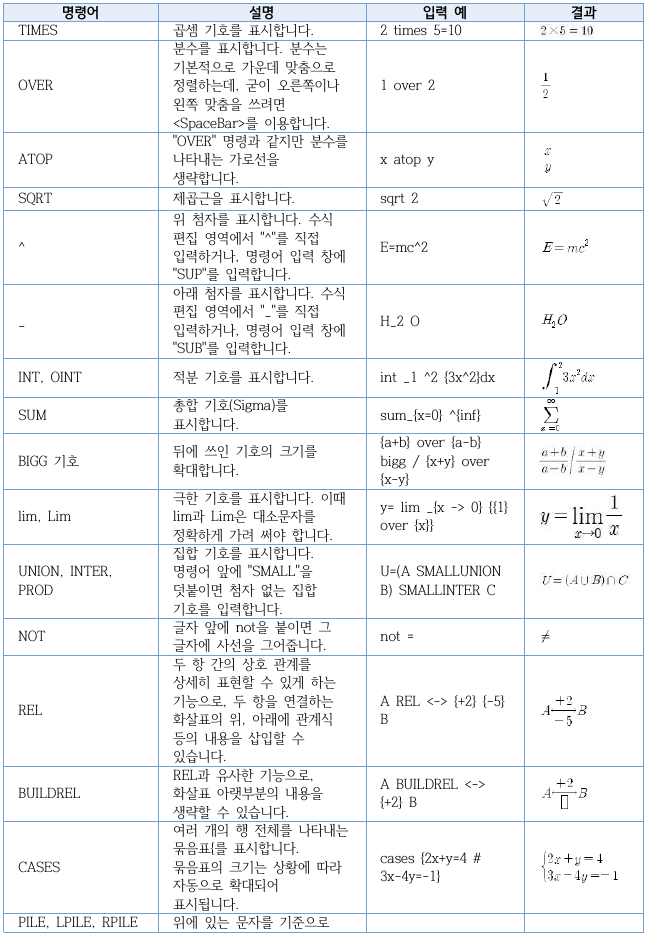

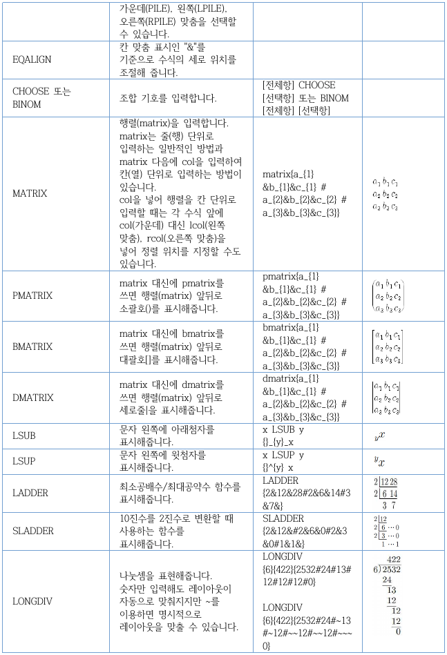

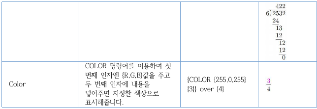

#### 1.2.1. 글자 장식 명령어

<!-- PDF 12쪽 -->

| 입력(왼쪽) | 입력(오른쪽) |
| --- | --- |
| acute A | bar A |
| grave A | vec A |
| dot A | dyad A |
| ddot A | under A |
| hat A | arch A |
| hat AA | arch AA |
| hat AAA | arch AAA |
| check A | tilde A |
| check AA | tilde AA |
| check AAA | tilde AAA |

각 입력의 결과:

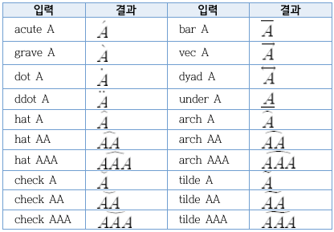

#### 1.2.2. 입력 기호 요약

| 입력 | 결과 |
| --- | --- |
| ~ | 빈칸 (스페이스 효과) |
| ' | 빈칸의 1/4 |
| { } | 여러 항의 묶음 |
| " " | 9자 이상의 한 낱말 묶음 |
| # | 줄 바꾸기 (&lt;Enter&gt; 효과) |
| & | 세로 칸 맞춤 (탭 효과) |

#### 1.2.3. 스크립트 입력 창에서 입력

<!-- PDF 12~13쪽 -->

| 명령어 | 이름 |
| --- | --- |
| TIMES | 곱하기 |
| OVER | 분수 |
| ATOP | 위아래 |
| SQRT | 제곱근 |
| BIGG 기호 | 가운데 큰 기호 |
| CASES | 경우들 |
| INT, OINT, DINT, TINT, ODINT, OTINT | 적분 |
| lim 또는 Lim | 극한 |
| SUM, PROD, UNION, INTER | 집합과 합 |
| PILE, LPILE, RPILE | 세로 쌓기 맞춤 |
| MATRIX, PMATRIX, BMATRIX, DMATRIX | 행렬 |
| CHOOSE, BINOM | 조합 |
| HAT, CHECK, TILDE, ACUTE, GRAVE, DOT, DDOT, BAR, VEC, DYAD, UNDER | 글자 꾸밈, 글자 장식 |

#### 1.2.4. 기호 종류

<!-- PDF 13~15쪽 -->

각 표에서 기호 이름은 검색 가능한 텍스트로, 기호 모양은 원본 표 이미지로 보존했다.

##### 1.2.4.1. 그리스 대문자()

| 이름(왼쪽) | 이름(가운데) | 이름(오른쪽) |
| --- | --- | --- |
| Alpha | Beta | Gamma |
| Delta | Epsilon | Zeta |
| Eta | Theta | Iota |
| Kappa | Lambda | Mu |
| Nu | Xi | Omicron |
| Pi | Rho | Sigma |
| Tau | Upsilon | Phi |
| Chi | Psi | Omega |

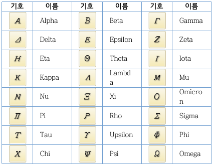

##### 1.2.4.2. 그리스 소문자()

| 이름(왼쪽) | 이름(가운데) | 이름(오른쪽) |
| --- | --- | --- |
| ALEPH | HBAR | IMATH |
| JMATH | OHM | ELL, LITER |
| WP | IMAG | ANGSTROM |
| vartheta | varpi | varsigma |
| varupsilon | varphi | varepsilon |

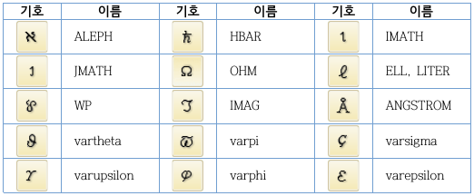

##### 1.2.4.3. 합/집합 기호()

| 이름(왼쪽) | 이름(가운데) | 이름(오른쪽) |
| --- | --- | --- |
| Sigma | PROD | COPROD |
| INTER | CAP | SQCAP |
| SQCUP | OPLUS | OMINUS |
| OTIMES | ODOT | OSLASH |
| VEE | WEDGE | SUBSET |
| SUPSET | SUBSETEQ | SUPSETEQ |
| IN | OWNS | notin |
| LEQ | GEQ | SQSUBSET |
| SQSUPSET | SQSUBSETEQ | SQSUPSETEQ |
| &lt;&lt; | &gt;&gt; | LLL |
| &gt;&gt;&gt; | PREC | SUCC |
| UPLUS |  |  |

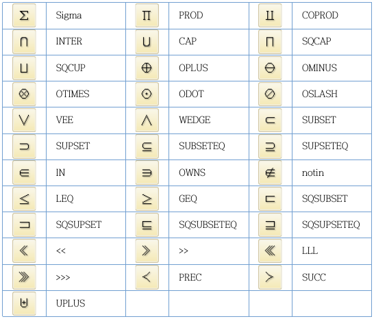

##### 1.2.4.4. 연산/논리 기호()

| 이름(왼쪽) | 이름(가운데) | 이름(오른쪽) |
| --- | --- | --- |
| PLUSMINUS | MINUSPLUS | times |
| DIV, DIVIDE | CIRC | BULLET |
| DEG | AST | STAR |
| BIGCIRC | EMPTYSET | THEREFORE |
| BECAUSE | IDENTICAL | EXIST |
| neq, != | DOTEQ | image |
| REIMAGE | SIM | APPROX |
| SIMEQ | CONG | ==, EQUIV |
| ASYMP | ISO | DIAMOND |
| DSUM | FORALL | prime |
| PARTIAL | inf | LNOT |
| PROPTO | XOR | TRIANGLED |
| DAGGER | DDAGGER |  |

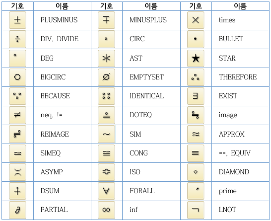

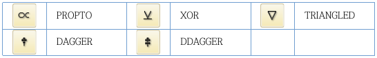

##### 1.2.4.5. 화살표()

| 이름(왼쪽) | 이름(가운데) | 이름(오른쪽) |
| --- | --- | --- |
| larrow | rarrow | uparrow |
| downarrow | LARROW | RARROW |
| UPARROW | DOWNARROW | udarrow |
| lrarrow | UDARROW | LRARROW |
| nwarrow | searrow | nearrow |
| swarrow | hookleft | hookright |
| mapsto | vert | VERT |

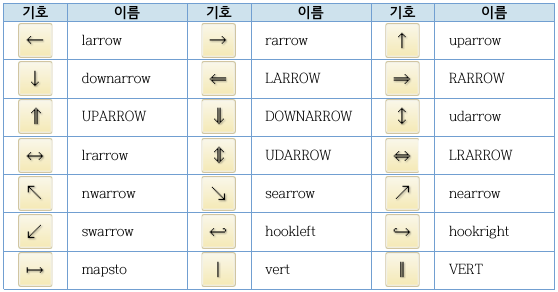

##### 1.2.4.6. 기타 기호()

| 이름(왼쪽) | 이름(가운데) | 이름(오른쪽) |
| --- | --- | --- |
| cdots | LDOTS | VDOTS |
| DDOTS | TRIANGLE | TRIANGLED |
| ANGLE | MSANGLE | SANGLE |
| RTANGLE | VDASH | HLEFT |
| BOT | TOP | MODELS |
| LAPLACE | CENTIGRADE | FAHRENHEIT |
| LSLANT | RSLANT | att |
| hund | thou | well |
| base | benzene |  |

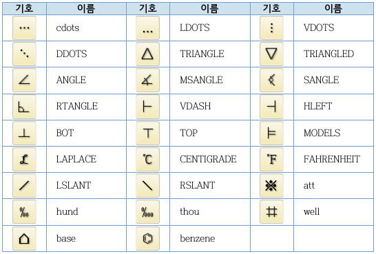

## 2. 수식 작성 예제 (Examples)

<!-- PDF 15쪽 -->

이 부분에서는 수식 편집기를 사용하는 몇 가지의 예제를 실었다. 각 예제마다 수식을 작성하는 절차를 수식 명령어를 사용하는 방법으로 설명하였다.

### 2.1. 분수식 만들기

<!-- PDF 16쪽 -->


수식 명령어:

```text
10a^3 over b^2 times ~□ ~÷ b^3 over 2a =( 2a^2 over b )^3
```

분수를 표현하는 명령어는 OVER이며, 곱셈 기호를 나타내는 명령어는 TIMES 이다. a³ 처럼 거듭제곱의 명령어는 SUP 또는 ^를 사용한다. □와 ÷는 코드표를 이용해 삽입한다.

### 2.2. De Morgan's 법칙 표현


수식 명령어:

```text
(A UNION B)^C` =` A^C INTER B^C
```

집합 명령어는 합집합이 UNION이고, 교집합이 INTER이며 여집합은 SUP C 또는 ^C 이다. 등호 앞뒤의 <code>&lt;`&gt;</code>은 보기 좋은 간격을 유지하기 위하여 삽입한 것이다.

### 2.3. 거듭제곱근이 들어간 식 만들기


수식 명령어:

```text
int from 0 to 3 `^3sqrt{x^2 +1}dx
```

적분은 INT 명령어를 써서 표현한다. 그리고 구간을 나타내는 명령어는 시작점 FROM, 끝점 TO이고 세제곱근의 표현은 거듭제곱근의 명령어인 SQRT앞에 거듭제곱의 명령어인 ^를 적당한 숫자와 함께 표현한다.

### 2.4. 간단한 행렬 만들기


수식 명령어:

```text
X = bmatrix { 42 & 52 & 48 & 58 #
              4 & 5 & 4 & 3 }
```

먼저 X=bamtrix{}와 같이 입력하여 행렬의 기본적인 틀을 만든다. {}안에 적당한 숫자를 `<&>`으로 열을 구분하면서 입력한다. 두 번째 행은 줄 바꿈 기호인 `<#>`으로 행을 구분하고 첫 번째 행과 같은 방법으로 입력한다.

<!-- PDF 17쪽 -->

### 2.5. 극한과 총합이 들어간 식 만들기


수식 명령어:

```text
lim_N->inf 1 over N sum_n=1^N
LEFT(SUM_k=1^n 1 over 2^k right)
```

기호가 여러 개 있어도 복잡하지는 않으며 맨 왼쪽부터 하나하나 표현해 나가면 된다. 아래 첨자는 SUB 또는 _를 쓴다. 그리고 화살표는 RARROW 또는 ->를 써서 표현하고 무한대는 INF 명령어를 쓴다. 큰 괄호는 LEFT( RIGHT)를 먼저 쓰고 괄호 사이에 수식을 차근차근 입력하면 된다. 하지만 괄호 앞에 LEFT, RIGHT 명령어를 쓰지 않으면 다음처럼 보기에 좋지 않은 수식이 되어 버리니 주의하기 바란다.

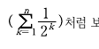

## 3. 변경 사항 이력

<!-- PDF 18쪽 -->

- revision 1.2:20141030
  - 한글 문서 파일 구조 파트별로 구성
  - 한글 문서 파일 형식 – 수식 공개
- revision 1.3:20181108
  - 신규 기본 함수/기본 명령어 추가

## 발행 정보

<!-- PDF 19쪽 -->

한글 문서 파일 구조 - 수식

| 항목 | 내용 |
| --- | --- |
| 발행처 | (주) 한글과컴퓨터 |
| 주소 | (우) 463-400<br>경기도 성남시 분당구 대왕판교로<br>644번길 49 한컴타워 10층 |
| 전화 | (031) 627-7000 |
| 팩스 | (031) 627-7709 |
