# 한글 문서 파일 구조 - 차트

Hwp Document File Formats - Charts 
revision 1.2:20141120

> 한컴 공식 [원본 PDF](https://cdn.hancom.com/link/docs/%ED%95%9C%EA%B8%80%EB%AC%B8%EC%84%9C%ED%8C%8C%EC%9D%BC%ED%98%95%EC%8B%9D_%EC%B0%A8%ED%8A%B8_revision1.2.pdf)의 전체 내용을 Markdown으로 옮긴 참조본입니다.
> 제목·본문·저작권·표 115개·구조 그림·상수 예시 이미지를 보존했습니다.
> PDF에서 쪽을 넘어 이어지는 표는 하나로 합쳤으며, 표 셀의 줄바꿈은 ` `로 표시했습니다.
> 원문의 옛한글 제품명 표기는 검색과 표시를 위해 “한글”로 통일했습니다.
> 원문의 값·속성명·설명·표제는 교정하지 않았습니다. 모호한 부분은 원본 PDF를 확인하십시오.
> PDF 쪽 위치는 HTML 주석에 기록했습니다. 다음 저작권과 본문은 원문 내용입니다.

<!-- PDF 1쪽 -->

<!-- PDF 2쪽 -->

## 저작권

(주)한글과컴퓨터(이하 ‘한컴’)는 문서 형식의 개방성과 표준화에 대하여 적극 찬성합니다. 한컴은 한글 97의 문서 형식을 무상으로 지원한 바 있으며, 한글 2002~2010 문서의 XML 형식은 HWPML에 대해서도 문서 형식을 공개한 바 있습니다. 개방형 문서 표준화 및 코드 관련 위원회에도 적극적으로 참여하여 파일 형식의 표준화와 개방성을 위해 노력해 왔습니다. 이러한 결과로 HWPML 스펙이 OWPML란 이름으로 한국산업표준(KS X 6101:2011)으로 제정되었습니다. 또한, 한컴오피스에서 기록물 장기보존 표준 포맷인 PDF/A-1의 지원과 ISO 국제 문서 형식인 ODF와 OOXML 파일 형식의 불러오기와 저장하기를 적극적으로 지원하였습니다.

본 문서를 열람하고자 하는 분이라면 누구에게나 제공되는 것이며, 본 문서를 열람하는 것 외에 복사, 배포, 게재 및 본 문서에 기재되어 있는 내용을 사용하고자 하는 분은 한컴의 본 저작권을 충분히 인식하고 동의하여야 합니다.

본 문서를 누구나 열람, 복사, 배포, 게재 및 사용을 자유롭게 할 수 있습니다. 다만, 배포는 원 내용이 일체 수정되지 않은 원본 또는 복사본으로 제한됩니다. 원본 및 복사본은 한컴에서 제공하는 스펙의 최신 버전을 포함하고 있어야 합니다.

한컴은 한컴오피스 한글 문서 파일(.hwp) 공개 문서에 따라 얻은 결과물을 기초로 또 다른 독점적, 배타적 권리를 취득하고 이를 한컴을 상대로 행사하고자 하는 자를 상대로는 적극적으로 권리 행사를 할 수도 있습니다.

그리고 본 문서 및 본 문서에 기재된 내용을 참고하여 개발한 결과물에 대한 모든 저작권은 결과물을 개발한 개인 또는 단체에 있을 것입니다. 그러나 반드시 개발 결과물에 “본 제품은 (주)한글과컴퓨터의 한글 문서 파일(.hwp) 공개 문서를 참고하여 개발하였습니다.”라고 제품 내 유저인터페이스, 매뉴얼, 도움말 및 소스에 모두 기재하여야 하며 제품이 이러한 구성물이 없을 시에는 존재하는 구성물에만 기재합니다. 한컴은 본 문서 및 본 문서에 기재된 내용을 참고하여 개발한 결과물에 대해서 어떠한 정확성, 진실성도 보증하지 아니합니다.

<!-- PDF 3쪽 -->

## 차례

- 본 문서에 대하여 — 1쪽

- 차트 — 2쪽

- 1. Chart Object의 기본 구조 — 2쪽

- 2. Chart Object의 Tree 구조 — 3쪽

- 3. Chart Object — 4쪽

- 3.1. VtChart Object — 4쪽

- 3.2. VtColor Object — 5쪽

- 3.3. VtFont Object — 5쪽

- 3.4. VtPicture Object — 6쪽

- 3.5. Attributes Collection — 6쪽

- 3.6. Attribute Object — 6쪽

- 3.7. Axis Object — 6쪽

- 3.8. AxisGrid Object — 7쪽

- 3.9. AxisScale Object — 7쪽

- 3.10. AxisTitle Object — 7쪽

- 3.11. Backdrop Object — 8쪽

- 3.12. Bar Object — 8쪽

- 3.13. Brush Object — 8쪽

- 3.14. CategoryScale Object — 8쪽

- 3.15. Contour Object — 9쪽

- 3.16. ContourGradient Object — 9쪽

- 3.17. Coor Object — 9쪽

- 3.18. Coor3 Object — 9쪽

- 3.19. DataGrid Object — 10쪽

- 3.20. DataPoints Collection — 10쪽

- 3.21. DataPoint Object — 10쪽

- 3.22. DataPointLabel Object — 11쪽

- 3.23. DateScale Object — 11쪽

<!-- PDF 4쪽 -->

- 3.24. Doughnut Object — 12쪽

- 3.25. Elevation Object — 12쪽

- 3.26. Fill Object — 12쪽

- 3.27. Footnote Object — 13쪽

- 3.28. Frame Object — 13쪽

- 3.29. Gradient Object — 13쪽

- 3.30. HiLo Object — 13쪽

- 3.31. Intersection Object — 14쪽

- 3.32. Labels Collection — 14쪽

- 3.33. Label Object — 14쪽

- 3.34. LCoor Object — 14쪽

- 3.35. Legend Object — 15쪽

- 3.36. Light Object — 15쪽

- 3.37. LightSources Collection — 15쪽

- 3.38. LightSource Object — 15쪽

- 3.39. Location Object — 16쪽

- 3.40. LRect Object — 16쪽

- 3.41. Marker Object — 16쪽

- 3.42. Pen Object — 16쪽

- 3.43. Pie Object — 17쪽

- 3.44. Plot Object — 17쪽

- 3.45. PlotBase Object — 18쪽

- 3.46. Position Object — 18쪽

- 3.47. PrintInformation Object — 18쪽

- 3.48. Rect Object — 19쪽

- 3.49. SeriesCollection Collection — 19쪽

- 3.50. Series Object — 19쪽

- 3.51. SeriesLabel Object — 20쪽

- 3.52. SeriesMarker Object — 20쪽

- 3.53. Shadow Object — 20쪽

- 3.54. StatLine Object — 21쪽

- 3.55. Surface Object — 21쪽

- 3.56. TextLayout Object — 21쪽

<!-- PDF 5쪽 -->

- 3.57. Tick Object — 22쪽

- 3.58. Title Object — 22쪽

- 3.59. ValueScale Object — 22쪽

- 3.60. View3D Object — 23쪽

- 3.61. Wall Object — 23쪽

- 3.62. Weighting Object — 23쪽

- 3.63. XYZ Object — 23쪽

- 4. Constants 자료형 — 24쪽

- 4.1. AngleUnits Constants — 24쪽

- 4.2. AxisId Constants — 24쪽

- 4.3. AxisTickStyle Constants — 24쪽

- 4.4. BrushStyle Constants — 24쪽

- 4.5. BrushPatterns Constants — 25쪽

- 4.6. BrushHatches Constants — 25쪽

- 4.7. ChartType Constants — 26쪽

- 4.8. ContourDisplayType Constants — 26쪽

- 4.9. ContourColorType Constants — 27쪽

- 4.10. DateIntervalType Constants — 27쪽

- 4.11. DrawMode Constants — 27쪽

- 4.12. DcType Constants — 27쪽

- 4.13. FillStyle Constants — 28쪽

- 4.14. FontEffect Constants — 28쪽

- 4.15. FontStyle Constants — 28쪽

- 4.16. FrameStyle Constants — 28쪽

- 4.17. GradientStyle Constants — 29쪽

- 4.18. HorizontalAlignment Constants — 29쪽

- 4.19. LabelComponent Constants — 29쪽

- 4.20. LabelLineStyle Constants — 29쪽

- 4.21. LabelLocationType Constants — 30쪽

- 4.22. LocationType Constants — 30쪽

- 4.23. MarkerStyle Constants — 30쪽

- 4.24. Orientation Constants — 31쪽

<!-- PDF 6쪽 -->

- 4.25. PartType Constants — 31쪽

- 4.26. PercentAxisBasis Constants — 32쪽

- 4.27. PenCap Constants — 32쪽

- 4.28. PenJoin Constants — 32쪽

- 4.29. PenStyle Constants — 32쪽

- 4.30. PictureOptions Constants — 33쪽

- 4.31. PictureMapType Constants — 33쪽

- 4.32. PictureType Constants — 33쪽

- 4.33. PieWeightBasis Constants — 34쪽

- 4.34. PieWeightStyle Constants — 34쪽

- 4.35. PrintOrientation Constants — 34쪽

- 4.36. PrintScaleType Constants — 34쪽

- 4.37. ProjectionType Constants — 35쪽

- 4.38. ScaleType Constants — 35쪽

- 4.39. SeriesType Constants — 35쪽

- 4.40. ShadowStyle Constants — 36쪽

- 4.41. SmoothingType Constants — 36쪽

- 4.42. SortType Constants — 36쪽

- 4.43. SsLinkMode Constants — 37쪽

- 4.44. StatsType Constants — 37쪽

- 4.45. SubPlotLabelLocationType Constants — 37쪽

- 4.46. SurfaceBaseType Constants — 38쪽

- 4.47. SurfaceDisplayType Constants — 38쪽

- 4.48. SurfaceProjectionType Constants — 38쪽

- 4.49. SurfaceWireframeType Constants — 38쪽

- 4.50. TextLengthType Constants — 39쪽

- 4.51. TextOutputType Constants — 39쪽

- 4.52. VerticalAlignment Constants — 39쪽

- 변경 사항 이력 — 40쪽

<!-- PDF 7쪽 -->

## 본 문서에 대하여

본 문서는 한글 워드 프로세서의 파일 저장 형식 중, 한글 2002 이후 제품에서 사용되는 한글 문서 파일 형식의 차트에 관하여 설명한다.

본 문서는 한글 문서 파일 형식의 차트에 관한 주요한 구조, object, constant 자료형에 대해서 설명한다.

한글 문서 파일 형식 5.0, 수식, 배포용 문서, 한글 문서 파일 형식 3.0, HWPML에 관해서는 별도의 문서에서 설명한다.

<!-- PDF 8쪽 -->

## 차트

### 1. Chart Object의 기본 구조

차트 바이너리 데이터는 아래 그림과 같이 순차적으로 ChartObj들이 하나씩 나열되어 있으며 각각의 ChartObj의 구조는 아래 그림과 같은 데이터로 구성 되어있다.

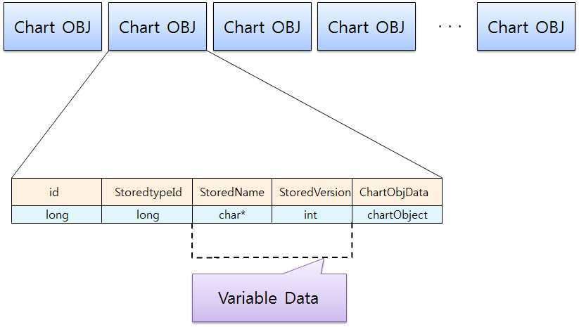

각각의 ChartObj의 기본 구조는 위와 같은 형식으로 저장이 되어있다.

그리고 ChartObjData는 또 다른 ChartObj를 포함하고 있을 수 있다.

StoredName과 StoredVersion은 Variable Data로써, ChartOBJ의 StoredtypeID 가 중복적으로 나올 경우는 위의 데이터가 제외된다. 즉 동일한 Type이 앞에 있다면 뒤에 있는 ChartOBJ의 VariableData는 제외된다.

<!-- PDF 9쪽 -->

### 2. Chart Object의 Tree 구조

기본적으로 차트는 VtChart가 하나의 차트를 의미하며, 내부적으로 VtChart가 아래 그림과 같은 ChartObj를 가지고 있는 구조이다. 각각의 ChartObj를 분석하여 따라가면, 또 다른 ChartObj를 순차적으로 읽을 수 있다.

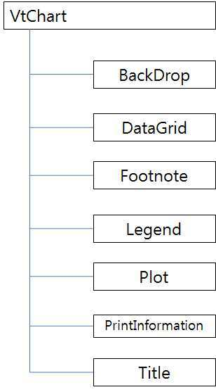

예를 들어 Legend Object는 VtFont Object와 TextLayout Object를 포함하고 있다.

각각의 Chart Object는 설명 뒤에 나오는 표를 참고한다.

<!-- PDF 10쪽 -->

### 3. Chart Object

#### 3.1. VtChart Object

데이터를 그래픽으로 표시하는 차트

**표 1 VtChart Object**

<!-- PDF 10, 11쪽 -->

| 속성 | 자료형 | 설명 |
| --- | --- | --- |
| ActiveSeriesCount | Integer | 데이터 격자의 열 수 및 그려지는 차트의 유형을 기준으로 차트에 나타나는 계열 수 |
| AllowDithering | Boolean | 차트에 대한 색상 디더링을 비활성화할지 결정 |
| AllowDynamicRotation | Boolean | 3D 차트를 사용자가 회전시킬 수 있는지를 나타낸다. |
| AllowSelections | Boolean | 사용자가 차트 개체를 선택할 수 있는지를 나타낸다. |
| AllowSeriesSelection | Boolean | 사용자가 개별 차트 데이터 요소를 클릭할 때 계열을 선택할 수 있는지를 나타낸다. |
| AllowUserChanges | Boolean | 현재 차트의 형식을 지정하기 위한 대화 상자를 표시할 수 있는지를 나타낸다. |
| AutoIncrement | Boolean | Column 및 Row 속성을 수동으로 설정하지 않고 데이터 입력 중 현재 데이터 요소를 설정하는 속성이 증가되도록 허용한다. |
| Backdrop | Backdrop Object | 차트 뒤의 음영, 패턴 또는 그림 |
| Chart3d | Boolean | 차트가 3D 차트인지 |
| ChartType | Integer | 차트를 표시하는 데 사용되는 차트 유형 ⇒ ChartType 상수 참고 |
| Column | Integer | 데이터 격자에서 현재 데이터 열 다른 속성을 사용하여 해당하는 차트 계열 또는 계열 내의 데이터 요소를 변경하려면 먼저 열을 선택해야 한다. |
| ColumnCount | Integer | 현재 데이터 격자에서 열 수 |
| ColumnLabel | String | 데이터 격자에서 열과 연결된 레이블 텍스트 |
| ColumnLabelCount | Integer | 데이터 격자에서 열 레이블의 레벨 수 |
| ColumnLabelIndex | Integer | 열 레이블의 특정 레벨 |
| Data | String | 데이터 격자에서의 값을 현재 데이터 요소에 삽입한다. 현재 데이터 요소에 이미 값이 포함되어 있을 땐 새 값으로 바뀐다. 새 값을 반영하여 차트가 다시 그려진다. |
| DataGrid | DataGrid Object | 차트 데이터 격자 |
| DoSetCursor | Boolean | 커서를 차트에서 설정할 수 있는지를 나타낸다. 응용 프로그램에서 마우스 포인터 모양을 제어할 수 있는지를 결정. |
| DrawMode | Integer | 차트를 다시 그리는 데 사용되는 방법 및 차트가 다시 그려지는 시기 |
| ErrorOffset | Integer | App에서 반환되는 오류 번호에 대한 조정 |
| FileName | String | 차트가 로드 및 저장되는 이름 |
| Footnote | Footnote Object | 차트 아래쪽에 나타나는 설명 텍스트 |
| FootnoteText | String | 각주를 사용되는 텍스트 |
| Handle | Long | 차트를 참조하는 데 사용할 수 있는 고유 번호 |
| Legend | Legend Object | 차트 계열을 식별하는 차트 키 |
| Picture | Integer | App에서 현재 차트의 그림을 요청하는 데 사용할 수 있는 핸들 |
| Plot | Plot Object | 차트가 표시되는 영역 |
| PrintInformation | PrintInformation Object | 차트 인쇄 방법을 설명하는 특성 |
| RandomFill | Boolean | 차트 데이터 격자에 대한 데이터가 임의로 생성되었는지를 나타낸다. |
| Repaint | Boolean | 차트가 변경된 후 App 컨트롤이 다시 페인트 되는지를 결정 |
| Row | Integer | 데이터 격자의 현재 열에서 특정 행 |
| RowCount | Integer | 격자의 각 열에 있는 행 수 |
| RowLabel | String | 현재 데이터 요소를 식별하는 데이터 레이블 |
| RowLabelCount | Integer | 데이터 격자에서 행 레이블의 레벨 수 |
| RowLabelIndex | Integer | 행 레이블의 특정 레벨을 선택한다. |
| SeriesColumn | Integer | 현재 계열 데이터에 대해 열 위치 |
| SeriesType | Integer | 현재 계열을 표시하는 데 사용되는 유형 |
| ShowLegend | Boolean | 차트에 대한 범례가 표시되는지를 나타낸다. |
| SsLinkMode | Integer | 스프레드시트 데이터가 App에서 해석되는 방법 |
| SsLinkRange | String | 차트 소스 데이터가 포함된 스프레드시트 내의 데이터 범위 |
| SsLinkBook | String | 차트 데이터 소스로 사용할 워크북을 식별한다. |
| Stacking | Boolean | 차트의 모든 계열이 쌓이는지를 설정한다. |
| TextLengthType | Integer | 화면이나 인쇄된 페이지에서 모양을 최적화하도록 텍스트가 그려지는 방법 |
| Title | Title Object | 차트를 식별하는 텍스트 |
| TitleText | String | 차트 제목으로 표시되는 텍스트 |
| TwipsWidth | Integer | 차트의 너비(X값, twip 단위) |
| TwipsHeight | Integer | 차트의 높이(Y값, twip 단위) |

#### 3.2. VtColor Object

그리기 색상

**표 2 VtColor Object**

<!-- PDF 11쪽 -->

| 속성 | 자료형 | 설명 |
| --- | --- | --- |
| Automatic | Boolean | 색상이 자동으로 계산되는지를 결정한다. |
| Blue | Integer | RGB 값의 파란색 구성 요소 |
| Green | Integer | RGB 값의 녹색 구성 요소 |
| Red | Integer | RGB 값의 빨간색 구성 요소 |
| Value | Integer | VtColor 개체의 RGB 값 값은 VtColor 개체의 기본 속성 따라서 사용자는 '값'을 지정하지 않고도 지정이 가능하다. |

#### 3.3. VtFont Object

차트 텍스트를 표시하는 데 사용되는 글꼴

**표 3 VtFont Object**

<!-- PDF 11, 12쪽 -->

| 속성 | 자료형 | 설명 |
| --- | --- | --- |
| Color | VtColor object | 차트 텍스트를 표시하는 데 사용되는 글꼴의 색상 |
| Effects | Integer | 글꼴 효과. ⇒ FontEffect 상수 참고 |
| Name | String | 글꼴 이름 |
| Size | Single | 글꼴 크기(포인트 단위) |
| Style | Integer | 글꼴 스타일. ⇒ FontStyle 상수 참고 |

#### 3.4. VtPicture Object

차트의 일부로 표시할 수 있는 그래픽

**표 4 VtPicture Object**

<!-- PDF 12쪽 -->

| 속성 | 자료형 | 설명 |
| --- | --- | --- |
| Embedded | Boolean | 그래픽 파일이 실제로 차트의 일부인지 지정한다. True이면 그림이 차트와 함께 저장된다. False이면 그림이 차트와 함께 저장되지 않는다. |
| Filename | String | 참조된 그래픽 파일에 대해 파일 이름 및 경로 |
| Map | Integer | 그림 표시 방법 ⇒ PictureMapType 상수 참고 |
| Type | Integer | 그래픽 파일 유형 ⇒ PictureType 상수 참고 |

#### 3.5. Attributes Collection

차트 등고선 그룹

**표 5 Attributes Collection**

<!-- PDF 12쪽 -->

| 속성 | 자료형 | 설명 |
| --- | --- | --- |
| Count | Long | 해당 컬렉션에서 등고선의 수 |
| Item | Attribute object | 해당 컬렉션에서의 특정 등고선 |

#### 3.6. Attribute Object

차트 등고선 및 모양

**표 6 Attribute Object**

<!-- PDF 12쪽 -->

| 속성 | 자료형 | 설명 |
| --- | --- | --- |
| Brush | Brush object | 차트 등고선을 밴드로 표시하는 데 사용되는 색상 및 스타일 |
| Pen | Pen object | 차트 등고선을 선으로 표시하는 데 사용되는 색상 및 스타일 |
| Text | String | 범례에서 등고선을 식별하는 데 사용되는 텍스트 |
| Value | Double | 등고선이 표시되는 등고선 데이터 값 |

#### 3.7. Axis Object

차트의 축

**표 7 Axis Object**

<!-- PDF 12, 13쪽 -->

| 속성 | 자료형 | 설명 |
| --- | --- | --- |
| AxisGrid | AxisGrid Object | 차트 축 주변의 평면 영역 |
| AxisScale | AxisScale Object | 날짜 축에 대한 배율 |
| AxisTitle | AxisTitle Object | 차트의 축 제목 |
| CategoryScale | CategoryScale Object | 범주 축에 대한 배율 |
| DateScale | DateScale Object | 날짜 축에 대한 배율 |
| Intersection | Intersection Object | 차트에서 축이 교차 축과 교차하는 포인트 |
| Labels | LabelsCollection Collection | 차트 축 레이블 그룹 |
| LabelLevelCount | Integer | 해당 축에 대한 레이블의 레벨 수 |
| Pen | Pen object | 차트에서 축을 그리는 데 사용되는 너비 및 색상 |
| Tick | Tick Object | 차트 축을 따라 분할을 나타내는 마커 |
| ValueScale | ValueScale Object | 값 축에 대한 배율 |

#### 3.8. AxisGrid Object

차트 축 주변의 평면 영역

**표 8 AxisGrid Object**

<!-- PDF 13쪽 -->

| 속성 | 자료형 | 설명 |
| --- | --- | --- |
| MajorPen | Pen object | 주 축 격자 선의 모양 |
| MinorPen | Pen object | 부 축 격자 선의 모양 |

#### 3.9. AxisScale Object

차트 값이 축에서 플롯으로 그려지는 방법을 제어한다.

**표 9 AxisScale Object**

<!-- PDF 13쪽 -->

| 속성 | 자료형 | 설명 |
| --- | --- | --- |
| Hide | Boolean | 축의 숨김을 결정한다. |
| LogBase | Integer | 로그 축에서 차트 값을 플롯으로 그리는 데 사용되는 로그 베이스 축 유형은 Type 속성으로 제어된다. |
| PercentBasis | String | 백분율 축에서 차트 값을 플롯으로 그리는 데 사용되는 백분율 유형 축 유형은 Type 속성으로 제어된다. |
| Type | Integer | 축의 배율 유형. ⇒ ScaleType 상수 참고 |

#### 3.10. AxisTitle Object

차트의 축 제목

**표 10 AxisTitle Object**

<!-- PDF 13쪽 -->

| 속성 | 자료형 | 설명 |
| --- | --- | --- |
| Backdrop | Backdrop Object | 축 제목 뒤의 음영, 패턴 또는 그림 |
| Text | String | 축 제목을 표시하는 데 사용되는 텍스트 |
| TextLayout | TextLayout Object | 축 제목의 텍스트 위치 지정 및 방향 |
| TextLength | Integer | 축 제목의 길이 |
| Visible | Boolean | 축 제목을 차트에 표시할지를 결정한다. |
| VtFont | VtFont Object | 축 제목을 표시하는 데 사용되는 글꼴 |

<!-- PDF 14쪽 -->

#### 3.11. Backdrop Object

개체 뒤의 음영, 패턴 또는 그림

**표 11 Backdrop Object**

<!-- PDF 14쪽 -->

| 속성 | 자료형 | 설명 |
| --- | --- | --- |
| Frame | Frame object | 개체 뒤에 표시되는 프레임의 모양 |
| Fill | Fill object | 개체 배경의 유형 및 모양 |
| Shadow | Shadow object | 개체 뒤에 표시되는 음영의 모양 |

#### 3.12. Bar Object

3D 막대 차트의 막대

**표 12 Bar Object**

<!-- PDF 14쪽 -->

| 속성 | 자료형 | 설명 |
| --- | --- | --- |
| Sides | Integer | 막대에 대해 표시되는 측면의 수 |
| TopRatio | Single | 막대의 상단을 그리는 데 사용되는 기준 크기의 백분율 |

#### 3.13. Brush Object

**표 13 Brush Object**

<!-- PDF 14쪽 -->

| 속성 | 자료형 | 설명 |
| --- | --- | --- |
| FillColor | VtColor object | 브러시 채우기 색상 |
| Index | Integer | 스타일이 BrushStylePattern 또는 BrushStyleHatch로 설정된 경우 브러시에서 사용되는 패턴 또는 해치 ⇒ BrushPatterns 상수 참고 ⇒ BrushHatches 상수 참고 |
| PatternColor | VtColor object | 브러시 패턴 색상 |
| Style | Integer | 브러시 스타일 ⇒ BrushStyle 상수 참고 |

#### 3.14. CategoryScale Object

범주 축에 대한 배율

**표 14 CategoryScale Object**

<!-- PDF 14쪽 -->

| 속성 | 자료형 | 설명 |
| --- | --- | --- |
| Auto | Boolean | 축이 자동으로 배율 조정되는지를 나타낸다. |
| DivisionsPerLabel | Integer | 레이블 사이에 건너뛸 분할 수 |
| DivisionsPerTick | Integer | 눈금 표시 사이에 건너뛸 분할 수 |
| LabelTick | Boolean | 범주 축 레이블이 축 눈금 표시에서 가운데에 오는지를 나타낸다. |

<!-- PDF 15쪽 -->

#### 3.15. Contour Object

3D 상승 차트의 평면 등고선

**표 15 Contour Object**

<!-- PDF 15쪽 -->

| 속성 | 자료형 | 설명 |
| --- | --- | --- |
| DisplayType | Integer | 차트에 표시되는 등고선의 유형 ⇒ ContourDisplayType 상수 참고 |

#### 3.16. ContourGradient Object

3D 상승 차트의 그러데이션 등고선

**표 16 ContourGradient Object**

<!-- PDF 15쪽 -->

| 속성 | 자료형 | 설명 |
| --- | --- | --- |
| FromBrushColor | VtColor object | 차트에 표시되는 시작 그러데이션 색상에 대한 브러시 색상 |
| ToBrushColor | VtColor object | 차트에 표시되는 끝 그러데이션 색상에 대한 브러시 색상 |
| FromPenColor | VtColor object | 차트의 시작 등고선에 대한 펜 색상 |
| ToPenColor | VtColor object | 차트의 끝 등고선에 대한 펜 색상 |

#### 3.17. Coor Object

Coor 개체는 부동 x 및 y 좌표 쌍

**표 17 Coor Object**

<!-- PDF 15쪽 -->

| 속성 | 자료형 | 설명 |
| --- | --- | --- |
| X | Single | 부동 좌표 쌍에서 X값 |
| Y | Single | 부동 좌표 쌍에서 Y값 |

#### 3.18. Coor3 Object

Coor3 개체는 부동 소수점 x, y 및 z 좌표

**표 18 Coor3 Object**

<!-- PDF 15쪽 -->

| 속성 | 자료형 | 설명 |
| --- | --- | --- |
| X | Single | 부동 소수점 좌표에 대한 X값 |
| Y | Single | 부동 소수점 좌표에 대한 Y값 |
| Z | Single | 부동 소수점 좌표에 대한 Z값 |

<!-- PDF 16쪽 -->

#### 3.19. DataGrid Object

차트 데이터 격자

**표 19 DataGrid Object**

<!-- PDF 16쪽 -->

| 속성 | 자료형 | 설명 |
| --- | --- | --- |
| ColumnCount | Integer | 현재 데이터 격자에서 열 수 |
| ColumnLabel | String | 차트와 연결된 격자에서 데이터 열의 레이블 |
| ColumnLabelCount | Integer | 현재 데이터 격자에서 열 레이블의 레벨 수 |
| CompositeColumnLa bel | Integer | 데이터 격자에서 열을 식별하는 다중 레벨 레이블 |
| CompositeRowLabel | String | 데이터 격자 행을 식별하는 다중 레벨 레이블 |
| RowCount | Integer | 현재 데이터 격자에서 행 수 |
| RowLabel | String | 현재 데이터 격자에서 행 레이블 |
| RowLabelCount | Integer | 현재 데이터 격자에서 행 레이블의 레벨 수 |

#### 3.20. DataPoints Collection

차트 데이터 요소의 그룹

**표 20 DataPoints Collection**

<!-- PDF 16쪽 -->

| 속성 | 자료형 | 설명 |
| --- | --- | --- |
| Count | Long | 해당 컬렉션에서 데이터 요소의 수 |
| Item | DataPoint object | 해당 컬렉션의 특정 데이터 요소 |

#### 3.21. DataPoint Object

차트의 데이터 요소

**표 21 DataPoint Object**

<!-- PDF 16쪽 -->

| 속성 | 자료형 | 설명 |
| --- | --- | --- |
| Brush | Brush object | 데이터 요소를 표시하는 데 사용되는 색상 및 패턴 |
| DataPointLabel | DataPointLabel object | 데이터 요소의 레이블 |
| EdgePen | Pen object | 데이터 요소의 가장자리를 그리는 데 사용되는 너비 및 색상 |
| Offset | Single | 데이터 요소가 오프셋 되거나 당겨지는 거리 |
| Marker | Marker object | 차트에서 데이터 요소를 그리는 데 사용되는 마커 유형 |
| VtPicture | VtPicture object | 데이터 요소로 표시할 수 있는 그래픽 |

<!-- PDF 17쪽 -->

#### 3.22. DataPointLabel Object

차트의 데이터 요소에 대한 레이블

**표 22 DataPointLabel Object**

<!-- PDF 17쪽 -->

| 속성 | 자료형 | 설명 |
| --- | --- | --- |
| Backdrop | Backdrop object | DataPointLabel 뒤에 표시되는 음영, 패턴 또는 그림 |
| Component | Integer | 데이터 요소를 식별하는 데 사용할 레이블의 유형 ⇒ LabelComponent 상수 참고 |
| Custom | Boolean | 사용자 정의 텍스트가 데이터 요소의 레이블을 지정하는 데 사용되는지 결정한다. |
| LineStyle | Integer | 데이터 요소를 레이블에 연결하는 데 사용되는 선의 유형 ⇒ LabelLineStyle 상수 참고 |
| LocationType | Integer | 레이블을 표시하는 데 사용되는 표준 위치 ⇒ LabelLocationType 상수 참고 |
| Offset | Coor object | 사전 정의된 (표준) 레이블 위치 중 하나에서 데이터 요소 레이블이 오프셋 되거나 당겨지는 거리 오프셋은 LocationType 설정을 기준으로 포인트에 대해 계산된 위치에 추가된다. |
| PercentFormat | String | 레이블을 백분율로 표시하는 데 사용되는 형식을 설명하는 문자열 Component를 사용하여 레이블 유형을 변경한다. |
| Text | String | 데이터 요소 레이블을 표시하는 데 사용되는 텍스트 |
| TextLayout | TextLayout Object | 데이터 요소 레이블 텍스트의 위치 및 방향 |
| TextLength | Integer | 데이터 요소 레이블의 길이 |
| ValueFormat | String | 레이블을 값으로 표시하는 데 사용되는 형식 Component를 사용하여 레이블 유형을 변경한다. |
| VtFont | VtFont object | 데이터 요소 레이블 텍스트를 표시하는 데 사용되는 글꼴 |

#### 3.23. DateScale Object

날짜 축에 대한 배율

**표 23 DateScale Object**

<!-- PDF 17쪽 -->

| 속성 | 자료형 | 설명 |
| --- | --- | --- |
| Auto | Boolean | 차트 축에 대한 날짜 배율이 자동으로 조정되는지를 결정한다. |
| MajFreq | Integer | 레이블을 축에 두기 전에 전달되는 주 간격의 수 |
| MajInt | Integer | 축에서 날짜를 표시하는 데 사용되는 간격의 유형 주 격자 선은 주 간격마다 그려진다. ⇒ DateIntervalType 상수 참고 |
| Maximum | Double | 차트 날짜 축에서 가장 큰 값 또는 끝나는 값 |
| Minimum | Double | 차트 날짜 축에서 가장 작은 값 또는 시작하는 값 |
| MinFreq | Integer | 레이블을 축에 두기 전에 전달되는 간격의 수 |
| MinInt | Integer | 축에서 날짜를 표시하는 데 사용되는 간격의 유형 부 격자 선은 부 간격마다 그려진다. |
| SkipWeekend | Boolean | 주말에 속하는 날짜가 차트에 표시되는지를 결정한다. |

<!-- PDF 18쪽 -->

#### 3.24. Doughnut Object

도넛 차트 유형

**표 24 Doughnut Object**

<!-- PDF 18쪽 -->

| 속성 | 자료형 | 설명 |
| --- | --- | --- |
| Sides | Integer | 도넛에 대해 표시되는 측면의 수 |
| InteriorRatio | Single | 도넛의 내부 "구멍"을 표시하는 데 사용되는 도넛의 반지름 비율 |

#### 3.25. Elevation Object

상승 차트

**표 25 Elevation Object**

<!-- PDF 18쪽 -->

| 속성 | 자료형 | 설명 |
| --- | --- | --- |
| Attributes | Collection | 차트 등고선 특성 그룹 ⇒ Attributes_Collection을 참고 |
| AutoValues | Boolean | 등고선을 표시하는 데 사용되는 값이 자동으로 계산되는지 또는 사용자 정의 등고선이 표시되는지를 결정. |
| ColorType | Integer | 차트 등고선을 표시하는 데 사용되는 색상 유형 |
| ColSmoothing | Integer | 열에 적용할 다듬기 요소 |
| Contour | Contour Object | 3D 상승 차트의 평면 등고선 |
| ContourGradient | ContourGradient Object | 3D 상승 차트의 그러데이션 등고선 또는 선 |
| RowSmoothing | Integer | 행에 적용할 다듬기 요소 |
| SeparateContourData | Boolean | 데이터 격자에 별도의 상승 및 등고선 데이터가 포함되는지를 지정한다. |
| Surface | Object | 평면 차트 |

#### 3.26. Fill Object

Fill 개체는 배경의 유형 및 모양

**표 26 Fill Object**

<!-- PDF 18쪽 -->

| 속성 | 자료형 | 설명 |
| --- | --- | --- |
| Brush | Brush object | 개체를 그리는 데 사용되는 채우기 유형 |
| Gradient | Gradient object VtPicture object | 개체 배경을 채우는 데 사용되는 그러데이션 유형 및 색상 |
| Style | Integer | 채우기 유형. ⇒ FillStyle 상수 참고 |
| VtPicture | VtPicture object | 개체 배경으로 표시할 수 있는 그래픽 |

<!-- PDF 19쪽 -->

#### 3.27. Footnote Object

차트 아래쪽에 나타나는 설명 텍스트

**표 27 Footnote Object**

<!-- PDF 19쪽 -->

| 속성 | 자료형 | 설명 |
| --- | --- | --- |
| Backdrop | Backdrop object | 차트 각주 뒤에 표시되는 음영, 패턴 또는 그림 |
| Location | Location object | 각주 텍스트의 현재 위치 |
| Text | String | 각주를 표시하는 데 사용되는 텍스트 |
| TextLayout | TextLayout object | 각주 텍스트 위치 지정 및 방향 |
| TextLength | Integer | 각주 텍스트의 길이 |
| VtFont | VtFont object | 각주 텍스트를 표시하는 데 사용되는 글꼴 |

#### 3.28. Frame Object

Frame 개체는 개체 주위의 프레임 모양에 대한 정보를 포함한다.

**표 28 Frame Object**

<!-- PDF 19쪽 -->

| 속성 | 자료형 | 설명 |
| --- | --- | --- |
| Style | Integer | 프레임 스타일. ⇒ FrameStyle 상수 참고 |
| Width | Single | 프레임의 너비(포인트 단위) |
| FrameColor | VtColor object | 프레임 색상 |
| SpaceColor | VtColor object | 프레임 사이의 공간 색상 |

#### 3.29. Gradient Object

Gradient 개체는 개체를 채우는 데 사용되는 그러데이션 유형에 대한 정보를 포함한다. 그러데 이션을 만드는 데 사용되는 색상도 포함한다.

**표 29 Gradient Object**

<!-- PDF 19쪽 -->

| 속성 | 자료형 | 설명 |
| --- | --- | --- |
| FromColor | VtColor object | 시작하는 그러데이션 밴드의 색상 |
| Style | Integer | 끝나는 그러데이션 스타일 |
| ToColor | VtColor object | 끝나는 그러데이션 밴드의 색상 |

#### 3.30. HiLo Object

Hi-lo 차트 유형

**표 30 HiLo Object**

<!-- PDF 19쪽 -->

| 속성 | 자료형 | 설명 |
| --- | --- | --- |
| GainColor | VtColor object | hi-lo 차트에서 계열에 대한 값의 이득을 나타내는 데 색상 |
| LossColor | VtColor object | hi-lo 차트에서 계열에 대한 값의 손실을 나타내는 데 색상 |

<!-- PDF 20쪽 -->

#### 3.31. Intersection Object

차트에서 축이 교차 축과 교차하는 포인트

**표 31 Intersection Object**

<!-- PDF 20쪽 -->

| 속성 | 자료형 | 설명 |
| --- | --- | --- |
| Auto | Boolean | Intersection 개체가 포인트 값을 사용하여 축 위치를 지정하는지를 결정한다. |
| AxisId | Integer | 현재 축과 교차하는 특정 축 |
| Index | Integer | 같은 ID를 가진 축이 둘 이상 있을 때 다른 축과 교차하는 축 |
| LabelsInsidePlot | Boolean | 축 레이블을 일반 위치에 그대로 두거나 축과 함께 새 교차 포인트로 이동할지를 결정한다. |
| Point | Double | 현재 축이 다른 축과 교차하는 포인트 |

#### 3.32. Labels Collection

차트 축 레이블 그룹

**표 32 Labels Collection**

<!-- PDF 20쪽 -->

| 속성 | 자료형 | 설명 |
| --- | --- | --- |
| Count | Long | 해당 컬렉션에서 레이블의 특정 레벨 |
| Item | Label object | 해당 컬렉션에서 특정 레이블 |

#### 3.33. Label Object

차트 축 레이블

**표 33 Label Object**

<!-- PDF 20쪽 -->

| 속성 | 자료형 | 설명 |
| --- | --- | --- |
| Auto | Boolean | 차트 레이아웃을 개선하기 위해 축 레이블이 자동으로 회전하는지를 결정한다. |
| Backdrop | Backdrop object | 축 레이블 뒤의 음영, 패턴 또는 그림 |
| Format | String | 축 레이블을 표시하는 데 사용되는 형식을 정의하는 문자 |
| FormatLength | String | 형식 문자열의 길이 |
| Standing | Boolean | 축 레이블이 X 또는 Z 면에 누운 상태로 표시되거나 텍스트 기준선에서 위로 회전하여 Y 면에 세워지는지를 결정한다. |
| TextLayout | TextLayout object | 축 레이블 텍스트의 위치 지정 및 방향 |
| VtFont | VtFont object | 차트 축 레이블을 표시하는 데 사용되는 글꼴 |

#### 3.34. LCoor Object

LCoor 개체는 long 정수 x 및 y 좌표 쌍

**표 34 LCoor Object**

<!-- PDF 20쪽 -->

| 속성 | 자료형 | 설명 |
| --- | --- | --- |
| X | Long | long 정수 X 좌표 값 |
| Y | Long | long 정수 Y 좌표 값 |

<!-- PDF 21쪽 -->

#### 3.35. Legend Object

차트 계열을 설명하는 그래픽 키 및 해당 텍스트

**표 35 Legend Object**

<!-- PDF 21쪽 -->

| 속성 | 자료형 | 설명 |
| --- | --- | --- |
| Backdrop | Backdrop object | 차트 범례 뒤에 표시되는 음영, 패턴 또는 그림 |
| Location | Location object | 범례 텍스트의 현재 위치 |
| TextLayout | TextLayout object | 범례 텍스트 위치 지정 및 방향 |
| VtFont | VtFont object | 차트 범례를 표시하는 데 사용되는 글꼴 |

#### 3.36. Light Object

3D 차트를 밝게 하는 광원

**표 36 Light Object**

<!-- PDF 21쪽 -->

| 속성 | 자료형 | 설명 |
| --- | --- | --- |
| AmbientIntensity | Single | 3D 차트를 밝게 하는 주변 빛의 백분율 |
| EdgeIntensity | Single | 3D 차트에서 개체 가장자리를 그리는 데 사용되는 빛의 밀도 |
| EdgeVisible | Boolean | 3D 차트에서 요소에 대한 가장자리가 표시되는지를 결정한다. |
| LightSources | Collection | 광원 그룹 |

#### 3.37. LightSources Collection

차트 광원 그룹

**표 37 LightSources Collection**

<!-- PDF 21쪽 -->

| 속성 | 자료형 | 설명 |
| --- | --- | --- |
| Count | Long | 해당 컬렉션에서 광원의 수 |
| Item | LightSource object | 해당 컬렉션에서 특정 광원 |

#### 3.38. LightSource Object

3D 차트에서 요소를 밝게 하는 데 사용되는 광원

**표 38 LightSource Object**

<!-- PDF 21쪽 -->

| 속성 | 자료형 | 설명 |
| --- | --- | --- |
| X | Single | 광원 위치에 대한 x 좌표 |
| Y | Single | 광원 위치에 대한 y 좌표 |
| Z | Single | 광원 위치에 대한 z 좌표 |
| Intensity | Single | 광원에서 오는 빛의 강도 |

<!-- PDF 22쪽 -->

#### 3.39. Location Object

개체 텍스트의 현재 위치

**표 39 Location Object**

<!-- PDF 22쪽 -->

| 속성 | 자료형 | 설명 |
| --- | --- | --- |
| LocationType | Integer | 텍스트의 위치 ⇒ LabelLocationType 상수 참고 |
| Rect | Rect object | 텍스트에 대한 위치 좌표 |
| Visible | Boolean | 텍스트가 표시되는지를 결정한다. |

#### 3.40. LRect Object

LRect 개체는 long 정수 좌표에서 사각형을 정의한다.

**표 40 LRect Object**

<!-- PDF 22쪽 -->

| 속성 | 자료형 | 설명 |
| --- | --- | --- |
| Max | Coor object | 사각형의 끝나는 모서리를 지정하는 long 정수 |
| Min | Coor object | 사각형의 시작하는 모서리를 지정하는 long 정수. LRect.Min |

#### 3.41. Marker Object

차트에서 데이터 요소를 식별하는 마커

**표 41 Marker Object**

<!-- PDF 22쪽 -->

| 속성 | 자료형 | 설명 |
| --- | --- | --- |
| FillColor | VtColor object | 마커를 채우는 데 사용되는 색상 |
| Pen | Pen object | 마커를 그리는 데 사용되는 너비 |
| Size | Single | 마커의 크기(포인트 단위) |
| Style | Integer | 마커 스타일. ⇒ MarkerStyle 상수 참고 |
| Visible | Boolean | 마커가 표시되는지를 나타낸다. |
| VtPicture | VtPicture object | 마커를 표시하는 데 사용되는 그래픽 |

#### 3.42. Pen Object

차트에서 선 또는 가장자리의 색상 및 패턴

**표 42 Pen Object**

<!-- PDF 22쪽 -->

| 속성 | 자료형 | 설명 |
| --- | --- | --- |
| Cap | Integer | 선 끝의 모양. ⇒ PenCap 상수 참고 |
| Join | Integer | 선 세그먼트의 모양. ⇒ PenJoin 상수 참고 |
| Limit | Single | 선의 결합 제한(포인트 단위) |
| Style | Integer | 선을 그리는 데 사용되는 펜 스타일. ⇒ PenStyle 상수 참고 |
| Width | Single | 펜 너비(포인트 단위) |
| VtColor | VtColor object | 선을 그리는 데 사용되는 펜 색상 |

<!-- PDF 23쪽 -->

#### 3.43. Pie Object

파이 차트

**표 43 Pie Object**

<!-- PDF 23쪽 -->

| 속성 | 자료형 | 설명 |
| --- | --- | --- |
| ThicknessRatio | Single | 3D 파이 높이 결정하는데 사용되는 반지름의 백분율 |
| TopRadiusRatio | Single | 3D 파이 상단 크기 결정하는데 사용되는 반지름의 백분율 |

#### 3.44. Plot Object

차트가 표시되는 영역

**표 44 Plot Object**

<!-- PDF 23, 24쪽 -->

| 속성 | 자료형 | 설명 |
| --- | --- | --- |
| AngleUnit | Integer | 모든 차트 각도에 대해 사용되는 측정 단위 |
| AutoLayout | Boolean | 플롯이 수동 또는 자동 레이아웃 모드인지 결정한다. |
| Axis | Axis Object | 차트 축 |
| Backdrop | Backdrop Object | 차트 플롯 뒤에 표시되는 음영, 패턴 또는 그림 |
| BarGap | Single | 범주 내에서 2D 막대 또는 클러스터 3D 막대의 공간 |
| Clockwise | Boolean | 파이, 도넛, 원추, 방사형 차트가 시계 방향으로 그리는지 지정 |
| DataSeriesInRow | Boolean | 데이터 격자에서 열 아닌 행에서 계열 데이터를 읽는지 결정 |
| DefaultPercentBasis | Integer | 차트에 대한 기본 축 백분율 기준 |
| DepthToHeightRatio | Single | 차트 깊이로 사용할 차트 높이의 백분율 |
| Doughnut | Coor Object | 도넛 차트 |
| Elevation | Elevation Object | 상승 차트 |
| Light | Light Object | 차트를 밝게 하는 광원 |
| LocationRect | Rect Object | x 및 y 좌표를 사용하는 차트 플롯의 위치 |
| MaxBubbleToAxisRatio | Single | 가장 큰 풍선의 지름으로 사용되는 가장 짧은 차트 축의 백분율. 다른 풍선들은 가장 큰 풍선 따라 크기가 조정된다. |
| Perspective | Coor3 object | 3D 차트를 보는 위치 및 거리(시점) |
| Pie | Wall Pie Object | 파이 차트 |
| PlotBase | PlotBase Object | 차트 아래쪽 영역 |
| Projection | Integer | 차트를 표시하는 데 사용되는 투사의 유형 ⇒ ProjectionType 상수 참고 |
| ScaleAngle | Single | 원추 또는 방사형 차트에서 배율을 표시할 위치 |
| Series | Series Object | 차트에서 데이터 요소의 그룹 |
| Sort | Integer | 파이 또는 도넛의 정렬 유형. SortType 상수 참고 |
| StartingAngle | Single | 파이, 도넛, 원추 또는 방사형 차트 그리기를 시작할 위치 |
| SubPlotLabelPosition | Integer | 각 파이 또는 도넛의 레이블을 표시하는 데 사용되는 위치 ⇒ SubPlotLabelLocationType 상수 참고 |
| UniformAxis | Boolean | 차트에서 모든 값 축에 대한 단위 배율이 일정한지를 지정 |
| View3D | View3D Object | 3D 차트의 물리적 방향 |
| Wall | Wall Object | 3D 차트의 Y 축 또는 2D 차트의 배경을 나타내는 평면 영역 |
| WidthToHeightRatio | Single | 차트 너비로 사용할 차트 높이의 백분율 |
| Weighting | Weighting Object | 동일 차트의 다른 파이나 도넛과 상대적인 2D 또는 3D 파이나 도넛의 크기 |
| xGap | Single | X 축에서 분할 사이의 막대 공간. 막대 너비의 백분율로 측정 |
| XYZ | XYZ Object | 3D XYZ 차트의 축이 교차하는 포인트 |
| zGap | Single | Z 축에서 분할 사이의 3D 막대 공간. 막대 깊이의 백분율. |

#### 3.45. PlotBase Object

차트 아래쪽 영역

**표 45 PlotBase Object**

<!-- PDF 24쪽 -->

| 속성 | 자료형 | 설명 |
| --- | --- | --- |
| Brush | Brush object | 차트 플롯 기준을 표시하는 데 사용되는 채우기 유형 |
| BaseHeight | Single | 3D 차트 기준의 높이(포인트 단위) |
| Pen | Pen object | 차트 플롯 기준에서 선 또는 가장자리의 색상 및 패턴 |

#### 3.46. Position Object

차트 계열이 다른 계열과 상대적으로 그려지는 위치 모든 계열이 같은 순서(위치)를 가지는 경우 계열이 쌓인다.

**표 46 Position Object**

<!-- PDF 24쪽 -->

| 속성 | 자료형 | 설명 |
| --- | --- | --- |
| Excluded | Boolean | 계열이 차트에 포함되는지를 결정한다. |
| Hidden | Boolean | 계열이 차트에 표시되는지를 결정한다. |
| Order | Integer | 차트에서 계열의 위치 순서상 위치가 다른 계열과 일치하는 경우 계열이 쌓인다. |
| StackOrder | Integer | 다른 계열과 함께 쌓이는 경우 현재 계열이 그려지는 위치 |

#### 3.47. PrintInformation Object

차트 인쇄 방법에 대한 속성

**표 47 PrintInformation Object**

<!-- PDF 24, 25쪽 -->

| 속성 | 자료형 | 설명 |
| --- | --- | --- |
| BottomMargin | Single | 용지 아래쪽 가장자리의 여백 양 |
| CenterHorizontally | Boolean | 차트가 페이지에서 가로로 가운데에 오는지를 결정한다. |
| CenterVertically | Boolean | 차트가 페이지에서 세로로 가운데에 오는지를 결정한다. |
| LayoutForPrinter | Boolean | 차트가 페이지에 가장 알맞게 재배치되는지를 결정한다. 모든 다시 그리기 결과는 인쇄된 페이지에만 보인다. |
| LeftMargin | Single | 용지 왼쪽 가장자리의 여백 양 |
| Monochrome | Boolean | 이 속성은 현재 사용되지 않는다. |
| Orientation | Integer | 인쇄된 페이지에서 차트의 물리적 레이아웃 ⇒ PrintOrientation 상수 참고 |
| RightMargin | Single | 용지 오른쪽 가장자리의 여백 양 |
| ScaleType | Integer | 페이지에 맞게 차트 배율 조정 방법 ⇒ PrintScaleType 상수 참고 |
| TopMargin | Single | 용지 위쪽 가장자리의 여백 양 |

#### 3.48. Rect Object

Rect 개체는 좌표 위치를 정의한다.

**표 48 Rect Object**

<!-- PDF 25쪽 -->

| 속성 | 자료형 | 설명 |
| --- | --- | --- |
| Min | Coor object | 사각형의 시작하는 모서리 |
| Max | Coor object | 사각형의 끝나는 모서리 |

#### 3.49. SeriesCollection Collection

차트 계열의 그룹

**표 49 SeriesCollection Collection**

<!-- PDF 25쪽 -->

| 속성 | 자료형 | 설명 |
| --- | --- | --- |
| Count | Long | 해당 컬렉션에서 계열의 수 |
| Item | Series object | 해당 컬렉션에 대한 특정 계열 |

#### 3.50. Series Object

차트에서 데이터 요소의 그룹

**표 50 Series Object**

<!-- PDF 25, 26쪽 -->

| 속성 | 자료형 | 설명 |
| --- | --- | --- |
| Bar | Bar Object | 3D 막대 차트의 막대 |
| DataPoints | Object | 차트의 데이터 요소. DataPoints Collection을 참고 |
| GuidelinePen | Pen object | 가이드 선을 표시하는 데 사용되는 선의 패턴 및 색상 이 속성을 설정하면 ShowGuideLines 속성이 자동으로 True로 설정 |
| HiLo | Object | hi-lo 차트 유형 |
| LegendText | String | 범례에서 계열을 식별하는 텍스트 |
| Pen | Pen object | 계열 선을 표시하는 데 사용되는 선의 패턴 및 색상 이 속성을 설정하면 ShowLine 속성이 자동으로 True로 설정 |
| Position | Position Object | 차트에서 계열의 위치 |
| SecondaryAxis | Boolean | 계열이 보조 축에서 차트로 만들어지는지를 결정. True이면 계열이 보조 축에서 차트로 만들어진다. False이면 계열이 보조 축에서 차트로 만들어지지 않는다. |
| SeriesLabel | SeriesLabel Object | 차트 계열의 레이블 |
| SeriesMarker | SeriesMarker Object | 계열 데이터 요소의 마커 |
| SeriesType | Integer | 현재 계열을 표시하는 데 사용되는 유형 ⇒ SeriesType 상수 참고 |
| ShowGuideLines | Boolean | 차트에서 데이터 요소를 연결하는 선이 계열에 대해 표시되는지를 결정한다. ⇒ AxisId 상수 참고 |
| ShowLine | Boolean | 차트에서 데이터 요소를 연결하는 선이 표시되는지를 결정. True이면 데이터 요소를 연결하는 선이 차트에 나타난다. False이면 데이터 요소 선이 나타나지 않는다. |
| SmoothingFactor | Integer | 다듬기 효과를 만들기 위해 차트 데이터 요소 사이에 샘플링되는 패싯 또는 포인트의 수 |
| SmoothingType | Integer | 계열 다듬기에 사용되는 수학 함수 유형 ⇒ SmoothingType 상수 참고 |
| StatLine | StatLine Object | 차트의 통계 선 |

#### 3.51. SeriesLabel Object

계열을 설명하는 이름 또는 텍스트

**표 51 SeriesLabel Object**

<!-- PDF 26쪽 -->

| 속성 | 자료형 | 설명 |
| --- | --- | --- |
| Backdrop | Backdrop object | SeriesLabel 뒤에 표시되는 음영, 패턴 또는 그림 |
| LineStyle | Integer | 계열을 레이블에 연결하는 데 사용되는 선의 유형 |
| LocationType | Integer | 계열 레이블을 표시하는 데 사용되는 표준 위치 ⇒ LabelLocationType 상수 참고 |
| Offset | Coor object | 레이블이 표준 레이블 위치 중 하나에서 이동하는 거리(x 및 y 방향) |
| Text | String | 계열 레이블을 표시하는 데 사용되는 텍스트 기본 계열 레이블 텍스트는 열 레이블과 같다. |
| TextLayout | TextLayout object | 계열 레이블 텍스트의 위치 및 방향 |
| TextLength | Single | 계열 레이블 텍스트의 길이 |
| VtFont | VtFont object | SeriesLabel 텍스트를 표시하는 데 사용되는 글꼴 |

#### 3.52. SeriesMarker Object

차트에서 계열 데이터 요소를 식별하는 마커

**표 52 SeriesMarker Object**

<!-- PDF 26쪽 -->

| 속성 | 자료형 | 설명 |
| --- | --- | --- |
| Auto | Boolean | SeriesMarker 개체가 다음 사용 가능한 마커를 계열의 모든 데이터 요소에 지정하는지를 결정한다. |
| Show | Boolean | 계열 마커가 차트에 표시되는지를 결정한다. |

#### 3.53. Shadow Object

Shadow 개체는 차트 요소의 음영 모양에 대한 정보를 포함한다.

**표 53 Shadow Object**

<!-- PDF 26, 27쪽 -->

| 속성 | 자료형 | 설명 |
| --- | --- | --- |
| Brush | Brush object | 음영을 표시하는 데 사용되는 채우기 유형 |
| Offset | Coor object | x 및 y 좌표 쌍으로 설명되는 음영의 위치 |
| Style | Integer | 음영 스타일 ⇒ ShadowStyle 상수 참고 |

#### 3.54. StatLine Object

차트에 표시되는 통계 선

**표 54 StatLine Object**

<!-- PDF 27쪽 -->

| 속성 | 자료형 | 설명 |
| --- | --- | --- |
| Flags | Integer | 계열에 대해 표시되는 통계 선 ⇒ StatsType 상수 참고 |
| Style | Integer | 통계 선을 표시하는 데 사용되는 선 유형 ⇒ PenStyle 상수 참고 |
| VtColor | VtColor object | 통계 선을 표시하는 데 사용되는 색상 |
| Width | Single | 통계 선의 너비(포인트 단위) |

#### 3.55. Surface Object

평면 차트

**표 55 Surface Object**

<!-- PDF 27쪽 -->

| 속성 | 자료형 | 설명 |
| --- | --- | --- |
| Base | Integer | 평면 차트의 기준 표현 방법 ⇒ SurfaceBaseType 상수 참고 |
| Brush | Brush object | 차트 등고선을 밴드로 표시하는 데 사용되는 색상 및 스타일 |
| ColWireframe | Integer | 열 선프레임 표시 상태 및 모양 ⇒ SurfaceWireframeType 상수 참고 |
| DisplayType | Integer | 차트 평면 자체의 표현 방법 ⇒ SurfaceDisplayType 상수 참고 |
| Projection | Integer | 평면 위에 투사되는 평면 등고선 차트의 모양 ⇒ SurfaceProjectionType 상수 참고 |
| RowWireframe | Integer | 행 선프레임 표시 상태 및 모양 ⇒ SurfaceWireframeType 상수 참고 |
| WireframePen | Pen object | 차트 등고선을 선프레임으로 표시하는 데 사용되는 색상 및 스타일 |

#### 3.56. TextLayout Object

텍스트 위치 지정 및 방향

**표 56 TextLayout Object**

<!-- PDF 27, 28쪽 -->

| 속성 | 자료형 | 설명 |
| --- | --- | --- |
| WordWrap | Boolean | 텍스트로 개체 둘러싸기 설정을 결정한다. True이면 텍스트가 개체를 둘러싼다. False이면 텍스트가 개체를 둘러싸지 않는다. |
| HorzAlignment | Integer | 텍스트의 가로 맞춤 방법 ⇒ HorizontalAlignment 상수 참고 |
| Orientation | Integer | 텍스트에 대한 방향 지정 방법 ⇒ Orientation 상수 참고 |
| VertAlignment | Integer | 텍스트의 세로 맞춤 방법 ⇒ VerticalAlignment 상수 참고 |

#### 3.57. Tick Object

차트 축을 따라 분할을 나타내는 마커

**표 57 Tick Object**

<!-- PDF 28쪽 -->

| 속성 | 자료형 | 설명 |
| --- | --- | --- |
| Length | Single | 축 눈금 표시의 길이 (포인트 단위) |
| Style | Integer | 축 눈금의 위치 ⇒ AxisTickStyle 상수 참고 |

#### 3.58. Title Object

차트를 식별하는 텍스트

**표 58 Title Object**

<!-- PDF 28쪽 -->

| 속성 | 자료형 | 설명 |
| --- | --- | --- |
| Backdrop | Backdrop object | 차트 제목 뒤에 표시되는 음영, 패턴 또는 그림 |
| Location | Location object | 차트 제목의 현재 위치 |
| Text | String | 차트 제목을 표시하는 데 사용되는 텍스트 Text 속성은 Title 개체에 대한 기본 속성 |
| TextLayout | TextLayout object | 차트 제목 텍스트의 위치 및 방향 |
| TextLength | Integer | 차트 제목 텍스트의 길이 읽기 전용 속성 |
| VtFont | VtFont object | 차트 제목을 표시하는 데 사용되는 글꼴 |

#### 3.59. ValueScale Object

값 축을 표시하는 데 사용되는 배율

**표 59 ValueScale Object**

<!-- PDF 28쪽 -->

| 속성 | 자료형 | 설명 |
| --- | --- | --- |
| Auto | Boolean | 값 축을 그리는 데 자동 배율 조정이 사용되는지를 결정한다. |
| MajorDivision | Integer | 축에 표시되는 주 분할 수 |
| Maximum | Double | 차트 값 축에서 가장 큰 값 또는 끝나는 값 이 속성이 설정되면 Auto 속성이 자동으로 False로 설정된다. |
| Minimum | Double | 차트 값 축에서 가장 작은 값 또는 시작하는 값 이 속성이 설정되면 Auto 속성이 자동으로 False로 설정된다. |
| MinorDivision | Integer | 축에 표시되는 부 분할 수 이 속성이 설정되면 Auto 속성이 자동으로 False로 설정된다. |

<!-- PDF 29쪽 -->

#### 3.60. View3D Object

3D 차트의 물리적 방향

**표 60 View3D Object**

<!-- PDF 29쪽 -->

| 속성 | 자료형 | 설명 |
| --- | --- | --- |
| Elevation | Single | 3D 차트를 보는 상승 각도 |
| Rotation | Single | 3D 차트를 보는 회전 각도 |

#### 3.61. Wall Object

3D 차트의 Y 축을 나타내는 평면 영역

**표 61 Wall Object**

<!-- PDF 29쪽 -->

| 속성 | 자료형 | 설명 |
| --- | --- | --- |
| Brush | Brush object | 벽면 영역을 표시하는 데 사용되는 색상 및 패턴 |
| Pen | Pen object | 벽면 가장자리의 색상 및 너비 |
| Width | Single | 플롯 벽면의 두께(포인트 단위) |

#### 3.62. Weighting Object

동일 차트의 다른 파이나 도넛과 상대적인 2D 또는 3D 파이나 도넛의 크기

**표 62 Weighting Object**

<!-- PDF 29쪽 -->

| 속성 | 자료형 | 설명 |
| --- | --- | --- |
| Basis | Integer | 파이 또는 도넛 크기를 결정하는 데 사용되는 가중치 유형 ⇒ PieWeightBasis 상수 참고 |
| Style | Integer | 가중치 계수 적용 방법 ⇒ PieWeightStyle 상수 참고 |

#### 3.63. XYZ Object

3D XYZ 차트의 축이 교차하는 포인트

**표 63 XYZ Object**

<!-- PDF 29쪽 -->

| 속성 | 자료형 | 설명 |
| --- | --- | --- |
| Automatic | Boolean | App에서 x 교차 값, y 교차 값 및 z 교차 값을 사용하여 교차 포인트 위치를 지정하는지 설정한다. True이면 X, Y 및 Z 교차 포인트를 0 교차 포인트(0,0,0)로 설정한다. False이면 x, y 및 z 교차 값을 사용하여 축 교차 위치를 지정한다. |
| xIntersection | Double | Y 및 Z 축이 교차하는 3DXYZ 차트의 X 축에서 포인트 이 속성이 설정되면 Automatic 속성이 False로 설정된다. |
| yIntersection | Double | X 및 Z 축이 교차하는 3DXYZ 차트의 Y 축에서 포인트 이 속성이 설정되면 Automatic 속성이 False로 설정된다. |
| zIntersection | Double | X 및 Y 축이 교차하는 3DXYZ 차트의 Z 축에서 포인트 이 속성이 설정되면 Automatic 속성이 False로 설정된다. |

<!-- PDF 30쪽 -->

### 4. Constants 자료형

#### 4.1. AngleUnits Constants

AngleUnits는 차트 각도를 측정하기 위한 유효한 단위를 제공한다.

**표 64 AngleUnits Constants**

<!-- PDF 30쪽 -->

| 값 | 설명 |
| --- | --- |
| 0 | 각도는 도로 측정된다. |
| 1 | 각도는 라디안으로 측정된다. |
| 2 | 각도는 그레이드로 측정된다. |

#### 4.2. AxisId Constants

AxisId는 차트 축을 식별하기 위한 옵션을 제공한다.

**표 65 AxisId Constants**

<!-- PDF 30쪽 -->

| 값 | 설명 |
| --- | --- |
| 0 | X 축을 식별한다. |
| 1 | Y 축을 식별한다. |
| 2 | 보조 Y 축을 식별한다. |
| 3 | Z 축을 식별한다. |

#### 4.3. AxisTickStyle Constants

AxisTickStyle은 축 눈금 표시 위치를 나타내기 위한 옵션을 제공한다.

**표 66 AxisTickStyle Constants**

<!-- PDF 30쪽 -->

| 값 | 설명 |
| --- | --- |
| 0 | 눈금 표시가 축에 표시되지 않는다. |
| 1 | 눈금 표시가 축의 가운데에 온다. |
| 2 | 눈금 표시가 축 내부에 표시된다. |
| 3 | 눈금 표시가 축 외부에 표시된다. |

#### 4.4. BrushStyle Constants

BrushStyle은 유효한 브러시 유형을 제공한다.

**표 67 BrushStyle Constants**

<!-- PDF 30쪽 -->

| 값 | 설명 |
| --- | --- |
| 0 | 브러시 없음 (배경이 투명하게 표시) |
| 1 | 단색 브러시 |
| 2 | 비트맵 패턴 브러시 |
| 3 | 해치 브러시 |

<!-- PDF 31쪽 -->

#### 4.5. BrushPatterns Constants

BrushStyle이 BrushStylePattern으로 설정된 경우 BrushPattern은 유효한 브러시 유형을 제 공한다.

**표 68 BrushPatterns Constants**

<!-- PDF 31쪽 -->

| 값 | 설명 |
| --- | --- |
| 0 | 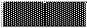 |
| 1 | 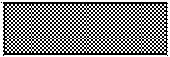 |
| 2 | 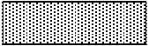 |
| 3 | 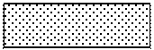 |
| 4 | 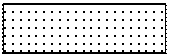 |
| 5 | 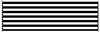 |
| 6 | 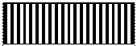 |
| 7 | 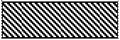 |
| 8 | 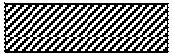 |
| 9 | 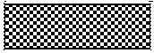 |
| 10 | 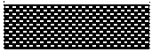 |
| 11 | 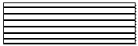 |
| 12 | 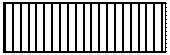 |
| 13 | 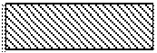 |
| 14 | 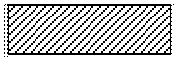 |
| 15 | 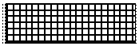 |
| 16 | 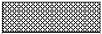 |
| 17 | 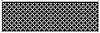 |

#### 4.6. BrushHatches Constants

BrushStyle이 BrushStyleHatch로 설정된 경우 BrushHatch는 유효한 브러시 유형을 제공한다.

**표 69 BrushHatches Constants**

<!-- PDF 31쪽 -->

| 값 | 설명 |
| --- | --- |
| 0 | 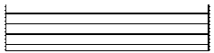 |
| 1 | 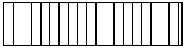 |
| 2 | 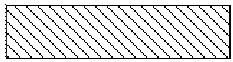 |
| 3 | 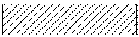 |
| 4 | 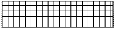 |
| 5 | 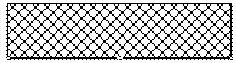 |

<!-- PDF 32쪽 -->

#### 4.7. ChartType Constants

ChartType은 차트 유형 옵션을 제공한다.

**표 70 ChartType Constants**

<!-- PDF 32쪽 -->

| 값 | 설명 |
| --- | --- |
| 0 | 3D 막대 |
| 1 | 2D 막대 |
| 2 | 3D 선 |
| 3 | 2D 선 |
| 4 | 3D 영역 |
| 5 | 2D 영역 |
| 6 | 3D 계단 |
| 7 | 2D 계단 |
| 8 | 3D 조합 |
| 9 | 2D 조합 |
| 10 | 3D 가로 막대 |
| 11 | 2D 가로 막대 |
| 12 | 3D 클러스터 막대 |
| 13 | 3D 파이 |
| 14 | 2D 파이 |
| 15 | 2D 도넛 |
| 16 | 2D XY |
| 17 | 2D 원추 |
| 18 | 2D 방사 |
| 19 | 2D 풍선 |
| 20 | 2D Hi-Lo |
| 21 | 2D 간트 |
| 22 | 3D 간트 |
| 23 | 3D 평면 |
| 24 | 2D 등고선 |
| 25 | 3D 산포 |
| 26 | 3D XYZ |

#### 4.8. ContourDisplayType Constants

ContourDisplayType은 차트 등고선을 표시하기 위한 옵션을 제공한다.

**표 71 ContourDisplayType Constants**

<!-- PDF 32쪽 -->

| 값 | 설명 |
| --- | --- |
| 0 | 등고선이 등고선 밴드로 표시된다. |
| 1 | 등고선이 등고선 선으로 표시된다. |

<!-- PDF 33쪽 -->

#### 4.9. ContourColorType Constants

ContourColorType은 등고선 색상을 표시하기 위한 옵션을 제공한다.

**표 72 ContourColorType Constants**

<!-- PDF 33쪽 -->

| 값 | 설명 |
| --- | --- |
| 0 | 등고선 색상이 기본 계열 색상으로 표시된다. |
| 1 | 등고선이 균일한 색상 전환으로 표시된다. |
| 2 | 사용자 정의 등고선 색상을 사용자가 지정하고 수정할 수 있다. (수동 색상은 Automatic 값이 선택되지 않은 경우에만 사용할 수 있다.) |

#### 4.10. DateIntervalType Constants

DateIntervalType은 날짜 축에서 눈금 표시를 표시하기 위한 옵션을 제공한다.

**표 73 DateIntervalType Constants**

<!-- PDF 33쪽 -->

| 값 | 설명 |
| --- | --- |
| 0 | 간격 없음 |
| 1 | 눈금 표시가 매일 나타난다. |
| 2 | 눈금 표시가 각 주의 월요일에 나타난다. |
| 3 | 눈금 표시가 각 월의 1일과 15일에 나타난다. |
| 4 | 눈금 표시가 각 월의 1일에 나타난다. |
| 5 | 눈금 표시가 각 연도의 1월 1일에 나타난다. |

#### 4.11. DrawMode Constants

DrawMode는 차트가 변경된 후 차트를 다시 표시하기 위한 옵션을 제공한다.

**표 74 DrawMode Constants**

<!-- PDF 33쪽 -->

| 값 | 설명 |
| --- | --- |
| 0 | 설정을 변경할 때마다 차트가 화면에 다시 그려진다. |
| 1 | 차트가 화면에서 없어지면서 다시 그려지고 다시 그리기가 완료된 후 표시된다. |

#### 4.12. DcType Constants

DcType은 hdc로 표현되는 컨텍스트 유형(표준 Windows 장치 컨텍스트)을 식별한다.

**표 75 DcType Constants**

<!-- PDF 33쪽 -->

| 값 | 설명 |
| --- | --- |
| 0 | 장치 컨텍스트가 표현되지 않는다. |
| 1 | hdc로 식별된 디스플레이에 파일을 보낸다. |
| 2 | hdc로 식별된 프린터에 파일을 보낸다. |
| 3 | hdc로 식별된 장치에 Windows 메타파일 형식으로 파일을 보낸다. |

<!-- PDF 34쪽 -->

#### 4.13. FillStyle Constants

FillStyle은 배경을 페인트 하는 데 사용되는 채우기 유형을 나타내기 위한 옵션을 제공한다.

**표 76 FillStyle Constants**

<!-- PDF 34쪽 -->

| 값 | 설명 |
| --- | --- |
| 0 | 채우기 없음(배경이 투명하게 표시) |
| 1 | 단색 또는 패턴 채우기 |
| 2 | 그러데이션 채우기 |

#### 4.14. FontEffect Constants

FontEffect는 유효한 글꼴 특성 옵션을 제공한다.

**표 77 FontEffect Constants**

<!-- PDF 34쪽 -->

| 값 | 설명 |
| --- | --- |
| 0 | 굵은꼴 특성을 글꼴에 적용한다. |
| 1 | 기울임꼴 특성을 글꼴에 적용한다. |
| 2 | 외곽선 특성을 글꼴에 적용한다. |

#### 4.15. FontStyle Constants

FontStyle은 유효한 글꼴 특성 옵션을 제공한다.

**표 78 FontStyle Constants**

<!-- PDF 34쪽 -->

| 값 | 설명 |
| --- | --- |
| 0 | 굵은꼴 특성을 글꼴에 적용한다. |
| 1 | 기울임꼴 특성을 글꼴에 적용한다. |
| 2 | 외곽선 특성을 글꼴에 적용한다. |

#### 4.16. FrameStyle Constants

FrameStyle은 배경 프레임을 표시하기 위한 옵션을 제공한다.

**표 79 FrameStyle Constants**

<!-- PDF 34쪽 -->

| 값 | 설명 |
| --- | --- |
| 0 | 프레임 없음 |
| 1 | 단일 선이 배경을 둘러싼다. |
| 2 | 두 개의 동일 너비 선이 배경을 둘러싼다. |
| 3 | 두꺼운 안쪽 선과 가는 바깥쪽 선이 배경을 둘러싼다. |
| 4 | 가는 안쪽 선과 두꺼운 바깥쪽 선이 배경을 둘러싼다. |

<!-- PDF 35쪽 -->

#### 4.17. GradientStyle Constants

GradientStyle은 차트 그러데이션을 표시하는 방법을 제공한다.

**표 80 GradientStyle Constants**

<!-- PDF 35쪽 -->

| 값 | 설명 |
| --- | --- |
| 0 | 색상이 위쪽에서 아래쪽으로 변화한다. |
| 1 | 색상이 왼쪽에서 오른쪽으로 변화한다. |
| 2 | 색상이 가운데에서 바깥쪽으로 동심원 사각형으로 변화한다. |
| 3 | 색상이 가운데에서 바깥쪽으로 동심원 타원형으로 변화한다. |

#### 4.18. HorizontalAlignment Constants

HorizontalAlignment는 텍스트 맞춤 옵션을 제공한다.

**표 81 LocationType**

<!-- PDF 35쪽 -->

| 값 | 설명 |
| --- | --- |
| 0 | 텍스트의 모든 선이 왼쪽 여백에 맞춰진다. |
| 1 | 텍스트의 모든 선이 오른쪽 여백에 맞춰진다. |
| 2 | 텍스트의 모든 선이 가로로 가운데에 맞춰진다. |

#### 4.19. LabelComponent Constants

LabelComponent는 차트 레이블을 표시하기 위한 옵션을 제공한다.

**표 82 LabelComponent Constants**

<!-- PDF 35쪽 -->

| 값 | 설명 |
| --- | --- |
| 0 | 데이터 요소의 값이 레이블에 나타난다. XY, 원추 및 풍선 차트의 데이터 요소는 실제로 2~3개의 값을 가진다. 이러한 차트 유형에 대한 기본 레이블은 모든 값을 표준 형식으로 표시한다. |
| 1 | 데이터 요소의 값이 계열의 총 값에 대한 백분율로 레이블에 표시된다. |
| 2 | 계열 이름이 데이터 요소 레이블을 지정하는 데 사용된다. 이 이름은 데이터 격자의 열과 연결된 레이블에서 가져온다. |
| 3 | 데이터 요소 이름이 데이터 요소 레이블을 지정하는 데 사용된다. |

#### 4.20. LabelLineStyle Constants

LabelLineStyle은 레이블과 계열을 연결하는 선을 표시하기 위한 옵션을 제공한다.

**표 83 LabelLineStyle Constants**

<!-- PDF 35쪽 -->

| 값 | 설명 |
| --- | --- |
| 0 | 레이블과 계열을 연결하는 선이 없다. |
| 1 | 직선이 레이블과 계열을 연결한다. |
| 2 | 굽은 선이 레이블과 계열을 연결한다. |

<!-- PDF 36쪽 -->

#### 4.21. LabelLocationType Constants

LabelLocationType은 계열 레이블 위치를 결정하기 위한 옵션을 제공한다.

**표 84 LabelLocationType Constants**

<!-- PDF 36쪽 -->

| 값 | 설명 |
| --- | --- |
| 0 | 레이블이 표시되지 않는다. |
| 1 | 레이블이 데이터 요소 위쪽에 표시된다. |
| 2 | 레이블이 데이터 요소 아래쪽에 표시된다. |
| 3 | 레이블이 데이터 요소 가운데에 표시된다. |
| 4 | 레이블이 범주 축을 따라 기준(데이터 요소 바로 아래)에 표시된다. |
| 5 | 레이블이 파이 슬라이스 안쪽에 표시된다. |
| 6 | 레이블이 파이 슬라이스 바깥쪽에 표시된다. |
| 7 | 레이블이 데이터 요소 왼쪽에 표시된다. |
| 8 | 레이블이 데이터 요소 오른쪽에 표시된다. |

#### 4.22. LocationType Constants

LocationType은 차트 요소에 대한 위치 옵션을 제공한다.

**표 85 LocationType Constants**

<!-- PDF 36쪽 -->

| 값 | 설명 |
| --- | --- |
| 0 | 위쪽 |
| 1 | 왼쪽 맨 위 |
| 2 | 오른쪽 맨 위 |
| 3 | 왼쪽 |
| 4 | 오른쪽 |
| 5 | 아래쪽 |
| 6 | 왼쪽 맨 아래 |
| 7 | 오른쪽 맨 아래 |
| 8 | 사용자 지정 |

#### 4.23. MarkerStyle Constants

MarkerStyle은 데이터 요소 마커를 표시하기 위한 옵션을 제공한다.

**표 86 MarkerStyle Constants**

<!-- PDF 36, 37쪽 -->

| 값 | 설명 |
| --- | --- |
| 0 | 숨겨짐 |
| 1 | 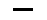 |
| 2 | 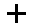 |
| 3 | 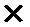 |
| 4 |  |
| 5 | 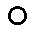 |
| 6 | 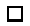 |
| 7 | 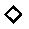 |
| 8 | 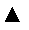 |
| 9 | 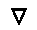 |
| 10 | 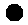 |
| 11 |  |
| 12 | 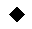 |
| 13 | 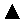 |
| 14 | 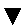 |
| 15 |  |

#### 4.24. Orientation Constants

Orientation은 텍스트 위치 지정을 위한 옵션을 제공한다.

**표 87 Orientation Constants**

<!-- PDF 37쪽 -->

| 값 | 설명 |
| --- | --- |
| 0 | 텍스트가 가로로 표시된다. |
| 1 | 텍스트의 문자가 위에서 아래로 다른 문자의 위에 하나씩 그려진다. |
| 2 | 텍스트가 회전하여 아래에서 위로 읽는다. |
| 3 | 텍스트가 회전하여 위에서 아래로 읽는다. |

#### 4.25. PartType Constants

PartType은 차트 요소에 대한 옵션을 제공한다.

**표 88 LocationType**

<!-- PDF 37쪽 -->

| 값 | 설명 |
| --- | --- |
| 0 | 차트 컨트롤을 식별한다. |
| 1 | 차트 제목을 식별한다. |
| 2 | 차트 각주를 식별한다. |
| 3 | 차트 범례를 식별한다. |
| 4 | 차트 플롯을 식별한다. |
| 5 | 차트 계열을 식별한다. |
| 6 | 계열 레이블을 식별한다. |
| 7 | 개별 데이터 요소를 식별한다. |
| 8 | 데이터 요소 레이블을 식별한다. |
| 9 | 축을 식별한다. |
| 10 | 축 레이블을 식별한다. |
| 11 | 축 제목을 식별한다. |

<!-- PDF 38쪽 -->

#### 4.26. PercentAxisBasis Constants

PercentAxisBasis는 백분율 축 표시 방법을 제공한다.

**표 89 PercentAxisBasis Constants**

<!-- PDF 38쪽 -->

| 값 | 설명 |
| --- | --- |
| 0 | 차트에서 가장 큰 값이 100%. 나머지 값은 해당 값의 백분율 |
| 1 | 각 행에서 가장 큰 값이 100%. 각 행의 나머지 값은 해당 값의 백분율 |
| 2 | 각 계열에서 가장 큰 값이 100%.. 각 계열의 나머지 값은 해당 값의 백분율 |
| 3 | 차트에서 모든 값이 더해지고 해당 값이 100%. 나머지 값은 해당 값의 백분율 |
| 4 | 각 행에서 모든 값이 더해지고 각 행에 대한 총 값이 100% 해당 행의 나머지 값은 해당 값의 백분율. 100% 스택 차트에 대한 기준 |
| 5 | 각 계열에서 모든 값이 더해져서 각 계열에 대한 총 값을 제공. 모든 값이 해당 계열 총 값의 백분율로 표시 |

#### 4.27. PenCap Constants

PenCap은 선 끝을 표시하는 방법을 제공한다.

**표 90 PenCap Constants**

<!-- PDF 38쪽 -->

| 값 | 설명 |
| --- | --- |
| 0 | 선이 끝점에서 사각형으로 끝난다. |
| 1 | 선 두께의 지름을 가지는 반원이 선의 끝에 그려진다. |
| 2 | 선이 끝점을 지나 선 두께의 절반에 해당하는 길이에서 사각형으로 끝난다. |

#### 4.28. PenJoin Constants

PenJoin은 계열의 선 세그먼트를 합치기 위한 옵션을 제공한다.

**표 91 PenJoin Constants**

<!-- PDF 38쪽 -->

| 값 | 설명 |
| --- | --- |
| 0 | 두 선이 만날 때까지 바깥쪽 가장자리가 연장된다. |
| 1 | 두 선이 만나는 포인트 주위에 원형 호가 그려진다. |
| 2 | 두 합쳐지는 선의 끝 사이에 표시가 채워진다. |

#### 4.29. PenStyle Constants

PenStyle은 차트 선을 그리는 데 사용되는 펜에 대한 옵션을 제공한다.

**표 92 PenStyle Constants**

<!-- PDF 38, 39쪽 -->

| 값 | 설명 |
| --- | --- |
| 0 | 펜이 적용되지 않는다. |
| 1 |  |
| 2 | 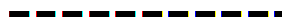 |
| 3 |  |
| 4 |  |
| 5 |  |
| 6 | 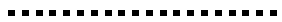 |
| 7 | 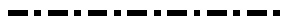 |
| 8 |  |

#### 4.30. PictureOptions Constants

PictureOptions는 차트를 그래픽으로 저장하기 위한 옵션을 제공한다.

**표 93 PictureOptions Constants**

<!-- PDF 39쪽 -->

| 값 | 설명 |
| --- | --- |
| 0 | App Placeable 헤더 정보를 메타파일에 저장하지 않는다. 메타파일을 외부 응용 프로그램으로 가져오려는 경우 이 옵션을 사용하지 않는다. 이러한 외부 응용 프로그램에서는 메타파일에 크기 정보가 포함되어야 한다. |
| 1 | 차트 텍스트를 텍스트 대신 곡선으로 저장한다. |

#### 4.31. PictureMapType Constants

PictureMapType은 그림이 표시되는 방법

**표 94 PictureMapType Constants**

<!-- PDF 39쪽 -->

| 값 | 설명 |
| --- | --- |
| 0 | 그래픽이 만들어진 원본 크기로 그래픽을 표시한다. |
| 1 | 개체 내부에 맞도록 그래픽 배율을 비율에 맞게 조정한다. |
| 2 | 원본 비율에 상관없이 개체를 채우도록 그래픽 배율을 조정한다. |
| 3 | 그래픽을 반복적으로 복제하여 개체를 채운다. |
| 4 | 그래픽을 가운데에 맞추고 비율에 맞게 배율을 조정하여 개체를 채운다. 원본 비율이 유지되므로 개체의 바깥쪽으로 나오는 이미지 일부가 잘릴 수 있다. |

#### 4.32. PictureType Constants

PictureType은 그래픽 파일의 유형을 제공한다.

**표 95 PictureType Constants**

<!-- PDF 39쪽 -->

| 값 | 설명 |
| --- | --- |
| 0 | 그래픽 없음 |
| 1 | Windows 비트맵 |
| 2 | Windows 메타파일. 이 메타파일에는 그림의 크기를 나타내는 App Placeable 헤더 정보가 포함된다. |

<!-- PDF 40쪽 -->

#### 4.33. PieWeightBasis Constants

PieWeightBasis는 파이 차트 슬라이스를 표시하기 위한 옵션을 제공한다.

**표 96 PieWeightBasis Constants**

<!-- PDF 40쪽 -->

| 값 | 설명 |
| --- | --- |
| 0 | 모든 파이가 같은 크기로 그려진다. |
| 1 | 각 파이의 슬라이스 값이 합산되고 총 값이 가장 큰 파이가 식별된다. 차트에서(가장 큰 파이와 비교한) 각 파이의 총 값의 비율로 크기가 결정된다. |
| 2 | 데이터 격자에서 데이터의 첫 번째 열이 상대 크기 인덱스를 포함한다. 예를 들어, 5개의 범주가 있으면 데이터 격자의 첫 번째 열을 사용하여 각 범주를 나타내는 파이의 크기를 조정하고, 1부터 5까지 행 번호를 지정할 수 있다. 파이의 크기가 첫 번째 열 값의 비율 및 첫 번째 열에서 가장 큰 값으로 결정된다. 1이 가장 큰 파이이고, 5가 가장 작은 파이이다. 값이 파이 슬라이스로 그려지지 않도록 데이터의 이 첫 번째 열을 제외하는 것이 일반적이다. |

#### 4.34. PieWeightStyle Constants

PieWeightStyle은 단일 차트 내에서 개별 파이를 표시하기 위한 옵션을 제공한다.

**표 97 PieWeightStyle Constants**

<!-- PDF 40쪽 -->

| 값 | 설명 |
| --- | --- |
| 0 | 개별 파이의 영역이 가중치를 기준으로 변화한다. |
| 1 | 개별 파이의 지름이 가중치를 기준으로 변화한다. |

#### 4.35. PrintOrientation Constants

PrintOrientation은 인쇄를 위한 차트 표시 옵션을 제공한다.

**표 98 PrintOrientation Constants**

<!-- PDF 40쪽 -->

| 값 | 설명 |
| --- | --- |
| 0 | 차트가 용지의 짧은 면을 따라 인쇄된다. |
| 1 | 차트가 회전하여 용지의 긴 면을 따라 인쇄된다. |

#### 4.36. PrintScaleType Constants

PrintScaleType은 인쇄를 위한 차트 배율 조정 방법을 제공한다.

**표 99 PrintScaleType Constants**

<!-- PDF 40쪽 -->

| 값 | 설명 |
| --- | --- |
| 0 | 차트가 만들어진 원본 크기로 차트가 인쇄된다. |
| 1 | 페이지에 맞도록 차트 배율이 비율에 맞게 조정된다. |
| 2 | 원본 비율에 상관없이 페이지에 맞도록 차트 배율이 조정된다. |

<!-- PDF 41쪽 -->

#### 4.37. ProjectionType Constants

ProjectionType은 차트를 표시하고 보기 위한 시점 및 관점 옵션을 제공한다.

**표 100 ProjectionType Constants**

<!-- PDF 41쪽 -->

| 값 | 설명 |
| --- | --- |
| 0 | 관점 뷰(현실감 있는 3D뷰. 점점 멀어지면서 사라진다). 기본 투사이다. |
| 1 | 2.5차원이라고도 한다. 차트에 깊이는 있지만, 차트가 회전되거나 상승해도 XY 면이 변화하지 않는다. |
| 2 | 이 3D 보기에서는 관점이 적용되지 않는다. 일부 차트의 경우 읽기가 더 쉽다. |

#### 4.38. ScaleType Constants

ScaleType은 차트 값을 플롯으로 그리고 차트 배율을 표시하기 위한 옵션을 제공한다.

**표 101 ScaleType Constants**

<!-- PDF 41쪽 -->

| 값 | 설명 |
| --- | --- |
| 0 | 최소 차트 범위 값에서 최대 차트 범위 값까지 선형 배율로 플롯이 그려진다. |
| 1 | 차트 값이 이 함수의 logBase 인수로 설정된 특정 로그 배율 기준의 값을 가진 로그 배율로 플롯이 그려진다. |
| 2 | 차트 값이 차트 범위 값 백분율 기준의 값을 가진 선형 배율로 플롯이 그려진다. |

#### 4.39. SeriesType Constants

SeriesType은 계열 유형에 대한 옵션을 제공한다.

**표 102 SeriesType Constants**

<!-- PDF 41, 42쪽 -->

| 값 | 설명 |
| --- | --- |
| 0 | 3D 막대 |
| 1 | 2D 막대 |
| 2 | 3D 가로 막대 |
| 3 | 2D 가로 막대 |
| 4 | 3D 클러스터 막대 |
| 5 | 3D 선 |
| 6 | 2D 선 |
| 7 | 3D 영역 |
| 8 | 2D 영역 |
| 9 | 3D 계단 |
| 10 | 2D 계단 |
| 11 | XY |
| 12 | 원추 |
| 13 | 방사 선 |
| 14 | 방사 영역 |
| 15 | 풍선 |
| 16 | Hi-Lo |
| 17 | Hi-Lo Close |
| 18 | Hi-Lo-Close (오른쪽에 닫는 마커 존재) |
| 19 | Open-Hi-Lo-Close |
| 20 | Open-Hi-Lo-Close 막대 |
| 21 | 2D 간트 |
| 22 | 3D 간트 |
| 23 | 3D 파이 |
| 24 | 2D 파이 |
| 25 | 도넛 |
| 26 | 날짜 |
| 27 | 부동 3D 막대 |
| 28 | 부동 2D 막대 |
| 29 | 부동 3D 가로 막대 |
| 30 | 부동 2D 가로 막대 |
| 31 | 부동 3D 클러스터 막대 |
| 32 | 3D 평면 |
| 33 | 2D 등고선 |
| 34 | 3D XYZ |

#### 4.40. ShadowStyle Constants

ShadowStyle은 음영 옵션을 제공한다.

**표 103 ShadowStyle Constants**

<!-- PDF 42쪽 -->

| 값 | 설명 |
| --- | --- |
| 0 | 음영 없음 |
| 1 | 배경 음영 |

#### 4.41. SmoothingType Constants

SmoothingType은 차트 표시 데이터 다듬기 방법을 제공한다.

**표 104 SmoothingType Constants**

<!-- PDF 42쪽 -->

| 값 | 설명 |
| --- | --- |
| 0 | 데이터에 다듬기가 적용되지 않는다. |
| 1 | 2차 B 스플라인 공식을 사용하여 데이터에 적용되는 다듬기를 결정한다. 이 다듬기 형식을 사용하면 데이터 요소에 더 가까운 덜 부드러운 곡선이 된다. |
| 2 | 3차 B 스플라인 공식을 사용하여 데이터에 적용되는 다듬기를 결정한다. 이 다듬기 형식을 사용하여 더 부드러운 곡선이 되지만, QuadraticBspline 곡선보다 데이터 요소에서 멀어진다. |

#### 4.42. SortType Constants

SortType은 파이 차트를 정렬하기 위한 옵션을 제공한다.

**표 105 LocationType**

<!-- PDF 42, 43쪽 -->

| 값 | 설명 |
| --- | --- |
| 0 | 데이터가 데이터 격자에 나타나는 순서대로 파이 슬라이스가 그려진다. |
| 1 | 가장 작은 슬라이스에서 가장 큰 슬라이스로 순서대로 그려진다. |
| 2 | 가장 큰 슬라이스에서 가장 작은 슬라이스로 순서대로 그려진다. |

#### 4.43. SsLinkMode Constants

SsLinkMode는 스프레드시트에 연결 및 연결을 유지하는 방법을 제공한다.

**표 106 SsLinkMode Constants**

<!-- PDF 43쪽 -->

| 값 | 설명 |
| --- | --- |
| 0 | 스프레드시트에 대한 연결이 활성화되지 않는다. |
| 1 | 스프레드시트가 활성화된다. App에서 스프레드시트 데이터를 해석하려고 시도하지 않는다. Column, Row, ColumnLabelCount 및 RowLabelCount 속성으로 설정된 값을 사용하여 데이터 격자 차원을 결정한 다음 스프레드시트의 데이터로 이러한 영역을 채운다. |
| 2 | 스프레드시트에 대한 연결이 활성화된다. App에서 스프레드시트 데이터를 검사하고 레이블 및 데이터가 무엇인지 확인한다. 데이터 격자의 차원을 판단하고 그에 따라 Column, Row, ColumnLabelCount 및 RowLabelCount 속성의 값을 조정한다. |

#### 4.44. StatsType Constants

StatsType은 차트에 통계 선을 표시하기 위한 방법을 제공한다.

**표 107 StatsType Constants**

<!-- PDF 43쪽 -->

| 값 | 설명 |
| --- | --- |
| 0 | 계열에서 최솟값을 표시한다. |
| 1 | 계열에서 최댓값을 표시한다. |
| 2 | 계열에서 값의 수학적 평균을 표시한다. |
| 3 | 계열에서 값의 표준 분산을 표시한다. |
| 4 | 계열의 값으로 나타난 추세 선을 표시한다. |

#### 4.45. SubPlotLabelLocationType Constants

SubPlotLabelLocationType은 하위 플롯 레이블을 표시하는 방법을 제공한다.

**표 108 SubPlotLabelLocationType Constants**

<!-- PDF 43쪽 -->

| 값 | 설명 |
| --- | --- |
| 0 | 하위 플롯 레이블이 표시되지 않는다. |
| 1 | 하위 플롯 레이블이 파이 위쪽에 표시된다. |
| 2 | 하위 플롯 레이블이 파이 아래쪽에 표시된다. |
| 3 | 하위 플롯 레이블이 파이 가운데에 표시된다. |

<!-- PDF 44쪽 -->

#### 4.46. SurfaceBaseType Constants

SurfaceBaseType은 평면 차트의 기준을 표시하는 방법을 제공한다.

**표 109 LocationType**

<!-- PDF 44쪽 -->

| 값 | 설명 |
| --- | --- |
| 0 | 평면 끝까지 연장되는 기준과 함께 차트가 표시된다. |
| 1 | 3D 막대 차트의 차트와 같이 기준과 함께 차트가 표시된다. |
| 2 | 위쪽에 등고선 밴드가 있는 표준 기준으로 차트가 표시된다. |
| 3 | 위쪽에 등고선 선이 있는 표준 기준으로 차트가 표시된다. |

#### 4.47. SurfaceDisplayType Constants

SurfaceDisplayType은 차트 평면을 표시하는 방법을 제공한다.

**표 110 SurfaceDisplayType Constants**

<!-- PDF 44쪽 -->

| 값 | 설명 |
| --- | --- |
| 0 | 평면이 표시되지 않는다. |
| 1 | 평면이 등고선 밴드로 표시된다 |
| 2 | 평면이 등고선 선으로 표시된다. |
| 3 | 평면이 평면 브러시로 표시된다. |
| 4 | 평면이 등고선 선으로 겹쳐진 평면 브러시로 표시된다. |

#### 4.48. SurfaceProjectionType Constants

SurfaceProjectionType은 차트 평면 위쪽에 등고선을 투사하기 위한 옵션을 제공한다.

**표 111 SurfaceProjectionType Constants**

<!-- PDF 44쪽 -->

| 값 | 설명 |
| --- | --- |
| 0 | 투사가 표시되지 않는다. |
| 1 | 등고선 밴드가 평면 위쪽에 투사된다. |
| 2 | 등고선 선이 평면 위쪽에 투사된다. |

#### 4.49. SurfaceWireframeType Constants

SurfaceWireframeType은 선프레임 평면을 표시하는 방법을 제공한다.

**표 112 SurfaceWireframeType Constants**

<!-- PDF 44쪽 -->

| 값 | 설명 |
| --- | --- |
| 0 | 선프레임이 표시되지 않는다. |
| 1 | 선프레임이 축의 주 분할을 기준으로 한다. |
| 2 | 선프레임이 축의 주 및 부 분할을 기준으로 한다. |

<!-- PDF 45쪽 -->

#### 4.50. TextLengthType Constants

TextLengthType은 화면용 또는 프린터용 텍스트 레이아웃을 최적화하기 위한 옵션을 제공한다.

**표 113 TextLengthType Constants**

<!-- PDF 45쪽 -->

| 값 | 설명 |
| --- | --- |
| 0 | TrueType 가상 글꼴 메트릭스를 사용하여 인쇄용 텍스트 레이아웃을 최적화하려면 이 상수를 선택한다. 큰 텍스트가 있어야 하는 위치에 맞지 않을 수 있으며 문자의 일부, 전체 문자 또는 때에 따라 단어가 잘릴 수 있다. |
| 1 | 화면용 텍스트 레이아웃을 최적화하려면 이 상수를 선택한다. 화면 표시용으로 레이아웃된 차트의 텍스트는 영역 내부에 알맞게 들어간다. 인쇄된 텍스트는 일반적으로 약간 더 작으므로 텍스트가 약간 다른 위치에 나타날 수 있다. |

#### 4.51. TextOutputType Constants

TextOutputType은 텍스트 출력 방법을 제공한다.

**표 114 TextOutputType Constants**

<!-- PDF 45쪽 -->

| 값 | 설명 |
| --- | --- |
| 0 | 장치 컨텍스트 유형이 널(Null)이다. |
| 1 | 장치 컨텍스트 유형이 메타파일이다. |

#### 4.52. VerticalAlignment Constants

VerticalAlignment는 텍스트를 세로로 맞추는 방법을 제공한다.

**표 115 VerticalAlignment Constants**

<!-- PDF 45쪽 -->

| 값 | 설명 |
| --- | --- |
| 0 | 텍스트의 모든 선이 위쪽 여백에 맞춰진다. |
| 1 | 텍스트의 모든 선이 아래쪽 여백에 맞춰진다. |
| 2 | 텍스트의 모든 선이 세로로 가운데에 맞춰진다. |

<!-- PDF 46쪽 -->

## 변경 사항 이력

### § revision 1.2:20141120

- 한글 문서 파일 구조 파트별로 구성

- 한글 문서 파일 형식 – 차트 공개

<!-- PDF 47쪽 -->

## 발행 정보

한글 문서 파일 구조 - 차트

발행처 (주)한글과컴퓨터 

(우) 463-400 

주 소 

경기도 성남시 분당구 대왕판교로 

644번길 49 한컴타워 10층 

전화: (031) 627-7000 

팩스: (031) 627-7709 

www.hancom.com
