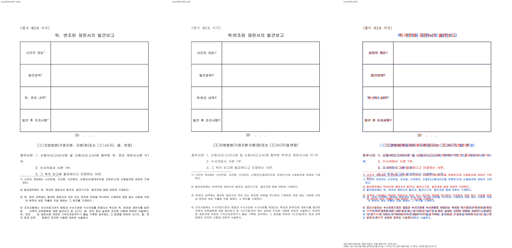

# 법원 서식의 수동 기준 출력과 기존 회귀 재검토

Issue: #7445 작업 중 발견한 #6034 대조군. 브랜치는 `fix/7445-completed-20261009`다.

## 독립 기준

사용자가 원본 `samples/issue6034/2912735_court_report_form.hwp`를 한컴에서 수동 출력해 `pdf/2912735_court_report_form-2020.pdf`에 저장했다. 실제 Creator는 Hwp 2022 12.0.0.4605이며 Producer는 Hancom PDF 1.3.0.550, PDF 형식은 1.4다. 원본 저장 버전 6.7.5.954의 변환 버킷과 실제 출력 제품명은 구별한다. 파일명 연도로 제품명을 대신하지 않는다.

PDF는 2쪽이며 마지막은 빈 쪽이다. 사용자가 한컴의 원본도 2쪽이라고 확인했다. 빈 쪽을 임의로 삭제하거나 한 쪽 비교를 전쪽 수용으로 기록하지 않는다. 실패한 MCP 출력 대신 이번 사용자 직접 출력을 정본으로 보존한다.

## 현재 결과와 원인

현재 Native와 같은 생산 소스의 실제 Chrome fresh WASM은 1쪽이며, 내용이 있는 첫 쪽 일치율은 둘 다 56.61208%다. 고정 devel `21ed64071f81f35f37618717693bd30f727392c9`도 1쪽이며 첫 쪽 62.43370%다. 양쪽 모두 전체 쪽수 불일치로 보류한다. 선택 첫 쪽 TSV는 전쪽 검증이 아니다.

표 외곽과 행 경계는 거의 일치한다. 후보는 결측 한점 리더 U+2024를 1em으로 추정해 제목·기관명·본문의 기호 주변이 벌어진다. 첨부서면 첫 항목이 두 줄이 되어 다음 항목과 각주 사이 배치도 달라진다. 독립 PDF는 선언 굴림에 없는 이 기호를 `/F4` Haansoft Dotum CID 3으로 출력하며 `/W`는 173/1000em이다. 고정 devel의 반각 0.5em도 독립 정답이 아니다. 글꼴 표의 존재만으로 모든 결측 기호를 전각으로 일반화한 가정을 재검토한다.

원 이슈 #6034에도 마지막 빈 꼬리쪽과 각주 간격 잔여가 기록돼 있다. 닫힌 이슈라는 이유만으로 회귀를 삭제하지 않는다. 기존 770..790px 핀과 9줄 단정은 전쪽 수용 후 독립 내용·각주 소속과 비겹침 관계로 다시 판단한다. 이번 단계에서는 생산 코드·테스트·baseline을 변경하지 않았다.

[입력·PDF 출처와 비교 요약](../pr/assets/issue7445/completed-20261009/court-manual-reference/validation.json).

수동 기준 PDF와 첫 쪽 진단 증거를 확보했다. 시각 보정·빈 꼬리쪽 처리·회귀 재검토와 최종 전체 검증은 남아 있다. 전체 검증 후 사용자 승인 전에는 PR을 생성하지 않는다.
