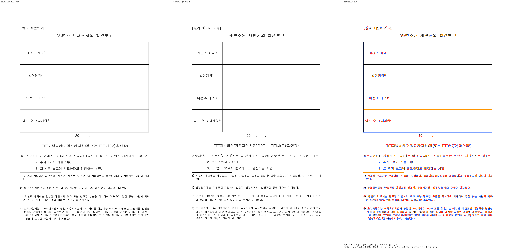
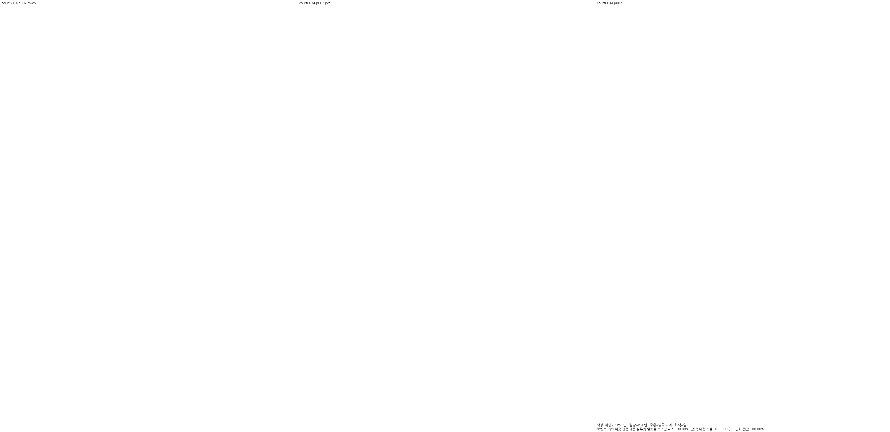

# 법원 서식의 각주 조판·빈 꼬리쪽 보정과 관계형 회귀

Issue: #7445의 제출 후보 검증 중 발견한 #6034 대조군. 브랜치는 `fix/7445-completed-20261009`이며, 보정 전 head는 `4544350ed`, 고정 devel은 `21ed64071f81f35f37618717693bd30f727392c9`다. 사용자 요청에 따라 현재 브랜치에서 출력을 먼저 보정하고 회귀를 수정했다.

## 사전 분석과 구현

1. 원본은 구버전 HWP5이며 굴림의 결측 U+2024를 한컴돋움으로 출력한다. 사용자 독립 Print PDF의 `/F4` CID 3 `/W=173/1000`, 설치 HDOTUM 원본의 `onedotenleader` hmtx는 `178/1024`로 PDF 정수 폭과 대응한다. 글꼴 표가 있다는 이유로 결측 기호를 1em으로 일반화한 후보는 첨부서면 첫 항목을 두 줄로 만들었다. 실제 글리프 hit, 영문 슬롯, HFT 치환을 유지하고 확인된 굴림 결측 기호만 기존 한컴돋움 메트릭으로 측정한다. 다른 글자나 미확인 글꼴까지 확대하지 않는다. 원본 폰트 바이너리를 추가하지 않았다.
2. 각주 끝의 실제 빈 문단 세 개는 각각 원본 9pt 글자모양을 갖는다. 저장 LineSeg가 없다는 이유로 400HU를 쓰면 각주 영역 총 높이가 20px 작아지고 구분선이 뒤로 밀린다. 비어 있지 않은 각주와 동일한 `reflow_line_segs` 경로로 실제 빈 문단도 구성한다. 문단 자체가 없는 입력과 유효 저장 줄은 유지한다. 이 공통 구성 결과를 각주 영역 측정과 실제 paint가 함께 소비한다.
3. 원본 HWP5 단단의 줄 정보 없는 통째 표 각주 등록은 400HU 예약을 계속 쓰고 있었다. 일반 표와 지연 표 등록 모두 실제 `estimate_footnote_area_height_with_metrics` 결과를 본문 예산에 예약한다. 실제 높이를 예약한 경우에는 추정 오차용 40px 버퍼를 중복 차감하거나 다시 반환하지 않는다. 각주 영역을 정확히 예약한 뒤에는 마지막 빈 문단의 높이를 없애서 흡수하지 않는다. 원본 마지막 문단만 둘째 빈 쪽으로 이월되고 첨부서면 세 항목과 각주 네 개는 첫 쪽을 유지한다.

값의 소비 경로는 `굴림 결측 기호 메트릭 → 본문/각주 줄 구성`, `빈 각주 문단 재조판 → 각주 영역 측정과 paint`, `통째·지연 표 각주 등록 → 실제 영역 예약 → available_height → 마지막 빈 문단 fit/이월`이다. 임의 좌표 clamp, 원본 수정, PDF 빈 쪽 삭제, 특정 문서 ID 분기는 없다.

## 독립 전쪽 검증

기준은 커밋된 `pdf/2912735_court_report_form-2020.pdf`다. 실제 출력 제품은 Hwp 2022이며, 파일명과 구버전 변환 버킷을 실제 제품명으로 보고하지 않는다. 사용자도 원본의 마지막 빈 쪽을 포함한 2쪽을 확인했다.

| 단계 | 첫 쪽 | 둘째 쪽 | 쪽수·내용 |
| --- | ---: | ---: | --- |
| 보정 전 Native/fresh | 56.61208% | 누락 | 1쪽 |
| 고정 devel Native | 62.43370% | 누락 | 1쪽 |
| 기호 폭 보정 Native | 69.74594% | 누락 | 1쪽 |
| 빈 각주 문단 높이 보정 Native | 91.16037% | 누락 | 1쪽 |
| 최종 Native | 91.16037% | 100% | 원본과 같은 2쪽 |
| 최종 실제 Chrome fresh WASM | 91.16037% | 100% | 원본과 같은 2쪽 |

두 백엔드의 전쪽 PNG도 byte-identical이다. 이는 독립 PDF와 엄격 픽셀 동일하다는 뜻은 아니다. 두 쪽 review PNG를 직접 판독했으며 첫 쪽 표·첨부서면·네 각주와 구분선 관계, 둘째 쪽의 빈 상태를 확인했다. Mac locked no-opt WASM 빌드이며 Docker 최적화 통과로 기록하지 않는다.

## 기존 회귀 수정과 대조군

전쪽 90% 이상·쪽수 일치·직접 판독을 확인한 후 기존 #6034 함수 하나를 유지해 수정했다. 본문 하단 770..790px, 각주 8..10줄, 영역 상단 -0.5px 핀을 제거했다. 독립 PDF의 2쪽 계약에는 마지막 빈 문단의 둘째 쪽 소유, 첨부서면 세 항목의 첫 쪽 한 줄 소유와 원문 일회 보존을 함께 검사한다. 각주 네 개의 원본 내용·소속·순서·비겹침, 실제 구분선 뒤 각주, 원본 글자 상자를 수용하는 빈 각주 줄을 검사한다. 새 `#[test]` 함수와 다른 문서의 baseline 변경은 없다.

관련 nextest는 locked release-test·threads=8로 **5 PASS / 0 FAIL / 필터 제외 877**, 실행 1.419초, exit 0이다. #6034 관계 검사, #5734 그림 셀, #6448 TAC 표와 후속 문단, 정책연구의 닫힌 분할 프레임 두 기존 대조군이 통과했다. 이 결과는 전체 회귀 통과가 아니다. 수정 전에는 1쪽 출력과 잘못된 px 전제의 기존 실패가 기록돼 있다. 최종 후보는 내용 보존 관계와 2쪽 소유를 통과한다.

[원본·PDF·빌드·전쪽 TSV·nextest 요약](../pr/assets/issue7445/completed-20261009/court-fidelity/validation.json).

로그는 ignored `output/pr-review/7445-completed-20261009/stage422-court-glyph-fallback/`에 보존하며 커밋하지 않는다. 단계 417의 구 생산 소스 시각 실행은 이 수정 전의 증거로 남긴다. 새 생산 소스의 나머지 대상 전쪽 검증과 전체 회귀·lint·Skia는 남아 있다. 전체 검증 완료 후 사용자 승인 전에는 PR을 생성하지 않는다.

Native `cargo clippy --locked -- -D warnings`도 exit 0으로 통과했다(47.37초). WASM32·all-target Clippy와 최종 전체 검증을 이 결과로 대신하지 않는다.

법원 서식의 시각 보정과 기존 관계형 회귀 수정을 완료했다.
