# 기존 실패 27개 재검증과 남은 판정

- 검증 head: `4ddcaaeb6` (`fix/7445-completed-20261009`)
- 고정 devel: `21ed64071f81f35f37618717693bd30f727392c9`
- 재생성한 정식 integration harness에서 기존 실패 27개를 모두 개별 실행했다.
- **8 PASS / 19 FAIL / 3003 skip**, 107.940초, 종료 코드 100. 전체 nextest 실행은 아니다.
- 정본: `/Users/tsjang/rhwp/output/pr-review/7445-completed-20261009/stage432-original-failures-rerun/nextest.log`

## 남은 검사

| 검사 | 상태 |
| --- | --- |
| `issue_5877_fragment_ghost_vrules::issue_5877_gas_rowspan_keeps_label_owner_and_next_row_minimum` | 기존 base·독립 PDF·현재 출력 판정 진행 |
| `issue_5756_superscript_advance_scale::issue_5756_superscript_line_stays_inside_cell` | 기존 base·독립 PDF·현재 출력 판정 진행 |
| `issue_7203_split_float_anchors_to_paragraph_top::split_fragment_without_a_gap_is_unchanged` | 기존 base·독립 PDF·현재 출력 판정 진행 |
| `issue_4514_overlay_table_flow::issue_4514_overlay_tables_do_not_overlap` | 기존 base·독립 PDF·현재 출력 판정 진행 |
| `text_overlap_baseline::text_overlaps_do_not_grow_partition_10` | 기존 base·독립 PDF·현재 출력 판정 진행 |
| `issue_7203_float_table_stored_anchor_top::downstream_table_split_and_body_follow_the_oracle_pages` | 기존 base·독립 PDF·현재 출력 판정 진행 |
| `issue_7445_biotoxin_source_ownership::cellbreak_boundary_rows_belong_wholly_to_their_pdf_pages` | 기존 base·독립 PDF·현재 출력 판정 진행 |
| `issue_rowbreak_chart_overlap::rowbreak_hwpx_page8_keeps_continued_nested_reference_line` | 기존 base·독립 PDF·현재 출력 판정 진행 |
| `issue_1692::issue_1692_so_sueop_hwp3_page22_relationship_box_uses_table_flow` | 기존 base·독립 PDF·현재 출력 판정 진행 |
| `issue_6797_table_item_clears_float_band::table_item_clears_the_previous_float_band` | 기존 base·독립 PDF·현재 출력 판정 진행 |
| `issue_7413_cell_padding_shrinks_only_when_wrapping_overflows::b_cell_that_cannot_wrap_within_its_height_still_shrinks` | 기존 base·독립 PDF·현재 출력 판정 진행 |
| `issue_1156_rowbreak_fragment_fit::kps_ai_page37_defers_overflowing_split_row_slice` | 기존 base·독립 PDF·현재 출력 판정 진행 |
| `issue_6812_square_picture_tac_table::issue_6812_following_text_respects_column_bottom_after_multiple_pictures` | 기존 base·독립 PDF·현재 출력 판정 진행 |
| `text_overlap_baseline::text_overlaps_do_not_grow_partition_2` | 기존 base·독립 PDF·현재 출력 판정 진행 |
| `issue_6981_split_straddle_row_height::completed_terminal_cut_does_not_allocate_an_empty_page` | 기존 base·독립 PDF·현재 출력 판정 진행 |
| `text_overlap_baseline::text_overlaps_do_not_grow_partition_15` | 기존 base·독립 PDF·현재 출력 판정 진행 |
| `issue_6981_split_straddle_row_height::continuation_height_respects_varying_page_budgets` | 기존 base·독립 PDF·현재 출력 판정 진행 |
| `text_overlap_baseline::text_overlaps_do_not_grow_partition_4` | 기존 base·독립 PDF·현재 출력 판정 진행 |
| `body_overflow_baseline::body_overflow_does_not_grow_partition_5` | 기존 base·독립 PDF·현재 출력 판정 진행 |

## 비교 조건과 진행 중 보정

- PrEP는 기본 96dpi 전쪽 비교에서 고정 devel 140쪽 최저 91.57672%, 현재 V9 140쪽 최저 91.93033%로 모두 통과한다. 192dpi 확대 자료의 7쪽 미달을 기본 조건의 기존 미달로 판단했던 #7804는 API로 본문을 정정했다. 정상 회귀를 삭제하거나 이관하지 않는다. fresh WASM 전 140쪽도 같은 기본 96dpi 조건에서 최저 91.93033%, 미달 0으로 통과했다. #7804는 기본 조건의 미달 이관 근거가 틀렸으므로 `not_planned`로 닫았으며, 192dpi 확대 자료는 진단 증거로 보존한다.
- 56345 규제영향분석은 기본 96dpi에서도 base/current 모두 21쪽 중 7·8·9·17·18쪽이 미달이다. 최저 12.81871%/12.85380%이며 #7806에서 기존 범위를 추적한다. 현재 수정으로 발생한 11·20쪽 제목 표의 원점은 구현에서 복구했고 두 기존 검사는 통과했다.
- 30269 권고 문서의 두 경로는 SHA가 같다. 96dpi base의 미달은 6·9·12쪽(최저 46.00942%), 현재는 6·12·15쪽(최저 49.32090%)이다. 이미 등록된 #7729의 기존 미달과 별개로 현재 15쪽 제목 문단 위로 TAC 표가 이동하는 겹침은 구현에서 해결한다. 지연 텍스트 사다리에서 역산한 원점만으로 개체 줄의 물리 원점을 확정하던 경로를 확인했다. 실제 Print와 대응되는 이전 본문은 같은 좌표인데 신규 inline 원점만 달랐다.
- 가스 문서 #7803은 32/31쪽 차이로 전체 TSV가 측정 불가다. 이를 90% 미만 수치로 복사하지 않는다. 원본·PDF·검사는 보존한다.
- superscript 3쪽은 독립 수동 Print PDF 대기 상태다. 기대값과 비교 허용치를 현재 출력으로 복사하지 않는다.

로그·TSV·진단 원문은 ignored output에 보존하며 새 테스트 함수·지침 변경은 없다. 원본 입력 파일을 삭제하지 않는다. 현재 보정과 이관 근거를 구분한 뒤 마지막 전체 검증과 사용자 승인을 진행한다.

## 30269 추가 보정 완료 (V10)

- 텍스트 누적 위치에서 추정한 `vpos_lazy_base`는 개체의 물리 쪽 원점을 인증하지 않는다. 저장 단일 개체 줄의 inline 원점 수용에서는 확인된 `vpos_page_base`만 소비하도록 수정했다. 저장 표의 측정 결과 → `stored_single_row_source` → inline placement → 최종 표 paint의 연결을 확인했다. 문서 ID나 좌표 상수 조건을 추가하지 않았다.
- 두 원본 경로 모두 Native 22쪽, 텍스트 겹침 0으로 복구했다. 독립 Print 15쪽의 표는 앞 본문 아래에 있으며 Native/fresh WASM 모두 98.29344%다. 6·12쪽의 기존 미달은 남아 있으며 전체 문서 시각 통과로 보고하지 않는다.
- 정식 `text_overlap_baseline` partition 4·15는 2 PASS / 0 FAIL / 186 skip, 3.931초다. 기존 19개 중 두 개를 추가로 해결했으며 나머지 17개는 후속 판정 대상이다. 최종 전체 nextest를 재실행한 결과가 아니다.
- 정상 대조군 12종·251쪽의 Native SVG와 실제 Chrome fresh WASM SVG는 V9와 전쪽 byte-identical이다. 동일 입력·PDF·글꼴·선언 DPI의 기존 raster 증거를 재사용한다. TAC 3쪽과 PrEP 140쪽의 기본 조건은 96dpi이며 192dpi 확대 점수를 기본 조건과 섞지 않는다.
- #7806 본문에 기본 96dpi에서 base/current 모두 기존 5쪽 미달이라는 근거를 완료 조건 앞에 추가했다. 11·20쪽의 현재 추가 이동은 코드에서 복구했고 정상 계약은 유지했다.

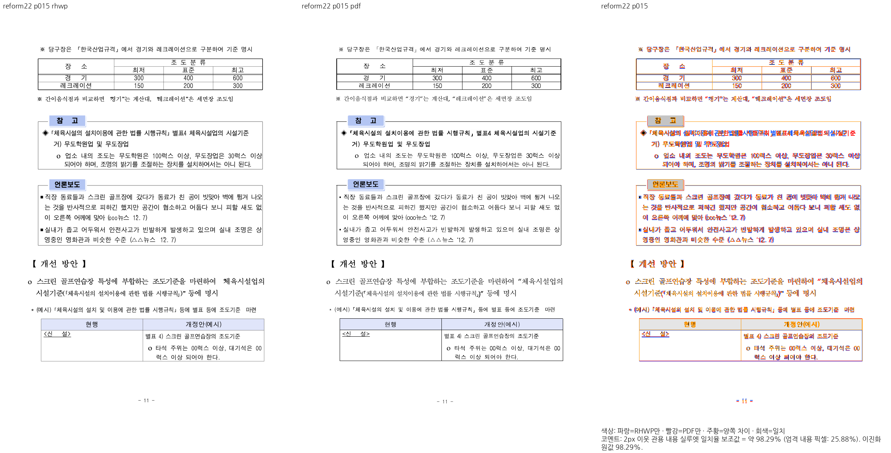

## PrEP 전쪽 통과 문서의 관계 검사 교정

- 기본 96dpi Native/fresh WASM 전 140쪽의 최저 91.93033%, 미달 0과 대응 20쪽의 직접 review 판독을 선행했다. V10 전쪽 SVG가 동일하므로 동일 원본·PDF·글꼴·DPI 증거를 재사용한다. 확대 192dpi 결과로 기본 조건을 바꾸지 않는다.
- 기존 세 파일의 검사 20개를 유지했다. 절대 잉크폭·줄 폭 하한과 x/y 핀을 줄·셀 내부 포함, 실제 소유 문단의 커서 문자 전진 비율, 캡션·본문·표 순서, 원본 문단 여백의 가운데 정렬 관계와 저장 줄 사이 간격으로 교정했다. 소스 메트릭의 크기·간격 계약은 유지하며 이전 px 상수를 비율로 옮긴 것이 아니다.
- 140쪽 대조는 독립 Print에서 확인한 쪽수와 표지·마지막 주의 사항 보존, 연구비 표의 105쪽 단독 소유를 함께 검사한다. 105쪽의 금액 열 20행은 한 번씩 이어져야 하고 다음 쪽에 중복 조각이 없어야 한다.
- 개체 캡션의 로컬 vpos와 본문 vpos는 다른 축이다. 초안에서 이들을 섞은 오류를 발견해 실제 caption owner의 차트 뒤 간격과 후속 빈 본문 줄의 높이·간격을 따로 소비하는 관계로 바로잡았다. 표의 소스 구역도 실제 Table 소유 메타데이터에서 찾는다. 초기 컴파일 오류와 초안 실패 로그는 ignored output에 보존했다.
- 정식 harness 재생성 후 **20 PASS / 0 FAIL / 634 skip**, 6.569초다. `issue_7362`의 기존 두 관계 검사는 유지하고 parser·provenance·chart CSV/편집 계약은 제거하지 않았다. 새 검사 함수는 추가하지 않았다.
- 이는 PrEP 변경 범위의 결과이며 남은 기존 실패 17개와 마지막 전체 nextest를 완료한 결과가 아니다.

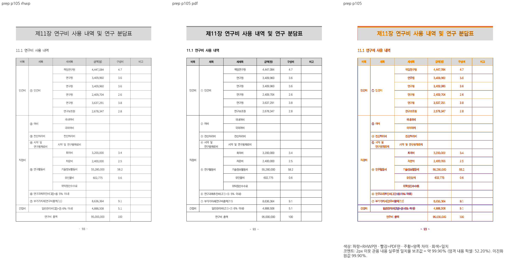

## V10 이후 원래 27개 재실행의 최신 확정 결과

- `c831d36de`에서 **11 PASS / 16 FAIL / 2762 skip**, 49.582초, 종료 코드 100이다. run `7b064ae6-ffcc-4dfd-be0e-affb6be28c7a`이며 이 문서 앞의 19개·17개는 이전 실행의 상태다. 전체 회귀 재실행은 아니다.
- API의 `downstream_table_split_and_body_follow_the_oracle_pages`도 기존 기대값 그대로 통과했다. 새 검사 함수나 baseline 갱신은 없다.
- API 105쪽의 기본 96dpi 전쪽 대조는 base 최저 46.19920%, V10 최저 25.16184%다. 양쪽 각각 17쪽 미달이지만 V10의 36쪽은 새 회귀다. 기존 #7731이 열린 상태임을 확인했으며 이 새 회귀는 구현에서 복구한다. 기존 미달 문서라는 이유로 정확한 분할 검사를 제거하지 않는다.
- `hwp-multi-001.hwp` 기본 96dpi 전 9쪽은 base 최저 93.57938%, V10 최저 95.98104%, 미달 0이다. 6쪽 직접 review에서 `구 분`과 분기 글자는 겹치지 않는다. em 상자 진단의 91→92건과 실제 잉크를 구분한다. fresh WASM과 진단 계약 검토 전 baseline은 갱신하지 않는다.

현재 16개 실패 함수:

- `issue_7413_cell_padding_shrinks_only_when_wrapping_overflows::b_cell_that_cannot_wrap_within_its_height_still_shrinks`
- `issue_5877_fragment_ghost_vrules::issue_5877_gas_rowspan_keeps_label_owner_and_next_row_minimum`
- `issue_4514_overlay_table_flow::issue_4514_overlay_tables_do_not_overlap`
- `issue_7203_split_float_anchors_to_paragraph_top::split_fragment_without_a_gap_is_unchanged`
- `issue_5756_superscript_advance_scale::issue_5756_superscript_line_stays_inside_cell`
- `issue_rowbreak_chart_overlap::rowbreak_hwpx_page8_keeps_continued_nested_reference_line`
- `text_overlap_baseline::text_overlaps_do_not_grow_partition_10`
- `issue_7445_biotoxin_source_ownership::cellbreak_boundary_rows_belong_wholly_to_their_pdf_pages`
- `issue_1156_rowbreak_fragment_fit::kps_ai_page37_defers_overflowing_split_row_slice`
- `issue_1692::issue_1692_so_sueop_hwp3_page22_relationship_box_uses_table_flow`
- `issue_6797_table_item_clears_float_band::table_item_clears_the_previous_float_band`
- `issue_6812_square_picture_tac_table::issue_6812_following_text_respects_column_bottom_after_multiple_pictures`
- `issue_6981_split_straddle_row_height::completed_terminal_cut_does_not_allocate_an_empty_page`
- `text_overlap_baseline::text_overlaps_do_not_grow_partition_2`
- `issue_6981_split_straddle_row_height::continuation_height_respects_varying_page_budgets`
- `body_overflow_baseline::body_overflow_does_not_grow_partition_5`

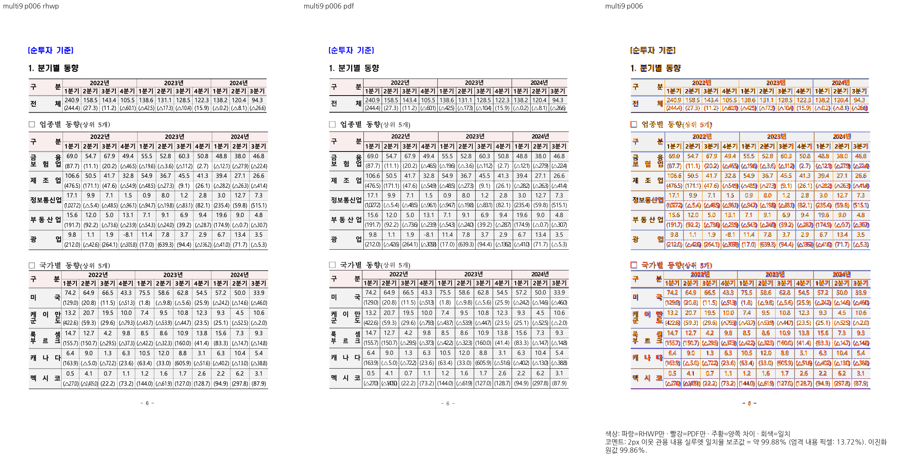

## API 첫 조각의 여백 예약 보정 (V11c)

- `fragment_host_placement`의 첫 조각 사전 검사는 통째 개체의 아래 바깥여백을 뺐지만, 실제 분할 예산은 `partial_rowbreak_fragment_spacing_px`가 반환한 조각의 아래 여백을 썼다. API pi797의 실제 가용 28.0px이 사전 검사에서는 24.3px이 되어 25.1px의 첫 줄 하한을 거부했다. 35쪽에 들어가는 원본 빈 줄 유닛도 36쪽으로 옮겨져 뒤 본문을 밀었다.
- 같은 helper의 첫 조각 여백을 사전 수용·first overhead·분할 예산에서 소비하도록 맞췄다. 측정 하한을 건너뛰거나 강제 유닛을 수용하는 초안은 폐기했다. 수용 불가 이월, 앵커 거리 소진, 원자 행의 기존 조건과 내용 컷은 유지한다.
- API는 105쪽을 유지하며 페이지 계획과 전쪽 SVG는 35·36쪽만 바뀌었다. 35쪽은 빈 시작 유닛 `endCut=[1]`, 36쪽은 `startCut=[1]` 이어받기로 복구했고 뒤 `See Also`·`EditMode` 내용이 제 위치에 있다. 직접 review를 확인했다.
- Native 기본 96dpi 35쪽 **99.34006%**, 36쪽 **99.21991%**다. 나머지 103쪽은 전쪽 SVG byte-identical 증거로 기존 같은 원본·PDF·글꼴·96dpi raster를 재사용했다. 정본 알고리즘으로 전체 105쪽 TSV를 다시 계산했으며 최저 **46.19920%**, 기존 미달 16쪽이다. 문서 전체 통과가 아니다.
- 기존 API 세 검사·저장 앵커 다섯 검사와 `#6950` 대조군 등 **36 PASS / 0 FAIL / 572 skip**, 1.252초다. run `6187b598-c671-4ee2-99cf-9b0fe5da761a`이며 기존 16개 실패 중 API 첫 조각 검사 한 개를 해결했다. 나머지 15개는 후속 판정·최신 후보 재실행 대상이다.
- 정상 12종·251쪽 Native 및 실제 Chrome fresh WASM 전쪽 SVG는 V10과 동일하다. Mac locked `--no-opt` fresh 빌드 종료 0도 확인했다. API의 전 105쪽 fresh raster·TSV는 계속 실행 중이며 아직 시각 검증 완료로 기록하지 않는다.
- 같은 원본 전체 피델리티는 열린 #7731에 이미 등록되어 있다. 새 36쪽 회귀는 현재 브랜치에서 복구했으며 기존 부적합 범위와 정상 관계 검사를 일괄 제거하지 않는다. 검사 함수·baseline·지침은 이 보정에서 변경하지 않았다.

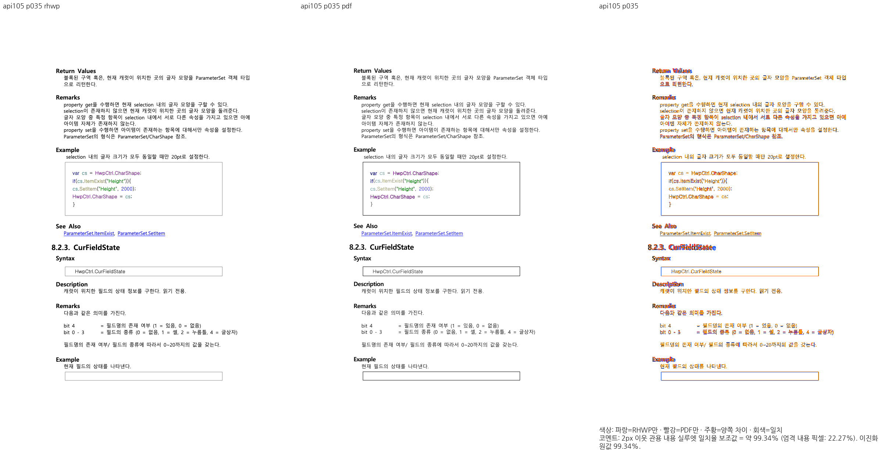
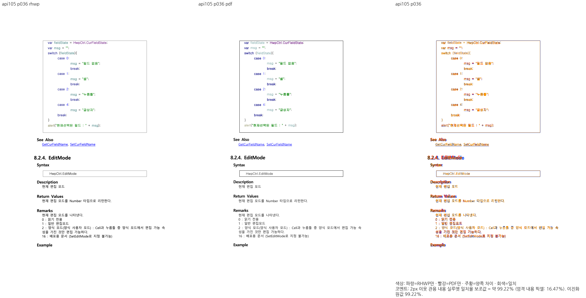

## V11c API fresh 전쪽 실행 완료

- `00cf12a1f`와 같은 조판 코드의 Mac fresh WASM을 실제 Chrome에서 8개씩 캡처해 전 105쪽 TSV를 산출했다. Native와 전쪽 수치가 동일하다. 35쪽 99.34006%, 36쪽 99.21991%이며 두 fresh review도 직접 판독했다.
- 전체 최저 46.19920%, 미달은 12·16·18·27·28·34·41·44·61·63·65·69·73·74·93·94쪽이다. sweep 종료 1은 이 기존 미달에 대한 정당한 검토 보류이며 빌드 실패가 아니다. 기존 #7731의 미완료 범위를 보존한다.
- 진단-only 배분 간격 보정과 보강한 기존 함수는 별도 최신 실행 중이다. 위 결과를 그 실행의 통과나 최종 전체 nextest 통과로 혼동하지 않는다.

## 배분 정렬의 마지막 간격을 잉크로 세는 진단 보정 (V12)

- `hwp-multi-001.hwp`는 기본 96dpi 전 9쪽 Native/fresh WASM 모두 최저 95.98104%, 미달 0이다. base도 최저 93.57938%로 통과한다. 따라서 문서를 미달 이슈로 넘기거나 baseline을 92로 올릴 근거가 없다.
- `extra_char_spacing`의 양수 값은 글리프를 넓히지 않고 다음 문자 원점을 옮긴다. 실제 SVG/Canvas는 `TextStyle::glyph_fit_advance`에서 이 간격을 빼지만 진단은 마지막 슬롯까지 잉크로 보았다. 같은 fit 계약을 끝 경계에 소비하도록 수정했다. 위치·렌더 트리·paint는 바꾸지 않는다. 커닝·세로·회전·겹침 문자와 손상된 전진폭은 보수적인 기존 상자 경로를 유지한다.
- 생산값 → `replay_positions_for`의 문자 원점 → SVG/Canvas의 cluster fit → 진단의 마지막 가시 글리프 끝을 연결했다. 실제 앞 글리프와 겹치는 이웃은 계속 검출하고 마지막 배분 간격에만 놓인 이웃은 잉크 충돌로 세지 않는다. 기존 검사 함수에 양쪽 관계를 보강했으며 새 함수는 추가하지 않았다.
- frozen 이전 진단 라이브러리에서 보강 사례가 1 FAIL(원래 1건/기대 0건)하는 isolated RED를 보존했다. 정식 harness에서 글자 경계 기존 10개는 모두 PASS다. 실제 9쪽 Native SVG도 전쪽 동일하며 진단 text-overlap은 92→0으로 정정됐다. 직접 확인한 6쪽도 0이다.
- 원래 실패 27개와 글자 경계 10개 재실행: **23 PASS / 14 FAIL / 2567 skip**, 47.440초, 종료 코드 100, run `735564d6-357c-4ba6-a7ef-9c815d82f11d`. 원래 27개만 보면 **13 PASS / 14 FAIL**다. 이는 최종 전체 nextest 통과가 아니다.
- harness는 1451 sources / 6207 static attrs / 48 targets / 최소 6559 cases로 고정 devel 기준 확인했다. baseline·원본·PDF·지침은 변경하지 않았다.

최신 잔여 14개:

- `issue_7413_cell_padding_shrinks_only_when_wrapping_overflows::b_cell_that_cannot_wrap_within_its_height_still_shrinks`
- `issue_5756_superscript_advance_scale::issue_5756_superscript_line_stays_inside_cell`
- `issue_5877_fragment_ghost_vrules::issue_5877_gas_rowspan_keeps_label_owner_and_next_row_minimum`
- `issue_rowbreak_chart_overlap::rowbreak_hwpx_page8_keeps_continued_nested_reference_line`
- `issue_4514_overlay_table_flow::issue_4514_overlay_tables_do_not_overlap`
- `issue_1156_rowbreak_fragment_fit::kps_ai_page37_defers_overflowing_split_row_slice`
- `issue_6797_table_item_clears_float_band::table_item_clears_the_previous_float_band`
- `issue_1692::issue_1692_so_sueop_hwp3_page22_relationship_box_uses_table_flow`
- `issue_7445_biotoxin_source_ownership::cellbreak_boundary_rows_belong_wholly_to_their_pdf_pages`
- `issue_6812_square_picture_tac_table::issue_6812_following_text_respects_column_bottom_after_multiple_pictures`
- `issue_6981_split_straddle_row_height::completed_terminal_cut_does_not_allocate_an_empty_page`
- `text_overlap_baseline::text_overlaps_do_not_grow_partition_2`
- `issue_6981_split_straddle_row_height::continuation_height_respects_varying_page_budgets`
- `body_overflow_baseline::body_overflow_does_not_grow_partition_5`

## 이어받은 물리 행의 예약 검사와 교육과정 쪽 번호 핀 분리

생산 보정 `cb7116471`은 이전 조각에서 넘겨받은 물리 잔여 높이를 바로 수용하던 경로도
기존 병합 셀 내용 높이 검사에 통과시킨다. 물리 최소는 보존하며, 새 쪽 예산을 넘으면
내용 분할·이월 경로에서 판정한다. 높이 허용치를 늘리거나 최종 bbox를 제한하지 않았다.

- 수정 전 여백 변형 41개 중 3개에서 본문 경계 초과가 재현됐다. 최초 초과는 0.77333px이다.
  행 높이 배열 차이라는 가설은 진단에서 배제했다. 시작 행의 잔여 높이를 수용하는 조기 경로가
  병합 내용 요구 검사를 건너뛴 것이 원인이었다.
- 유지한 교육과정 관계 검사 7개는 모두 통과했다. 글줄과 셀의 포함, 내용의 소속·중복 방지,
  가변 여백·쪽수, 다시 잘리는 병합 셀과 거대 병합 셀의 비적용 대조를 그대로 검사한다.
- 기존 실패 목록 및 대조 재실행은 **32개 중 20 PASS / 12 FAIL / 2580 skip, 49.817초**다.
  run `02d5579e-534b-4145-adf3-db37bdc4e500`이며 전체 회귀 완료로 보고하지 않는다.
  최초 27개 기준으로 **14개 해결 / 부적합 검사 1개 분리 / 12개 잔존**이다.

분리 함수는 `issue_6981_split_straddle_row_height::completed_terminal_cut_does_not_allocate_an_empty_page`
한 개다. 고정 base `21ed64071f81f35f37618717693bd30f727392c9`에 이미 등록되어 있던 검사이며,
378쪽에 다음 구역 `노동인권`을 요구했다. 독립 한컴 2022 Print PDF에서 378쪽은 이전 표의
`선언문 작성` 행을 소유하고 `노동인권` 구역은 380쪽부터 나온다. 숫자만 옮겨 검사하지 않았다.

같은 원본의 전쪽 피델리티와 쪽 소속은 열린 [#7743](https://github.com/edwardkim/rhwp/issues/7743)에
이미 등록돼 있다. 원본 SHA-256은 `623b00d56beffc45d27c5bf23911bdc49d3a541ded8aecbb323d0716a2bc9f4e`,
이번 대조 PDF SHA-256은 `6d1119be4b5043f75ba057ed9aeb06753a03eef4b82f78014bfcd02729cf05f2`다.
base는 413쪽, 현재는 416쪽, PDF는 415쪽이다. Native 96 DPI의 377~380쪽은 base에서
69.71230 / 24.13970 / 32.10921 / 29.21402%, 보정 직전에는
49.31812 / 70.48507 / 69.25696 / 22.65933%였다. Native 부정 증거이며 전쪽·fresh WASM
90% 통과를 뜻하지 않는다. 대표 [378쪽 review](../pr/assets/issue7445/completed-20261009/stored-anchor-repair/curriculum-old-pin-review_378.png)를 직접 확인해
쪽 소속과 행 내용 차이를 판독했다. 입력과 PDF는 다른 정상 계약 검사와 공유하므로 원래 경로에 보존한다.
이 함수만 제거했으며 나머지 7개 관계 검사와 자동 corpus의 다른 정상 범위는 유지한다.

Native와 실제 Chrome fresh WASM의 기존 대조 13문서·356쪽 SVG는 각각 직전 증거와 모두 동일하다.
교육과정 전체 Native SVG는 416쪽 중 4쪽(311·331·380·397)에서 변경됐으나, 해당 4쪽의
96 DPI PNG는 수정 전후 바이트가 동일하고 TSV도 동일하다. 현재 fresh WASM 416쪽 SVG는
현재 Native의 비임베딩 SVG와 모두 바이트가 동일하다. 이 동일성은 변화 범위 증거이며,
교육과정 전쪽 피델리티 수용이나 기존 시각 결함 해결을 뜻하지 않는다. 해당 문서는 #7743에서
독립 PDF의 전쪽 소속·내용과 최저 90% 이상을 확인한 뒤 관계 검사로 복원해야 한다.

원시 증거는 Mac 공용 ignored `/Users/tsjang/rhwp/output/pr-review/7445-completed-20261009/stage433-remaining-relations/`의
`v13b-original-controls-nextest.log`, `v13b-provenance.json`, `v13b-remaining.json`,
`curriculum-pin-classification.json`, `native-v13b-identity.json`, `fresh-v13b-identity.json`,
`curriculum-v13b-identity.json`, `curriculum-affected-raster-identity.json`,
`curriculum-native-fresh-raw-identity.json`에 둔다. 새 회귀 함수·fixture와 지침 변경은 없다.
Mac locked `--no-opt` fresh WASM은 로컬 대체 빌드이며 Docker 최적화 빌드 통과가 아니다.

4쪽의 fresh PNG도 현재 Native와 바이트가 동일했다. 최저값은 22.65933%로 기존 미달이며,
Native/fresh TSV는 311쪽 67.60855%, 331쪽 64.74204%, 380쪽 22.65933%, 397쪽 48.23959%로
일치했다. 원본에서 생성한 해당 4쪽의 전체 글꼴 선언을 정본 `svg_font_face_rules` /
`apply_svg_font_policy`로 공급하고, `check_sweep_embedded_fonts`의 Unicode cmap 검사,
정본 Chrome rasterizer, `write_silhouette_tsv`를 그대로 사용했다. 알고리즘과 2px 관용 거리는
변경하지 않았으며 캡처 동시 실행 상한은 8개다. 증거는 `curriculum-fresh-selected96/provenance.json`,
`embedded_fonts.json`, `silhouette.tsv`다. 별도로 시작한 416쪽 전체의 중복 글꼴 정책 처리
(38.62GiB)은 이 검증 완료 후 종료했으며 exit143을 통과로 세지 않는다. 실제 fresh 416쪽의
raw SVG와 관련 4쪽의 검증 결과는 보존한다.

## KPS 제안서 지침 표의 잘못된 행 컷 핀 교정

`tests/issue_1156_rowbreak_fragment_fit.rs`의 기존 KPS 함수 한 개를 수정했다. 독립
`pdf/kps-ai-2022.pdf`의 37쪽은 성능 요구사항까지, 38쪽은 데이터 요구사항부터 소유한다.
기존 `rows=0..16` / `rows=16..32` 고정 문자열은 데이터 항목을 앞 조각에 요구했다.
고정 base Native는 37쪽 96.63984%, 38쪽 50.03174%였으며 실제 base render tree는 데이터를
앞 조각에 두고 이어받은 조각에서는 누락했다. 현재 Native와 실제 Chrome fresh WASM은 각각
37쪽 **99.75093%**, 38쪽 **98.65303%**이고 PNG도 서로 바이트가 동일하다.
두 쪽의 review를 직접 판독해 항목·작성방법·표 경계와 내용을 대조했다.

새 검사는 제목으로 원본 표의 소속을 찾고, 두 연속 조각에서 성능/데이터 항목의 순서와
소속·중복 방지를 확인한다. 모든 원본 셀의 내용과 정확한 복사 수를 보존하며 원본의 반복
제목행만 예외로 둔다. 본문 안의 표와 셀 안의 글줄을 상대 포함 관계로 검사한다.
절대 쪽 인덱스·행 컷 숫자·dump 문자열 형식에 묶지 않는다. 원본·PDF와 함수 이름은
유지했고 새 테스트 함수, 픽스처, 픽셀 핀은 추가하지 않았다. 같은 파일의 Synam 검사는 바꾸지 않았다.

정식 nextest는 **2 PASS / 0 FAIL / 217 skip, 0.214초**로 두 기존 함수를 모두 통과했다.
원본 27개 실패의 누적 상태는 **15개 해결 / 부적합 1개 분리 / 11개 잔존**이다.
전쪽 77쪽의 시각 수용이나 전체 회귀 완료를 주장하지 않는다. 관측 쪽수는 Native/fresh/PDF
77쪽으로 같으며 이 테스트에 전체 쪽수 핀을 추가하지 않았다. 변경한 경계의 전체 범위는 위 두 쪽이다.

원시 증거는 `/Users/tsjang/rhwp/output/pr-review/7445-completed-20261009/stage434-next-failure-classification/`의
`kps-nextest.log`, `kps-nextest-command.json`, `kps-base96/kps77/silhouette.tsv`,
`kps-current96/kps77/silhouette.tsv`, `kps-fresh-selected96/silhouette.tsv`,
`kps-fresh-selected96/provenance.json`, `embedded_fonts.json`이다. 대표
[38쪽 review](../pr/assets/issue7445/completed-20261009/stored-anchor-repair/kps-boundary-review_038.png)를 보존했다.
base의 새 Rust 함수 RED 실행은 하지 않았으며, 실제 base CLI의 내용 소속 관측을 그 실행으로
바꾸어 보고하지 않는다. 처음 잘못 지정한 standalone 필터의 0-test 결과도 통과 수로 세지 않고,
정확한 함수 필터의 1 PASS와 정식 nextest 2 PASS만 기록한다.

## 영월 원본 HWP3 전4쪽 보정과 기존 검사 교정 (V14)

원본 `samples/issue5699/20099369_yeongwol_forms.hwp`와 독립 한컴 2020 Print
`pdf/20099369_yeongwol_forms-2020.pdf`를 보존했다. 고정 devel의 기본96 DPI 전4쪽 최저는
30.74890%, 보정 전 현재 출력은 31.50317%였다. 첫 제목 여백이라는 초기 가설과 달리,
한컴 변환본과 대조하니 제목과 빈 줄의 **쪽 소속** 및 일부 줄 구성이 달랐다.

- HWP3 사양 표12의 bit15는 단/페이지 구분 정보의 유효성이다. 이 비트 하나만으로 줄 전체를
  버리는 시안은 폐기했다. 원본의 줄 시작·공백 보정·좌표·구분이 모두 0이고 글자 높이만 남은
  레코드는 저장 줄 구성을 인증하지 않는다. 해당 경우 문단·개체 속성을 보존하고 공통 composer가
  실제 너비로 줄 구성과 점유 높이를 정한다. 본문에 저장 사다리가 전혀 남지 않으면 한글97의
  마지막 줄 추가 예산을 부여하지 않는다. 실제 용지·여백 수치는 변경하지 않았다.
- 같은 원본의 독립 한컴 HWPX 변환은 engine2020, job
  `2ad1bdde-09bb-4aa6-ae09-9ed7816fb0cb`, 제품 `11.0.0.9136`에서 성공했다.
  서버/클라이언트 61,823바이트와 SHA-256이 일치한다. 변환본은 진단 참고 자료로
  자산 폴더에 보존했으며 원본 HWP나 기준 Print PDF를 대체하지 않는다.
- 실제 Native와 Chrome154 fresh WASM 전4쪽은 각각
  **99.53097 / 100.00000 / 99.94533 / 100.00000%**이고 PNG4개 모두 서로 같다.
  전쪽 TSV 원본을 자산 폴더에 보존했다. Mac locked `--no-opt` 빌드는 로컬 대체 경로다.
- 기존 HWP3 대조 3입력·78쪽의 Native SVG는 보정 전후 모두 바이트가 동일하다.
  `SO-SUEOP`의 기존 미해결 범위를 시각 통과로 승격하는 증거는 아니다.

기존 영월 회귀 함수3개의 계약을 교정했다. `#5699`의 4쪽 개수는 독립 Print와 일치하므로
유지하고, 원본의 별지 제목4개가 각 대응 쪽에서 한 번만 소유되는지 함께 확인한다.
SVG `y>570`은 원본 선행 표와 계약조건 본문의 소유·순서 관계로 바꿨다.
`#7413`의 고정 y/폭 셀 선택과 한 줄 요구는 독립 Print에서 틀렸다. `월별누계`는
`월별` / `누계` 두 줄이며 마지막 줄 뒤 간격을 제외하면 원본 셀 안에 들어간다.
원본 셀과 표의 소속, 내용 순서·누락·중복·프레임 내부 포함으로 수정했다. 기존 두번째 함수의
이름은 `b_uncomputed_hwp3_cell_preserves_the_oracle_wrapped_content`로 변경했다.
다른 입력 `table-text.hwpx`의 기존 여백 계약은 변경하지 않았다. 새 테스트 함수는 추가하지 않았다.

- HWP3 파서 기존 검사: **50 PASS / 0 FAIL / 3959 skip**, 0.128초.
- 정식 하네스의 기존 실패와 관련 정상 대조: **41개 중 31 PASS / 10 FAIL / 3254 skip**,
  53.395초, run `4c996fc0-0b6c-482c-ad01-a237e587bc0f`, 종료100. 영월4개는 모두 PASS다.
- 최초27개 기준 **16개 해결 / 부적합 검사1개 분리 / 10개 잔존**이다.
  전체 nextest와 최종27문서 검증 완료를 뜻하지 않는다. PR 준비는 아직 보류다.

대표 [3쪽 review](../pr/assets/issue7445/completed-20261009/stored-anchor-repair/yeongwol-review_003.png)와
[4쪽 review](../pr/assets/issue7445/completed-20261009/stored-anchor-repair/yeongwol-review_004.png)를
직접 확인했다. 표 괘선 농도·래스터 가장자리 차이는 남아 있으며, 2px 관용 실루엣100%를
엄격 픽셀 동일로 보고하지 않는다. 원시 증적은 ignored output의
`stage435-yeongwol-margin/`에 보존한다. 지침 수정·원본 삭제·외부 이슈 게시를 하지 않았다.
이번4쪽 원본은 현재 브랜치에서 보정했으며 별도 이관이 필요하지 않았다.

## SO-SUEOP의 기존 좌표 요구 분리 (V15)

두 원본과 독립 한컴 PDF는 모두 46쪽이다. HWP3 기준은 기존
`pdf/SO-SUEOP-hwp-2020.pdf`(Creator Hwp 2022), HWPX 기준은
`pdf/SO-SUEOP-hwpx-2024.pdf`(Creator Hwp 2024)를 그대로 썼다. 유효한 독립 PDF의
버전 표기 때문에 재산출하거나 원본을 바꾸지 않았다.

현재 Native 전 46쪽 TSV는 HWP3 최저 36.34276%·미달 39쪽, HWPX 최저 43.01145%·미달 9쪽이다.
검사 대상 22쪽은 고정 devel HWP3 81.85474%, 현재 HWP3 81.67681%, 현재 HWPX 96.87848%다.
devel의 1쪽은 35.80495%이며 devel 비교 범위는 1·22쪽이다. 전 46쪽 base 통과로 쓰지 않는다.
실제 Chrome fresh WASM은 두 원본 각각 46쪽 SVG를 생성했으며, 관련 22쪽 PNG는 각각 현재
Native PNG와 같고 점수도 같다. 전쪽 fresh 검증 완료나 전체 피델리티 수용을 주장하지 않는다.

두 22쪽을 직접 읽었다. HWP3의 파란 글자 요청은 `필기`인데 Mac Fontconfig의 정확한 family를
찾지 못했으며 PDF와 글자 모양이 다르다. 유사 필기체로 임의 치환하지 않았고 모든 미달을
글꼴 하나로 단정하지 않았다. 원본 전쪽 미달은 새 [#7807](https://github.com/edwardkim/rhwp/issues/7807)에
등록한 뒤 #7445의 서브 이슈로 연결했다. API로 본문 일치·OPEN·parent의 child 7807을 재확인했다.
기존 child 80개와 열린 이슈의 같은 원본 body/comment를 확인했으며 #7203의 표 여백 계약과
#4680의 왕복 저장 범위는 이 전쪽 시각 미달과 구분했다.

변경은 기존 실패 함수 안의 **두 좌표 assertion 분리**다. 다른 rhwp 형식의 y를 1px 이내로
같게 만드는 비교와 후속 질문의 절대 PDF y 상수를 제거했다. 원본 각주 컨트롤 위치·관계도 문자/
연결선 복원·표의 기존 바깥여백 흐름 계약·본문 내용과 후속 질문 존재/쪽 소속은 보존했다.
전체 함수를 삭제하지 않았다. 생산 렌더러·입력·PDF·지침을 변경하지 않았고 새 테스트 함수는 없다.

정식 모듈 검사 **11 PASS / 0 FAIL / 207 skip**, 0.153초,
run `014fd5d5-e3eb-4167-b077-d1c18b21fc7c`, 종료0이다. 최초 27개 기준
**16개 해결 / 부적합 검사 범위 2개 분리(함수 1·assertion 범위 1) / 9개 잔존**이다.
현재 통과 17개 중 1개는 부적합 좌표를 분리한 정상 계약의 통과이며 문서 피델리티 해결로 세지 않는다.

대표 [HWP3 22쪽 review](../pr/assets/issue7445/completed-20261009/stored-anchor-repair/so-sueop-hwp3-review_022.png)와
[HWPX 22쪽 review](../pr/assets/issue7445/completed-20261009/stored-anchor-repair/so-sueop-hwpx-review_022.png),
각 Native 전쪽 TSV·fresh 22쪽 TSV·devel 선택 TSV를 자산으로 보존한다. 로그와 거대한 임베딩 SVG는
ignored `stage436-so-sueop-oracle/`에 둔다. #7807에서 두 원본 전쪽 최저 90% 이상과 직접 판독 뒤
독립 내용·소속 관계로 재구축한다. 현재 전체 검증과 PR 준비는 미완료다.

## 빈 호스트 표의 선행 밴드 회피 (V16, 시각 마무리 진행 중)

양돈 원본 `samples/issue6797/156160455-social-pig-farm-income.hwp`과 기존 독립 한컴 Print PDF
`pdf/156160455-social-pig-farm-income-2020.pdf`는 전 11쪽이다. 수정 전 7쪽은 34.05714%,
나머지 10쪽은 모두 98% 이상이었다. 원래 회귀 검사는 앞 표·그래프 소유 표·뒤 제목의 순서와
두 그림의 셀 내부 포함을 검사하므로 유지했다.

생산 경로는 `empty_float::prepare`의 확정 상자 → `lane_bottom`의 fit →
`commit_empty_float_table`의 배치 계획/높이 예약 → layout의 계획 조회 →
`layout_table_with_wrapper_margin`의 확정 원점이다. 같은 문단의 lane은 앞 문단의 자리차지
밴드를 포함하지 않았다. 기존 공통 `clear_occupied_bands`로 앞 소유자의 밴드를 지난 상자를
fit·예약·paint에 전달했다. 겹침 허용/어울림 형제는 유지하고 이동한 상자의 후속 줄 간격 증거는
분리했다. 초기 host push-floor 보정안은 실패가 지속되어 되돌렸고 커밋하지 않았다.

기존 양돈 검사 5개는 5 PASS / 0 FAIL이다. 정식 관련 검사 38개는 37 PASS / 1 FAIL,
0.974초·종료 100이며, 남은 1개는 기존 다중 그림의 본문 바닥 초과 검사다.
13개 대조 원본 전 356쪽의 unembedded Print SVG는 생산 V14와 byte-identical이다.
대조 SVG 동일은 새로운 PDF/fresh WASM 통과를 뜻하지 않는다.

양돈 Native 전 11쪽에서 7쪽은 **80.90032%**로 개선됐고 다른 10쪽은 여전히 98% 이상이다.
[7쪽 review](../pr/assets/issue7445/completed-20261009/stored-anchor-repair/pigfarm-v16-review_007.png)를
직접 읽었다. 표 겹침은 없어졌지만 그래프 뒤 제목/본문의 앞 간격이 남아 있다. 이 문서는 기존
[#7770](https://github.com/edwardkim/rhwp/issues/7770) 범위이며 이 브랜치에서 후속 프레임을 마무리한다.
전쪽 90%/fresh 완료나 이슈 해결로 보고하지 않는다. 새 회귀 함수/기대값 변경/지침 수정은 없다.

`sample1-repro.hwp`는 독립 한컴 PDF `sample1-repro-hwp-2020.pdf`를 사용했다.
다른 `sample1-repro-2020.pdf`는 Cairo 출력이어서 독립 기준으로 사용하지 않았다.
Native 전 46쪽은 최저 2.77636%·미달 23쪽, 현재 10쪽 53.82229%, 고정 devel의 같은 10쪽은
50.42130%다. [10쪽 review](../pr/assets/issue7445/completed-20261009/stored-anchor-repair/overlay4514-review_010.png)에서
ECR-004 앞 항목 반복과 ECR-005 상세 행 누락을 확인했다. 기존 열린 이슈/서브 이슈를 확인한 뒤
[#7808](https://github.com/edwardkim/rhwp/issues/7808)을 등록하고 #7445에 연결했으며 API로 본문·OPEN·
parent child를 확인했다. 정확한 겹침/이어받기 검사는 유지했다. fresh 전쪽은 미검증이다.

원 실패 기준 18개가 현재 통과 중이나, 1개는 부적합 좌표 분리 후 정상 계약 통과이고 1개는
양돈 시각 마무리가 남아 있다. **16개 해결 / 부적합 범위 2개 분리 / 실패 8개 + 양돈 시각 잔여**다.
전체 nextest/최종 대상 문서 검증/PR 준비는 미완료다. 원시 로그는 ignored `stage437-overlay-flow/`다.

## 양돈 11쪽 원본 프레임 복구와 관계 검사 (V17)

V16의 단순 선행 밴드 회피 뒤에도 원본 상자를 이전 호스트 흐름에 옮기는 분기가 남아 있었다.
앞 밴드와 뒤 저장 줄이 전체 원본 상자를 이미 증명한 경우에는 그 쪽 원점을 보존하도록 수정했다.
동일 원점의 부동소수 끝자리 차이는 기존 lane 이동 판정과 같은 상대 epsilon으로 구분하며,
실제 이동을 허용하거나 픽셀 비교의 관용 범위를 늘린 것이 아니다.

같은 원본/독립 PDF/96 DPI/글꼴 조건의 **Native·실제 Chrome fresh WASM 전 11쪽 최저
98.19793%, 미달 0**이다. 7쪽은 34.05714% → 80.90032% → **98.96856%**다.
Mac locked `--no-opt` WASM을 새로 빌드하고 실제 Chrome 154.0.8037.99에서 전 11쪽을 출력·
최대 8개 병렬 캡처했다. 모든 fresh PNG가 Native와 byte-identical이며 재시도도 없었다.
Docker 최적화 빌드로 보고하지 않는다. 13개 대조 원본 전 356쪽 Native Print SVG도 V14와 같다.

[최신 7쪽 review](../pr/assets/issue7445/completed-20261009/stored-anchor-repair/pigfarm-v17-review_007.png)를
직접 확인했다. 두 그래프·후속 제목·본문의 순서와 내용을 보존하고 앞 간격 차이는 해소됐다.
괘선 농도·글자 래스터 가장자리 차이는 남아 있어 엄격 픽셀 동일로 보고하지 않는다.

원본의 전쪽 검증 뒤 기존 `issue_6812` 함수의 81.24px 위치 핀을 같은 표 앞 입력에서 뒤 그림만
없는 대조군과의 배치 불변 관계로 교정했다. 141HU 여백 상수는 원본 표의 위여백으로,
100px 새 쪽 하단 상수는 수정한 PageDef 본문 안의 포함 관계로 바꿨다. 원본 속성에서 계산하는
크기/비율 및 기존 겹침/내용/쪽 소속 검사는 유지하고 새 회귀 함수는 추가하지 않았다.
양돈 원본 검사 5개는 5 PASS이며 같은 입력의 기존 어울림 검사 20개는 진단 19 PASS / 1 FAIL이다.
기존 다중 그림 변형의 본문 줄 3.64px 초과는 숨기지 않고 유지했다.
정식 nextest도 **24 PASS / 1 FAIL / 198 skip**, 0.359초·종료 100이며
run `93609cdb-4298-4960-99d6-8e8a186320fe`이다. 실패한 본문 포함 assertion은 변경하지 않았다.

최초 27개 기준 **17개 해결 / 부적합 범위 2개 분리 / 실패 8개 잔존**이다.
전체 nextest와 최종 대상 전체 검증은 아직 미완료다. #7770은 통합 전이므로 OPEN을 유지한다.

## 그림 회피 줄의 물리 끝점 공유 (V18)

`issue_6812_following_text_respects_column_bottom_after_multiple_pictures`는 독립 쪽 안의 본문
포함을 검사하는 정확한 관계 검사다. 3.64px 초과 assertion은 유지하고 구현을 보정했다.
원본 저장 줄은 실제 표 본체와 상하 바깥여백을 온전히 소유하며, 다음 원점은 뒤 간격 전량을
증명한다. 기존 분할 후 상한은 이 공간 일부를 회수했지만 paint는 전량 소비해 줄 수용과
출력의 끝점이 갈라졌다.

생산 경로는 `stored_tac::side_wrap_row`의 원본 소유 줄·점유/뒤 간격 → `typeset_tac_table`의
그림 회피 프레임/occupied fit → 동일 `InlineBoxPlacement.advance_end`의 예약 →
`tac_reconcile::capped_bottom`과 `layout_table_control_block`의 같은 끝점 소비다.
가로 위치의 소유는 `resolved_x`로 분리하여, 세로 끝점 유무가 그림 옆 구간의 x를 지우지 않게 했다.
완전한 단일 원본 줄에만 적용하고 앞뒤 본문·캡션·각주·편집/재구성 줄은 기존 경로를 유지한다.
문서 ID·좌표 상수·출력 clamp·픽셀 관용 변경은 없다.

원래 기존 함수 20개는 수정 전 19 PASS / 1 FAIL → 수정 후 20 PASS / 0 FAIL이다.
양돈 원본 검사를 포함한 정식 nextest는 **25 PASS / 0 FAIL / 198 skip**, 0.463초·종료 0,
run `2f4a8614-1fe2-4daf-ba25-5ad4788a07d9`이다. 이후 같은 함수에서 원본 줄 순서·단일 소유와
전체 텍스트 보존을 보완한 진단 20개도 통과했다. 원본 141HU 위치 몫은 표의 실제 위여백 속성으로
바꿨고 새 회귀 함수를 추가하지 않았다. 보완 후 정식 재실행도 **25 PASS / 0 FAIL / 198 skip**,
0.361초·종료 0, run `15033650-56fc-453a-b703-1bebdd781dc4`로 통과했다.

같은 원본·독립 한컴 PDF의 **Native·실제 Chrome fresh WASM 전 11쪽 최저 98.19793%,
미달/누락/쪽수 차이 0**이다. 최대 8개 병렬 캡처, 재시도 0이며 모든 fresh PNG가 Native와 같다.
현재 Native PNG 전 11쪽도 V17과 같고, 13개 정상 대조 원본 356쪽 Print SVG도 V14와 같다.
대조 SVG 동일은 356쪽의 새로운 PDF/fresh 수용을 뜻하지 않는다. Mac locked no-opt WASM을
새로 빌드했으며 Docker 최적화 빌드로 보고하지 않는다.

[최신 1쪽 review](../pr/assets/issue7445/completed-20261009/stored-anchor-repair/pigfarm-v18-review_001.png)와
ignored `stage437-overlay-flow/pigfarm-v18-review/review_007.png`를 직접 확인했다.
표·그림·제목·뒤 본문의 소속과 간격을 보존한다. 괘선 농도·글자 래스터 가장자리 차이는 남아
엄격 픽셀 동일로 보고하지 않는다. 전쪽 Native/fresh TSV와 대표 1쪽 PNG를 보존한다.

최초 27개 기준 **18개 해결 / 부적합 범위 2개 분리 / 실패 7개 잔존**이다.
현재 브랜치에서 새로 생긴 본문/텍스트 초과는 기존 미달이나 이슈 등록으로 제거하지 않고
계속 구현을 확인한다. 전체 nextest·최종 대상 전쪽 검증·PR 준비는 미완료다.

## 저장 프레임 완료 소유를 일반 행 수용보다 먼저 적용 (V19)

원본 `samples/issue5679/10857_delegation_rules.hwp`의 62쪽 표는 현재 변경으로 추가된
본문 아래 넘침 1건이었다. 저장된 첫 조각 높이는 66633HU인데, 큰 병합 블록 안의
마지막 일반 행이 기존 완료 프레임 검사를 건너뛰고 통째 수용 허용량을 먼저 사용했다.
표의 올바른 위여백140HU를 없애거나 baseline을 늘리지 않고 기존 검사의 실행 순서를 고쳤다.

`row_step.rs`는 첫 source frame 끝과 앞 병합 소유가 일치할 때 같은 `RowScanQuery`로
수용 원장·실제 여백·내용 완전 소비를 확인한다. 성공한 경우 source 잔여 높이와 컷·끝행
override를 함께 반환한다. `fragment/emit.rs`의 기존 완료 표식/이어받기 경로가 이를 소비하며,
다음 조각은 남은 빈 물리 밴드와 다음 실제 행을 보존한다. 편집·재조판·중첩/개체가 있는
셀에는 기존 제외 조건을 유지한다. source 파일명 분기·paint clamp·공차 변경은 없다.

실제 표 높이는894.28→888.44px로 원본66633HU와 일치하고, 본문 아래 사건은3→2건으로
기존 baseline 수준에 복구됐다. 마지막 `신변보호조치 해제 및 신고자 통지`의 가시 소유는
62쪽에 한 번이며, 63쪽의 이어받은 빈 밴드는 글자를 재소비하지 않는다. 그 다음 실제 행
`책임감면 / 징계의 감경․면제 요구`를 보존하고, 앞 rowspan의 양쪽 물리 높이 합은 원본
34139HU와 직렬화 오차 범위에서 같다.

- 기존 본문 넘침 검사 및 #6790/#5057/#3820/#6981/#7470/#7288/#7095 대조군:
  run `5ba5ec58-b536-4cc0-84fa-07c759f4f11b`,36 PASS/0 FAIL/1418 skip,47.769초,threads8,exit0.
- 남은6개 원 실패 재실행: run `3796b42d-e2cb-4512-921a-adad7caf8503`,0 PASS/6 FAIL/1081 skip,
  1.367초,exit100. source 파일·검사 기대값은 바꾸지 않았다.
- 앞서 검증한13개 문서356쪽의 Native SVG는 V18과 모두 바이트 동일하다. 이것을
  356쪽의 새 PDF 비교나 fresh 전쪽 수용으로 대신하지 않는다.
- #3820의 원본82쪽은2쪽만 SVG가 바뀌었다. 실제 저장 제품2024에 맞는 독립 Print
  `pdf/issue1891/76076-original-hwp-exact-2024-20261005.pdf`와 generation2024로 확인한
  2쪽은97.34589→97.67017%이며 Native/fresh PNG가 같다. 이전 다른 HWPX용2020 PDF와
  Cairo 산출물은 판정에 사용하지 않았다. 전82쪽 피델리티 수용을 주장하지 않는다.

위임전결 원본은 engine2020의 실제 Hancom PrintMethod0/one-up으로 다시 PDF를 생성했다.
job `9a5db5bb-3d42-4fb5-9bbd-4b0f286d089e`,success,769432byte/103쪽이며 최종 정본을
`pdf/10857_delegation_rules-2020.pdf`에 함께 보존한다. 원본·기존 정본을 삭제하지 않았다.
기존 #5679에도 한컴103쪽이 기록되어 있고 전체 피델리티 잔여는 OPEN #7700에 등록되어
있으므로 중복 이슈를 만들지 않았다.

| 진단용 의미 소속 대조 | V18 Native | V19 Native/fresh | 판정 |
| --- | ---: | ---: | --- |
| Native62쪽 / Print61쪽 |98.67835%|98.08764%|현재 source frame과 본문 포함 확인|
| Native63쪽 / Print62쪽 |60.52857%|84.18323%|개선됐지만 잔여 미달, #7700 유지|

현재 Native/fresh는105쪽,Print는103쪽이다. 위 표는 의미가 같은 표 조각을 대응시킨
**진단 값**이며 같은 쪽 번호의 canonical 전쪽 TSV나 전체 문서 수용이 아니다. 자동 쪽 매핑으로
쪽수 차이를 숨기지 않았다. 실제 Chrome154.0.8037.99에서 fresh187쪽(105+82쪽)을 생성했고,
영향3쪽만 capture8로 래스터 비교했다. 선택3쪽의 Native/fresh PNG는 모두 동일하다.
Mac locked `--no-opt` WASM build exit0이며 Docker 최적화 결과로 표시하지 않는다.

#5756 원본 보도자료는 고정 base·다운로드 원본과 동일한140288byte/SHA-256 입력이다.
자동 Print 재시도 `69f08d05-3061-431f-893c-a00e9a5b6b87`도 output0/failed였다.
기존 문자열 크기 검사10.0/14.2가 현재10.2666/14.6666과 달라 실패하지만, 독립 PDF가 없어
90% 판정 또는 기대값 변경 근거로 사용하지 않았다. 이 기준 확보·재검토를 #7809로 등록하고
#7445의 서브 이슈로 연결했으며 본문·부모 연결을 API로 재확인했다. 검사는 유지한다.

정본은 기존 `stored-anchor-repair/validation.json`의 `v19`,선택 Native/fresh TSV,
`delegation-native062-print061-v19-review.png`, `delegation-native063-print062-v19-review.png`,
`regulatory82-p002-v19-review.png`다. 원시 로그·source/binary hash·진단은 ignored
`stage438-delegation-budget/` 및 `stage439-superscript-print/`에 둔다.
기존27건은19건 해결·2개 부적합 scope 분리·6개 실패 잔여다. 전체 nextest·최종 대상 전쪽
검증·PR 준비는 미완료이며 PR 게시·병합은 전체 검증 후 사용자 승인 전까지 수행하지 않는다.

## 이어받기 빈 prefix와 저장 줄 압축의 소비 대상 정합 (V20)

설문 원본 `samples/task2430/1382000_domestic_violence_survey.hwp`의 24쪽은 현재 변경으로
새 텍스트 겹침·본문 아래 넘침이 생긴 범위였다. `advance_row_cut`이 흐름을 소유하지 않는
빈 시작 유닛을 높이 합에서 제외했지만, 예약과 paint는 이전 시작 컷을 다시 사용했다.
마지막 줄 뒤의 비가시 간격과 원본 쪽 상자의 가운데 정렬 공간을 구분해 보정했다.

`CellUnit`의 빈 줄 소유 판정 → 이어받기 스캔의 실제 점유/수용 예산 → 같은 원본 프레임
Query → 시작 컷 갱신과 같은 예산 재스캔 → `emit_table_fragment` 예약 → partial paint의
같은 프레임 Query로 연결된다. 원래 첫 조각의 빈 밴드는 이어받기 prefix가 아니므로 보존한다.
내용을 소유한 줄·hard break·물리 높이 override·완전한 끝 조각을 같은 빈 prefix로 소비하지
않는다. source 파일명 분기, 출력 좌표 clamp, 테스트 기대값·공차·baseline 변경은 없다.

첫 두 보정안은 가운데 정렬 대조군을 깨뜨려 기각했고, 다음 보정안은 24쪽을 고치지 못해
기각했다. V20d는 정식 25개가 통과했지만 API 35쪽의 원래 첫 빈 프레임이 바뀌어 그대로
채택하지 않았다. 최종 V20e는 원장의 비소유 이어받기 prefix가 있는 경우에만 프레임 소유를
재검토한다. API 105쪽의 SVG는 V19와 모두 바이트 동일해 원래 빈 프레임을 보존한다.

별도로 설문 27·34쪽은 글꼴·크기·글자 수가 같은데 선두 공백의 가로 전진이 달랐다.
양쪽 정렬의 양수 여분 폭에서 제외할 들여쓰기 공백을 자연 폭 초과의 압축에서도 제외해
오른쪽으로 밀렸다. 압축 대상 배열을 글줄 계산과 실제 text run이 함께 소비하도록 수정했다.
원본 글꼴과 기준 PDF는 바꾸지 않았다.

설문의 기존 `-2020-print.pdf`는 Cairo 산출물이었다. 실제 engine 2020 PrintMethod 0/one-up
job `a3ef2118-897a-4427-ac15-375c0a5806f8`로 원본을 새로 출력했고, 기존 Cairo 파일을 같은
정본 경로의 한컴 PDF로 대체한다. 461,873바이트·39쪽이며 이전 유효한 Hwp 2018 40쪽 PDF는
보존했다. 교체 전후 SHA-256과 실제 runtime은 `validation.json`의 `v20`에 기록한다.

| 대조 범위 | 변경 전 | 현재 Native·fresh WASM | 판정 |
| --- | ---: | ---: | --- |
| 설문 24쪽 | V19 40.62366% | 92.21086% | 겹침·본문 넘침 해소, 내용·표·쪽번호 소속 유지 |
| 설문 27쪽 | base 91.78356%, V20d 86.33744% | 91.78356% | base 수준 복구 |
| 설문 34쪽 | base 90.81951%, V20d 89.95164% | 90.81951% | base 수준 복구 |
| 규제분석 전 17쪽 | 입력·Print·설치 글꼴 동일 | 최저 97.71204% | 미달·누락·쪽수 차이 0 |
| 철도 EMC 전 14쪽 | 입력·Print·설치 글꼴 동일 | 최저 98.00998% | 미달·누락·쪽수 차이 0 |
| 자산관리 전 60쪽 | 입력·Print·설치 글꼴 동일 | 최저 93.48019% | 미달·누락·쪽수 차이 0 |
| PrEP 전 140쪽 | 입력·Print·설치 글꼴 동일 | 최저 91.93033% | 미달·누락·쪽수 차이 0 |

위 완료 문서 4종 231쪽은 Native/fresh PNG가 모두 같다. 설문은 영향 24·27·34쪽을 포함해
38쪽이 같고, 변경하지 않은 1쪽의 래스터 차이는 별도로 기록했다. 설문의 전 39쪽은 여전히
11쪽 미달이며 전체 피델리티 수용을 주장하지 않는다. 고정 base에서도 미달인 범위이고 기존
#7095·#7387·#7391에 같은 원본이 등록되어 있어 중복 이슈를 만들지 않았다. 기존 정확한
텍스트 겹침 검사는 제거하지 않고 구현을 고쳤다. 새 전체 판정으로 잠정 쪽수·좌표 핀을
추가하거나 현재 미달을 새로운 기대값으로 고정하지 않았다.

- 최종 기존 분할·정렬·본문·텍스트 겹침 정식 검사: run
  `7cd63220-ba78-4ca8-a4fc-5f307cf6a52d`, 29 PASS / 0 FAIL / 5,047 skip,
  50.057초, threads 8, exit 0. 전체 nextest의 대용이 아니다.
- 13종 356쪽 Native SVG 중 가로 간격이 바뀐 4종 59쪽을 확인했고, 해당 4종은 위와 같이
  전쪽을 새로 비교했다. 나머지 297쪽은 이전 SVG와 같다.
- Native·fresh 각각 270쪽을 실제 래스터화했고 최대 동시 캡처 8개, 재시도 0이다.
  첫 PrEP 명령은 PDF 경로가 잘못되어 캡처 전에 실패했다. 기존 manifest로 경로를 바로잡고
  첫 세 문서를 다시 캡처하지 않은 채 PrEP를 수행했다. 실패 로그도 보존한다.
- 기존 입력·PDF와 설치 글꼴의 해시 변화는 0이다. 기존 Native SVG에서 같은 글꼴 CSS만
  가져왔으며 좌표·PNG를 재사용하지 않았다. raw WASM은 실제 Chrome에서 전쪽을 출력했다.
- Mac locked no-opt WASM은 exit 0이고 Docker 최적화 빌드로 표시하지 않는다.
- 원시 TSV·manifest·로그·SVG는 ignored `stage440-continuation-prefix/`에 둔다.
  커밋에는 수정 소스, 새 Print PDF, 대표 review PNG 3장과 최종 요약만 포함한다.

기존 27건 중 20건 해결·2개 부적합 범위 분리·5개 실패가 남았다. 남은 5개 원 검사는 최종
소스에서 재실행 중이며 제거하거나 기대값을 바꾸지 않았다. 전체 최종 검증과 PR 준비는
미완료이고, 전체 검증 후 사용자 승인 전까지 PR 게시·push·merge는 수행하지 않는다.

## 부분 표의 실제 표시 범위와 빈 줄 메타데이터 분리 (V21)

#4514의 정확한 관계 검사는 유지했다. 10쪽의 `pi=139`와 `pi=158`은 셀·괘선 사이의
실제 겹침이 아니라, 부모 표 bbox가 빈 마지막 글줄까지 확대된 4.4267px 겹침으로 실패했다.
`descendant_bottom`이 물리 행으로 이미 예약한 `TextLine`의 구성 상자와 빈 `TextRun`의
caret 상자를 새로운 표시물 끝점으로 다시 포함했다.

부분 표 행 예약·셀 높이·빈 줄 위치는 그대로 두고, 실제 가시 자손의 끝만 paint 확대에
사용한다. `TextLine`의 자식 글자·개체와 공백 문자열의 장식은 계속 검사하며, 빈 표시
문자열 자체를 새 표시 끝점으로 쓰지 않는다. 숨김 노드도 paint 범위를 늘리지 않는다.
소유 컷·내용·페이지·후속 문단·공차를 변경하지 않았으며 표를 clamp하거나 글자를 숨기지 않았다.

10쪽 전후 render tree diff는 `pi=139`의 부모 표 높이 468.5→464.7 하나뿐이다. 셀·글줄·빈
caret·뒤 표는 모두 같은 좌표를 유지한다. Native 및 실제 Chrome fresh WASM에서도 같은
부모 범위를 확인했다. 원본 전 46쪽 Native SVG는 변경 전과 바이트 동일하며, 현재 fresh
WASM의 raw SVG 전 46쪽도 Native와 모두 같다. 정상 대조 13종 356쪽의 SVG 역시 모두 같다.

기존 검사는 진단 1 PASS와 정식 관련 검사 run `b9457e70-8862-439e-bdc0-b39d2a45f822`의
**24 PASS / 0 FAIL / 594 skip**, 7.964초·threads 8·exit 0으로 통과했다. Mac locked no-opt
WASM도 exit 0이다. 같은 Print와 실제 브라우저로 새 캡처한 10쪽은 Native/fresh PNG가
같고 53.82229%다. 이 값은 기존의 문단 쪽 소속·내용 누락 잔여가 유지됨을 보여 주며,
피델리티 90% 수용을 뜻하지 않는다. 이 잔여는 이미 등록된 #7808에서 계속 추적한다.
새 회귀 함수·픽셀 핀·baseline 갱신·다른 글꼴 공급을 추가하지 않았다.

원본 배포용 #5756의 헤더는 flags `0x5`, compressed true, encrypted false,
distribution true이며 마지막 저장 제품은 한컴 2022다. engine 2020 선택을 유지한다.
배포용 속성은 확인 사실이고 Print 실패 원인이라고 확정한 것은 아니다. 원본의 보호 속성을
변경하지 않았으며 독립 Print 확보는 기존 #7809에서 추적한다.

증적은 `validation.json`의 `v21`과 `overlay4514-p010-v21-review.png`다. 원시 tree diff,
SVG 동일성, fresh manifest·선택 TSV·로그는 ignored `stage441-overlay-paint-bounds/`에 둔다.
기존 27건은 **21건 해결 / 2개 부적합 범위 분리 / 4개 실패 잔여**다. #5877의 추가 32쪽에는
실제 원본 표가 있으므로 빈 쪽으로 제거할 수 없다. 앞 쪽의 누적 분할 경계부터 다시 확인한다.
전체 최종 nextest·lint/Skia·최종 대상 검증·PR 준비는 미완료이며 사용자 승인 게이트를 유지한다.

## 가스 표의 완전 행 경계와 독립 의견 행 최소 보정 (V22b)

- 원본 `fragment_ghost_vrules.hwp`의 10쪽 잔여는 첫 내용 행을 담을 수 있지만, 마지막 독립 의견 행의 선언 높이까지 담지는 못한다. 블록의 내용 유닛이 모두 들어간다는 이유로 통째로 이월하던 경로에서, 원본 완전 행 경계 후보를 조회하고 기존 공유 프레임 Query가 양쪽을 인증할 때만 수용한다. 다음 행의 유닛을 미리 소비하지 않는다.
- 첫 후보는 31쪽과 라벨 소속을 복구했지만 다음 의견 행의 독립 최소 검사에서 실패했다. 앞 밴드의 빈 공간을 병합 셀 잔여에서 뺀 값을 다음 행의 상한으로 쓰던 문제를 바로잡았다. scan의 새 쪽 수용 판단과 emit의 다음 상자는 같은 측정 행 최소를 보존한다. 문서명·쪽 번호·좌표 상수 분기는 추가하지 않았다.
- 기존 두 검사와 기대값은 그대로다. 진단 2 PASS와 정식 nextest **26 PASS / 0 FAIL / 592 skip**, 7.923초, run `13087007-f35a-4059-95d6-4a2b5ebda25f`를 확인했다. 마지막 전체 nextest는 아직 실행하지 않았다. 원래 실패 27개 중 22개 해결·부적합 범위 2개 분리·실패 3개가 남는다.
- 같은 원본·독립 Print를 새로 캡처한 Native/fresh WASM은 모두 31쪽이며 모든 PNG가 byte-identical이다. 96dpi 10쪽 **99.65286%**, 11쪽 **99.14578%**다. 두 review를 직접 열어 라벨·체크 상자·다음 의견 행·마지막 주석의 내용/테두리를 확인했다. 캡처 동시성은 최대 8, Mac locked `--no-opt` 빌드 종료 0이며 Docker 최적화 빌드가 아니다.
- 전쪽 최저 **42.00626%**, 미달은 17~22쪽이다. V21의 대응 본문과는 같지만 이것만으로 기존 devel 미달이라 판정하지 않았다. 정확한 devel `21ed64071f81f35f37618717693bd30f727392c9` 바이너리의 내용 대응 Native 18~23쪽을 같은 Print 17~22쪽과 96dpi로 재캡처했다. Print 대응 순서의 base 값은 **50.81659 / 52.80618 / 96.70875 / 94.47641 / 94.36311 / 98.62759%**다. base 전체는 32/31쪽이라 이 여섯 쪽 비교를 전체 fidelity 통과로 쓰지 않는다.
- **17·18쪽은 base 미달이고 19~22쪽은 현재 브랜치의 신규 미달이다.** 네 쪽은 구현에서 복구해야 하며 기존 이슈 등록을 이유로 정확한 검사나 회귀를 제거하지 않는다. 원본 전체 후속 #7803은 열려 있고 시각 완료 조건은 충족하지 않았다. PR 생성·통합 승인은 계속 보류한다.
- 정상 대조 13종·356쪽 Native SVG는 V21과 모두 같다. 이전 시각 증거에 공급한 설치 글꼴 706개도 해시가 같음을 재확인했다. 새 검사 함수·baseline/허용치·비교 알고리즘·지침 변경은 없다. 로그·전체 TSV·원시 SVG/중간 manifest는 ignored output에 보존하고 요약 JSON과 대표 PNG만 커밋한다.

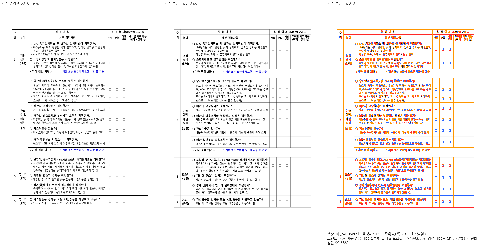

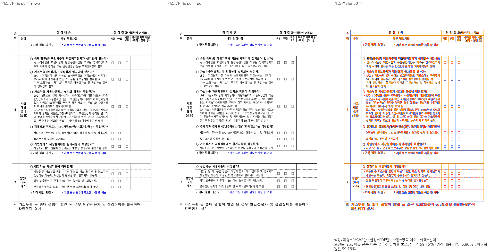

## 소방 표의 시작 컷과 병합 잔여 공간 보정 (V24c)

- 원본 가스·소방 점검표의 31쪽 전체를 Native와 실제 Chrome fresh WASM으로 비교했다. 두 경로 모두 **최저 97.06444%, 미달 0쪽, 누락 0쪽**, 독립 한컴 Print와 31/31쪽이다. 전 31쪽 raw SVG와 PNG가 Native/fresh 사이에서 모두 같다. 최종 전체 회귀 검증의 완료를 뜻하지 않는다.
- 소방 표의 62행은 앞 조각에서 첫 유닛을 이미 소비했다. 이어지는 조각의 높이 조회가 원래 행 전체 내용을 다시 측정하면서 그 유닛을 중복 예약했다. 시작 컷이 있는 행은 현재 컷과 잔여 물리 상자로 이미 정한 하한을 사용하고, 완전 행은 기존 내용 하한과 원본 병합 높이 원장으로 계산한다. 완전 행의 선언 높이를 내용 하한으로 다시 넣었던 초안은 15쪽을 84.97219%로 낮춰 폐기했다.
- 원래 본문 프레임·여백·셀 높이·내용 컷을 유지한다. 마지막 행을 남은 용지에 강제로 맞추거나 좌표/문서명 분기를 넣지 않았다. 반복 프레임을 바꾸던 두 초안도 정상 14·15쪽을 훼손해 폐기했다. 전체 내용 재측정은 해당 병합 계약이 성립할 때만 수행해 일반 행에 중복 조회를 추가하지 않았다.
- 15쪽 **99.51767%**, 17쪽 **99.33011%**, 18쪽 **100%**, 19쪽 **97.06444%**, 20쪽 **100%**, 21쪽 **99.97361%**, 22쪽 **100%**다. 기존 미달 17·18쪽과 현재 브랜치의 신규 미달 19~22쪽을 모두 복구했다. 17·19·22쪽 review를 직접 확인해 이어받은 문장, 표의 내용/행 소속, 뒤쪽 라벨과 마지막 체크 상자가 유지됨을 확인했다. Print와의 엄격 픽셀 동일성을 주장하지 않는다.
- 관련 기존 정식 nextest는 run `e4e6f0a3-fadb-47dd-878c-1a32687ec4df`, **26 PASS / 0 FAIL / 592 skip**, 7.754초, threads 8, exit 0이다. 기대값·baseline·공차를 바꾸지 않았으며 새 검사 함수도 없다. 정식 실행 뒤 rustfmt가 같은 표현식의 줄바꿈만 정리했다. Native/정식 후보와 formatted WASM 소스 해시를 구분해서 보존하며 최종 전체 검증은 아직 남아 있다.
- 정상 대조 13종 356쪽 Native SVG는 V22b와 모두 같다. 설치 글꼴 706개의 해시도 그대로다. Native에서는 변경 6쪽을 새로 캡처하고 raw SVG·글꼴·PDF·96dpi가 같은 25쪽의 raster를 재사용했다. fresh WASM은 31쪽 모두 새로 캡처했다. 동시 캡처 최대 8개, 재시도 0이며 Mac locked `--no-opt` 빌드 종료 0이다. Docker 최적화 빌드 통과로 표시하지 않는다.
- review 생성 호출에서 PDF/Native 입력 순서가 거꾸로 전달되어 라벨과 빨강/파랑 설명이 뒤바뀐 사실도 확인했다. 비교 도구는 수정하지 않고 호출 순서를 바로잡았다. 10·11쪽 기존 대표 PNG와 이번 17·19·22쪽 PNG를 올바른 순서로 재생성했다. 원래 raster와 TSV 입력/수치는 변하지 않았고 잘못된 중간 패널은 ignored output에 보존했다.
- 원본 전체 후속 #7803의 시각 완료 근거는 확보했으나 공개 완료 보고·이슈 종료는 아직 하지 않았다. 현재 원 실패 27건의 판정은 **22건 해결·부적합 범위 2개 분리·실패 3개 잔존**이다. HWPX 8쪽 중첩 줄, 생물독소 경계 행 소속, #5756 독립 Print 확보/기대값 판정이 남는다. 전체 검증을 마친 뒤 사용자 승인 전까지 PR 게시·push·merge는 수행하지 않는다.

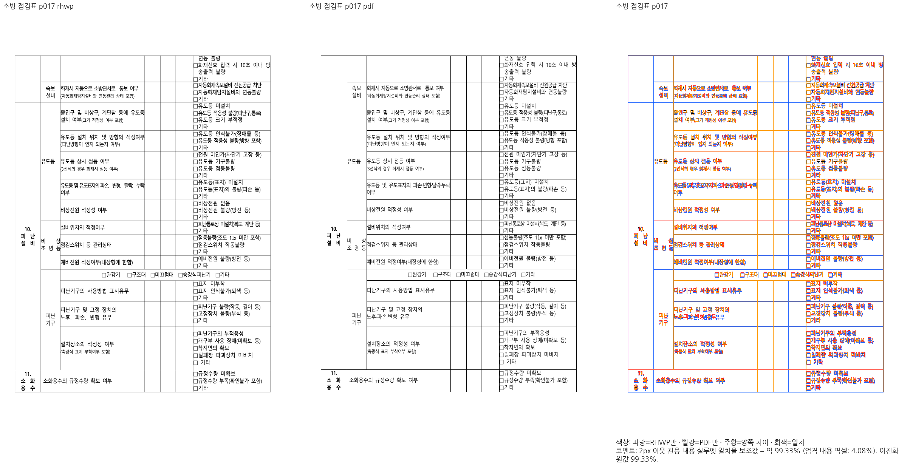

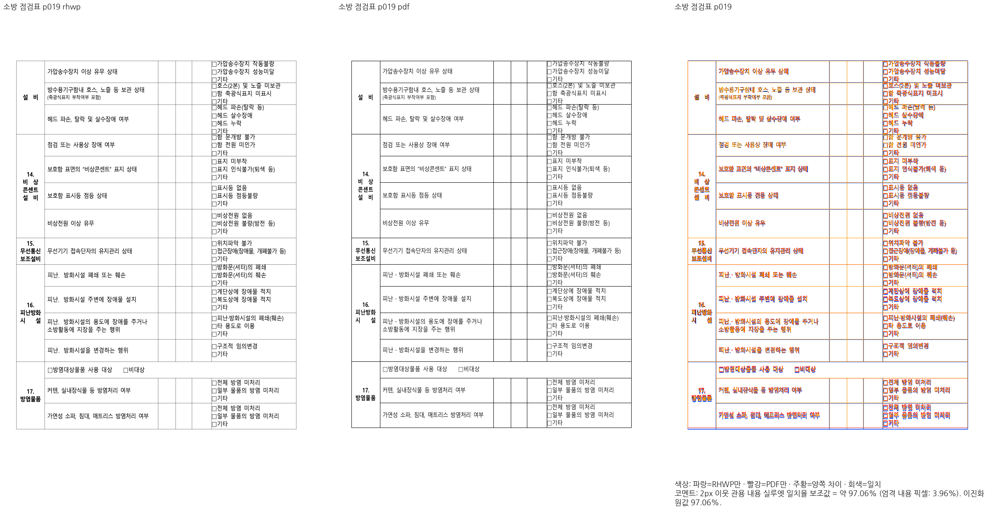

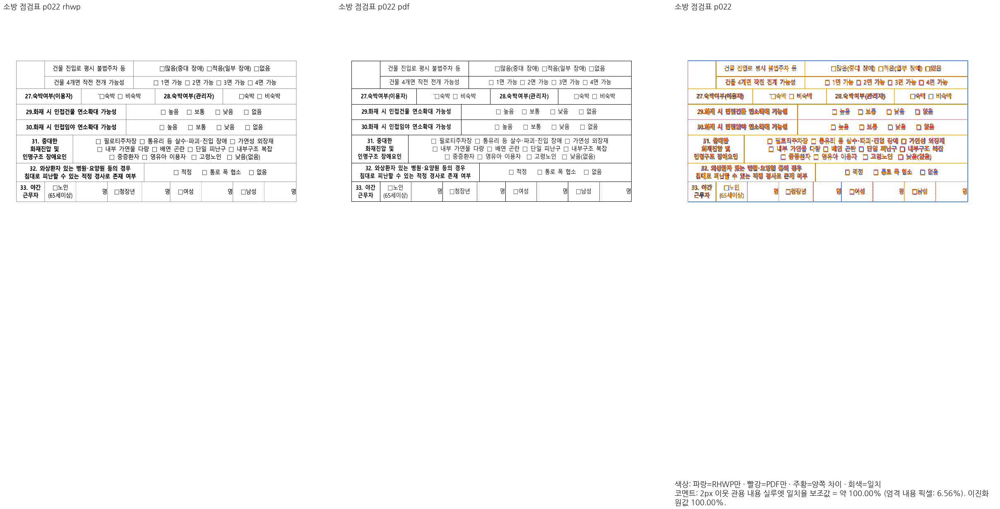

## HWPX 종료 중첩 줄의 소스 컷 소비 보정 (V25)

- `rowbreak-problem-pages.hwpx` 8쪽 실패는 절대 좌표 핀이 아니라, 남은 참조 줄의 셀 내부 포함과 후속 문단/중첩 테두리 관계 검사다. 같은 원본·독립 Print 8쪽의 첫 줄에 해당 문장이 실제로 보인다. 원래 검사와 기대값을 유지하고 구현을 수정했다.
- `mixed_nested_split_from_cut`은 HWPX의 종료 1×1 자식이라는 이유로 첫 가시 줄이 앞 조각에서 이미 출력됐다고 추정하고 한 줄 높이를 추가 소비했다. 앞쪽 render tree에는 그 마지막 줄이 실제로 표시되지 않았다. 이미 소비한 원본 컷을 반영한 offset을 유지하도록 이 추정 분기를 제거했다. 재귀 커서와 기존 1×1 호스트 비종료 예약 계약은 그대로다.
- 8쪽 마지막 참조 줄이 셀/중첩 창 안으로 돌아오고, 뒤 문단과 테두리의 순서는 유지됐다. Native 변경은 8쪽 하나뿐이고 나머지 17쪽 raw SVG는 같다. 8쪽 review에서 복구된 첫 줄을 직접 판독했다.
- 원 테스트 파일 전체를 같은 Native rlib와 Rust test runner로 직접 실행한 **진단 17 PASS / 0 FAIL**, threads 8, 0.17초, exit 0이다. 정식 nextest 전체 재실행은 아직 하지 않았다. 함수/기대값/공차/baseline을 바꾸지 않았으며 새 검사도 추가하지 않았다.
- 고정 devel 18쪽 최저 **36.13013%**, 기존 미달 4·6·7·8·15·16쪽이다. 수정 전 현재 18쪽 최저 **36.40792%**, 동일한 여섯 쪽 미달이며 8쪽은 71.18870%다. 수정 후 Native/실제 Chrome fresh WASM 18쪽은 모두 **최저 36.40792%**, 같은 여섯 쪽 미달, 8쪽 **72.73193%**다. 전 18쪽 raw SVG와 PNG가 Native/fresh 사이에서 모두 같다. 줄 잘림의 정확한 검사 통과와 문서 전체 피델리티 수용을 구분한다.
- 같은 입력/PDF 해시가 열린 **#7741**에 이미 등록되어 있음을 live API로 재확인했다. 새 중복 이슈나 공개 완료 보고를 만들지 않았고 전체 피델리티를 완료로 처리하지 않는다. 정확한 기존 관계 검사를 문서 미달만으로 제거하지 않았으며 원본/PDF도 보존했다. HWP 대응본은 별도 원본과 기준이므로 그 90% 증거로 HWPX를 승인하지 않는다.
- 정상 대조 13종 356쪽, 별도 HWP 대응본 18쪽과 가스·소방 31쪽의 Native SVG는 V24c와 모두 같다. HWPX Native는 바뀐 8쪽만 새로 캡처하고 같은 SVG/글꼴/PDF/96dpi의 17쪽 raster를 재사용했다. fresh는 18쪽 모두 새 캡처했다. 최대 동시 캡처 8개, 재시도 0, Mac locked `--no-opt` WASM 빌드 exit 0이며 Docker 최적화 빌드가 아니다.
- 수리 검사의 현재 판정은 **원 실패 27건 중 23건 수정 검사 통과·부적합 범위 2개 분리·잔존 후보 2개**다. 마지막 두 건은 생물독소 205쪽 문서의 경계 행과 #5756의 독립 Print/옛 글자 크기 핀 판정이다. 이는 마지막 전체 nextest 결과가 아니며 전체 검증 및 사용자 승인 전에는 PR 게시·push·merge를 진행하지 않는다.

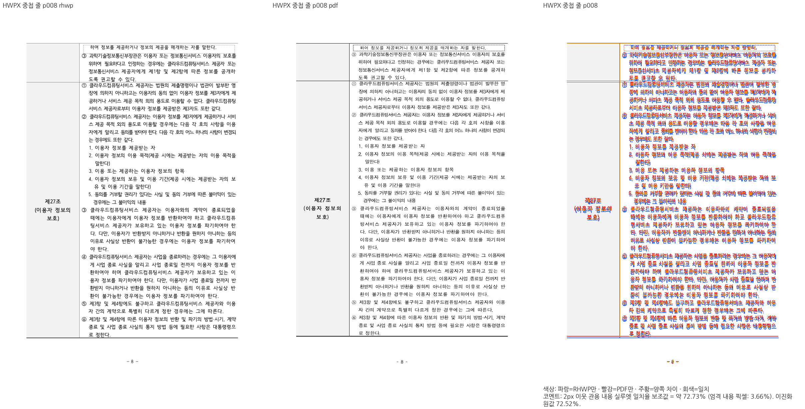

## 위첨자 보도자료의 수동 Print 확보와 관계형 검사 교정

- 사용자가 요청 경로에 저장한 `pdf/156732409_superscript_advance-2020.pdf`를 확인했다. Creator는 Hwp 2022 12.0.0.4605, Producer는 Hancom PDF 1.3.0.550이며 3쪽이다. 같은 원본을 한컴에서 직접 출력했다는 사용자 확인에 근거한 독립 기준이다. 배포용 HWP의 보안 플래그나 원본 바이트는 변경하지 않았다.
- 현재 V25 Native와 실제 Chrome fresh WASM으로 3쪽 전체를 각각 새로 캡처했다. 쪽별 관용 실루엣 일치율은 양쪽 모두 **94.98340% / 98.51440% / 93.36302%**, 최저 93.36302%, 90% 미만 0쪽이다. PDF·Native·WASM 모두 3쪽이며 Native/fresh PNG 3개가 모두 동일하다. 캡처는 최대 8개 병렬, 비교 알고리즘·허용치 변경 없이 수행했다.
- 1·3쪽 review PNG를 직접 열었다. 3쪽 위첨자 줄은 오른쪽 셀 안에 있으며 원래 내용과 뒤 본문이 보존된다. 완전 픽셀 동일을 주장하지 않는다. 1쪽 하단 담당 부서 표의 가로 위치와 글꼴 잉크·간격 차이가 남아 있으며 전체 비교 수치에 포함되어 있다.
- 기존 검사는 장평을 세로에도 적용했던 `10.0/14.2px` 크기와 고정 오른쪽 좌표를 유지해 실패했다. 전쪽 선행 조건을 충족한 뒤 **동일한 기존 테스트 함수**를 원본 기준 글자모양과 기존 위첨자 그리기 배율, 셀 내부의 실제 run 전체 전진 범위, 위첨자 포함 문단의 내용·순서·누락·중복 관계로 수정했다. 독립 PDF의 전체 쪽수도 함께 검사한다. 새 테스트 함수·렌더러 소스·지침·baseline·허용치 변경은 없다.
- 독립 PDF에서 추출한 글리프 크기를 정확한 70%로 주장하지 않는다. 테스트의 70%는 기존 위첨자 그리기 계약을 원본 크기에 적용하는 것이며 PDF 출력과의 시각 수용은 별도의 전쪽 비교로 판단했다.
- 원 파일을 현재 Native rlib와 직접 연결한 진단 검사 1개는 통과했다. 정식 focused nextest는 실행 중이며 아래 기록을 완료 후 추가한다. 전쪽 TSV·manifest·수동 Print 글꼴 추출 기록과 로그는 ignored `output/pr-review/7445-completed-20261009/stage446-superscript-manual-print/`에 보존했다. 요약 출처·해시와 대표 PNG는 `stored-anchor-repair/validation.json`의 `superscript_manual_print`에 있다. PDF도 커밋 범위에 포함한다.
- 서비스 반복 저장 실패 후속 #7809에는 독립 Print가 확보되었으나, 공개 완료 보고는 최종 검증·사용자 승인 전에는 하지 않는다. 전체 검증·PR 게시·push·merge는 아직 완료하지 않았다.

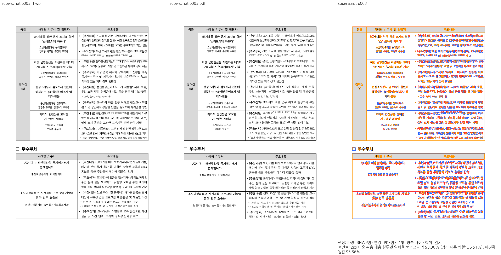

- 정식 focused nextest 완료: run `03220500-1b7d-47ab-9222-efd9711486ab`, 위첨자 기존 검사 1개와 장평 대조군 2개 **3 PASS / 0 FAIL / 397 skip**, 0.120초, exit 0. 현재 원 실패 27건은 수정 검사 통과 24건·부적합 범위 2개 분리·생물독소 경계 행 1건 잔존이다. 이는 마지막 전체 nextest 결과가 아니다.

## 생물독소 경계 행과 143쪽의 PDF 래스터 보정 (V26)

- 원본은 `samples/issue5941/1480000-201900698-native-neartop-reset.hwp`, 독립 Print는
  `pdf/issue5941-1480000-201900698-2020.pdf`다. 원본·PDF 바이트를 유지했고 205쪽이다.
  선언 높이로 닫힌 완전 행 경계는 내용 소속을 정하지만 저장 글줄 원점을 가져오지는 않는다.
  `block/prepare.rs`의 `declared_cellbreak_prefix_end → source_cellbreak_row_end`를
  `continuation/fragment/budget.rs`의 첫 조각 행 예산과 반복 머리행 높이가 소비한다.
  저장 글줄 원점과 논리 흐름 끝이 같아야 한다는 잘못된 조건을 제거했다. 실제 호스트·캡션·
  바깥 상자가 현재 본문 예산 안에 있는지 검사하는 기존 조건은 유지한다.
- 수정한 경계는 표43 첫 조각 0..5, 표44 첫 조각 0..8이다. 독립 PDF처럼 147쪽 첫 행은
  `Hyaluronidase`, 148쪽 첫 행은 `Venom prothrombin activator`다. 내용·셀 소유 관계를
  검사하는 기존 4개는 기대값을 바꾸지 않았다. 이전에 새 검사로 늘리거나 제거하지 않았다.
- 기존 PDF 래스터화로는 Native/fresh 모두 143쪽 86.98876%가 남았다. 원본 SVG의 회색 선은
  0.48px/#bfbfbf, 독립 PDF의 선은 0.36pt/gray0.749로 96dpi에서 두께·색상이 같다.
  PDF를 PNG로 만들 때 1px 미만 선의 농도가 달라지는 것을 확인했다. `visual_sweep.py`에서
  Poppler `-thinlinemode shape`를 사용해 원래 두께에 비례하는 coverage로 비교한다.
  PDF/SVG의 물리 두께·색상, 내용 판정 임계값, 2px 공차, 90% gate는 유지했다.
- 같은 V26 Native PNG와 실제 Chrome fresh WASM PNG 205개를 해시로 고정했다. 같은 PDF 전체를
  새 모드로 래스터화하고 양쪽 전쪽 TSV를 각각 다시 산출했다. 두 경로 모두 **최저 92.75882%,
  미달 0쪽, 누락 0쪽, 205/205쪽**, 143쪽 **98.25150%**다. 양쪽 PNG와 TSV가 모두 같다.
  과거 모드의 PNG·86.98876% TSV는 그대로 보존한다. 값의 상승은 실제 내용 재배치가 아니라
  비교 래스터화 정정이며, 이진화 원값 86.98876%와 경계 농도 지원 픽셀 11150도 함께 기록한다.
- 새 143·147·148쪽 review PNG를 생성하고 143쪽을 직접 판독했다. 얇은 표 선을 유지하며
  캡션·학명·아래 표의 내용과 경계 행 소속을 보존한다. 엄격 픽셀 동일성을 주장하지 않는다.
  표를 지운 대조군은 22.87671%, 표를 오른쪽으로 16px 옮긴 대조군은 77.79612%로 미달을
  검출한다. 이것은 실제 출력의 일반 회귀 기대값에 px 상수를 추가하는 검사가 아니라
  비교 경로가 큰 누락·이동을 숨기지 않는지 확인하는 진단이다.
- Visual Sweep 기존 단위 검사 **83 PASS**, 생물독소 기존 정식 관계 검사 **4 PASS / 0 FAIL /
  230 skip**, 1.293초, run `bda74b86-e0f2-4675-ad97-e589635efa63`, exit 0이다.
  회귀 처리 결정은 **4개 유지**다. 쪽수 205와 해당 셀의 쪽 소속, 그림 기준선·캡션·뒤 본문 보존은
  독립 기대값과 일치한다. 테스트에는 최신 시각 출처 설명만 교정했다.
- 사용자가 등록된 #7749의 회귀 참조 제거를 명시 승인했다. SHA가 같은 80550/3637 두 원본과
  독립 PDF, 합성 중첩 표 오프셋 계약 3개를 보존하고 80550 경로의 text-overlap/off-canvas corpus
  참조와 해당 baseline 두 행만 제거했다. 같은 표의 body corpus는 이미 제외되어 있었다.
  정확한 고정 devel의 overlap14와 V25/V26의17을 구분한다. 생물독소 보정 전후 값이 같다는
  사실만으로 이전 브랜치의 회귀가 없었다고 주장하지 않는다.
- 원래 실패 27건의 재검사는 25 PASS·80550 overlap 실패 1건·기존 승인으로 제거된 범위 1건이었다.
  앞 단계의 “24건 해결” 추정 대신 실제 개별 실행 증거로 정정한다. 80550 참조 제거 후 전체
  nextest run `6237ac66-a3a8-4fc7-8d3d-01836962d8b9`는 **10280 run / 10253 PASS /
  27 FAIL / 45 skip**, 620.183초, exit 100이다. 새 실패 27건은 별도 목록이며 생물독소 4개는
  통과했다. API 이어받기 컷·다른 원본의 분할/쪽수 실패가 남아 전체 검증·PR 준비는 미완료다.
- 전체 TSV·원시 SVG·PNG·로그·쪽별 해시 원장은 ignored
  `output/pr-review/7445-completed-20261009/stage450-biotoxin143-raster/`에 둔다.
  요약 JSON·대표 PNG만 커밋한다. 비교 가이드에 래스터 모드·출처·과거 증거 보존을 반영했다.
  PR 생성·push·merge는 전체 검증 후 사용자 승인 조건을 유지한다.

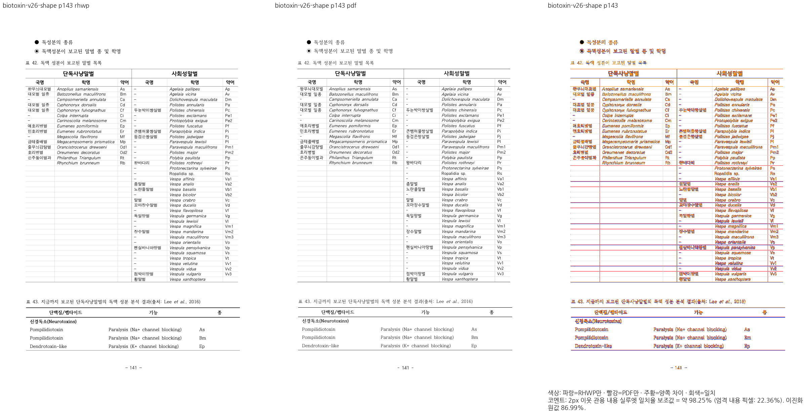

## 2026-10-11 — 사용자 지정 원본과 기존 시각 미달 회귀의 서브 이슈 이관

- 다른 브랜치에서 보정 중인 `table_giant_cell_overfill.hwpx`는 #7812,
  `2700727_animal_facility_standards.hwpx`는 #7811,
  `2025 행정업무운영 편람(최종).hwpx`는 기존 #7752로 연결했다.
- 앞 세 문서에 의존하는 기존 20검사 함수와 HWPX E2E 입력 하나를 활성 대상에서 분리하고,
  전용 파일/혼합 파일의 변경 전 원문 12개를 `.rs.txt`로 보존했다.
  #3930의 혼합 함수에서는 HWPX 렌더링 검사만 이관하고 모델 저장 계약은 유지했다.
- `issue1949_giant_cell_nested_tables_perf` HWP·HWPX는 #7813으로 이관했다.
  실패 4함수와 전용 컷/경계 helper 원문을 보존하고 활성 단위 검사에서 분리했다.
  다른 정상 API/cache/serializer·프로파일링 검사는 유지했다.
- 합계 24검사 함수 이관이다. 원본·PDF·HWP counterpart는 공유 입력으로 기존 경로와 바이트를 유지한다.
  자동 렌더링 corpus의 해당 HWPX 참조/원장 행은 명시적으로 분리했다.
- 고정 renderer base `90fa2f8955c2dd21e9f0ea8fd0c6ee8dc5996a47`, 현재 Visual Sweep
  `6d55a02401a9be42488fcb7aa7519900aebcecb2`로 giant perf 두 원본의 전 115쪽씩을 비교했다.
  Native/실제 Chrome fresh WASM 최저는 HWP 23.54542%, HWPX 23.78253%로 각 115쪽 모두 미달이며,
  각 원본의 Native/fresh TSV가 바이트 동일하다. 96dpi·2px·문턱 32·thinlinemode shape를 유지했다.
  upstream의 기본 2022 프로필을 쓰는 export adapter 외에는 Rust/WASM·비교 공식을 변경하지 않았다.
- base의 기존 시각 미달과 현재 브랜치의 새 start/end 컷 간극은 구분해 #7813에 기록했다.
  이관을 컷 간극 해결이나 전체 검증 통과로 보고하지 않는다.
- #7445 본문에 하위 이슈 표·본문 끝의 현재 이관 상태를 갱신하고 API로 확인했다.
  기존 첫 문단과 과거 기록·완료 기준은 보존했다.
- 정본 이관 자산: `mydocs/pr/assets/issue7445/deferred-regressions-20261011/`.
  코드·원본·PDF 해시와 검사별 이전/새 경로는 `transfer-inventory.json`,
  API 4검사는 `issue1949/transfer-plan.json`, 시각 결과는 `issue1949/qualification.json`에 있다.
- fmt·source unit 정책은 통과했다. 남긴 integration/진단 계약 집중 실행은 64 PASS / 0 FAIL / 필터 skip 10241, 2.162초, exit0이다.
  이 집중 실행은 API 4검사 이관 전의 빌드에서 시작한 것이며 최종 전체 회귀와 필수 lint를 대신하지 않는다.
  로컬 정본: `/Users/tsjang/rhwp/output/pr-review/7445-completed-20261009/stage452-other-branch-regressions/`.
- 새 PR/push/merge는 전체 검증 후 사용자 승인 단계로 유지한다.

## 2026-10-11 고정 devel 재검증과 최근접 행 끝의 의미 교정 (진행 중)

`upstream/devel`을 `8761ac90270a5dddfa0860e3de700ee83d2bf7c8`로 고정하고,
132개 고유 커밋을 rebase했다. 백업 브랜치는
`backup/7445-completed-before-8761-20261011`이다. 새 upstream의 중앙 정렬 재조판 계약과
공개 조판 세대 API를 보존했으며, 로드맵 제목의 반례·최종 전쪽 재검증은 아직 필요하다.

같은 원본·Print PDF·현재 Visual Sweep·generation 2022·실제 Library/Fonts로
실패에 연결된 9문서를 다시 비교했다. base Native에서 도로조명 2쪽은 최저
94.82081%였지만 이전 후보의 2쪽은 58.45975%였다. 재난 2→3쪽,
synam 35→36쪽, 토지표 5→6쪽도 현재 후보에서 추가된 차이였다. 이를 기존 미달
이슈에 연결했다는 이유로 해결·이관 완료로 처리하지 않는다. 나머지 base 수치와
쪽수 불일치는 ignored `stage453-current-devel-qualification/base-head-classification.json`에
구분해 기록했다. 해당 파일의 before 결과는 다음 경계 교정 전 결과다.

원인은 `saved_first_fragment_source_frame → nearest_saved_rowbreak_frame_row_end →
row_step의 완료 조각 조기 종료 → fragment/emit의 끝행/다음 커서` 경로였다.
최근접 행 끝은 허용량 조회 기준이며 실제 소유 종료를 증명하지 않는다. 재난은
저장 프레임이 해당 측정 행 끝보다 약 22.6px 길고, 도로조명도 다음 행 첫 유닛을
수용할 여지가 있다. 완료 분기가 남은 공간을 현재 행의 빈 물리 밴드로 소비하고
스캔을 끝내면서 다음 행 첫 줄을 넘겼다.

`row_step.rs`의 완료 분기는 프레임이 누적 측정 행 끝을 지나지 않을 때에만
실행하도록 교정했다. 지나면 기존 다음 행의 내용 컷·실제 예산 검사를 계속한다.
문서 ID 조건·새 픽셀 공차·출력 clamp는 없다. 위임전결의 프레임 안에서 닫히는
기존 빈 밴드 보정은 유지한다. 새 Native에서 재난 2쪽·synam 35쪽·토지표 5쪽을
확인했고, 도로조명 첫 줄도 SVG 1쪽에 있다. 이는 쪽수/소유 진단이며 전쪽 시각
수용으로 보고하지 않는다. 위임전결 전쪽 진단의 사건 수는 같고 하단 넘침 증가가
없지만, 55·63·81쪽의 표 높이가 달라 직접 PDF 대조가 남아 있다.

기장군 `20117321_gijang_handover_bond_ledger_form.hwp`는 경계 교정 전 후보의
Native/실제 Chrome fresh WASM 모두 98.94647%, 원본·독립 PDF·HWPX 왕복은 1쪽이다.
`export-hwpx --verify --verify-pages`도 IR diff 0건으로 통과했다. 제목·표 머리글·하단
확인/서명 내용의 review를 직접 확인했다. 기존 두 검사에서 XML lineseg 존재를
가정한 지표를 원본 글자모양의 em 크기·실제 run의 글줄 소유/포함으로 바꿨다.
빈 지표 집합도 두 검사 모두 실패시킨다. 선행 시각 증적은
`../pr/assets/issue7445/completed-20261009/current-base-qualification/ledger-qualification.json`과
같은 디렉터리의 `ledger-p001-review.png`다. 새 경계 교정 이후 최종 재검증과
수정한 정식 검사 결과는 완료를 확인한 뒤 기록한다.

새 한컴 Print 정본 `pdf/hwp3-empty-cell-2020.pdf`와
`pdf/issue7235/156086935_none_image_fill-2020.pdf` 및 job·원본/PDF 해시·PrintMethod0
출처는 `100f605f9875ca8388c873d491c2e4a9fdc44f33`으로 보존했다. 원본·다른 작업의
합성 PDF를 대체하지 않았다. 독립 정본 확보를 시각 통과로 판정하지 않는다.

경계 교정 전 fresh WASM 화학제품 103쪽 캡처 중 81쪽에서 브라우저 load 30초
시간 초과가 발생했다. 102쪽 PNG는 있으나 해당 실행의 전쪽 TSV/수용은 미완료다.
진행 중인 나머지 캡처를 보존하고, 완료 후 누락 81쪽만 공식 rasterizer로 재실행한다.
Mac locked no-opt package이며 Docker 최적화 빌드 통과로 보고하지 않는다.

현재 네 integration suite의 집중 nextest는 실행 중이다. manifest(1446 sources,
6198 static test attrs)와 source unit tier(4113 tests/297 modules)는 고정 base 대비
통과했다. 전체 회귀·필수 lint·새 code head의 Native/fresh 시각 검증은 미완료다.
**2026-10-11 사용자 재확인: 결과 보고와 승인 전 PR 생성·push·CI 모니터링·머지·후속
처리를 진행하지 않는다.** 로컬 보정·검증·보존은 계속한다.

집중 검사 기록 정정: 최초 run `58bb89a0-ed35-406c-9e7d-08b29340de49`는
manifest 준비 전의 suite 번호를 사용해 **0 tests / exit 4**로 끝났다.
검증 통과로 계산하지 않는다. `--prepare` 후 실제 검사 위치
`regression_suite_016/017/020`을 다시 조회해 같은 명시적 함수 필터로 재실행 중이다.

정정 후 정식 집중 run `17521d1d-bd99-41b1-8a9d-2a32238c0a31`은
**9 run / 9 PASS / 0 FAIL / 629 filtered skip**, 1.402초·exit 0이다.
기장군 관계형 2검사, 도로조명 원본/0-reset 제거 대조군 2검사, 재난·정상 신청서
쪽수 1검사, 생물독소 원본 내용 소유 4검사를 실제 실행했다. 생물독소 대조군은
이 작은 경계 교정으로 기존 내용 소유 계약이 깨지지 않음을 확인하며, 205쪽의
새 Native/fresh 시각 수용을 대신하지 않는다. 테스트 함수는 새로 추가하지 않았다.

### 2026-10-11: HWP3 입장권과 무관한 그림 밴드의 원점 공유

원본 `samples/hwp3-empty-cell.hwp`는 독립 한컴 Print 2020 정본과 같은 1쪽으로
복구했다. 표 하나만 담은 빈 TAC 호스트는 실제 표 프레임이 그 줄을 소유하므로
모든 값이 0인 HWP3 LineInfo를 텍스트 재조판의 근거로 쓰지 않는 규칙과 구분했다.
`#5184`의 기존 저장 높이 왕복 계약은 기대값을 바꾸지 않고 통과했다.
집중 run `33a57a57-bb18-4094-8d59-00ad2219ea09`는 7 PASS / 0 FAIL /
840 filtered skip, 0.046초다. 이 실행 뒤 추가한 문자 폭·기호 슬롯·선폭 및
토지표 전체 소유 관계의 보완은 해당 7 PASS에 포함되지 않는다.

한컴 2020 독립 재저장 진단(job `b16b8c15-5dd4-4e8d-87d4-88b710744e6b`)은
원본 한글 face `옛한글`을 HFT로, 영문 `HCI Tulip`도 HFT로 보존한다.
원본 raw hchar `0x2015`를 U+2015로 보존하고 기호 슬롯으로 보내 가로선의 누락과
1em 오계산을 보정했다. 보통 실선은 재저장 XML의 0.12mm와 Print의 0.36pt가
같은 선폭을 증명한다. 원본이나 PDF를 진단 HWPX로 대체하지 않았다.

입장권 번호 런의 영문 표시 폴백 `HY견명조` 폭을 원본 HCI Tulip 폭으로 쓰던
문제를 독립 PDF의 `/T1` ToUnicode·Widths·FontMatrix와 재저장 charPr 12의 face로
확인했다. 확인한 regular/upright 글리프만 기존 부분 메트릭 경로로 보존한다.
미확인 문자·bold·italic은 기존 폴백을 유지한다. 숫자·구두점 폭을 반영한 중간
Native는 92.44689%, 장부는 98.97669%, 각각 1쪽이며 누락은 없다.
확대 판독에서 일반 공백을 글꼴 자연 폭 250/1000em으로 덮어쓰는 별도 오차를
찾아 해당 항목을 제거했다. `useFontSpace=false`의 반각 문서 공백 계약을 유지한
최신 수정본은 재빌드 중이며 이 중간 수치로 최종 수용을 주장하지 않는다.

`156086935_none_image_fill.hwp` 1쪽의 회귀는 오래된 다른 세로 밴드 그림이
단에 남아 있다는 사실을 현재 TAC 표의 회피 줄 소유로 오인한 것이었다.
실제 carve 결과가 없는 데도 `resolve_wrap_row`가 누적 커서로 절대 배치를
발행해 표 pi=6과 후행 본문을 80px 아래로 옮겼다. 원본 표 줄은 21657HU이고
표 높이 5897HU와 다음 줄 27918HU가 원본 흐름을 닫는다. `side_wrap_row`는
실제 `place_inline_box` 결과가 있는 경우에만 줄 소유를 수용하도록 보정했다.
같은 밴드를 실제로 회피한 표와 다음 단으로 넘어온 소유 줄은 기존 공통
배치·끝점 계약을 유지한다. 이 보정은 아직 재출력 검증 전이며 미달 baseline
이관이나 검사 삭제로 현재 회귀를 숨기지 않는다.

이 단계의 전체 JSON·TSV·실행 로그는 ignored
`output/pr-review/7445-completed-20261009/stage453-current-devel-qualification/`에
보존한다. 새 함수형 테스트는 추가하지 않았다. 최종 전체 회귀와 completed 대상
전쪽 Native/fresh WASM 재검증은 남아 있으며 승인 전 push·PR 생성은 보류한다.

최신 일반 공백/배제 줄 보정의 전쪽 재출력은 Native와 fresh WASM 모두 끝났다.
입장권 1쪽 95.89598%, 장부 1쪽 98.97669%, 재난 2쪽 96.21501%,
도로조명 2쪽 94.56250%를 양 backend에서 유지한다. 토지표 5쪽은
Native 98.68216%, fresh WASM 96.81887%이며 누락은 없다.
그림 채우기 14쪽은 1쪽이 99.80314%로 복구됐으나 양 backend의 6쪽
73.86639%가 남는다. 그 문서의 sweep exit 1은 이 gate 보류이며 성공으로
계산하지 않는다. 6쪽 확대 판독에서 첫 표 뒤 모든 줄/표가 약 5px 위로
이동한 차이를 확인했다. 호스트의 원본 줄 10377HU+뒤 간격 752HU가 다음
줄 11129HU를 닫는데, 이전 쪽에 속한 호스트 vpos 때문에 전량 뒤 간격을
인증하지 못하는 경로를 확인하고 있다. 이것은 원인 후보이며 아직 보정 완료가 아니다.

compact 증적과 두 실제 Native review PNG는
`../pr/assets/issue7445/completed-20261009/current-base-qualification/hwp3-source-and-exclusion.json`에
연결했다. Mac locked no-opt package 및 Studio JS/WASM 해시 동기화 확인을
기록했으며 Docker 빌드로 보고하지 않는다. 최신 관계형·글꼴 계약·원본 분할의
집중 nextest는 아직 컴파일 중이다. 전체 nextest 결과와 혼동하지 않는다.

최신 집중 run `16d60612-8534-4aae-b039-fb00e6153090`은 **24 PASS / 0 FAIL /
1497 filtered skip**, 4.369초·exit 0이다. manifest 준비 후 실제 7개 suite와
8개 원본 모듈을 이름 필터로 선택했으며 0-test 실행은 아니다. 토지표의 전체
쪽·원본 셀 문단 67개의 분할 소유 관계, 재난 셀 내용/후행 본문 관계, HWP3
저장 높이 왕복, 장부 글자모양/줄 관계, 도로조명 대조군, 글꼴 coverage/정본
projection 계약을 확인했다. 화학제품 #6761의 기존 네 검사도 모두 통과했고
기존 두 실패 함수를 제거하거나 기대값을 바꾸지 않았다. 전체 화학제품의
시각 미달과 정확한 이 네 계약은 구분해 유지한다. 전체 nextest는 여전히 남는다.

### 2026-10-11: 새 쪽의 완전한 원본 TAC 후행 간격과 관계형 검사

그림 채우기 원본 6쪽의 보류를 원본 저장 줄의 프레임으로 보정했다. 호스트의
이전 쪽 vpos를 다시 더하지 않고, 원본 표의 선언 높이·바깥여백이 완전한 저장
줄 높이를 소유하고 다음 줄의 새 원점 vpos를 정확히 닫는 경우에만 뒤 간격
전량을 소비한다. 단순 되감김·더티 셀·합성 사다리·불완전한 표 높이는 근거가
아니다. 문서 식별자, 고정 px 보정, clamp 또는 점수 정책 변경은 없다.

소비 경로는 `composer::tac_next_line_full_spacing` →
`typeset/controls/stored_tac.rs`의 후행 간격 측정 및 `layout.rs`의 실제
호스트 사영·TAC 후행 y 전진이다. 두 소비자가 같은 원본 줄의 닫힘을 사용한다.
이 원본의 10377HU 줄과 752HU 간격은 11129HU의 다음 줄을 소유한다.
독립 PDF의 첫 표 원점은 유지하면서 뒤 본문과 사례 2·3 표의 공통 약 5px
조기 시작을 해결했다. 변경 전 6쪽 73.86639% → Native/fresh 모두
98.94678%, 전 14쪽 최저 97.76365%·미달 0·누락 0·PDF와 14쪽 일치다.
같은 영역의 두 review PNG를 직접 열어 표·본문의 시작과 끝 및 내용 보존을
대조했다. 글리프 윤곽의 남은 차이는 픽셀 동일성으로 보고하지 않는다.

같이 재출력한 6개 원본·25쪽은 양 backend에서 모두 90% 이상이며 쪽수와
누락 문제가 없다. 토지표 Native 98.68216%/fresh 96.81887%, 도로조명
94.56250%, 재난 96.21501%, 장부 98.97669%, 입장권 95.89598%를 유지한다.
Mac locked no-opt 빌드와 Studio JS/WASM 동기화 해시를 확인했다. 캡처 뒤
production 함수에는 rustfmt 줄바꿈만 적용했고 검사만 보완했다. 정식 최종
후보 전체 재출력이나 Docker 최적화 빌드의 증거로 승격하지 않는다.

기존 `issue_7235_none_image_fill_fits_area` 두 함수의 최근접 px 상자 선택,
절대 PDF 좌표, 중심 3px·크기 5% 핀은 제거했다. 실제 SVG의 그림 payload를
원본 해상도로 식별하고, 해당 원본 그림이 소유 셀·도형 영역을 한 번씩 채우며
종횡비·가운데 맞춤을 보존하는 관계로 검사한다. 원본 그림의 고유 해상도는
파일 속성이므로 유지한다. 원본 TAC와 뒤 문단의 쪽·줄 소유, 표 셀 전체 내용의
누락·중복, 원본 줄의 후행 간격 관계도 같은 기존 함수 안에서 보호한다.
기존 단위 함수에 완전한 닫힘과 단순 되감김·더티 셀·합성 줄·높이 부족의
반례를 보완했다. 새로운 테스트 함수는 추가하지 않았다.

집중 nextest run `4abf65fe-fb54-4049-9054-750f86fcdded`는 **27 PASS /
0 FAIL / 5746 filtered skip**, 3.968초·exit 0이다. 변경 전 새 assertion의
nextest 실행은 하지 않았으므로 before FAIL로 기록하지 않는다. 변경 전
동결된 실제 출력의 미달과 반간격 차이, 변경 후 실제 출력을 구분해 보존한다.
compact 증적과 Native/fresh PNG는
`../pr/assets/issue7445/completed-20261009/current-base-qualification/none-image-fill-rebased-spacing.json`에
연결했다. 전체 회귀·완료 대상 전쪽 재검증은 아직 남아 있다. 최신 사용자
지시에 따라 PR 초안과 검증 결과를 준비한 뒤 승인을 받으며, 승인 전 원격
push·PR 생성·merge는 진행하지 않는다.

## 2026-10-11: 최신 devel 전체 회귀의 두 실제 소속 결함 보정

- 기준은 `790a6f8f388445e7bff2bcb165aa7b384f9ece80`이며 137개 커밋의 rebase에 충돌이 없었습니다.
  직전 후보 `cccfe283a1c23ebd6c81fd0050d7f3eaca7f2c65`의 전체 nextest는
  **10266 PASS / 2 FAIL / 45 SKIP, 501.906초**입니다. 두 정확한 관계 검사는 유지했습니다.
- 보도자료는 유닛 174(빈 문단 135)의 양수 높이를 이미 측정했지만 이어받기에서 후속 객체를
  이유로 버려, 앞 조각의 끝 컷 174와 다음 조각의 시작 컷 175 사이에서 점유가 사라졌습니다.
  원본 빈 줄의 슬롯이 후속 저장 원점을 닫는 공통 판정을 유닛 보존·일반/블록 컷의 예약·
  이어받기 prefix 소비·블록 잔여 높이에 공유했습니다. 이제 두 컷은 모두 174입니다.
  `cell_line_ranges_from_cut`과 실제 partial paint가 이 소유 유닛을 소비합니다.
  적용되지 않는 합성 원점·되감김·닫히지 않는 원점·0높이 반례를 기존 단위 함수에 보완했습니다.
- 영월은 객체-only HWP3 호스트의 LineInfo 하나를 본문 저장 조판의 증거로 사용해,
  재조판 본문에도 한글97 바닥 관용을 주었습니다. 다음 별지 제목이 앞 쪽 여백에 수용됐습니다.
  원본 본문 텍스트의 저장 줄이 있는 경우에만 기존 관용을 유지합니다. 독립 Print의
  별지 1~4 제목은 각각 대응 쪽에 한 번 보존됩니다. 원본과 독립 PDF는 변경하지 않았습니다.

| 전쪽 검증 대상 | Native 최저 | fresh WASM 최저 | 쪽수/미달 |
| --- | ---: | ---: | --- |
| 보도자료 | 97.28456% | 97.28456% | 12/12, 0 |
| 영월 서식 | 99.54887% | 99.54887% | 4/4, 0 |
| 정상 대조군 6종 포함 | 94.56250% | 94.56250% | 8문서·41쪽씩, 0 |

보도자료 3·8·11쪽은 각각 99.53044%·98.59646%·99.90622%이며 표 시작, 내부 글줄,
그림, 뒤 내용과 쪽 번호를 직접 확인했습니다. 3·8쪽과 영월 2·4쪽의 Native/fresh 실제 PNG는
byte-identical입니다. 11쪽은 `新` 글리프 영역 288픽셀의 래스터 차이가 있어 양쪽 review를
따로 확인했고, 두 일치율은 모두 99.90622%입니다. 픽셀 동일성으로 완료를 주장하지 않습니다.
기존 검사 함수에 셀 소유·빈 줄 1회 점유·후속 표 1회 소유·원본 간격 뒤 순서를 보완했습니다.
고정 px 영역은 사용하지 않았습니다. 강화한 기존 실물 검사는 같은 frozen library로
수정 전 FAIL / 수정 후 PASS를 확인했고, 영월 기존 2개 검사도 PASS입니다.
이는 개별 `rustc --test` 실행이며 최신 전체 Cargo nextest를 대신하지 않습니다.
새 테스트 함수는 추가하지 않았습니다. manifest와 unit-tier 정책도 통과했습니다.

증적: [현재 기준 요약](../pr/assets/issue7445/completed-20261009/current-base-qualification/empty-slot-and-hwp3-title-current-base.json),
[보도자료 8쪽 Native review](../pr/assets/issue7445/completed-20261009/current-base-qualification/press-empty-slot-p008-native-review.png),
[fresh WASM review](../pr/assets/issue7445/completed-20261009/current-base-qualification/press-empty-slot-p008-wasm-review.png).
TSV·실행 로그는 ignored `output/pr-review/7445-completed-20261009/stage458-empty-line-cut-ownership/`에 보존했습니다.
두 정상 대조군의 Chrome 30초 navigation timeout은 지원 환경 변수로 90초를 지정해 같은
원본·동일 DPI·동일 비교 알고리즘·8개 캡처로 재실행했으며 최초 실패 로그도 유지했습니다.

최신 전체 nextest·필수 lint/build/Skia·완료 corpus 전체 검증은 아직 남았습니다.
**로컬 보정과 검증을 마친 후 PR 제출안을 보여드리고 승인받습니다. 원격 push·PR 생성·merge는 진행하지 않았습니다.**
