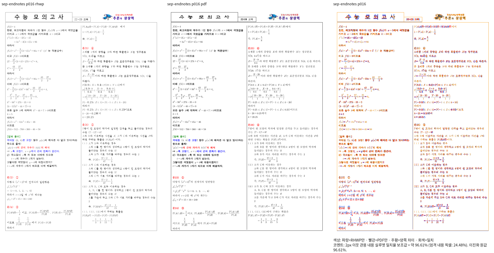
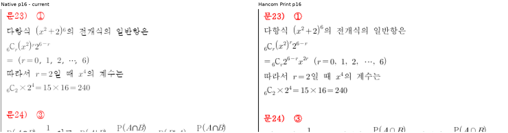
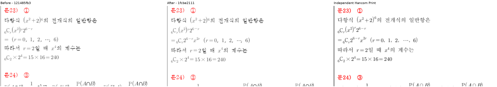
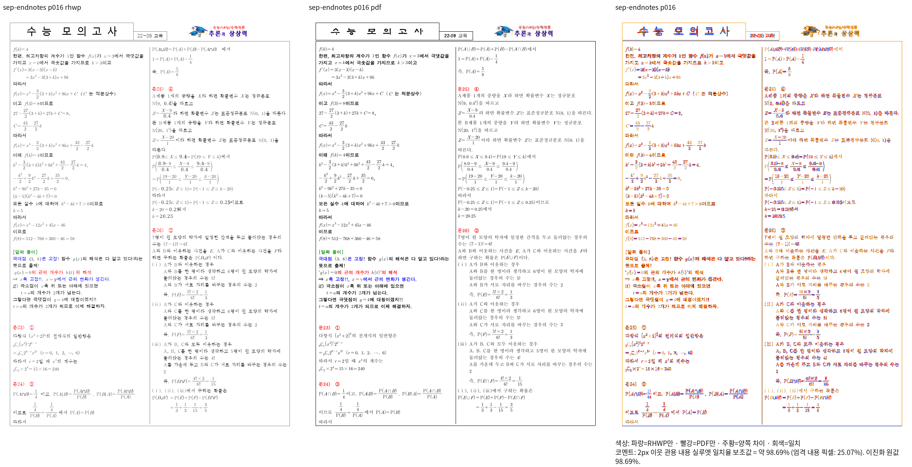

# #7642 미주 경계의 공통 수식 입력 중단 원인

Issue: #7642

## 구현 전 근거와 반례

제품 `121485fb3`의 Native 전쪽 72행·1,250쪽은 최저 90.71286%, 쪽수 일치다.
그러나 독립 Print와 9월 16쪽을 확대하면 `문23`의 `= _{6} {rmC} it_{r} …`에서
등호 뒤 조합식이 통째로 없다. 문24 제목도 4.39370 CSS px 위로 당겨진다.
같은 내용의 여덟 간격·격자 변형에서 같은 원본 소유에 반복된다.

30개 시험지의 미주 제목 1,380개는 단일 표시·소유 순서·쪽·단이 Print와 일치한다.
이 결과는 내부 수식 내용 보존까지 입증하지 않는다. 실제 parser 단독 진단은 위 전체
스크립트를 `Symbol("=")` 하나로 읽고 중단한다. Symbol atom은 첨자를 소비하지 않고,
다음 `_`를 기저 없는 오류로 판단해 나머지 입력을 버린다. 유효한 표시 기호를 첨자의
기저로 소비하는 경로가 문자·숫자·일부 기호와 다르다.

공통 경로는 `parser_atoms.rs`의 표시 기호 → `flow_metrics_hwp`의 축소된 수식 상자 →
`equation_line_metrics.rs`의 1,228→900HU 줄 갱신 → `stored_row_projection.rs`의 후속
원점 -328HU → 미주 fit·실제 paint다. 간격 helper에서 7mm는 한 번 소비되고 있다.
문서·번호·좌표별 간격 예외를 더하지 않는다.

문서 파서에서 표시 기호도 붙은 첨자를 소비하게 하며 공개 호환 파서의 기존 계약과
초기 orphan `_`, 누락 operand, 닫힘·행 경계는 유지한다. `=`, `+`, `-`, 비교 기호,
이름 기호·공백·빈 그룹·문자 기저를 한 묶음으로 대조한다. Hancom 정상 저장·Print의
64개 진단도 요청했으며 아직 queued다. 새 진단을 시각 통과 fixture로 선언하지 않는다.

## 검증 계획

- 기존 parser 단독 before 로그와 원본 확대에서 입력 중단·내용 누락을 보존한다.
- 수정 뒤 같은 스크립트의 내용·상하첨자 보존과 원본 미주 제목·수식 원점을 비교한다.
- 같은 내용의 HWP/HWPX·간격 변형을 대조하고 관련 전쪽 Native/fresh WASM을 재실행한다.
- 90%와 직접 판독 전에는 새 정식 회귀·fixture/golden을 갱신하지 않는다.
- 기존 전체 회귀는 10,615 통과·12 실패·45 건너뜀이다. 이 보정으로 전체 통과라고 쓰지 않는다.

증적 루트는 `output/pr-review/issue7642/failed-inputs-20261008/stage15-current-validation/`다.
`stage1636-endnote-owner-flow-audit.json`, `stage1638-sep-endnote-boundary-review/`,
`stage1639-endnote-flow-traces/`, `stage1640-sep-endnote-source-lines.log`,
`stage1643-operator-script-ast-before.log`를 연결한다. 초기 진단 driver의 모듈 누락 빌드 실패는
보존하고, 성공한 r2 실행만 제품 parser 관측으로 사용한다.

## 수정과 현재 확인

`parser_atoms.rs`에서 문서 Symbol도 기존 첨자 소비 경로를 사용한다. 공개 호환 파서의
ASCII Symbol 해석은 유지하고, 기존 비ASCII 이항 기호도 첨자를 두 번 소비하지 않는다.
동일한 단독 진단 16개를 묶어 실행했다. 원본 조합식의 AST는 등호 하나에서 전체
Subscript·Roman C·아래첨자 r·위첨자·곱 항을 보존하는 Row로 바뀌었다.
이름 기호 TIMES·문자 기저·빈 그룹·초기 orphan 및 괄호 대조군은 기존 AST와 같다.
이는 parser 진단이며 Native/fresh WASM 시각 통과나 새 정식 회귀 실행이 아니다.

현재 Native 전체 엔진 재빌드와 새 전범위 검증을 진행한다. 기존 전쪽 90% 결과를
이 새 코드의 검증 결과로 바꾸어 보고하지 않는다. MCP 정상 저장·Print 대조도 진행 중이다.

16쪽 엄격 내용 픽셀 보조값은 24.48%, 2px 관용 실루엣은 96.61434%다.
수치가 90%를 넘더라도 그림에서 확인한 수식 누락과 뒤 제목 이동은 남은 결함이다.
PNG crop은 정렬·이동·마스킹 없이 같은 원본 좌표를 같은 배율로 확대했다.

## 전체 Rust 실패의 일괄 분류

정식 Native feature 전체 실행은 code `121485fb3`, 검사 `9ce58d902`의
10,627 실행 중 10,615 통과·12 실패·45 건너뜀, exit 100이다.
`stage1628-full-nextest.log`, `stage1628-full-regression.json`의 소스 해시 유지도 확인했다.
이후 문서 commit은 제품 소스를 바꾸지 않았으나 이번 parser 변경은 별도 재검증 대상이다.

| 실패 범위 | 수 | 실제 실패와 남은 확인 |
| --- | ---: | --- |
| 수식 golden | 1 | 251개 차이 중 AST 53·layout 251·SVG 237. 독립 구문·출력 근거 없이 일괄 갱신하지 않는다. |
| WMF/EMF golden | 1 | 직렬화·장치 좌표의 실제 출력 계약을 구분한다. |
| HWP3 sample16 제목 | 1 | `1.추진목적` 정확 문자열 전제에서 먼저 실패. 원본은 공백·FFFC를 보존한다. 저장 줄 왕복 계약과 별도로 검토한다. |
| HWP3 수식 추출 | 1 | 단독/인라인 트리 소속 가정에서 실패. 내용 한 번·읽기 순서 검사는 유지해 재검토한다. |
| 합성 수식 가운데 정렬 | 1 | 수동 LineSeg의 유효성·저장 시작 계약을 독립 근거로 확인한다. |
| 온새미로 점선 | 1 | 근처 LineNode의 dash enum 가정과 실제 테두리 출력을 대조한다. |
| 가상융합 영문 하이픈 | 1 | 단일 TextRun을 전제한 검색 실패. 실제 글자 경계·font slot 계약을 대조한다. |
| 흑백 WMF ROP | 3 | 문자열 `rop_pat` 부재가 아닌 실제 mask 적용·색상·XOR 결과를 독립 Print와 대조한다. |
| 그림 표 조각 | 1 | 5쪽 하단 931.48px 핀과 실제 939.68px 차이의 구현·기준을 확인한다. |
| EMF 장치 변환 | 1 | rect 속성 가정에서 실패. 현재 path와 전체 변환을 합성한 실제 장치 기하를 확인한다. |

12개 검사 모두 고정 devel에도 존재한다. 이 사실만으로 devel에서도 실패하거나
90% 미만이었다고 판정하지 않는다. 현재 실패 로그·기준 SHA·검사 원본 해시는
`stage1637-current-full-failure-inventory.json`에 있다. 기대값·golden·허용치 갱신이나
실패 검사 제외는 하지 않았다.

## 독립 진단의 반례와 Native 확인

MCP 정상 저장 `8cbce758-b826-4d55-9892-640c4f5dcee5`, Print
`486e14d6-9ff5-4753-bc87-7303ea933b67`은 모두 2024 engine,
실제 한컴 `13.0.0.3901`이다. Print는 method 0,
`frame_print_to_pdf_ex_one_up`, 8쪽이다. 원본 생성 스크립트 64개와 정상 저장본의
스크립트가 모두 같다. 두 face·두 크기에서 초기 orphan 네 경우는 Print glyph가 없고,
괄호 뒤 첨자 네 경우는 괄호·첨자·후속 C가 실제로 보인다.

따라서 괄호를 그대로 보존한 최초 단독 진단 결과를 완료 조건으로 삼지 않았다.
문서 파서의 표시 괄호 atom도 같은 첨자 소비 규칙을 적용했다. 소유된 괄호 그룹의
기존 결합과 공개 호환 파서, 기저 없는 첨자 오류의 경계는 유지한다.
64개 원본·한컴 저장 크기·Print glyph 원점은
`stage1642-independent-script-print-observations.json`에 있다. 이 관측은 시각 점수
검증 또는 fixture 등록의 대체물이 아니다.

첫 보정 `1fcbe2111`의 Native 빌드 1644는 exit 0·생산 소스 해시 유지 true다.
원본 9월 HWP/HWPX 전 23쪽은 각각 최저 90.84811/90.86593%이고 기준 쪽수와 같다.
16쪽 실루엣은 96.61434% → 98.68725%, 엄격 내용 픽셀 보조값은 25.07451%다.
문24 제목 y는 974.9 → 979.3 CSS px, 독립 Print는 979.29370 CSS px다.
328HU의 누락된 줄 점유가 복원되어 간격 예외 없이 뒤 제목이 맞는다.
같은 원점·배율의 확대에서 빠진 조합식도 복원됐음을 확인했다.

선택 20/21쪽은 각각 90.84811/97.86755%다. 다른 미세 차이가 남아 있어 미주 전체의
완료나 px 회귀 추가를 선언하지 않는다. 괄호 보강 뒤 생산 소스의 Native 빌드 1650과
Native/fresh WASM 전범위 74행·1,274쪽을 별도로 재검증한다. 원래 72행·1,250쪽에
정상 저장 수식 진단 2행·24쪽을 더한 범위다. 새 회귀·fixture는 두 backend의 선행
조건과 직접 판독 후 추가한다. 첫 수정 전 12개 전체 Rust 실패도 계속 남은 gate다.

처음 예약한 1646/1647 WASM 대기는 괄호 반례를 얻은 뒤 **컴파일 시작 전에만**
종료·대체했다. 기존 실행 중인 전체 Rust 결과와 다른 전범위 시각 실행은 지우지 않았다.
`stage1646-queue-superseded.json`에 실제 PID·이유를 기록했다. 1650 Native 뒤
1652 fresh WASM을 공용 target에서 순차 실행한다. 이전 head의 자료는 해당 head의
증거로 보존하며 최신 소스의 완료로 보고하지 않는다.
