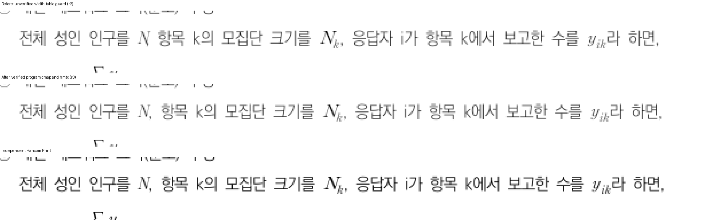
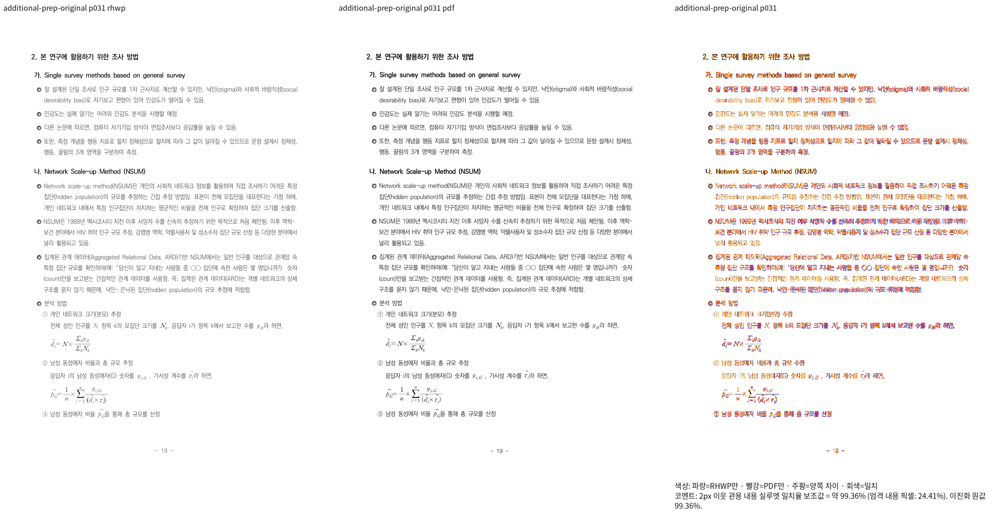

# #7642 수학 영숫자 보정의 Native 판독과 #7913 리베이스

Issue: #7642

## 보정 소스와 직접 판독

수학 영숫자 cmap·hmtx 보정은 리베이스 전 `4231701a102afeb5a8d9d1484554b5856d7a2669`에
커밋했다. 빌드 시점의 dirty 소스를 해당 커밋의 전체 제품 파일 집합·해시와 대조했다.
`stage1665-math-alphabet-commit-binding.json`의 원본 경로·명령·실행 파일 해시를 참조한다.

Native 실제 trace에서 PrEP 31쪽의 본문 U+1D441은 반각 추정 550 HWPUNIT 대신 확인한
HCR Batang Ext의 760 HWPUNIT를 사용한다. 뒤 인라인 수식의 상자 x는 각각
383.6→386.3, 617.4→620.0 CSS px로 이동했다. 이는 실제 배치 관측값이며 PDF 글리프
잉크 원점과 상자 원점을 같은 값으로 가정한 새 회귀 기대값이 아니다.

독립 Print와 같은 좌표·배율의 확대를 직접 판독해 N과 쉼표의 겹침이 해소되고 뒤 수식
간격이 가까워진 것을 확인했다. 아래 자료는 **리베이스 전 보정 소스**의 증거다.
새 head에서 다시 출력하기 전에는 최종 제출 증적으로 재사용하지 않는다.

| 페이지 | 수정 전 2px 실루엣 | 수정 후 2px 실루엣 | 변화(%p) |
| --- | --- | --- | --- |
| 31 | 98.76787% | 99.36390% | +0.59603 |
| 33 | 99.46565% | 99.46565% | 0 |
| 67 | 98.73126% | 98.73126% | 0 |

31쪽의 엄격 잉크 일치율 `visual_accuracy_proxy_percent`는 24.29230→24.40662%다.
2px 관용 실루엣과 같은 수치로 보고하지 않는다. 전체 페이지의 점수와 확대 판독은
별도 판단이며, 67쪽의 알려진 미세 어절 분할 차이까지 해결했다고 보고하지 않는다.
이 비교는 3쪽 Native 진단이다. 새 소스의 전쪽 Native/fresh WASM과 회귀 추가 자격을
대신하지 않는다. 원본·독립 Print PDF는 1657 기록과 같은 PrEP 파일이다.

## 리베이스와 이력 보존

fetch로 `upstream/devel`의 #7913 `4662c069e557e928ed7968d061121fde90b1f027`을 확인했다.
기존 기준은 `375aff29498166260a22796d54e67f508c84aada`, 리베이스 전 head는 위
`4231701a1`, 완료 후 head는 `47a1e544d71243fd8c1d286c482fedd61fc94829`다.

- 기존 788개 작업 커밋을 유지했으며 저자·저자 시각·메시지·순서가 모두 일치한다.
- `src/wasm_api.rs`는 기존 layout_generation과 feature 조건이 있는 pdf_import를 모두 유지했다.
- 글꼴 고지는 PDF backend 4개와 기존 branch의 2개 추가 항목을 모두 보존했다.
  repositoryOnlyFonts 26개의 파일 존재·SHA-256을 확인했다.
- 독립 merge-tree 결과와 최종 트리는 위 두 충돌 해소 파일을 제외한 모든 경로에서 같다.
- 최초 일시적 index.lock으로 중단됐을 때 실행 중인 Git과 lock 파일이 남아 있지 않음을
  확인하고 같은 rebase를 continue했다. 새 rebase 시작이나 commit skip은 하지 않았다.
- 백업 `backup/issue7642-before-rebase-4662c069e-20261016`에 원래 이력을 보존했다.

명령·충돌 해소·비교 결과는 ignored `stage1665-rebase.log`, `stage1665-rebase.json`,
`stage1665-rebase-integrity.json`에 있다. 재생 중 추적 PDF가 잠시 없어져 이전 Native와
base WASM 큐가 종료됐다. 검증 driver와 입력이 바뀌는 구간임을 확인한 뒤 나머지 이전
큐도 종료하고 `stage1665-rebase-validation-interruption.json`에 실제 PID·명령을 기록했다.
이를 엔진의 시각 결함이나 전체 검증 완료로 세지 않는다. 리베이스 후 카탈로그 74행,
1274쪽의 입력·PDF 해시가 모두 원래 값과 일치함을 확인했다.

## 남은 검증

새 기준 위의 Native·fresh WASM 빌드와 전쪽 TSV를 다시 산출한다. 이전 고정 devel의
0.01%p 하락 비교를 새 기준 무회귀 증거로 승격하지 않는다. 공유 target과 8개 빌드 잡을
유지하고 Cargo 계열은 순차 실행한다. 실제 로그 링크는 실행 시작·결과 보고에 표시한다.

기존 전체 Rust 결과의 12개 실패는 해결 완료가 아니다. 실패 입력의 시각 자격·독립
기대값을 먼저 확인하고 사용자가 지시한 새 이름의 관계 검사를 준비한다. 새 렌더링
회귀를 추가하지 않은 상태이며 전체 Rust·lint·fresh WASM·전쪽 대조가 끝나기 전에는
PR 준비 완료로 판정하지 않는다. PR 생성 뒤 CI와 별도 review·오늘할일 PR 및 merge
후속 처리는 기존 사용자 승인 범위에 따라 이어간다.
