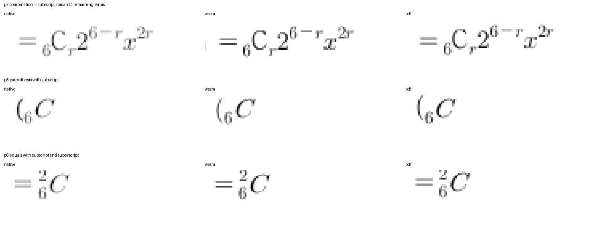
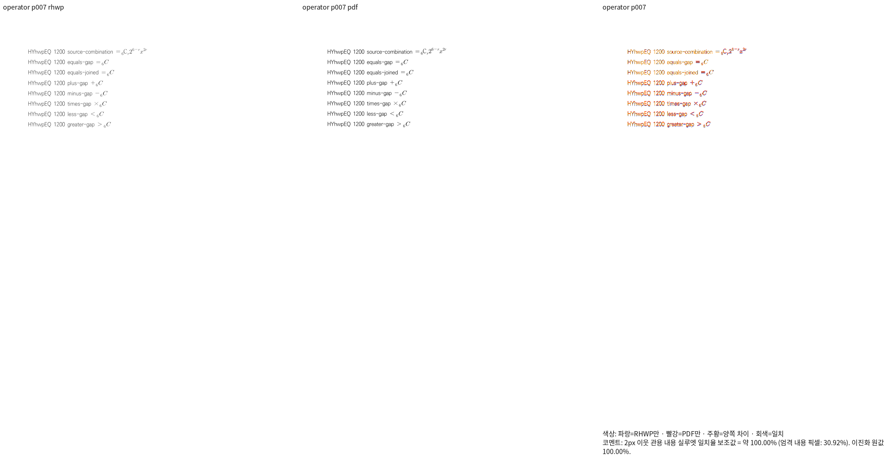
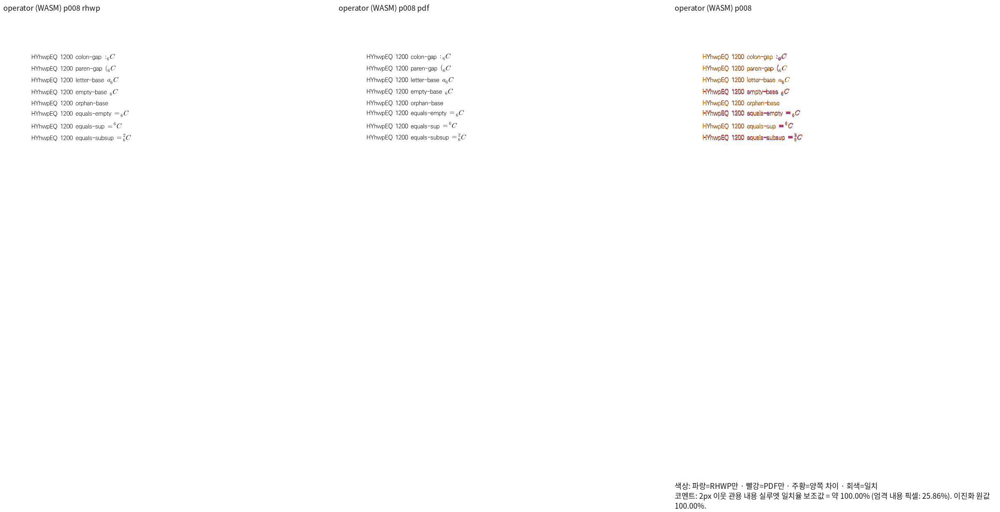

# #7642 연산자 첨자의 독립 Print 대조군과 새 회귀 검사

Issue: #7642

## 적용 범위와 선행 증거

제품 소스 `221c9e8c205601dba3a2b13f304a7d13a7757da9`는 최신 확인 기준
`4662c069e557e928ed7968d061121fde90b1f027`(#7913)을 포함한다. 이번 단계는 제품 코드를
바꾸지 않고, 앞서 보정한 기호·괄호 뒤 첨자 소유의 새 회귀 검사를 추가한다.

정상 한컴 저장본과 독립 Print 8쪽의 Native 최저는 99.18280%, fresh WASM 최저는
99.16442%이며 모두 쪽수가 일치한다. 7·8쪽은 양쪽 100%다. 입력·PDF SHA, 정상 저장 및
Print job, 실제 제품 버전·인쇄 경로, 전쪽 TSV 해시는
[대조군 출처](../../tests/fixtures/equation-font-metrics/HANCOM_OPERATOR_SCRIPTS.md)에 기록했다.
한컴으로 정상 저장한 합성 대조군이며 시험지 원본 전체의 자격을 대신하지 않는다.

## 직접 판독

등호 뒤 조합식의 아래첨자와 나머지 항, 괄호의 아래첨자, 등호의 위아래첨자를 같은 좌표와
배율로 독립 Print와 확대 대조했다. 본체·첨자 소속과 뒤 항의 보존·간격이 일치한다.
실루엣 100%라도 Native·브라우저·PDF의 잉크 농도와 안티앨리어싱 차이는 남는다.
한컴도 비우는 진짜 선행 고아 첨자 `_{6} C`는 수식 제어를 보존하되 빈 출력이어야 한다.

[Native 7쪽 standalone overlay](assets/issue7642/operator_scripts_20261016/native-p007-overlay.png)

## 새 검사와 현재 실행

기존 시험지 회귀의 삭제 예정 이름을 재사용하지 않고
`tests/cases/verified_hancom_operator_scripts.rs`에 3개 검사를 새로 만들었다.

| 검사 | 독립 기대값과 보호 범위 |
| --- | --- |
| `printed_operator_scripts_preserve_every_source_owner_and_all_following_terms` | Print 전체 8쪽·64개 수식, 원본 제어 소유와 스크립트, 페이지·줄 순서, PDF 실제 글리프 수, 누락·중복, 고아 첨자 음성 대조군 |
| `printed_subscripts_and_superscripts_keep_their_base_and_following_term_relations` | 두 face·두 크기 56개 적용 사례의 본체·첨자·뒤 항 순서, 위·아래 기준선, 위아래첨자의 본체 공유 |
| `completed_operator_pages_keep_independent_print_script_origins` | Native/WASM 모두 100%인 7·8쪽의 독립 PDF 글리프 원점 11개를 ±2 CSS px로 보호. 앞 두 관계 검사도 유지 |

`stage1695-operator-regression/tests.log`: 새 검사 **3 PASS / 0 FAIL**.
제품 Native library는 `stage1670`의 고정 복사본이며 dependency도 동일 source의 세 workspace
archive를 `stage1679`에서 해시 고정한 복사본으로 연결했다. 모든 실행 파일·컴파일 산출물은
공유 `target/pr-review`를 사용했다. 별도 Cargo target을 만들지 않았다.

첫 작성의 1691·1693 실패는 기대 글리프의 선택 방식 오류였다. 조합식의 중복된 6과
PDF 사적 영역 코드·실제 face 코드 차이를 수정해 독립 Print의 내용 순서로 대응했다.
독립 기대 좌표·오차·실루엣 임계값을 완화하지 않았다. 기존 library 1617을 재연결한
1694는 의존 archive를 찾지 못한 컴파일 실패여서 결함 재현으로 세지 않는다.

`node scripts/rust-test-suite-manifest.mjs --prepare`로 정식 자동 수집 경로에 포함했다.
1545 sources / 6619 static test attrs / 28 suites + 20 exceptions = 48/48 targets.
새 검사는 `regression_suite_016`에 포함되며 ignored 생성 harness·manifest는 커밋하지 않는다.
`--adopt-new`만 실행했을 때의 예외 수 초과는 기존 예외 정리를 포함하는 정본 `--prepare`로
해소했다. 정책 예산이나 검사 수 하한은 바꾸지 않았다.

수정 전 같은 검사 실행도 별도 고정 worktree와 새 archive로 완료했다.
source `a3ac53e07c3fe428415bfe3ad648a4abf66affb5`는 기호 뒤 첨자 수정 `5563d37c2`의
직전 부모다. `stage1698-before-operator-native`는 exit 0이며,
`stage1699-before-operator-regression/tests.log`는 **0 PASS / 3 FAIL**, exit 101이다.

- 내용 보존 검사는 조합식에서 글리프가 독립 Print의 11개 대신 등호 1개만 남아 실패했다.
- 관계 검사는 `= _{6} C`의 첨자와 뒤 항이 사라져 실패했다.
- 좌표 검사는 같은 조합식의 첫 기준선 107.43917과 Print 110.11966의 차이로 실패했다.
- 수정 전후 검사 소스 SHA-256은 같고, 같은 공식 HWP 입력과 독립 기대값을 사용했다.
  1695의 **3 PASS**와 연결해 실제 결함 검출을 확인했다.

수정 전 첫 준비 1696은 worktree checkout이 끝나기 전에 시작해 clean 확인에서 중단됐다.
checkout 완료와 clean 상태를 확인한 1698에서 실행했으며 그 준비 실패는 결함 재현으로 세지 않는다.

## 전체 검증과 남은 실제 결함

74개·1274쪽의 새 기준/현재 Native·fresh WASM 전체 비교는 아직 진행 중이다.
`stage1704-base-head-partial-audit.json`은 그 시점의 일부만 비교한 기록이다. 90% 미만 부재와
0.01%p 이상 하락 부재는 다른 조건이며 후자도 재검토한다. 이번 8쪽의 자격으로 전체 범위나
기존 12개 Rust 실패가 완료됐다고 판정하지 않는다.

별도 실패 원본 4개도 같은 새 기준과 현재 head로 측정했다. 그림 스택 8쪽은 현재 Native
최저 97.80938%, WASM 최저 98.21964%다. 하지만 5쪽 직접 판독은 표 하단의 약 8px 차이를
보였다. 독립 PDF의 아래 괘선은 y=697.87701pt, 종이 높이는 841pt다. 기존 검사 기대값의
약 931.48 CSS px에는 근거가 있고 현재 상자는 약 939.68에서 끝난다. 점수 99.24%만으로
면제하거나 좌표 기대값을 현재 출력으로 바꾸지 않고 높이 소비 경로를 추적한다.

온새미로 HWP/HWPX는 현재 47쪽·기준 PDF 46쪽의 불일치가 남고, 78494 문서는 양쪽 모두
미달이므로 새 자격을 선언하지 않는다. 기존 이슈 #7737·#7761·#7762의 실제 이관 범위를
읽었으며 해당 문서를 쓴다는 이유만으로 남은 정상 검사나 다른 증상을 일괄 제거하지 않았다.

추가 진단의 원본·정상 저장본 Print는 1692·1701 MCP 기록에 분리했다. 합성 기본 문서의
수식 두 개는 정상 HWP 저장은 성공했지만 raw·저장본 PDF Print는 실패해 독립 PDF가 없다.
그 입력을 새 시각 회귀 fixture로 추가하거나 저장 LineSeg의 권위를 입증한 것으로 세지 않는다.

## 상태

새 회귀의 수정 전 FAIL / 수정 후 PASS와 시각 선행 조건은 충족했다. 전체 Rust·나머지
필수 게이트, 전쪽 무회귀와 알려진 미세 결함은 진행 중이다. PR 생성·CI 완료·통합을 보고하지 않는다.
