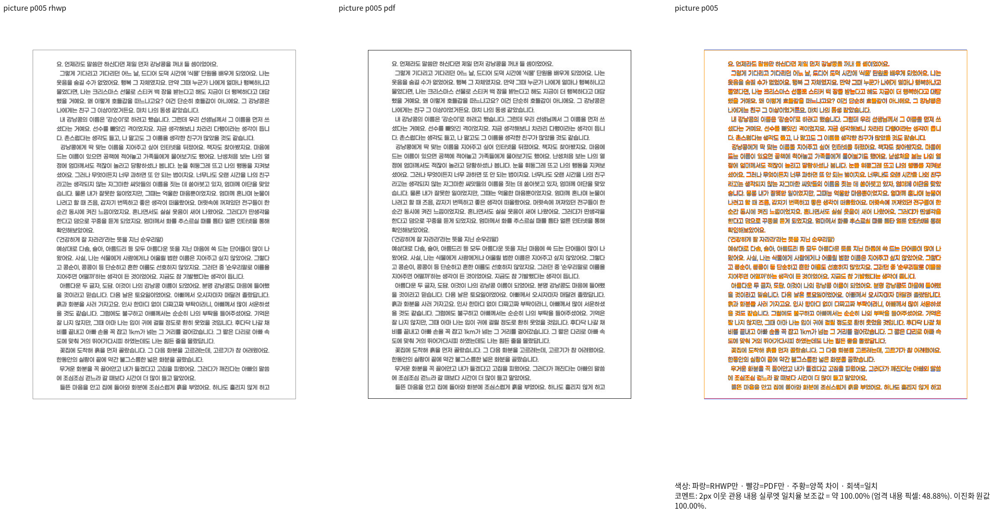
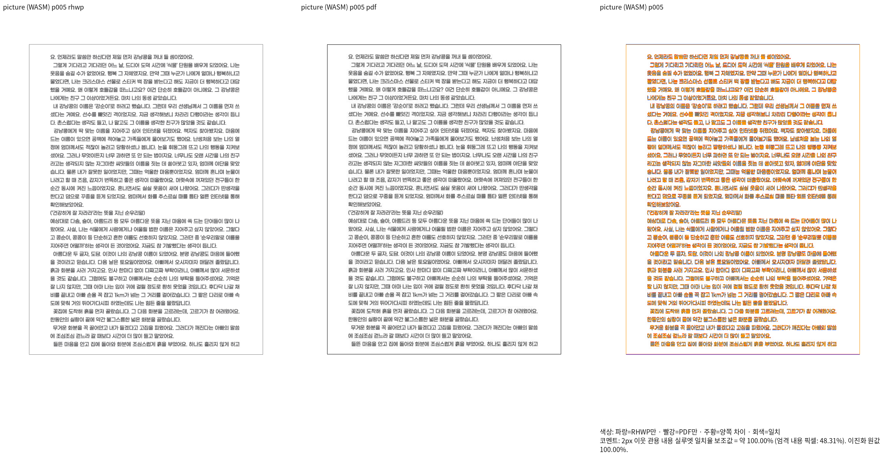
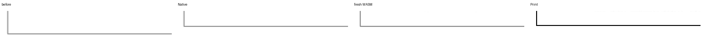

# #7642 부동 그림 스택의 투영 줄 높이 이중 재계산 보정

Issue: #7642

## 보정 전 독립 근거와 호출 경로

제품 `221c9e8c2`의 실제 그림 스택 5쪽은 99.24%여도 아래 괘선이 Print보다 약 8px 아래다.
원본 `samples/issue2004_cell_image_stack.hwp`, 독립 `pdf/issue2004_cell_image_stack-hwp-2020.pdf`.
8쪽 전체의 Native 최저97.80938%, fresh WASM 최저98.21964%, 쪽수8/8 일치.
원본 dump1708, 기존 진단 플래그의 실행 로그1709, 직접 review1700을 ignored output에 보존했다.

- 생산: `queries/rendering.rs::reclassify_cell_floating_stacks`는 원본 5개 부동 그림을
  렌더 사본의 그림별 문단으로 분리한다. 그림2의 높이63057HU, 줄간격0으로 계산했다.
- 측정: `table_layout.rs::compose_cell_unit_paragraph`가 공유 셀 composer를 호출한다.
  `recompose_cell_lines_in_frame`은 합성 단일 줄을 일반 NO_LS 입력으로 보아 캐시를 비우고
  다시 채워 문단의 160% 줄간격에서600HU=8px를 더한다. unit 높이848.76px는
  실제 그림840.76px보다 정확히8px 높다. 마지막 그림은 뒤 줄이 없어 증분이 없다.
- 실제 배치도 같은 셀 composer를 읽지만 이미 확정된 더 큰 unit 높이가 조각 상자·정렬의
  예약에 쓰인다. `table_partial.rs`의 projected_content는 전쪽 상자로 늘리는 분기만
  막고, 이8px의 잘못된 요구 높이를 제거하지 못한다.
- 독립 PDF의 아래 선y697.877014pt/종이841pt를 원본84188HU로 정규화하면 약931.48CSSpx.
  현재 표 상자 끝939.68은 정확한 기존 회귀의 ±2px를 벗어난다. 기존 기대값을 유지한다.

## 적용할 공통 규칙

이미 정규화에서 확정한 개체 흐름 줄과 재조판이 필요한 합성 줄을 출처로 구분한다.
새 렌더 전용 provenance를 원본·wire 값에서 추측하지 않고 투영을 생산한 경계에서 설정한다.
문단 입력 무효화·줄 교체·문단 분할은 이 표시를 지운다. parser·serializer의 원문 계약은 그대로다.
셀의 공유 composer는 이 출처의 확정 줄을 그대로 소비해 측정과 실제 배치의 줄간격이 같게 한다.
일반 NO_LS·일반 합성 단일 줄은 기존 재조판 경로를 유지한다. 문서 ID·숫자·원시 속성 조합으로
예외를 고르거나 paint 테두리를 clamp하지 않는다.

## 검증 계획

정확한 기존 그림 스택5쪽 검사와 정상 대조군, 원본8쪽 Native/fresh WASM 재산출·아래 괘선
확대 판독을 먼저 확인한다. 새 회귀는 이름을 새로 만들고 전쪽90% 이상과 직접 판독 뒤 추가한다.
출처가 없는 일반 합성/NO_LS 줄은 계속 스타일에 따라 재조판되는 반례를 확인한다.
이후 전체 범위와 필수 Rust·WASM 게이트를 새 제품 source에 연결한다. 이전 head의 전쪽 결과를
수정 후 증거로 재사용하지 않는다. Cargo는 공유 target/pr-review, 빌드 잡8로 순차 실행한다.

## 구현과 검증 결과

렌더 전용 `Paragraph.layout_object_projection`을 추가하고, 개체 스택을 투영하는 생산 경계의
`publish_object_projection`에서 확정 줄과 출처를 함께 발행했다. 입력 무효화·줄 교체·분할은
이 표시를 지운다. IR 직렬화·필드 비교에서는 제외한다. 셀의 공통 composer가 이 출처의 줄을
다시 채우지 않아 원본 그림의 높이·간격을 측정과 실제 배치가 공유한다.

`stage1709-picture-units.log` → `stage1725-picture-units.log`에서 그림2 유닛 높이는
848.76→840.76 CSS px다. 실제 그림 자체의 높이840.76은 바뀌지 않았다. 앞 네 그림의
잘못 더해진8px가 제거되고 마지막 그림은 원래 높이를 유지한다. 5쪽 셀·표 상자의 실제
끝은 약931.68로, 독립 Print의 정규화931.48과 약0.20px 차이다. paint에서 상자를 잘라
맞추는 코드는 추가하지 않았다.

Native 빌드1711, fresh WASM 빌드1712 모두 성공, 8개 빌드 잡과 공용 target/pr-review 사용.
원본8쪽의 양쪽 전쪽 TSV를 먼저 측정한 뒤4·5·8쪽 review·overlay를 만들었다.
Native 최저97.80938%, WASM 최저98.21964%, 양쪽 전체8쪽 일치. 5쪽은 양쪽100%다.
Native·WASM 5쪽과 아래 괘선을 독립 Print와 직접 판독했다.

[Native standalone overlay](assets/issue7642/picture_projection_20261016/native-p005-overlay.png)

| 검증 | 실제 결과 |
| --- | --- |
| 정확한 기존 `projected_picture_fragment_does_not_claim_a_stored_page_frame` | 수정 전1628 실패 → 수정 후1719 통과. 독립 PDF 좌표 기대값·±2px 유지 |
| 이전12개 실패가 있던10개 모듈과 새 수식 모듈의 실제51검사 | 40 PASS / 11 FAIL. 전체 Rust gate가 아닌 집중 검증 |
| 정상 대조군 | 표 상단·마지막 조각·저장 줄/빈 호스트의 유닛 보존 검사 통과. 캐시 없는 일반 수식의 가운데 정렬, 일반 인라인 수식 읽기 순서 검사도 통과 |
| 새 연산자 첨자 검사 | 3개 모두 계속 통과 |
| 전체 rustfmt | `cargo fmt --all -- --check` exit0 |

기존 정확한 회귀를 바꾸지 않고 구현을 고쳤다. 원래 실패 중 남은11개는 미해결이며,
새롭게 이름만 바꾼 중복 검사를 추가해 그 실패를 감추지 않는다. 새 시험지 회귀 추가는
기존 지침의 새 이름·시각 선행 조건을 그대로 따른다.

### 입력과 실행 증거

- 입력 SHA-256: `c633fd086323075ab25777d8ee10357869d037bd17c9e74d444d5b8297c40d50`.
- 독립 Print PDF SHA-256: `b5e2f962620d8d7cdd2ec8b10571c53fbe959eb9ce7b3428ff09a595f12fee90`.
- native TSV: `stage1720-picture-projection-review/native-tsv/picture/silhouette.tsv`, SHA-256 `47384285e97d8b3b06152ead1fa16cfb149e1c657fef31acdd88646683090d75`.
- wasm TSV: `stage1720-picture-projection-review/wasm-tsv/picture/silhouette.tsv`, SHA-256 `c17f137e139747c567bb00a88cd254c8f2fe88b4e9b3f23b8a5b759969615835`.
- `stage1711-current-native.json`, `stage1712-fresh-wasm-build.json`: 제품 source 파일별 해시·dirty diff 해시·명령·산출물 해시. 제품 소스가 빌드 전후 동일함을 확인했다.
- `stage1711-native-path-deps/receipt.json`: 경로 의존 archive4개를 고정. worktree 전환 때 이름은 같아도 metadata가 달라지는 vendor/svg2pdf도 포함한다.
- `stage1720-picture-projection-review/receipt.json`: 전쪽 TSV→대표 review 실행 순서와 명령.
- `stage1719-existing-failures/tests.log`: 기존 모듈의 실제 집중 회귀 결과.
- `stage1732-fmt.log`: 전체 rustfmt 결과.

위 로그·TSV·JSON은 ignored output에만 보존한다. 원본 HWP·기준 PDF는 기존 추적 파일을
그대로 재사용했다. 전체 범위의 최종 검증·PR·CI·merge 완료를 주장하지 않는다.
