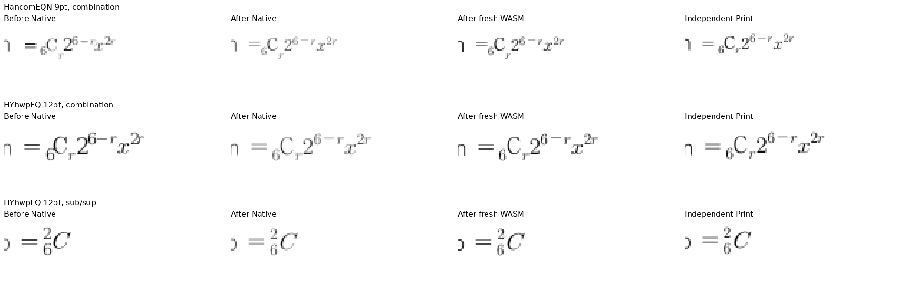
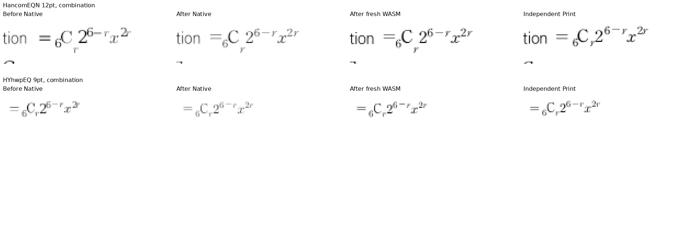

# #7642 수식 크기 보호와 표시 글리프 선택 분리

Issue: #7642

## 독립 근거와 적용 범위

기준 제품은 그림 높이 보정을 커밋한 `03073384f`다. 정상 한컴 저장본의 64개 수식을
로컬 HWPX로 내보내 양의 저장 크기·스크립트·문단·저장 줄·글꼴을 유지하고
`hp:sz@protect`만 0/1로 바꾼 두 입력을 만들었다. 수동 변경한 합성 대조군이며 시험지
원본의 축소본이 아니다. 두 face·두 크기에 각 16개 스크립트를 포함한다.

MCP `engine: 2020`, 실제 한컴 `11.0.0.9136`, `pdf_print_method: 0`,
`pdf_output_mode: hancom2020_pdf_driver_one_up`로 두 입력과 정상 HWP 저장본을 Print했다.
독립 Print는 원본 용지·전체 8쪽·한 쪽씩 출력이다. 두 raw 입력의 Print는 96dpi 전쪽 PNG가
바이트 단위로 동일하다. 정상 HWP를 실제 모델로 읽어 미보호 0/64·보호 64/64도 확인했다.
한컴이 속성을 지우거나 무시한다는 가정으로 동일 출력을 설명할 수 없다.

로컬 HWPX 재내보내기만으로 양쪽 0을 관측했던 1736단계는 writer의 속성 누락 때문에
불충분한 증거였다. 실제 정상 HWP 파싱 결과 1737단계로 바로잡았다. 시험지
`3-09월_교육_통합_2022.hwp`의 538개 수식은 모두 보호가 꺼져 있어, 이번 수정은 그 시험지
8쪽 하락의 원인 해결이 아니다. 시험지 수식 원점·첨자·정체 표시 차이는 별도로 추적한다.

## 수정과 소비 경로

`EqLayout::for_equation`의 `!size_protect` 조건이 보호 수식에 일반 글리프 경로를 선택했다.
지원 face의 글리프는 동일한데 크기 보호가 표시 글리프와 전진폭을 바꾸던 원인이었다.
크기 보호 조건을 제거하고 face에 따른 기존 경로를 사용한다. 그 결과를 측정과
SVG·Canvas·Skia가 함께 소비한다. 저장 프레임 수용·편집 크기 보호의 기존 조건은 유지한다.

`render_equation`은 true인 크기 보호를 `hp:sz@protect="1"`로 보존한다. false는 기존의
유효한 생략 표현을 유지한다. 정상 한컴 저장 HWP에서 true가 유지되는 것과 현재 writer에서
유실되는 사실을 독립 근거로 삼았다.

## 시각 검증

1745 Native와 1746 fresh WASM은 같은 제품 source hash로 빌드했다. 출발 SHA는
`03073384fdf94e73f9328358cf7e90dbc8a1439e`이며 제품 diff hash·파일 hash·실행 명령은
각 producer receipt에 기록했다. Cargo 8잡, 공용 `target/pr-review`를 순차 사용했다.
빌드 중 source 불변과 root `pkg/`·Studio public의 JS/WASM hash 일치도 확인했다.
JS wrapper의 추적 내용은 이번 변경으로 달라지지 않았다.

| 입력 | 보정 전 Native 최저 | 보정 후 Native 최저 | 보정 전 WASM 최저 | 보정 후 WASM 최저 |
| --- | ---: | ---: | ---: | ---: |
| 미보호 HWPX·정상 HWP | 99.18280% | 99.18280% | 99.16442% | 99.16442% |
| 보호 HWPX·정상 HWP | 97.94494% | 99.18280% | 98.62899% | 99.16442% |

네 파일 각각 8쪽을 먼저 TSV로 산출했다. 양쪽 모두 전쪽 Print 쪽수와 일치하고 누락·90% 미만
쪽이 없다. 이어 대표 review·overlay를 생성했다. RHWP로 재저장한 보호·미보호 HWPX도
각각 MCP Print를 재산출했으며, 양쪽 전쪽 최저가 99.18280%·99.16442%로 유지됐다.

두 face·두 크기의 조합식, 7·8쪽 아래첨자·위첨자·뒤 항과 고아 첨자 대조군을 같은 배율로
직접 확인했다. 보호 속성 때문에 바뀌던 글리프와 첨자 관계가 Print에 맞게 개선됐다.
잉크 농도와 안티앨리어싱 차이는 남는다. 100% 실루엣을 모든 픽셀의 동일성으로 해석하지 않는다.

[Native 7쪽 review](assets/issue7642/size_protection_20261016/native-p007-review.png),
[WASM 7쪽 review](assets/issue7642/size_protection_20261016/wasm-p007-review.png),
[Native 독립 overlay](assets/issue7642/size_protection_20261016/native-p007-overlay.png).

## 새 이름 회귀와 수정 전후 검출

전쪽 시각 조건과 확대 판독을 충족한 뒤
`tests/cases/verified_hancom_size_protection.rs`를 추가했다. 보호/미보호 두 입력의 표시 글리프 수·
본체 기준 상대 위치·원본 소유·순서·누락·중복과, HWPX 저장 후 보호·내용·저장 크기 보존을 검사한다.
7·8쪽은 양쪽 100%이고 독립 Print 원점을 확인해 핵심 위치를 ±2 CSS px로 보호한다.

첫 작성안은 보호된 저장 프레임과 비보호 논리 프레임의 전역 줄 원점까지 완전히 같다고
가정해 0.04 CSS px 차이로 실패했다. 보호 프레임과 글리프 선택을 분리하는 계약에 따라
본체 기준 상대 글리프 관계와 독립 Print의 실제 좌표 검사로 역할을 분명히 했다.
현재 실측 차이에서 허용치를 정하거나 기존의 정확한 검사를 완화하지 않았다.

같은 최종 검사 소스·입력을 수정 전 1711 제품과 수정 후 1745 제품에 각각 연결했다.
수정 전에는 표시 관계와 보호 저장 보존 2개가 실제 원인으로 FAIL, 좌표 검사 1개는 PASS였다.
수정 후에는 3개 모두 PASS다. 이 사실을 세 검사 모두의 수정 전 실패로 과장하지 않는다.
기존 실패 모듈과 함께 실행한 1768단계는 **54개 중 43 PASS·11 FAIL**이며, 남은 11개는
이전 1719단계와 같은 검사다. 전체 Rust 회귀 gate를 통과한 결과가 아니다.

입력 HWP/HWPX와 독립 PDF는
[공식 대조군 기록](../../tests/fixtures/equation-font-metrics/size-protection/HANCOM_SIZE_PROTECTION.md)에
SHA·MCP job·전쪽 점수·실행 기록을 연결해 함께 보존했다. 로그·TSV·JSON·다음 실행 기록은
ignored output에만 두며 Git에 넣지 않는다.

## 남은 검증

기준 `upstream/devel`은 `4662c069e557e928ed7968d061121fde90b1f027`이며 현재 브랜치에 이미
포함돼 있다. 새 fetch에서도 같은 HEAD여서 추가 rebase하지 않았다. 이전 제품 source
`221c9e8c2`의 74문서 1,274쪽은 Native/WASM 모두 90% 이상이지만, 기준 대비 0.01%p 이상
하락한 쪽이 Native 74쪽·WASM 55쪽이다. 이 보정의 대조군 통과로 그 하락을 면제하지 않는다.
현재 제품의 최종 전쪽 재검증·하락 보정·남은 Rust 실패 해결이 필요하므로 PR 준비 미완료다.

실행 기록은 `output/pr-review/issue7642/failed-inputs-20261008/stage15-current-validation/`의
`stage1745-current-native.json`, `stage1746-fresh-wasm-build.json`,
`stage1747-current-native-scope/receipt.json`, `stage1748-new-base-wasm-scope/receipt.json`,
`stage1752-size-protect-reexport-mcp.json`, `stage1754-current-native-scope/receipt.json`,
`stage1755-new-base-wasm-scope/receipt.json`, `stage1767-protected-regression/receipt.json`,
`stage1768-existing-failures/receipt.json`에 있다.
