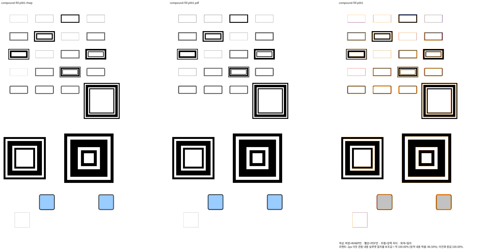
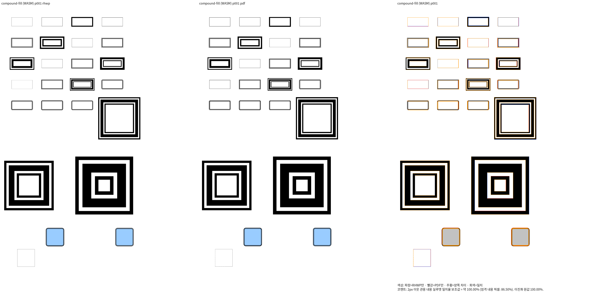
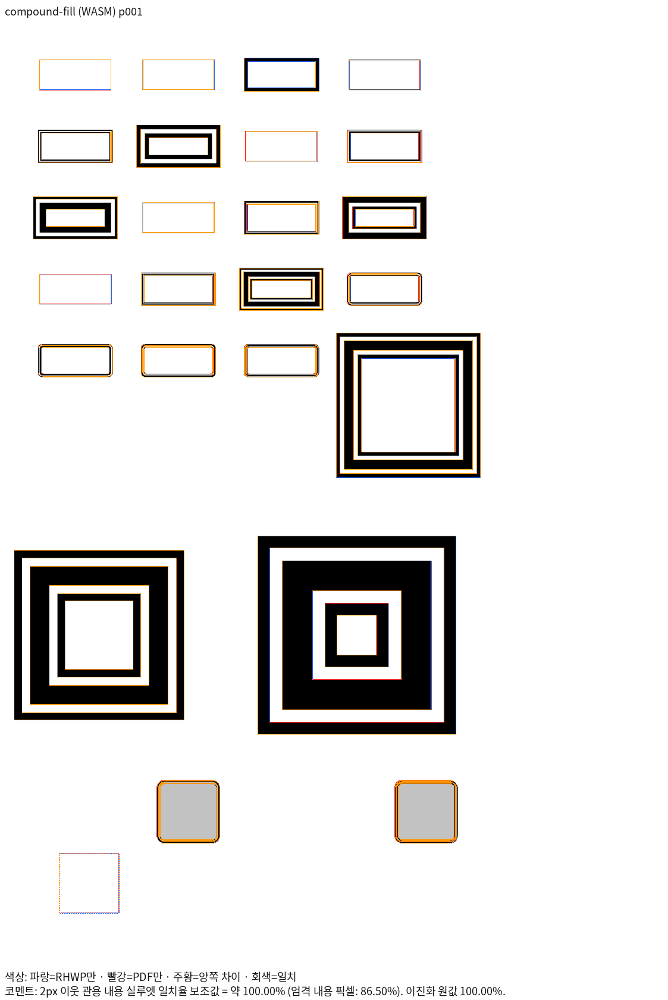
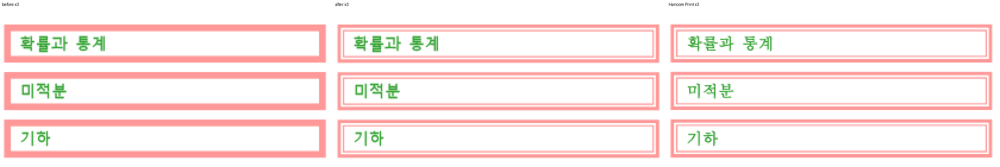
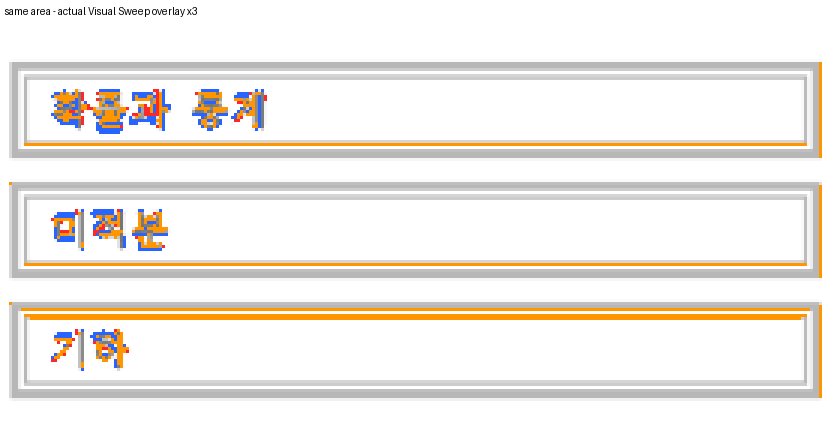

# #7642 복합 사각형 테두리의 공통 기하 복원

Issue: #7642

## 근거와 범위

이전 재현·재검증은 `7c082b0a3f`에 커밋했다. 사용자는 PDF의 이중선이 RHWP에서
단선으로 합쳐진 점을 다시 지적했다. 같은 굵기 이중선, 가는/굵은 이중선,
굵은/가는 이중선, 삼중선의 닫힌 사각형을 우선 보정한다.

원본 HWP의 선 속성 8..11은 parser/model에 보존된다. 현재
`layout/utils.rs::drawing_to_shape_style`은 `hwp_shape_line_type`의 dash만 읽고
`LineRenderType`을 버린다. `shape_layout`이 생성한 Rectangle은 각 backend에서
단일 stroke로 소비된다. 직선·표 테두리의 다른 비율을 그대로 재사용하지 않는다.

정상 한컴 저장본의 독립 Print에서 60/425/1600 HU를 비교했다. 같은 굵기 이중선은
전체 선폭의 1/3씩인 두 띠와 빈 간격, 가는/굵은 이중선은 0.2/0.3/0.5,
굵은/가는 이중선은 0.5/0.3/0.2의 띠·간격이다. 선폭과 띠 경계는 600dpi 장치
격자에서 관측됐다. 홀수 장치 폭은 양쪽 경계가 비대칭일 수 있다. 삼중선은 3200/6400/10000 HU까지 확대해 0.15/0.16/0.38/0.16/0.15의
선·간격 비율을 확인했다. 600dpi에서 반올림한 전체 폭과 각 부호 있는 경계의
올림값이 60/425/1600/3200/6400/10000 HU 여섯 폭의 독립 Print 띠와 일치한다.
예를 들어 장치 폭 833의 삼중선은 125/133/317/133/125 장치 단위다.
임의 화면 px 비율이 아닌 독립 장치 벡터의 일반 규칙을 사용한다.

## 공통 결과와 소비 경로

- Rectangle의 채우기·그라데이션·원본 소유·흐름 bbox·글상자는 유지한다.
- 원본의 복합 선 종류와 선폭에서 닫힌 띠를 공통 Path로 만든다. 빈 간격은 흰색으로
  덮지 않고 반대 winding의 내부 윤곽으로 뚫는다.
- image fill 뒤, 글상자 앞에 border Path를 방출한다. Rectangle의 단일 stroke만
  대체한다. Path는 같은 원본 소유와 같은 중심의 회전·대칭을 소비한다.
- Native Skia, Canvas2D, SVG는 같은 Path를 그린다. 특정 문서나 화면 좌표를
  조건으로 두지 않고 도형의 비등방 크기에 펜 굵기를 다시 곱하지 않는다.
- 단선·점선·선 없음은 기존 경로를 유지한다. 내부 구멍이 사라지는 넓은 펜과
  둥근 모서리도 기하의 유효 범위로 처리한다.

## 검증 순서

1. 정상 한컴 저장과 Print를 확인한 추가 대조군의 폭·선·간격을 독립 측정한다.
2. 확인한 공통 규칙을 한 번에 구현하고 같은 source의 Native/fresh WASM을 순차 빌드한다.
3. 대조군 전쪽과 원본 수학 23쪽, 국어 HWP/HWPX의 전쪽 TSV 및 대표 영역을 다시 확인한다.
4. 모든 관련 페이지의 양쪽 90% 이상과 직접 판독 뒤 새 이름의 정식 관계 회귀를 추가한다.
   완료 페이지의 양쪽 98% 조건을 만족할 때만 독립 좌표의 ±2px 검사를 보완한다.
5. 동일 검사 source의 수정 전 FAIL/수정 후 PASS와 기존 정상 대조군을 확인한다.

국어의 얇은 단선 래스터와 HFT 윤곽 차이는 별도 미해결 상태다. 복합선 개선을 그 차이의
해결이나 전체 PR gate 완료로 보고하지 않는다. 로그·TSV·JSON·다음 실행 인계는 output에 둔다.

## 구현·부분 검증 결과

`shape_layout.rs`의 Rectangle 생성 뒤 공통 모듈 `shape_layout/compound_rectangle.rs`를
호출했다. 동일 bbox·소유·변환을 가진 하나의 Path에 닫힌 띠와 반대 winding의 구멍을
만들며, 채우기 위에 흰색 선을 덧그리지 않는다. 선 색상·투명도를 보존한다.

공통 output 경로는
`output/pr-review/issue7642/failed-inputs-20261008/stage15-current-validation/`이다.
`stage1904-current-native.json`과 `stage1905-fresh-wasm-build.json`은 같은 source 해시로
Native/fresh WASM을 순차 빌드했다. source는 `7c082b0a3f` 위의 수정이며 새 공통 파일
SHA-256은 `7bd0dfe52129eff44d5f5239edbce3c547a74b88b8f37a52d5f00a7b10805dfb`이다.
공유 `target/pr-review`, 빌드 잡 8개를 사용했다.

정식 입력·Print PDF는 [fixture 기록](../../tests/fixtures/shapes/HANCOM_COMPOUND_RECTANGLES.md)에
생성 과정·버전·해시와 함께 보존했다. 정상 한컴 저장본 26개 도형의 전체 1쪽에서
Native/fresh WASM 모두 **84.78558% → 100.00000%**였다. 수정 전 producer는
`stage1876-current-native.json`/`stage1877-fresh-wasm-build.json`이며 현재 source로
오인하지 않도록 `stage1924`/`stage1925`에 표시했다. 수정 전 Sweep의 예상된 보류를
wrapper가 성공 종료만 허용해 실패로 처리한 점도 receipt에 기록했다.

| 경로 | review | 같은 쪽 standalone overlay |
| --- | --- | --- |
| Native |  |  |
| fresh WASM |  |  |

직접 판독에서 이중선·삼중선의 띠와 빈 간격, 가는/굵은 순서, 둥근 모서리,
간격으로 드러나는 파랑 채우기를 확인했다. 단선 래스터 농도 차이는 아직 남는다.
수동 회전 속성과 행렬이 불일치했던 별도 입력은 독립 회전 증거로 사용하지 않았다.

전쪽 TSV는 `stage1920-compound-fixture-tsv/{native,wasm}/silhouette.tsv`에 있다.
새 이름의 관계 검사 4개는 `stage1926-compound-regression-proof/`에서 수정 전
3 FAIL/정상 대조군 1 PASS, 수정 후 4 PASS였다. 기존 관련 도형·테두리·수식 검사
36개도 `stage1922-compound-existing-controls/tests.log`에서 전부 PASS였다.
절대 px 좌표를 추가하지 않았으며 전체 Rust gate의 결과로 보고하지 않는다.

## 원본 수학 문서의 확대 대조와 남은 검증

원본 `samples/3-09월_교육_통합_2022.hwp`와 독립 Print
`mydocs/pr/assets/pr_7600_control_print_20261006/input-01-3-09월_교육_통합_2022-2020.pdf`의
8쪽에 있는 분홍 이중선도 단선 띠에서 실제 복합선으로 바뀌었다.

| 같은 영역의 수정 전·후·Print | 실제 Sweep overlay의 같은 영역 |
| --- | --- |
|  |  |

전체 페이지 증거: [review](assets/issue7642/compound_rectangles_20261016/math-native-p008-review.png),
[overlay](assets/issue7642/compound_rectangles_20261016/math-native-p008-overlay.png).
확대 이미지는 같은 좌표를 최근접 3배 확대한 진단이며 재정렬·색상 변경을 하지 않았다.

이 쪽의 Native 점수는 98.46641%에서 98.44463%로 0.02178%p 낮아졌다.
`stage1923-original-math-compound-detail/silhouette-decline-analysis.json`에서
미해결 실루엣은 수정 전후 같은 위치의 933픽셀로 변화가 없었다. 잘못 채워졌던 선
사이의 잉크가 줄어 내용 합집합이 60,642에서 59,793픽셀로 감소하면서 같은 미해결
픽셀의 비율이 커졌다. 이 설명으로 수치 무회귀 gate를 면제하지 않는다.
현재 고정한 devel `0953598d8e08af5e9149b3e4cdbbbf2f5f2bae64`와의 전쪽 비교,
단선·HFT 차이 보정, 전체 Rust 검증은 아직 완료되지 않았다.

`stage1917-compound-native-scope/receipt.json`의 34문서·225쪽은 전쪽 수치 90% 이상과
쪽수·누락 여부를 확인했다. 같은 범위의 fresh WASM은 `stage1918-compound-wasm-scope/`에서
진행 중이다. 전체 범위의 직접 판독·무회귀를 완료하거나 PR 준비 완료로 판정하지 않는다.
