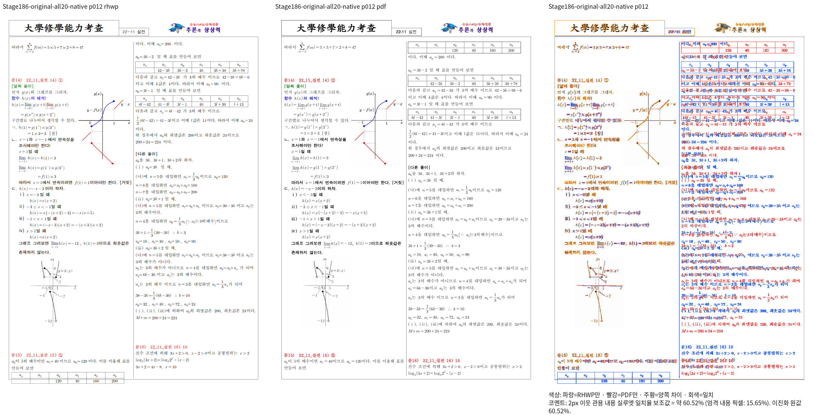
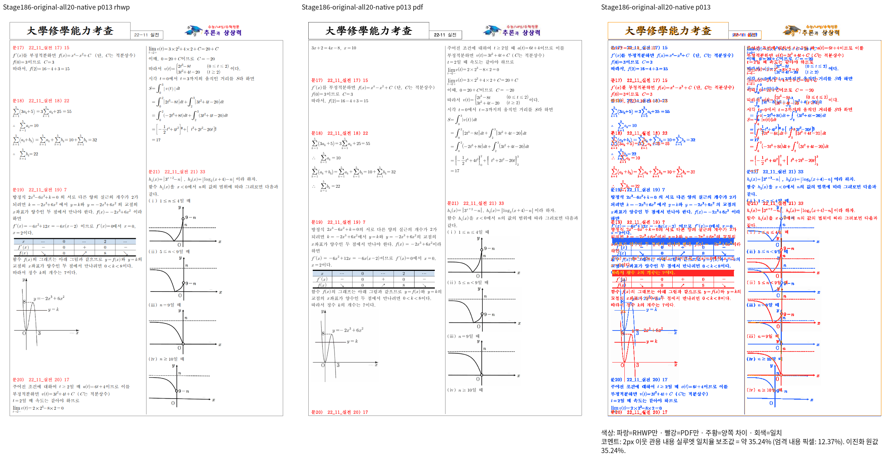
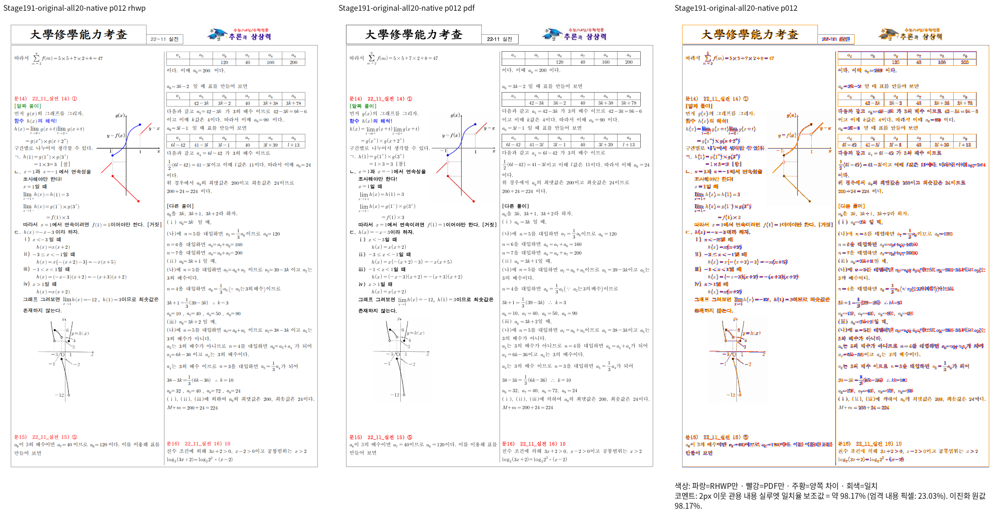
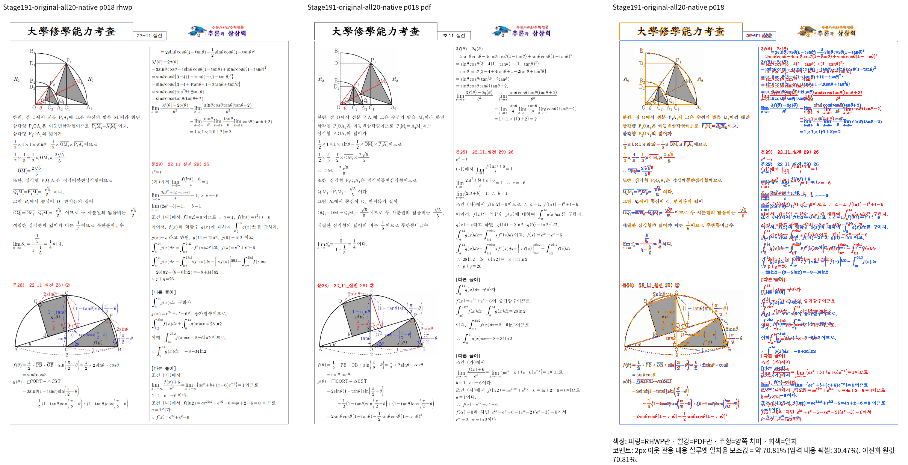

# #7642 Stage 191 — 미주 단 끝의 독립 TAC 표 수용

Issue: #7642

## 독립 근거와 원인 경로

`samples/3-11월_실전_통합_2024-구분선위0미주사이20구분선아래2.hwp`와 대응 HWPX는 Native 전쪽 검증에서 12~20쪽이 미달이다. 독립 한컴 2024 Print PDF의 12쪽은 문15의 첫 표를 오른쪽 단 첫머리에 놓지만, 현재 source `b9ef5267658bcaaeeb8fb81d5e3934422f60ec16`은 이 표를 왼쪽 단 끝에 놓아 본문 하단을 넘긴다. 같은 본문의 `[다른 풀이]`와 문16 제목은 약 39.9px 위에 있고, 다음 쪽 제목의 누적 차이는 약 87.5px다. 이 수치는 진단 관측값이며 회귀 기대 좌표가 아니다.

`compat 2024`로 같은 원본·PDF·바이너리를 대조한 12·13쪽 진단도 최저 35.23876%, 두 쪽 모두 미달이다. 호환 프로필 변경을 시각 개선으로 보고하지 않는다. HWPX 원본의 문15 미주 문단2는 본문 문자열 없이 2행 6열 TAC 표 하나를 소유한다. 저장 호스트 글줄은 표 높이 2542HU를 소유하며 표는 원본의 오른쪽 단에서 시작한다. 원본 HWP의 줄·컨트롤 trace는 별도로 확인한다.

현재 `typeset_endnote_flow_tables`의 진입 조건은 비 TAC TopAndBottom 표만 받는다. TAC 표는 문단의 근사 높이 fit 후 `endnote_paragraph_items`에서 Table로 방출되어, 표 전용 문단의 실제 글줄 수용과 본문 TAC 표 수용이 달라진다.

수정 후보 경로는 `표 전용 문단 판별 → 공유 HeightMeasurer/format_table → 같은 단의 실제 flow_bottom → 기존 typeset_tac_table의 원자적 fit/이월 → 기존 Table paint`다. 독립 TAC 표도 기존 본문 TAC 경로에서 수용한다. 여러 인라인 표가 같은 줄에 있는 문단, 본문과 표가 섞인 문단, 독립 float·Square·배경 개체는 이 단일 표 경로로 확장하지 않는다. 기존 비 TAC 표의 분할·이어받기 경로는 유지한다.

## 검증 계획과 현재 한계

Stage190 fresh WASM 빌드와 전쪽 검증의 source를 보존하기 위해 이 후보를 별도 worktree에서 준비한다. Cargo는 앞 작업이 종료된 뒤 공용 `/home/tsjang/rhwp/target/pr-review`에서 순차 실행한다. 현재 후보는 미검증이며 개선 완료나 정식 회귀 추가 조건 충족으로 판정하지 않는다.

1. 원본 HWP의 문15 미주 문단2가 대응 HWPX와 같은 실제 TAC 표 소유인지 확인한다.
2. 후보 Native에서 해당 표의 단 소유, 하단 포함, 뒤 문단 순서와 12·13쪽 직접 비교를 먼저 확인한다.
3. 미주 간격이 다른 정상 대조군과 원본 HWP/HWPX 전체 페이지를 재검증한다.
4. Native/fresh WASM 전쪽 90% 이상과 직접 확대 판독 뒤 새 이름의 관계형 회귀를 추가한다. 해당 테스트는 표·문단 소유와 포함·순서를 검사하며 위 진단 좌표를 고정하지 않는다.

TSV·진단 JSON·명령·실행 로그는 ignored `output/pr-review/issue7642/failed-inputs-20261008/stage15-current-validation/`에 보존한다. 기준 PDF는 기존 Print 출력이며 이번 진단에서 내용을 변경하거나 재저장하지 않았다.

## 원본 소유 확인과 수정 전 증거

원본 HWP 진단 명령은 `rhwp-stage190-structural-contract dump-endnote-lines <원본.hwp> 0 128 0 2`다. 실제 결과는 `source=s0:p128:ci0 endnote_no=15 note_paras=20`, `note_para=2`, 빈 텍스트, 컨트롤 1개, 저장 글줄 1개, `vpos=0 lh=2542 gap=452`, `Table pos=0 tac=true rows=2 cols=6`이다. HWPX 대조군과 같은 소유·글줄 구성을 확인했다. `dump`와 trace가 출력한 실제 overflow도 `page=11 col=0 para=557 type=Table`, 본문 하단 밖 16.3px로 대응한다. 이 진단 좌표를 테스트에 고정하지 않는다.

이 이미지의 실제 렌더 source는 `b9ef5267658bcaaeeb8fb81d5e3934422f60ec16`이다. Stage191 후보 출력으로 표시하지 않는다. 정확한 입력·PDF·바이너리 해시와 canonical 이미지 합성의 입력 해시는 ignored `stage191-gap-native-review/receipt.json`에 있다. 후보 Native 전쪽 TSV는 별도 출력 디렉터리에 산출하며 이전 캡처를 재사용하지 않는다.

## 사전 빌드

공용 target에서 `cargo check --locked --lib --bin rhwp --target-dir /home/tsjang/rhwp/target/pr-review`는 exit 0, 87.71초다. Native 실제 출력·fresh WASM·정식 회귀는 아직 미검증이다.

## 후보 Native 전쪽 결과

source `22966ae42be189ac900f7e665df0741c244015c5`의 Native 빌드는 exit 0, 348.90초이며 source 해시 유지와 불변 바이너리 SHA-256 `fd19f1fbb4b287c34054aab5b37c8e849f1348458404986d9206e304ce6dc0ba`를 확인했다. 원본 HWP의 실제/기준 쪽수는 모두 22쪽이다. 모든 쪽을 측정했고 미달 쪽은 기존 12~20쪽에서 18·19·20쪽으로 줄었다. 전체 최저 39.65261%이므로 전체 통과·회귀 추가 조건 충족으로 판정하지 않는다.

12쪽은 60.51745%에서 98.17287%로 개선됐다. 직접 연 새 review에서 문15의 표가 오른쪽 단 첫머리로 넘어가고, 표 외곽·뒤 본문·문16 제목이 Print에 대응함을 확인했다. 13~17쪽도 90% 이상이다. 일부 수식 기호/간격 차이는 따로 확대 확인하며 점수만으로 면제하지 않는다.

18쪽은 70.81327%이며 오른쪽 단 시작 내용이 Print보다 한 줄 먼저 이어진다. 대응 HWPX의 문28 미주 문단3(본문 source `s0:p318:ci0`)에서 마지막 저장 줄이 vpos=0으로 재시작하는 것을 확인했다. HWP 원본의 해당 줄 메타데이터는 추가 trace가 필요하며, Print에서는 실제 줄 구성에 따라 왼쪽 단에 남는다. 현재 RenderTree는 가상 문단804를 양쪽 단으로 분할한다. 저장 경계와 실제 줄 점유의 소비 우선순위를 더 확인해야 하며, 단순 좌표 보정·기대값 변경으로 처리하지 않는다. 19·20쪽은 각각 39.65261%, 55.94188%이고 전파 원인까지 계속 보정한다.

정확한 명령·TSV·입력/기준 PDF 해시·전쪽 coverage는 ignored `stage191-all-20-whole-native/receipt.json`에 보존한다. HWPX·정상 대조군 queue는 같은 source에서 계속 실행 중이며 fresh WASM과 새 정식 회귀는 아직 필요하다.
