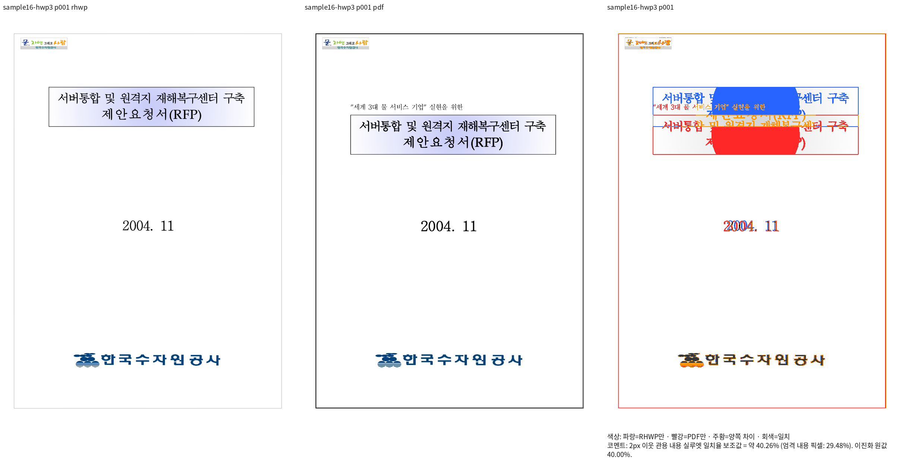
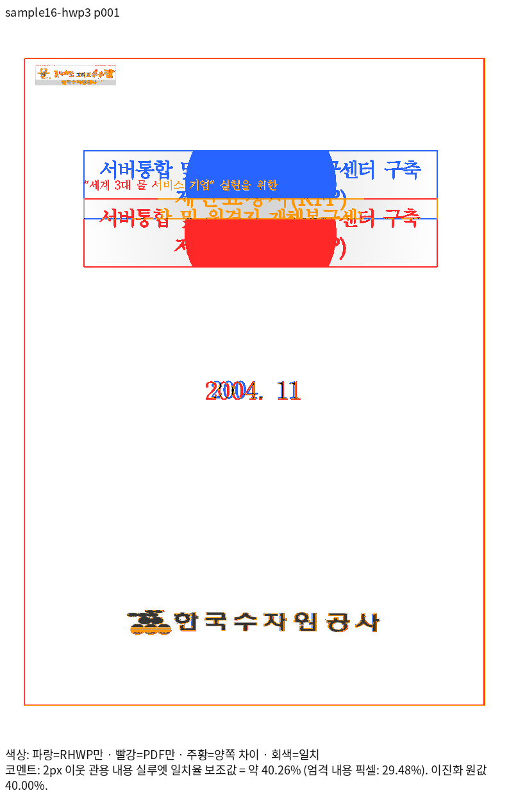
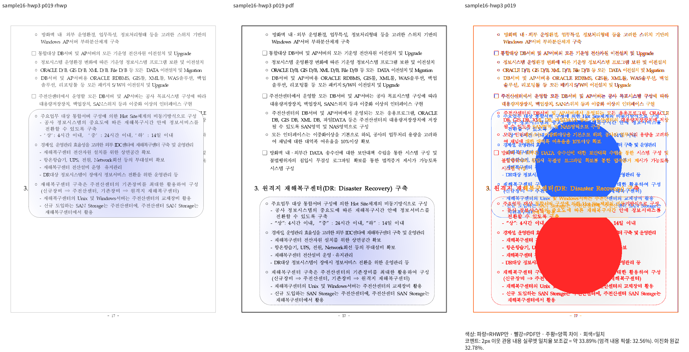
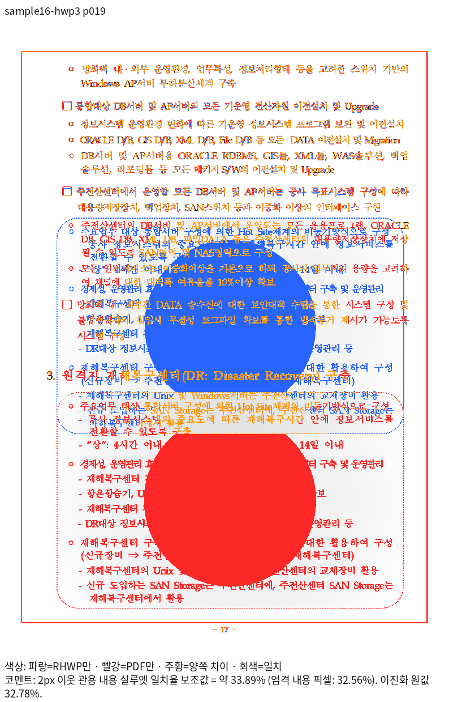

# #7642 전쪽 검증 범위 감사와 현재 devel 대조

Issue: #7642

## 고정 source와 범위

현재 제품 source는 `48e859305459a5fecd14866b446484ddb2bb48e8`이며 기반 devel은
`0953598d8e08af5e9149b3e4cdbbbf2f5f2bae64`다. 복합선 보정의 34개 항목·225쪽은
영향 대조군이다. 이를 기존 전체 범위의 완료로 보고하지 않는다.

이전 전쪽 목록 `stage1651-validation-catalog.json`의 74개 항목·1,274쪽을 대조하니
현재 34개와 겹치지 않는 항목이 49개·1,080쪽이었다. 원본·PDF의 SHA-256이 모두
기존 값과 같은 것을 확인했다. 별도 이전 대조군 목록에는 수동 Print를 확보하고 보정했던
`samples/hwp-3.0-HWPML.hwp` 122쪽과 `condensed-title` 1쪽이 있었다. 이 두 항목도
복구해 같은 head에서 재검증한다. 이전 실패 원본 4개·174쪽을 추가로 확인한다.

통합 범위는 89개 검증 항목·1,602쪽이다. 같은 원본/PDF/compat의 중복 2개를 제외하면
87쌍이다. 항목 수를 고유 문서 수로 바꾸어 보고하지 않는다. 현재 확인한 34개 외 잔여
55개·1,377쪽의 카탈로그는 ignored output의 `stage1935-expanded-rest-catalog.json`이다.
합성 입력의 정상 저장본을 원본의 대체 증거로 사용하지 않으며 기존 원본·Print를 유지한다.

## 실행 순서

공통 output 경로는
`output/pr-review/issue7642/failed-inputs-20261008/stage15-current-validation/`이다.

1. current producer 1904 Native / 1905 fresh WASM은 같은 production 해시로 고정했다.
   1917/1918에서 34개 항목을, 1936/1937에서 나머지 55개를 전쪽 측정한다.
2. clean base worktree를 고정 devel로 전환하고 1927 Native / 1928 fresh WASM을
   공용 `target/pr-review`에서 순차 빌드한다. 빌드 잡은 8개이며 기존 산출물을 삭제하지 않는다.
   1929/1930과 1938/1939에서 같은 원본·PDF·쪽·backend·compat·글꼴 조건을 측정한다.
3. 1931은 영향 34개 항목을 먼저 대조한다. 이후 전체 통합 비교에서 Decimal로
   0.01%p 이상 하락, 90% 미달, 쪽수·누락·측정 불가를 각각 기록한다.
4. 하락·구조 차이·사용자 지적 부분을 review와 실제 standalone overlay로 확대 판독한다.
   필요 수정은 원인별로 묶어서 반영하고 관련 시각 출력을 다시 확인한다.
5. 기존 전체 Rust 결과는 과거 source의 증거다. 실행 중인 base WASM이 끝난 뒤
   현재 head의 suite를 준비하고 전체 nextest, Native Skia 정식 범위, Rust lint와
   변경 범위별 검증을 순차 수행한다. 실패 원본의 시각 자격과 독립 기대값을 먼저 확인한다.

쪽수 검사도 내용 소속·보존과 함께 검증한다. 90% 통과만으로 직접 판독·무회귀를
완료 처리하지 않는다. 완료된 페이지의 양쪽 98%와 직접 판독 조건을 충족한 중요 위치만
±2px 회귀를 보완하며, 나머지는 새 이름의 관계 회귀로 보호한다.

## 상태와 남은 작업

복합선 수정은 커밋했고 관련 검사 40개는 통과했다. 국어 단선 농도·HFT 윤곽,
고정 devel 대비 하락, 최신 source의 전체 Rust·lint와 전쪽 직접 판독은 남아 있다.
전체 검증이 끝나기 전 PR 준비 완료로 판정하지 않는다.

모든 gate를 통과한 뒤 PR 전에 upstream/devel head를 확인하고 변경 시 rebase·재검증한다.
이후 사용자 승인된 PR 생성·CI 모니터링·merge, 옵션 2의 별도 review·오늘할일 PR,
merge 후속 처리를 진행한다. TSV·로그·JSON·다음 실행 기록은 Git에 넣지 않는다.

## 재검증에서 발견한 원본 배치 차이

34개 영향 대조군은 양쪽 전225쪽이 모두90% 이상이고 누락·쪽수 차이가 없다.
잔여 전쪽 실행에서는 `samples/hwp3-sample16.hwp`의 Native 최저33.88629%,
fresh WASM 최저34.31673%를 확인했다. HWPX의 Native 최저도33.61164%다.
64쪽 자체는 일치하지만 1·18·19쪽의 배치가 달라 완료로 판정할 수 없다.

| 원본 Native review | 같은 쪽 실제 overlay |
| --- | --- |
|  |  |
|  |  |

원본·독립 PDF의 SHA는 이전과 같다. `stage1944-inline-shape-source-trace/`에서
표지 TAC 도형의 원본 줄 높이7948HU·기준선6755HU, 19쪽 TAC 도형의 줄 높이28560HU·
기준선24276HU를 확인했다. 둘 다 원본 도형 높이와 줄 높이가 같다. 현재 배치는
본문 TAC 줄의 텍스트용 기준선으로 축소한 뒤 그 값을 도형 정렬에도 사용한다.
최근 도형 정렬 일반화가 축소 전 줄 상자와 텍스트 표시 축을 혼동했는지 실제 소비 경로를
대조하고, 해당 원인을 보정한다. 점수 미달을 기존 검사 삭제나 기대값 완화로 처리하지 않는다.
