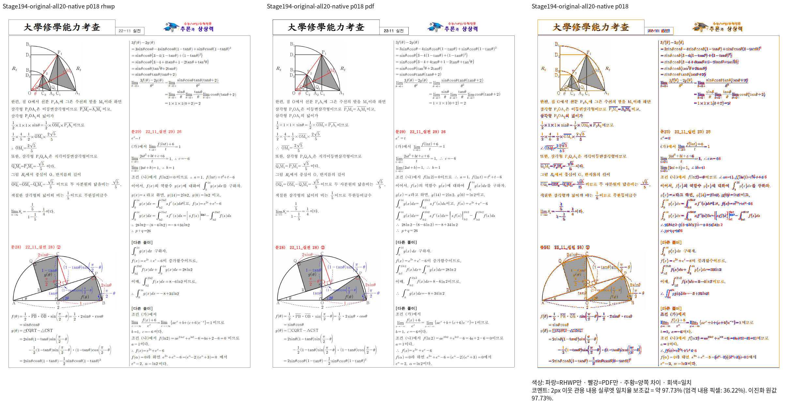
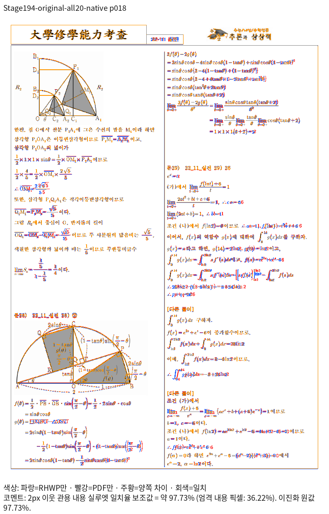
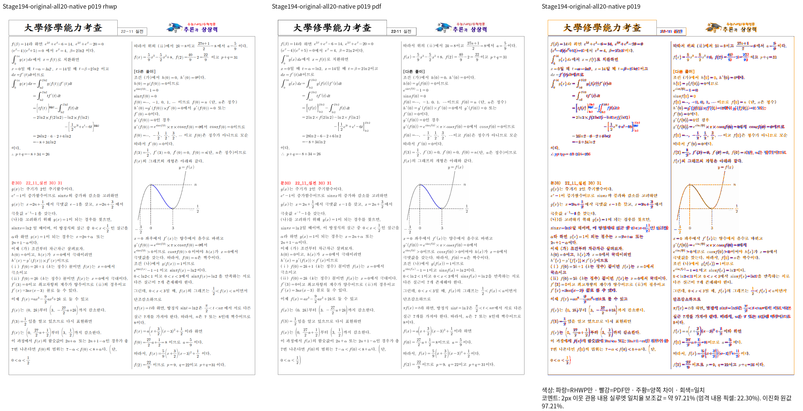
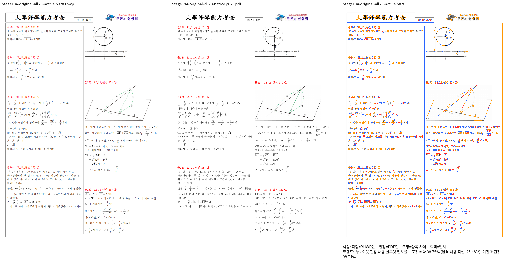

# 미주 수식 줄의 재발행과 저장 단 컷의 출처

Issue: #7642

## 동기화와 독립 근거

2026-10-13 `git fetch upstream devel` 뒤 기준 SHA는
`552f5228d2dbfd6046c838f14241704f1bcb8a05`다. 본 작업 브랜치와 후보 브랜치의
`git rebase upstream/devel`은 모두 이미 최신 상태로 종료됐다. 기존 커밋을 다시 쓰지 않았다.

원본 `samples/3-11월_실전_통합_2024-구분선위0미주사이20구분선아래2.hwp`와
독립 Print PDF `pdf/issue7642-equation-print/equation-19-3-11월_실전_통합_2024-구분선위0미주사이20구분선아래2-hwp-print-2024.pdf`를 유지한다.
Stage191 Native 원본·HWPX 전쪽 비교는 18·19·20쪽 미달이며, 원본의 최저값은
39.65261%다. 정상 간격 대조군 `all-19`는 전쪽 통과했다. 원본의 compatibility 2024
선택 쪽 비교도 같은 최저값·같은 미달 쪽이므로 단순 프로필 선택으로 해결되지 않는다.

원본 HWP의 `s0:p318:ci0:note3` 직접 trace는 4줄이며 마지막 줄의 저장 `vpos=0`을
확인했다. 첫 줄은 선언 높이 2070HU·내용 높이 1125HU이고 다음 줄은 내용 높이와
간격으로 전진한다. 이 첫 줄의 실제 포맷 높이는 12px이며 저장 선언 높이와 다르다.
진단 수치를 회귀 기대 좌표로 고정하지 않는다.

## 소비 경로와 수정 후보

`composer/stored_row_projection.rs::project_equation_rows`가 실제 줄 결과로 높이·간격·
후속 원점을 갱신한다. 미주 `row_projection.rs`는 이 결과를 `paragraph.rs`로 넘기고,
상태의 가상 미주 목록에 등록한다. `stored_ink_fit.inc.rs::stored_endnote_column_cut`는
태그와 되감김을 읽으며, 잉크 fit 및 `paragraph/reflow_fit.rs`의 전체 문단 fit 양쪽이
이 컷을 우선한다. 현재는 갱신한 세로 좌표도 원본 저장 경계로 취급한다.

후보는 실제 높이·간격·원점이 변경된 미주 문단의 출처를 상태 내부에 별도 보존한다.
해당 문단은 과거 단 컷으로 실제 fit을 강제하지 않으며 기존 공통 점유 측정을 사용한다.
폭·문자 분할·명시적 개행 정보와 원본을 변경하지 않는다. HWPX의 누락 원점 보정은
실제 메트릭 재발행과 구분하며, 그 보정만 있는 문단의 저장 컷은 유지한다.
수정하지 않은 세로 줄 정보에는 기존 저장 컷 계약이 적용된다.

이미 1000줄을 넘는 `paragraph.rs`에는 기존 호출 인수 한 줄만 교체한다. 새 분기와
출처 저장은 1000줄 미만인 모듈에 둔다. 후보의 실제 개선과 범위 일반성은 아직 미검증이다.

## 검증 순서

1. 진행 중인 Root 후보의 fresh WASM 빌드 종료 후 공용 `target/pr-review`에서 순차 빌드한다.
2. 원본 HWP/HWPX 전쪽과 정상 간격 대조군을 같은 Print PDF로 비교한다.
3. 18쪽 마지막 수식의 단 소유·뒤 문단 순서·하단 포함과 19·20쪽 전파를 직접 판독한다.
4. Native/fresh WASM 전체 관련 쪽 90% 이상과 확대 판독 후 새 이름의 관계형 회귀를 추가한다.

TSV·trace·receipt·실행 로그는 ignored `output/pr-review/issue7642/failed-inputs-20261008/stage15-current-validation/`에 보존한다.
현재 후보를 전체 검증 완료·PR 가능 상태로 판정하지 않는다.

## 사전 빌드

공용 target에서 `cargo check --locked --lib --bin rhwp --target-dir /home/tsjang/rhwp/target/pr-review`는 exit 0, 79.06초다. Native 실제 출력·fresh WASM·정식 회귀는 아직 미검증이다.

## Native 빌드와 18쪽 직접 비교

source `e265a235ca79c96cf2dcde3c92ad22c75e68bc3c`의 Native 빌드는 exit 0,
345.36초이며 전체 source 해시 유지와 바이너리 SHA-256
`251bf6446c6ebc50bea6994ec0b0ab6146ebb7a432ce29814defd05109d6c750`을 확인했다.
새로 출력한 원본 18쪽은 70.81327%에서 97.72749%로 개선됐다. 같은 입력·Print PDF를
사용했고 PNG 재사용 없이 `export-svg --embed-fonts=full --profile print --compat 2022 -p 17`
후 canonical raster/overlay/review 함수를 실행했다.

직접 연 이미지에서 문28의 마지막 수식 줄이 왼쪽 단에 남고, 오른쪽 단은 다음 문단의
`3f(θ)-2g(θ)`로 시작함을 확인했다. 별도 RenderTree 진단에서 원본 가상 문단804의
모든 4줄이 왼쪽 단에 있고 마지막 줄 하단도 단 본문 안에 포함된다. 문단805는 오른쪽
단 첫머리다. 이전 source191은 문단804를 왼쪽 3줄·오른쪽 1줄로 분할했다.
좌표 수치를 회귀 선택자·기대값으로 고정하지 않는다.

선택한 18쪽의 개선은 전체 검증 통과가 아니다. HWP/HWPX·정상 간격 대조군 전쪽 Native,
fresh WASM 및 추가 미달 원본·언어 정상 대조군 검증을 계속 진행 중이다. 아직 새 정식
회귀를 추가하지 않았다. 정확한 입력/PDF/PNG/바이너리 해시와 명령은 ignored
`stage196-page18-native-review/receipt.json`, 소유 진단은
`stage196-source194-page18-ownership/receipt.json`에 보존한다. 첫 진단에서 지원하지
않는 `export-render-tree --profile` 인수로 exit 2가 발생했고, canonical tree와 같은
인수로 수정한 재실행은 exit 0이다. 인수 실패를 결함 재현으로 세지 않는다.

## 원본 HWP 전쪽과 간격 변형 대조 결과

같은 producer `e265a235ca79c96cf2dcde3c92ad22c75e68bc3c` 의 원본 `all-20`
실제/기준 쪽수는 모두 22, 누락 없음, 전체 최저 96.85154%, exit 0이다. 기존 18~20쪽도 모두 90% 이상이다.
새 19·20쪽 이미지를 보존하고 19쪽을 직접 열었다. 양쪽 단의 내용·그림·문단 순서가 대응하며 수식 세부 차이는 확대 판독을 계속한다.
`all-09` 의 9월 간격 변형도 실제/기준 23쪽 일치, 전체 최저 91.38431%, exit 0이다.
기존 17~21쪽 미달이 해소됐다. 이 Native 결과를 fresh WASM 결과로 표시하지 않는다.

ignored `stage196-note28-relational-draft.rs`의 관계형 진단 초안은 같은 Native producer의
라이브러리에서 compile exit 0, runtime exit 0(1개 진단, HWP/HWPX 두 원본), 56.99초다.
원본 문28의 미주 수식 5개에 대해 유일한 방출·동일 문단 소유·왼쪽 단 포함을 검사하고,
다음 문단의 오른쪽 단 소유·원문 순서를 확인한다. 문단·수식 내용으로 대상을 선택하며
화면의 절대 픽셀이나 영역으로 선택하지 않는다. 정식 tests/cases에는 아직 추가하지 않았다.

수정 전 Stage191 보존 rlib는 의존성 해석 E0463로 compile에 실패했다. 이 빌드 실패는
결함 재현 FAIL로 세지 않으며 수정 전 정식 검사 실행은 미검증이다. 기존 실제 RenderTree의
문단804 분할 관측과 구분한다. fresh WASM 전체 결과·확대 판독·수정 전 실행이 준비된 뒤
새 이름의 정식 회귀와 전체 Rust 게이트를 진행한다. 정확한 진단 source·rlib·명령·해시는
ignored `stage196-note28-draft-proof.json`에 남겼다.

## 대응 HWPX까지 확인한 Native 결과

같은 원본을 다른 문서로 대체하지 않고 각 입력·각 Print PDF를 독립 비교했다.
아래 네 결과는 같은 source `e265a235ca79c96cf2dcde3c92ad22c75e68bc3c`의 Native 전쪽 결과다.

| 원본 | 실제/기준 쪽수 | 최저 일치율 | 90% 미만 쪽수 | ignored receipt |
| --- | --- | --- | --- | --- |
| `3-11월_실전_통합_2024-구분선위0미주사이20구분선아래2.hwp` | 22/22 | 96.85154% | 0 | `stage194-all-20-whole-native/receipt.json` |
| `3-11월_실전_통합_2024-구분선위0미주사이20구분선아래2.hwpx` | 22/22 | 96.85154% | 0 | `stage194-all-21-whole-native/receipt.json` |
| `3-09월_교육_통합_2024-구분선아래20구분선위20.hwp` | 23/23 | 91.38431% | 0 | `stage195-source194-all-09-whole-native/receipt.json` |
| `3-09월_교육_통합_2024-구분선아래20구분선위20.hwpx` | 23/23 | 91.38431% | 0 | `stage195-source194-all-10-whole-native/receipt.json` |

미주 원본의 fresh WASM·정상 간격 대조군 및 추가 원본 검증은 진행 중이다.
수정 전 관계 진단은 보존 rlib의 환경 실패를 해소하려고 실제 Stage191 source를
공용 target에서 재빌드한 뒤 같은 초안을 실행하도록 예약했다. 앞서 실행한 수정 후
PASS와 구분하며, 미실행 상태를 수정 전 결함 검출로 표시하지 않는다.
