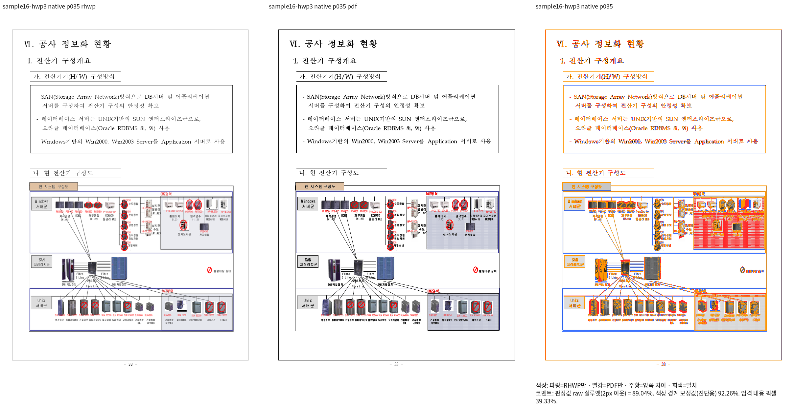
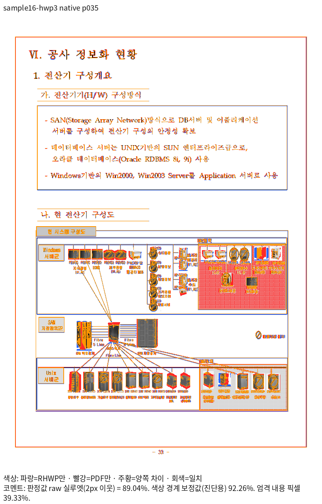

# #7642 raw 전쪽 재검증과 비트맵 마스크·이중선 보정

Issue: #7642

## 원격 지침 적용과 전체 Rust 결과

`ubuntu-ted3`의 미공개 raw 판정 변경 `737d2cea2eeb6fa7eb5afda393eb0f96c1df12fb`를
`8ffa93979a`에 적용했다. Visual Sweep Python 검사 161개가 통과했다.
색상 경계 보정값은 진단용이며 90% gate·devel 대비 하락·98% 좌표 회귀는 raw 값으로 판정한다.

고정 base `552514f423ec91f1b7171f6e6b0882a4efe034f2` 위의 `8ffa93979a`를
clean review worktree에서 검사했다. prepare·check는 exit 0이다.
공유 `target/pr-review`, 빌드 잡 8개·테스트 스레드 12개로 전체 기본 nextest를 실행한 결과는
**10,565개 실행·10,553개 통과·12개 실패·45개 건너뜀**, exit 100이다.
소스 해시 유지를 확인했으며 컴파일 오류는 없었다. 전체 통과로 판정하지 않는다.

실패는 #7418 구두점 run 소유, #6735 저장 줄의 도형 배치, WMF/EMF golden,
#7266 장치 변환, 수식 command golden, #1440 표 외곽, #3518 제목 round-trip,
#5583 저장 줄 시작, #6865 마스크 3건, #6527 수식 읽기 순서다.
기대값·golden을 갱신하지 않았다. 각 원본의 raw 시각 자격과 독립 기대값을 먼저 확인한다.

89개 항목·1,602쪽의 새 raw 전쪽 queue는 계속 진행 중이다.
이번 기록 시점 Native는 49개 종료(수치 통과 43·미달 4·측정 실패 2),
fresh WASM은 26개 종료(수치 통과 21·미달 3·측정 실패 2)다.
이는 서로 다른 입력/PDF/compat 조합의 항목 수이며 최종 완료 수가 아니다.
#1440 원본은 47/46쪽 불일치, #7418은 전쪽 미달 범위가 남는다.

## Native 그림의 원인 분리

원본 `samples/hwp3-sample16.hwp` 35쪽은 Native raw 89.03816%,
fresh WASM raw 98.82678%다. 독립 기준은 원본 그대로 한컴 Print한
`pdf/issue7642-hwp3-original-print/hwp3-sample16-2020.pdf`다.
Native에서 그림 안의 미세 무늬가 옅은 단색으로 합쳐지고 쪽 이중선도 옅다.
실제 원본 출력의 대표 증거는 다음과 같다.

WMF → SVG의 흑백 8×8 반복 무늬 → mask/filter → Native `image_conv`의 목적지 크기
래스터화 → PNG → Skia 배치로 추적했다. 축소된 무늬를 먼저 마스크로 평가하면 타일의 정수
표본 격자와 반복 합성의 결과가 달라진다. 마스크 합성 후 축소와 같은 연산이 아니다.
문서 좌표·크기·본문 흐름·글꼴을 바꿀 근거는 없다.

고정 stage1954 라이브러리와 그림 소비 코드를 사용한 별도 진단에서 기존 경로의 그림 영역이
실제 Native 원본과 raw 100% 일치하는 것을 먼저 확인했다. 같은 SVG를 원래 표본 격자에서
먼저 합성하고 Skia로 축소한 진단은 35쪽 그림 영역의 raw 86.30571% →97.92144%였다.
진단 좌표는 원래 그림 경계이며 출력 색·위치를 사후 보정하지 않았다.
JPEG·crop은 이 진단의 비실행 경로다. 첫 진단 컴파일의 private API 오류는 별도 보존했으며
결함의 수정 전 실패로 세지 않는다. 이 진단은 정식 전쪽 Visual Sweep을 대신하지 않는다.

제품 보정은 **실제 마스크가 image pattern을 소비하며 SVG가 축소되는 경로**에서
원래 SVG 표본을 먼저 합성한다. 이후 Skia로 원래 요청한 PNG 크기에 재표본한다.
따라서 crop·fill·최종 배치가 소비하는 PNG 크기와 좌표는 유지한다.
일반 벡터 마스크·마스크 없는 SVG·페이지 좌표 fragment는 기존 경로를 사용한다.
입력 4MiB·래스터 67,108,864픽셀 예산을 유지하고 원래 격자가 예산을 넘으면 기존 경로로
계속 출력한다. 새 경로 때문에 그림을 생략하지 않는다.

정상 저장 HWP/HWPX 18쪽은 양쪽 raw 약75~76%로 별개 미달이다.
원본과 재저장본의 그림 SVG SHA는 동일하지만 독립 2024 PDF는 그림을 3917×2574 JPEG와
1bit 투명 mask로 합성했다. 원본 2020 PDF는 다수의 벡터와 작은 타일 이미지다.
같은 intrinsic 진단만으로 정상 저장본의 미달은 해소되지 않았다. PDF의 JPEG·mask와
원본 비트맵을 계속 대조하며, 기준 PDF를 교체하거나 색상 예외로 통과시키지 않는다.

## HWP3 이중선 폭의 독립 근거와 보정

같은 한컴 정상 저장 HWPX의 borderFill 2는 쪽 네 면을 `DOUBLE_SLIM`, 전체 굵기
`0.5 mm`로 저장한다. 셀의 DOUBLE_SLIM도 같은 굵기다. 원본 Print 1·35쪽에서
각 stroke 0.36pt·중심 간격 1.08pt를 확인했다.
HWP3 파서는 쪽 이중선을 얇은 기본선 width 1로, 셀은 width 6으로 정규화했다.
한컴 저장의 width 7(0.5mm)로 정규화하면 기존 공통 `double_line_parts`가
각 stroke 0.48 CSS px·중심 간격 1.44 CSS px를 생성해 독립 Print와 대응한다.
특정 문서 ID·화면 좌표를 조건으로 쓰지 않는다.

폭의 생산/소비는 HWP3 선 종류4 → BorderLine.width → 공통 물리 폭 변환 →
`double_line_parts` → 쪽/셀의 실제 선 배치다. 페이지 테두리 중심·저장 간격은 바꾸지 않는다.
이중선 폭 규칙만 작은 별도 모듈로 공유하고 큰 기존 parser에는 호출 연결만 둔다.
기존 parser 자체가 6,805줄이어서 이번 연결 후에도 1,000줄을 넘는다.
관련 없는 parser 전체 분할을 섞지 않으며 새 모듈은 1,000줄 이하로 유지한다.

## 다음 검증과 증적

두 원인의 제품 보정을 한 번에 커밋한 뒤 Native 빌드와 fresh WASM 빌드를 순차 실행한다.
마스크 면적·프레임·원래 색의 기존 계약, 마스크 없는 대조군, 영향 쪽의 실제 출력과 전체
Native/fresh WASM raw TSV를 확인한다. 이중선의 독립 폭·간격도 직접 대조한다.
일반 벡터 마스크와 fragment의 계약을 기존 면적 검사로 확인한다.
이전 source의 진행 중 queue는 그 고정 producer의 결과로 보존하며 새 코드 통과로 보고하지 않는다.
전쪽 raw 90%와 확대 판독을 충족하기 전에는 이 원본의 새 회귀·기대값·px 핀을 추가/변경하지 않는다.
PR과 전체 완료는 계속 보류다.

구현 커밋 `33757642d5`의 첫 Native 빌드(stage1980)는 새 Skia API 호출에서
필수 `&Paint` 자리에 `None`을 전달해 E0308로 실패했다. 이번 구현의 컴파일 오류이며
앞서 끝난 전체 회귀의 12개 실패와 구분한다. 기본 paint를 명시해 수정하고 새 기록으로
다시 빌드한다. 실패 로그·receipt는 덮어쓰지 않는다.

ignored `output/pr-review/issue7642/failed-inputs-20261008/stage15-current-validation/`에
stage1967 전체 Rust 로그·실패 목록, stage1968/1969 전쪽 queue,
stage1972 실제 review/overlay, stage1974 JPEG·mask, stage1975 이중선 독립 측정,
stage1976 타일 진단, stage1977 frozen Native 진단과 stage1978 결과 원장을 보존한다.
