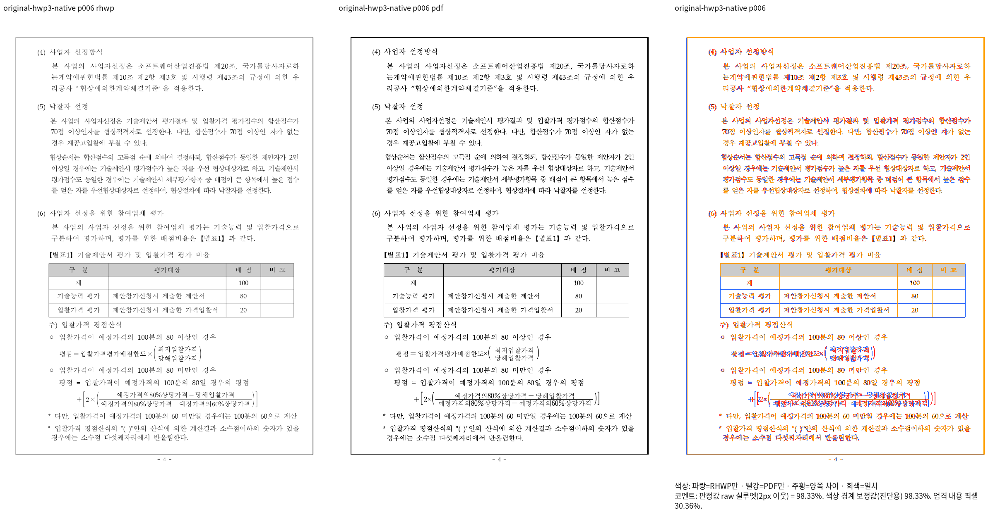
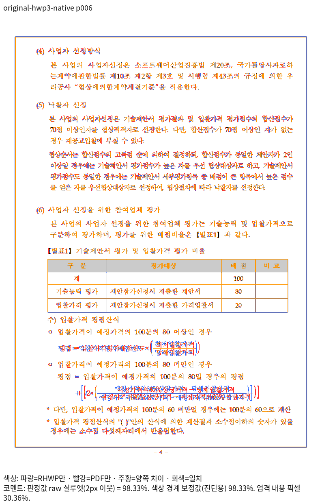
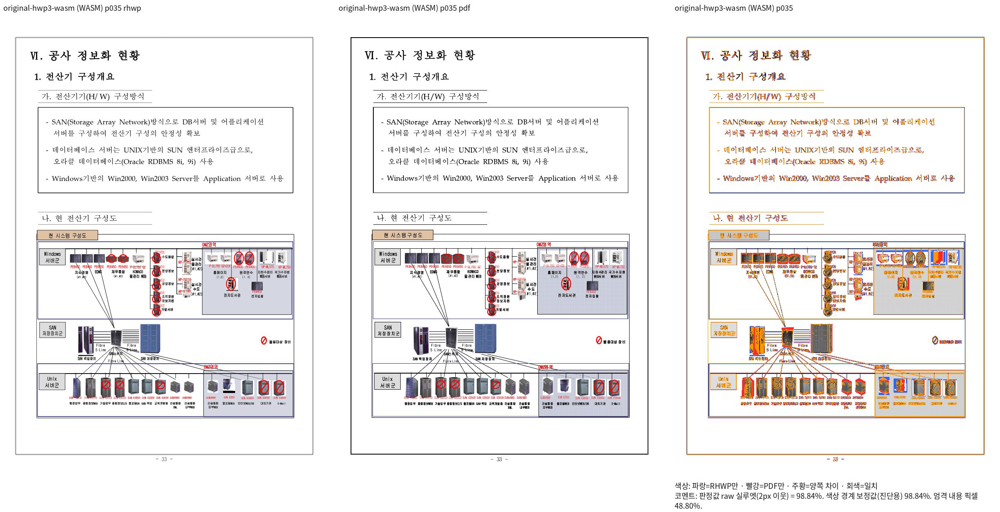
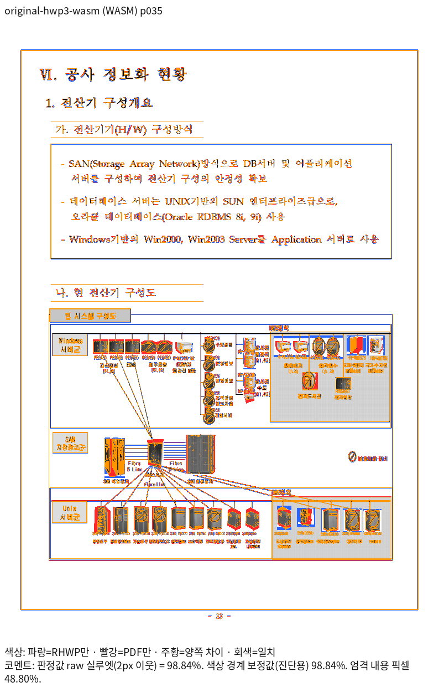

# #7642 원격 raw 판정 대조와 면적 보존 축소의 실제 검증

Issue: #7642

## 판정 도구의 출처와 재확인

사용자가 알려 준 `ubuntu-ted3:~/rhwp/scripts/tests/test_visual_sweep.py`를
원격 head `619a12d91bd98a07cf9ac9f911775fcae45677e8`에서 다시 읽었다.
raw 판정 변경의 원본은 `737d2cea2eeb6fa7eb5afda393eb0f96c1df12fb`이며,
현재 브랜치의 `8ffa93979aa6edd5402a6b73b9d45de8c5235029`에 반영되어 있다.
원격 두 파일은 해당 변경 이후 추가 수정이 없고 작업 트리도 clean이다.
원격 파일이나 브랜치는 수정하지 않았다.

현재 두 파일과 원격 사본의 차이는 기존 PDF 그라데이션 보존에 필요한
`thinlinemode=none`과 그에 대응하는 검사뿐이다. raw와 색상 경계 보정 지표의
의미는 같다. `silhouette_raw_match_percent`를 90% gate와 98% px 자격에 쓰고,
`tolerant_content_match_percent`는 진단용으로 유지한다.

`venv/bin/python -m unittest discover -s scripts/tests -p 'test_visual_sweep*.py'`는
161개 검사 모두 통과했다(exit 0, 15.240초). 로그와 원격 사본은 ignored
`output/pr-review/issue7642/remote-raw-policy-check-20261017/`에 보존한다.

## 실제 제품과 전쪽 결과

제품 source는 `05b84fa932d4da1a0effb076a4d830e232cd9573`이다.
stage1992의 Native CLI 빌드는 exit 0·312.96초이며 실제 compiler artifact를 고정했다.
stage1993의 기존 Native 마스크 정식 nextest는 2개 모두 통과했다.
stage1994의 최적화된 fresh WASM 빌드도 exit 0이고 pkg/Studio 산출물의 해시가 같다.
모두 공유 `target/pr-review`와 빌드 잡 8개를 사용했고, source 해시가 유지됐다.
이 결과는 전체 Rust 회귀 통과가 아니다.

같은 원본과 독립 Print PDF, 96dpi, compat 2022/2024, raw 지표로 전체 페이지를 비교했다.

| 입력 | Native 최저 | fresh WASM 최저 | 90% 미만 | 쪽수 |
|---|---:|---:|---|---|
| `samples/hwp3-sample16.hwp` |95.97427%|95.87021%|없음|양쪽 64/64|
| `samples/hwp3-sample16-hwp5.hwpx` |75.58051%|75.64976%|양쪽 18·35쪽|양쪽 64/64|
| `samples/hwp3-sample16-hwp5.hwp` |76.31601%|76.46802%|양쪽 18·35쪽|양쪽 64/64|

원본 35쪽은 Native 98.95422%, WASM 98.83960%다. bilinear 축소로 작은 글자 획이
빠졌던 이전 제품의 판독 결과와 구분한다. 면적 보존 축소 뒤 새로 출력한 결과이며,
정상 저장본 2개의 미달을 원본의 통과로 상쇄하지 않는다.

원본 입력 SHA-256은
`559fd94860cf836d5800436d56055c23a73e59eedef3da273a5ba365e6ed9e16`,
기준 `pdf/issue7642-hwp3-original-print/hwp3-sample16-2020.pdf`는
`f1f2e6dd265d098ea468bae14b44e98a1609dd7eba293f91d73ba16704be73c5`다.
두 파일은 이미 Git에 포함되어 있다.

원본 전쪽 Native TSV SHA-256은
`f5442ab6e43aabea13003fd68b0ea43878a7feef1623c5b2e2df80c9a75f7a0f`,
fresh WASM TSV는 `112fb7eb07e0772879cbe158cb25ce295aa6c9dcc93f480b6e521cf491aa6caa`다.
전체 명령·입력 해시·TSV는 ignored stage1995/1996 receipt에 연결한다.

## 직접 판독과 미완료 범위

stage2011에서 같은 제품으로 3·6·35쪽의 Native/fresh WASM 일반 모드를 다시 실행했다.
각각 exit 0이며, 아래 6쪽 Native와 35쪽 fresh WASM의 review와 standalone overlay를
함께 열었다. 산출만 한 다른 쪽을 이번 직접 판독 범위에 포함하지 않는다.
6쪽은 Native 98.33040%, WASM 98.35277%지만 수식의 본문 간격·분수와 괄호 위치가
독립 Print와 다르다. 새 px 회귀를 추가하거나 기존 실패 검사의 기대값을 바꾸지 않았다.
35쪽은 그림 안의 글자 획이 유지되지만 Print의 농도·무늬 차이가 남아 있어 직접 판독
완료를 점수만으로 선언하지 않는다.

### 6쪽 Native: 수식 위치 차이 보존

### 35쪽 fresh WASM: 그림의 작은 글자와 무늬

## 시험지 공통 미달의 진단과 다음 비교

11월 원본의 같은 입력을 Hancom 2024 MCP Print로 다시 출력했다.
job `93c83c5d-75f3-47cd-b1e2-ac34f17c4dd0`, 제품 13.0.0.3901,
`PrintMethod=0`, `frame_print_to_pdf_ex_one_up`이며 21쪽이다.
새 Print의 구 그림 JPEG는 기존 기준 PDF의 JPEG와 바이트까지 같다.
이 차이를 잘못된 기준 PDF로 분류하지 않는다.

원본 RGB와 RHWP가 해석한 bitmap 픽셀은 같지만 한컴 Print에서는 일부 회색이 밝아진다.
합성 색상 대조군·원본 그림의 비그룹 배치·동일 픽셀의 BMP/PNG·DPI 변경을 나누어
출력한 진단에서 전역 색 보정, 그룹, BMP 메타데이터, 이미지 크기만으로는 설명되지 않았다.
5비트 채널 양자화 진단도 일부 값만 가까워지고 전체 픽셀이 일치하지 않는다.
이 가설을 제품 색상 보정 조건으로 추가하지 않았다. 합성 문서의 그림이 겹치는 배치는
codec 자원 분석용이며 시각 통과나 회귀 fixture의 근거로 사용하지 않는다.

stage1969의 이전 제품 `1079acd3d9` fresh WASM 큐는 89개 항목까지 종료됐다.
64개가 수치 자격을 통과했고, 나머지는 미달 또는 측정 실패다. 현재 제품의 최종 전쪽
결과로 대체하지 않는다. stage1968 Native와 stage1998 진단은 부모 프로세스가 없고
exit code를 확보하지 못했으므로, 남아 있는 `running` receipt를 완료로 해석하지 않는다.
원래 receipt와 산출물은 보존하고 별도 stage2013 감사에 중단 상태를 기록했다.

최신 `upstream/devel`을 fetch한 결과는 여전히
`552514f423ec91f1b7171f6e6b0882a4efe034f2`다. 추가 리베이스는 필요 없다.
이전 `0953598d8e` base 산출물을 최신 devel 비교로 쓰지 않고, 고정 552514f4의
Native/fresh WASM을 stage2014에서 별도로 준비해 같은 입력·PDF·raw 정책으로 대조한다.
기존 base worktree의 dirty JS는 보존하고 별도 검증 worktree에서도 같은 공유 target을 쓴다.

전체 Rust의 기존 12개 실패, 정상 저장본과 시험지의 raw 미달, 최신 devel 대비
페이지별 비교 및 필수 lint는 미완료다. PR 준비 완료·승인·통합으로 판정하지 않는다.
요청된 PR 생성과 CI·옵션 2 기록 PR·merge 후속 처리는 필수 gate 충족 뒤
`pr_review_workflow.md`와 `pr_review/post_merge.md`의 해당 경로로 계속한다.

세부 실행 증적은 ignored
`output/pr-review/issue7642/failed-inputs-20261008/stage15-current-validation/` 아래
stage1992~1997, stage1999~2012, stage2013 asset·process 감사에 보존한다.
