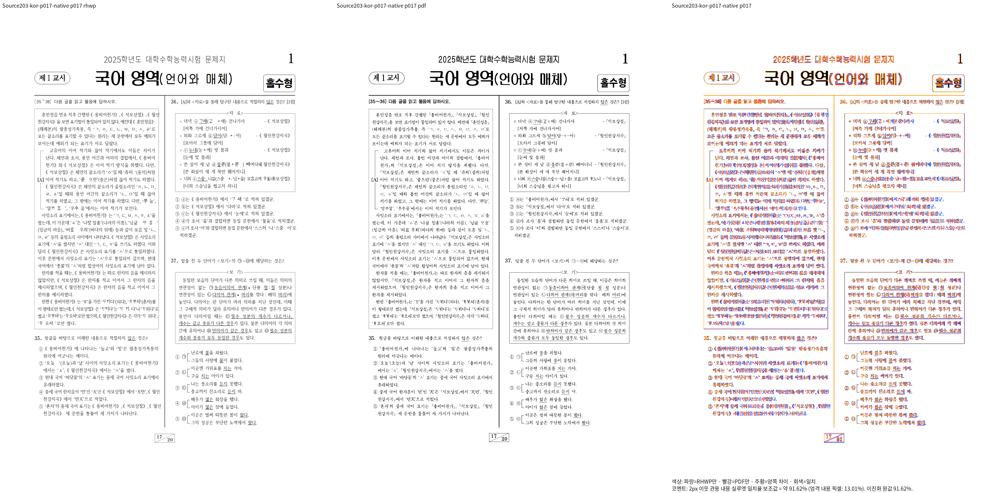

# 원본 저장 축 역환산의 정수 단위 보존

Issue: #7642

## 현재 관측

Source201 Native 통합 빌드는 통과했지만 `exam_kor.hwp` 전쪽 비교는
최저 82.33453%, 13·17·18쪽 미달이다. 시각 보정 완료로 판정하지 않는다.
실행 중인 Source201의 소스·바이너리를 유지하고 후속 후보는
`/home/tsjang/rhwp-review-7642-stage192`에서 검증한다. 모든 Cargo 산출물은
기존 `/home/tsjang/rhwp/target/pr-review`를 순차 재사용한다.

`stage203-kor-current-flow/p017.log`에서 원본 첫 줄의 기준 7085HU가
역환산 뒤 `page_base=Some(7086)`으로 바뀌었다. `px_to_hwpunit`의 절삭이
정수 단위의 왕복 계산 오차를 한 단위 이동으로 만들었고, 정확한 원본 축 인증을
거절했다. 따라서 순차 내용 하단으로 돌아가 표가 제목 위에 겹쳤다.

## 후보

원본 저장 표의 기준축을 역산하는 한 지점에서만 상대 물리 원점을 정수 HWPUNIT로
반올림한다. 전체 엔진의 절삭 계약과 인증 허용치를 바꾸지 않는다.
이는 원본 정수 단위의 보존이며 문서 좌표나 픽셀 기대값을 맞추는 보정이 아니다.
현재 후보의 실제 출력은 미검증이며 원점 trace와 국어 HWP/HWPX 전쪽, 미달 문서와
정상 대조군을 다시 확인한 뒤 판단한다.

## Native 실제 경계 확인

후보 `a70ab38ea`를 공용 target에서 실제 재컴파일했다. 새 진단은 원본 기준
7085HU 유지, 앞 문단의 실제 내용 하단 조회, 표 `s2:p23:ci0`의 원점과
렌더러 복원 원점 일치를 확인했다. 제목 다음에 보기 표가 놓이며 겹침이 해소됐다.

독립 Print와 국어 17쪽 Native 새 출력의 내용 실루엣은
82.33453% → **91.61595%**다. 이 한 쪽의 통과를 문서 전쪽 또는 fresh WASM
통과로 확대하지 않는다. 글꼴 모양·장평과 미세 간격의 잔여 차이는 확대 판독 대상이다.

[단독 overlay](../pr/assets/issue_7642_stage205_saved_axis/native-kor-p017-overlay.png)
실행·입력/PDF 해시·PNG 해시는 ignored `stage205-kor-p17-native-review/receipt.json`,
원점 소비 trace는 `stage205-rounded-kor-flow/receipt.json`에 보존한다.
전쪽 대조군 큐는 계속 실행 중이다.

## 전쪽 판정과 남은 경계

국어 HWP 20쪽 Native는 13쪽만 미달(86.95688%)이며 17·18쪽은 통과했다.
문서 전쪽 통과는 아직 아니다. 남은 13쪽의 새 비교와 원본 dump는 ignored
`stage206-kor-p13-native-review`, `stage206-kor-p13-flow`,
`stage206-kor-s1-p12-source.log` 및 `stage206-kor-s1-p21-source.log`에 있다.

이 단은 `s1:p12`의 명시적 단 나누기와 저장 첫 줄로 시작하지만 다음 개체가
일반 float라 TAC 기준축을 확립하지 않는다. `p21`의 두 줄 제목 뒤 `p22`가
축을 인증하지 못한 순차 내용 하단을 상속해 제목 위에 겹친다. 원본 단 시작 줄과
상태의 실제 시작 밴드가 정확히 대응할 때 같은 축을 인증하는 후속 후보를 준비했다.
아직 적용·빌드·검증하지 않았으며 현재 실행 중인 생산자 소스는 유지한다.
