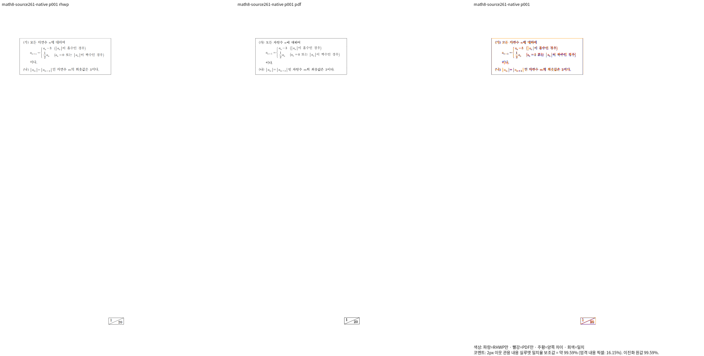
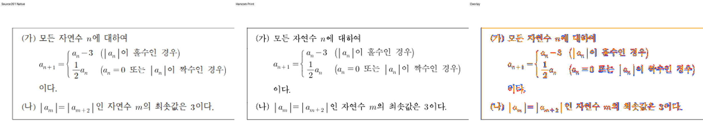

# 항 경계·구분자 원점 보정의 Native 개선과 현재 브랜치 통합

Issue: #7642

## 소스와 실제 실행

[보정 근거·소비 경로](task_m100_7642_stage261.md)의 후보
`a0ab9afce5d40ad4bd2c5c761da58d761d1f1c2d`가 공용
`/home/tsjang/rhwp/target/pr-review`에서 Native 빌드 exit 0을 받았다.
실제 재컴파일과 소스 해시 불변을 확인했다. 실행 파일 SHA-256은
`f819d983cd4b0f2a2bc3dc036464c3ce6e5ae94754cef2ca69e6401148fc5b74`다.

현재 작업 브랜치에 `f840bc9aa984edbe5e741eaaf004c745e13c52eb`로 통합했다.
빌드에 기록된 소스·글꼴 등 1526개 파일의 SHA-256이 통합 후 파일과 모두
동일하다. 이전 main의 Native 큐는 이미 terminal이었다. 후보별 결과와
완료된 원시 증거는 보존했다. 동일한 upstream SHA의 리베이스는 생략했다.

## 같은 입력·독립 Print PDF의 Native 비교

| 입력 키 | 전체 쪽수 | 페이지별 최저값 | 실행 결과 |
|---|---:|---:|---|
| `all-40` | 1 | 99.59499% | complete |
| `delimiter-24` | 1 | 98.51842% | complete |
| `term-64` | 3 | 98.48803% | complete |
| `term-32` | 1 | 99.29034% | complete |

`all-40`은 원본 `samples/exam_math_8.hwp`이며
`pdf/issue7642-exam-print/exam-05-exam_math_8-hwp-print-2020.pdf`와 대조했다.
앞선 Source255의 90.14556%에서 99.59499%로 개선됐다.
나머지 세 입력은 [보존한 정상 저장·Print 대조군](task_m100_7642_stage263.md)이다.
합성 대조군의 통과를 다른 원본 시험지의 통과로 보고하지 않는다.

## 직접 판독과 대표 PNG

새 head의 같은 영역을 직접 비교했다. CASES의 첫 조건식 약 4.4px,
둘째 조건식 약 8.7px의 문맥 여백 누락이 해소됐다. 관측 픽셀 수치는 원인
진단에만 사용하며 회귀 검사나 배치 분기의 핀으로 사용하지 않는다.
구분자와 본체의 기준선·높이 계약은 기존 코드와 다른 새 후보에서 확인한다.
획과 본문 글꼴의 미세 차이는 남아 있으며 전체 확대 판독은 완료하지 않았다.

[Standalone overlay](../pr/assets/issue_7642_stage264_term_context/native-math8-p001-overlay.png)

## 진행 중인 검증과 판정 제한

Source261 전체55 원본·853쪽 Native 큐와 같은 소스의 fresh WASM 빌드를
실행 중이다. WASM 빌드 뒤 전체55 원본과 세 진단 대조군의 전쪽 TSV를 산출한다.
Source255/235의 미완료 큐는 새 후보로 대체해 종료했으며 이미 완료된 결과와
로그를 보존했다. 이 종료를 검증 통과로 세지 않는다.

새 관계형 정식 회귀는 양쪽 출력 90% 이상과 직접 판독 후 추가한다.
전체 Rust·lint·정책·Studio·PR·CI·merge·후속 처리는 아직 완료되지 않았다.
이 결과는 Native 부분 개선이며 최종 승인 판정이 아니다.
TSV·실행·해시 정합 증거는 ignored stage261/stage264/stage265 output에 보존한다.
